# JEV Healthcare Lab

[简体中文](README.md) | **English**

**Evaluating JEV in healthcare scenarios**: measure decision accuracy, sustained throughput, and usage cost across triage, diagnosis, medication, nursing, and clinical trial screening, with DeepSeek Flash and Qwen as comparison models.

## Background and purpose

JEV is TypeSafe’s flagship model, described by its developers as a System One model for decisions inside software. It accepts context (state) and typed questions, then returns structured results that code can consume directly. Its API offers Choice, Score, and Noul questions and supports multiple independent judgments over the same context in parallel. [Official introduction](https://docs.typesafe.ai/introduction)

Healthcare workflows involve many narrowly scoped judgments: assessing urgency, checking contraindications, choosing the next diagnostic test, or screening trials that may suit a patient. These tasks provide concrete settings for evaluating JEV’s structured decisions. Both machine-readable output and the correctness of the underlying judgment need to be tested on medical questions.

JEV’s interface design and the task results here make it well suited to frequent, structured decisions with clearly defined scope: turning context into judgments over explicit options that software can combine into screening, routing, or review workflows. Its suitability for a specific healthcare task still depends on that task’s accuracy and error patterns.

This project asks three questions: which healthcare tasks JEV handles well and where it falls short; how accuracy, throughput, and cost trade off when processing multiple questions under sustained concurrency; and how sharing one patient’s context across multiple questions performs in medical screening. Frozen question sets, data provenance, scoring methods, and raw results are available for reproduction and comparison.

The current evaluation covers Choice tasks with explicit options and reference answers. Score, Noul, and confidence calibration have not been evaluated. Results support research and prototype selection; they do not establish clinical validity.

## Evaluation results

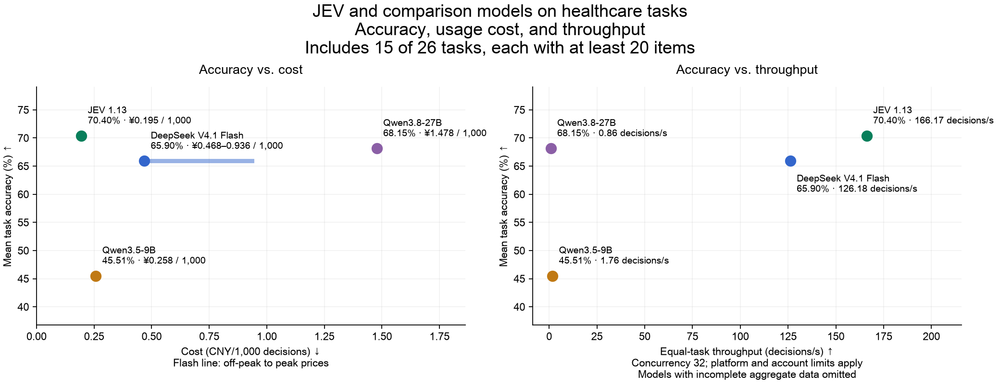

**Overview scope: this chart includes the 15 of 26 main evaluation tasks with at least 20 items each. The other 11 tasks contain only 3–16 items and remain in the complete results table below.** This filter reduces the influence of small-sample tasks on task-averaged results. The additional multiple-trial screening panel for a shared patient is reported separately and excluded from this chart because it may overlap with the existing question set.

This round covers 1,514 decisions across 26 existing medical tasks, plus 64 trial referral decisions for eight simulated patients. Data include exam cases, simulated patients, and public annotations; this is not a clinical deployment validation.

Models that completed the full question set: JEV 1.13, DeepSeek V4.1 Flash, Qwen3.5-9B, Qwen3.8-27B.

Three tasks illustrate different tradeoffs (see Table 1 for full throughput, cost, and Qwen comparisons):

- [Patient-specific contraindication assessment](#patient_contraindication): JEV accuracy is 77.78% versus 62.96% for Flash; JEV throughput at concurrency 32 is higher in this run.
- [Medication selection](#medication_choice): JEV accuracy is 83.00% versus 62.00% for Flash; JEV throughput at concurrency 32 is lower in this run.
- [TCM syndrome classification](#tcm_syndrome): JEV accuracy is 28.00% versus 41.00% for Flash; JEV throughput at concurrency 32 is higher in this run.

Accuracy is scored from unmodified model outputs, with invalid options counted as errors; it reflects both judgment and output usability. Throughput counts valid decisions received per second, **not correct decisions per second**. Cost is estimated in CNY from input and output usage for fresh cases without cache discounts; Flash ranges reflect off-peak and peak list prices.

**Test account limitations: account quotas, request rate limits, and shared service conditions may prevent some performance metrics—especially response speed and throughput—from fully reflecting model capabilities.** The values shown are observations under the tested conditions, not model performance ceilings; speed differences between models should not be extrapolated directly to other deployment conditions. The two Qwen accounts were limited to 80,000 and 40,000 tokens per minute, respectively. Network conditions and provider caching also affect results.

**Table 1 | Healthcare task overview. Accuracy and cost use the full question set at concurrency 8; throughput uses two sustained-load rounds at the prespecified concurrency of 32. Select a task for details.**

<table>
<thead><tr><th>Healthcare scenario</th><th>Task</th><th>Unique decisions</th><th>Model</th><th>Accuracy (%) ↑</th><th>Throughput (decisions/s) ↑</th><th>Cost (CNY/1,000 decisions) ↓</th></tr></thead>
<tbody>
<tr><td rowspan="8">Intake and triage</td><td rowspan="4"><a href="#triage_urgency">Triage and urgency assessment</a></td><td rowspan="4" align="right">100</td><td>JEV 1.13</td><td align="right">66.00</td><td align="right"><strong>270.00</strong></td><td align="right"><strong>0.086</strong></td></tr>
<tr><td>DeepSeek V4.1 Flash</td><td align="right">58.00</td><td align="right">194.80</td><td align="right">0.308–0.615</td></tr>
<tr><td>Qwen3.5-9B</td><td align="right">54.00</td><td align="right">3.20</td><td align="right">0.175</td></tr>
<tr><td>Qwen3.8-27B</td><td align="right"><strong>69.00</strong></td><td align="right">0.60</td><td align="right">0.900</td></tr>
<tr><td rowspan="4"><a href="#message_urgency_pair">Patient message prioritization</a></td><td rowspan="4" align="right">30</td><td>JEV 1.13</td><td align="right">66.67</td><td align="right">103.20</td><td align="right"><strong>0.326</strong></td></tr>
<tr><td>DeepSeek V4.1 Flash</td><td align="right"><strong>70.00</strong></td><td align="right"><strong>209.35</strong></td><td align="right">1.063–2.126</td></tr>
<tr><td>Qwen3.5-9B</td><td align="right">16.67</td><td align="right">0.42</td><td align="right">0.571</td></tr>
<tr><td>Qwen3.8-27B</td><td align="right">66.67</td><td align="right">0.54</td><td align="right">3.356</td></tr>
<tr><td rowspan="4">Examinations and tests</td><td rowspan="4"><a href="#examination_choice">Diagnostic test selection</a></td><td rowspan="4" align="right">100</td><td>JEV 1.13</td><td align="right"><strong>86.00</strong></td><td align="right">260.80</td><td align="right"><strong>0.083</strong></td></tr>
<tr><td>DeepSeek V4.1 Flash</td><td align="right">81.00</td><td align="right"><strong>269.23</strong></td><td align="right">0.209–0.419</td></tr>
<tr><td>Qwen3.5-9B</td><td align="right">54.00</td><td align="right">3.83</td><td align="right">0.122</td></tr>
<tr><td>Qwen3.8-27B</td><td align="right">78.00</td><td align="right">2.00</td><td align="right">0.684</td></tr>
<tr><td rowspan="20">Diagnosis and differential diagnosis</td><td rowspan="4"><a href="#clinical_grade">Disease staging and severity assessment</a></td><td rowspan="4" align="right">100</td><td>JEV 1.13</td><td align="right"><strong>53.00</strong></td><td align="right">103.60</td><td align="right"><strong>0.086</strong></td></tr>
<tr><td>DeepSeek V4.1 Flash</td><td align="right">51.00</td><td align="right"><strong>119.38</strong></td><td align="right">0.217–0.434</td></tr>
<tr><td>Qwen3.5-9B</td><td align="right">30.00</td><td align="right">3.85</td><td align="right">0.127</td></tr>
<tr><td>Qwen3.8-27B</td><td align="right">51.00</td><td align="right">0.80</td><td align="right">0.714</td></tr>
<tr><td rowspan="4"><a href="#diagnosis">Case diagnosis selection</a></td><td rowspan="4" align="right">200</td><td>JEV 1.13</td><td align="right"><strong>78.50</strong></td><td align="right"><strong>216.00</strong></td><td align="right"><strong>0.258</strong></td></tr>
<tr><td>DeepSeek V4.1 Flash</td><td align="right">75.00</td><td align="right">176.85</td><td align="right">0.538–1.076</td></tr>
<tr><td>Qwen3.5-9B</td><td align="right">58.00</td><td align="right">1.65</td><td align="right">0.300</td></tr>
<tr><td>Qwen3.8-27B</td><td align="right">78.00</td><td align="right">0.84</td><td align="right">1.744</td></tr>
<tr><td rowspan="4"><a href="#tcm_syndrome">TCM syndrome classification</a></td><td rowspan="4" align="right">100</td><td>JEV 1.13</td><td align="right">28.00</td><td align="right"><strong>104.20</strong></td><td align="right">1.072</td></tr>
<tr><td>DeepSeek V4.1 Flash</td><td align="right"><strong>41.00</strong></td><td align="right">29.20</td><td align="right">2.029–4.057</td></tr>
<tr><td>Qwen3.5-9B</td><td align="right">27.00</td><td align="right">0.59</td><td align="right"><strong>1.042</strong></td></tr>
<tr><td>Qwen3.8-27B</td><td align="right">35.00</td><td align="right">0.27</td><td align="right">6.162</td></tr>
<tr><td rowspan="4"><a href="#case_etiology">Case etiology assessment</a></td><td rowspan="4" align="right">100</td><td>JEV 1.13</td><td align="right">80.00</td><td align="right">175.20</td><td align="right"><strong>0.091</strong></td></tr>
<tr><td>DeepSeek V4.1 Flash</td><td align="right">81.00</td><td align="right"><strong>236.40</strong></td><td align="right">0.220–0.439</td></tr>
<tr><td>Qwen3.5-9B</td><td align="right">56.00</td><td align="right">4.03</td><td align="right">0.128</td></tr>
<tr><td>Qwen3.8-27B</td><td align="right"><strong>82.00</strong></td><td align="right">1.00</td><td align="right">0.721</td></tr>
<tr><td rowspan="4"><a href="#tcm_pathogenesis_candidate">TCM candidate pathogenesis assessment</a></td><td rowspan="4" align="right">100</td><td>JEV 1.13</td><td align="right">71.00</td><td align="right">134.40</td><td align="right"><strong>0.147</strong></td></tr>
<tr><td>DeepSeek V4.1 Flash</td><td align="right"><strong>78.00</strong></td><td align="right"><strong>155.00</strong></td><td align="right">0.359–0.719</td></tr>
<tr><td>Qwen3.5-9B</td><td align="right">59.00</td><td align="right">2.80</td><td align="right">0.196</td></tr>
<tr><td>Qwen3.8-27B</td><td align="right">70.00</td><td align="right">0.97</td><td align="right">1.131</td></tr>
<tr><td rowspan="24">Treatment and medication</td><td rowspan="4"><a href="#patient_contraindication">Patient-specific contraindication assessment</a></td><td rowspan="4" align="right">54</td><td>JEV 1.13</td><td align="right"><strong>77.78</strong></td><td align="right"><strong>260.20</strong></td><td align="right"><strong>0.086</strong></td></tr>
<tr><td>DeepSeek V4.1 Flash</td><td align="right">62.96</td><td align="right">82.47</td><td align="right">0.211–0.422</td></tr>
<tr><td>Qwen3.5-9B</td><td align="right">38.89</td><td align="right">3.35</td><td align="right">0.123</td></tr>
<tr><td>Qwen3.8-27B</td><td align="right">64.81</td><td align="right">1.60</td><td align="right">0.694</td></tr>
<tr><td rowspan="4"><a href="#treatment_choice">Treatment selection</a></td><td rowspan="4" align="right">100</td><td>JEV 1.13</td><td align="right"><strong>78.00</strong></td><td align="right"><strong>254.60</strong></td><td align="right"><strong>0.086</strong></td></tr>
<tr><td>DeepSeek V4.1 Flash</td><td align="right">73.00</td><td align="right">178.57</td><td align="right">0.214–0.428</td></tr>
<tr><td>Qwen3.5-9B</td><td align="right">57.00</td><td align="right">4.40</td><td align="right">0.126</td></tr>
<tr><td>Qwen3.8-27B</td><td align="right">72.00</td><td align="right">2.00</td><td align="right">0.704</td></tr>
<tr><td rowspan="4"><a href="#medication_choice">Medication selection</a></td><td rowspan="4" align="right">100</td><td>JEV 1.13</td><td align="right"><strong>83.00</strong></td><td align="right">184.80</td><td align="right"><strong>0.086</strong></td></tr>
<tr><td>DeepSeek V4.1 Flash</td><td align="right">62.00</td><td align="right"><strong>271.43</strong></td><td align="right">0.218–0.436</td></tr>
<tr><td>Qwen3.5-9B</td><td align="right">43.00</td><td align="right">3.98</td><td align="right">0.128</td></tr>
<tr><td>Qwen3.8-27B</td><td align="right">64.00</td><td align="right">1.80</td><td align="right">0.718</td></tr>
<tr><td rowspan="4"><a href="#fluid_plan">Fluid therapy selection</a></td><td rowspan="4" align="right">16</td><td>JEV 1.13</td><td align="right"><strong>62.50</strong></td><td align="right"><strong>244.60</strong></td><td align="right"><strong>0.096</strong></td></tr>
<tr><td>DeepSeek V4.1 Flash</td><td align="right">43.75</td><td align="right">193.07</td><td align="right">0.237–0.475</td></tr>
<tr><td>Qwen3.5-9B</td><td align="right">31.25</td><td align="right">3.70</td><td align="right">0.144</td></tr>
<tr><td>Qwen3.8-27B</td><td align="right"><strong>62.50</strong></td><td align="right">1.80</td><td align="right">0.812</td></tr>
<tr><td rowspan="4"><a href="#pgx_guideline_recommendation">Pharmacogenomic guideline recommendation selection</a></td><td rowspan="4" align="right">100</td><td>JEV 1.13</td><td align="right">56.00</td><td align="right">155.40</td><td align="right"><strong>0.139</strong></td></tr>
<tr><td>DeepSeek V4.1 Flash</td><td align="right">53.00</td><td align="right"><strong>323.40</strong></td><td align="right">0.407–0.814</td></tr>
<tr><td>Qwen3.5-9B</td><td align="right">34.00</td><td align="right">1.80</td><td align="right">0.230</td></tr>
<tr><td>Qwen3.8-27B</td><td align="right"><strong>62.00</strong></td><td align="right">1.14</td><td align="right">1.311</td></tr>
<tr><td rowspan="4"><a href="#administration_route_choice">Administration route and method selection</a></td><td rowspan="4" align="right">4</td><td>JEV 1.13</td><td align="right"><strong>100.00</strong></td><td align="right">129.80</td><td align="right"><strong>0.093</strong></td></tr>
<tr><td>DeepSeek V4.1 Flash</td><td align="right">75.00</td><td align="right"><strong>164.90</strong></td><td align="right">0.229–0.457</td></tr>
<tr><td>Qwen3.5-9B</td><td align="right">50.00</td><td align="right">3.30</td><td align="right">0.132</td></tr>
<tr><td>Qwen3.8-27B</td><td align="right">50.00</td><td align="right">1.30</td><td align="right">0.749</td></tr>
<tr><td rowspan="24">Inpatient care and nursing</td><td rowspan="4"><a href="#case_complication">Case complication assessment</a></td><td rowspan="4" align="right">100</td><td>JEV 1.13</td><td align="right"><strong>90.00</strong></td><td align="right">188.60</td><td align="right"><strong>0.089</strong></td></tr>
<tr><td>DeepSeek V4.1 Flash</td><td align="right">66.00</td><td align="right"><strong>214.32</strong></td><td align="right">0.215–0.429</td></tr>
<tr><td>Qwen3.5-9B</td><td align="right">53.00</td><td align="right">3.55</td><td align="right">0.126</td></tr>
<tr><td>Qwen3.8-27B</td><td align="right">84.00</td><td align="right">2.20</td><td align="right">0.707</td></tr>
<tr><td rowspan="4"><a href="#nursing_priority">Nursing intervention selection</a></td><td rowspan="4" align="right">42</td><td>JEV 1.13</td><td align="right"><strong>88.10</strong></td><td align="right">205.40</td><td align="right"><strong>0.090</strong></td></tr>
<tr><td>DeepSeek V4.1 Flash</td><td align="right">78.57</td><td align="right"><strong>252.00</strong></td><td align="right">0.211–0.422</td></tr>
<tr><td>Qwen3.5-9B</td><td align="right">57.14</td><td align="right">4.80</td><td align="right">0.123</td></tr>
<tr><td>Qwen3.8-27B</td><td align="right">85.71</td><td align="right">2.20</td><td align="right">0.689</td></tr>
<tr><td rowspan="4"><a href="#nutrition_plan">Nutrition and diet selection</a></td><td rowspan="4" align="right">11</td><td>JEV 1.13</td><td align="right"><strong>63.64</strong></td><td align="right">100.28</td><td align="right"><strong>0.097</strong></td></tr>
<tr><td>DeepSeek V4.1 Flash</td><td align="right"><strong>63.64</strong></td><td align="right"><strong>173.60</strong></td><td align="right">0.232–0.464</td></tr>
<tr><td>Qwen3.5-9B</td><td align="right">27.27</td><td align="right">3.70</td><td align="right">0.135</td></tr>
<tr><td>Qwen3.8-27B</td><td align="right"><strong>63.64</strong></td><td align="right">1.65</td><td align="right">0.763</td></tr>
<tr><td rowspan="4"><a href="#positioning_choice">Patient positioning selection</a></td><td rowspan="4" align="right">10</td><td>JEV 1.13</td><td align="right"><strong>100.00</strong></td><td align="right"><strong>178.65</strong></td><td align="right"><strong>0.084</strong></td></tr>
<tr><td>DeepSeek V4.1 Flash</td><td align="right">70.00</td><td align="right">174.90</td><td align="right">0.206–0.413</td></tr>
<tr><td>Qwen3.5-9B</td><td align="right">30.00</td><td align="right">3.33</td><td align="right">0.126</td></tr>
<tr><td>Qwen3.8-27B</td><td align="right">60.00</td><td align="right">1.80</td><td align="right">0.706</td></tr>
<tr><td rowspan="4"><a href="#monitoring_target">Clinical monitoring and treatment response assessment</a></td><td rowspan="4" align="right">5</td><td>JEV 1.13</td><td align="right">80.00</td><td align="right">72.38</td><td align="right"><strong>0.086</strong></td></tr>
<tr><td>DeepSeek V4.1 Flash</td><td align="right"><strong>100.00</strong></td><td align="right"><strong>161.75</strong></td><td align="right">0.208–0.416</td></tr>
<tr><td>Qwen3.5-9B</td><td align="right">40.00</td><td align="right">3.62</td><td align="right">0.122</td></tr>
<tr><td>Qwen3.8-27B</td><td align="right">80.00</td><td align="right">1.50</td><td align="right">0.686</td></tr>
<tr><td rowspan="4"><a href="#infection_precaution">Infection prevention measures</a></td><td rowspan="4" align="right">5</td><td>JEV 1.13</td><td align="right"><strong>100.00</strong></td><td align="right"><strong>162.38</strong></td><td align="right"><strong>0.095</strong></td></tr>
<tr><td>DeepSeek V4.1 Flash</td><td align="right"><strong>100.00</strong></td><td align="right">150.00</td><td align="right">0.231–0.462</td></tr>
<tr><td>Qwen3.5-9B</td><td align="right">40.00</td><td align="right">2.90</td><td align="right">0.132</td></tr>
<tr><td>Qwen3.8-27B</td><td align="right">80.00</td><td align="right">1.88</td><td align="right">0.746</td></tr>
<tr><td rowspan="16">Discharge and follow-up</td><td rowspan="4"><a href="#followup_plan">Follow-up testing and timing</a></td><td rowspan="4" align="right">6</td><td>JEV 1.13</td><td align="right"><strong>83.33</strong></td><td align="right"><strong>201.30</strong></td><td align="right"><strong>0.086</strong></td></tr>
<tr><td>DeepSeek V4.1 Flash</td><td align="right">50.00</td><td align="right">163.80</td><td align="right">0.222–0.444</td></tr>
<tr><td>Qwen3.5-9B</td><td align="right">66.67</td><td align="right">2.85</td><td align="right">0.129</td></tr>
<tr><td>Qwen3.8-27B</td><td align="right">66.67</td><td align="right">1.95</td><td align="right">0.727</td></tr>
<tr><td rowspan="4"><a href="#rehabilitation_choice">Rehabilitation plan selection</a></td><td rowspan="4" align="right">4</td><td>JEV 1.13</td><td align="right"><strong>100.00</strong></td><td align="right">127.50</td><td align="right"><strong>0.100</strong></td></tr>
<tr><td>DeepSeek V4.1 Flash</td><td align="right"><strong>100.00</strong></td><td align="right"><strong>156.10</strong></td><td align="right">0.231–0.462</td></tr>
<tr><td>Qwen3.5-9B</td><td align="right">50.00</td><td align="right">3.30</td><td align="right">0.132</td></tr>
<tr><td>Qwen3.8-27B</td><td align="right">75.00</td><td align="right">1.50</td><td align="right">0.746</td></tr>
<tr><td rowspan="4"><a href="#prevention_choice">Preventive intervention selection</a></td><td rowspan="4" align="right">13</td><td>JEV 1.13</td><td align="right"><strong>76.92</strong></td><td align="right">88.70</td><td align="right"><strong>0.092</strong></td></tr>
<tr><td>DeepSeek V4.1 Flash</td><td align="right"><strong>76.92</strong></td><td align="right"><strong>163.95</strong></td><td align="right">0.224–0.447</td></tr>
<tr><td>Qwen3.5-9B</td><td align="right">69.23</td><td align="right">4.03</td><td align="right">0.129</td></tr>
<tr><td>Qwen3.8-27B</td><td align="right"><strong>76.92</strong></td><td align="right">0.97</td><td align="right">0.724</td></tr>
<tr><td rowspan="4"><a href="#patient_counseling">Patient education and communication</a></td><td rowspan="4" align="right">11</td><td>JEV 1.13</td><td align="right"><strong>90.91</strong></td><td align="right">173.38</td><td align="right"><strong>0.100</strong></td></tr>
<tr><td>DeepSeek V4.1 Flash</td><td align="right"><strong>90.91</strong></td><td align="right"><strong>204.95</strong></td><td align="right">0.232–0.464</td></tr>
<tr><td>Qwen3.5-9B</td><td align="right">81.82</td><td align="right">3.38</td><td align="right">0.132</td></tr>
<tr><td>Qwen3.8-27B</td><td align="right"><strong>90.91</strong></td><td align="right">2.12</td><td align="right">0.746</td></tr>
<tr><td rowspan="8">Clinical trial screening</td><td rowspan="4"><a href="#trial_referral">Clinical trial prescreening and referral</a></td><td rowspan="4" align="right">100</td><td>JEV 1.13</td><td align="right">54.00</td><td align="right"><strong>160.60</strong></td><td align="right"><strong>0.194</strong></td></tr>
<tr><td>DeepSeek V4.1 Flash</td><td align="right">58.00</td><td align="right">76.00</td><td align="right">0.605–1.211</td></tr>
<tr><td>Qwen3.5-9B</td><td align="right">45.00</td><td align="right">1.72</td><td align="right">0.347</td></tr>
<tr><td>Qwen3.8-27B</td><td align="right"><strong>60.00</strong></td><td align="right">0.57</td><td align="right">1.929</td></tr>
<tr><td rowspan="4"><a href="#trial_shared_patient">Multiple trial referrals for one patient</a></td><td rowspan="4" align="right">64</td><td>JEV 1.13</td><td align="right">67.19</td><td align="right">205.60</td><td align="right"><strong>0.165</strong></td></tr>
<tr><td>DeepSeek V4.1 Flash</td><td align="right"><strong>75.00</strong></td><td align="right"><strong>255.60</strong></td><td align="right">0.550–1.101</td></tr>
<tr><td>Qwen3.5-9B</td><td align="right"><strong>75.00</strong></td><td align="right">1.74</td><td align="right">0.297</td></tr>
<tr><td>Qwen3.8-27B</td><td align="right">73.44</td><td align="right">0.96</td><td align="right">1.733</td></tr>
<tr><td rowspan="4">Medical records and quality assurance</td><td rowspan="4"><a href="#consent_action">Informed consent and privacy decisions</a></td><td rowspan="4" align="right">3</td><td>JEV 1.13</td><td align="right"><strong>100.00</strong></td><td align="right">73.58</td><td align="right"><strong>0.098</strong></td></tr>
<tr><td>DeepSeek V4.1 Flash</td><td align="right"><strong>100.00</strong></td><td align="right"><strong>90.45</strong></td><td align="right">0.257–0.514</td></tr>
<tr><td>Qwen3.5-9B</td><td align="right"><strong>100.00</strong></td><td align="right">2.77</td><td align="right">0.143</td></tr>
<tr><td>Qwen3.8-27B</td><td align="right"><strong>100.00</strong></td><td align="right">0.75</td><td align="right">0.817</td></tr>
</tbody>
</table>

Bold indicates the best observed value among tested models for the same task and concurrency, including ties; it does not imply statistical significance. Overlapping cost intervals are not highlighted when the cheapest model cannot be determined.

“—” denotes incomplete data or insufficient samples. Unique decisions are deduplicated items, not statistically independent observations or unique patients; patient/source group counts appear in each task caption. Tasks with fewer than 20 items are exploratory. Three empty tasks (dose appropriateness, critical-value escalation, and department routing) are not scored.

[Methods and scope](docs/MEDICAL_LOAD.md) · [Datasets and licenses](docs/datasets/README.md) · [Raw responses and reproduction](results/medical-load-jev-gateway-v1/README.md)

## Triage and urgency assessment

**Table 2 | Triage and urgency assessment: 100 unique decisions from 62 source groups; up to 8 decisions per request. Accuracy uses concurrency 8; load testing uses concurrency 32.**

| Model | Accuracy (%) ↑ | Macro-F1 (%) ↑ | Throughput (decisions/s) ↑ | Full-response P95 (s) ↓ | Cost (CNY/1,000 decisions) ↓ |
| --- | ---: | ---: | ---: | ---: | ---: |
| JEV 1.13 | 66.00 | 62.84 | **270.00** | **1.559** | **0.086** |
| DeepSeek V4.1 Flash | 58.00 | 54.61 | 194.80 | 2.406 | 0.308–0.615 |
| Qwen3.5-9B | 54.00 | 54.82 | 3.20 | — | 0.175 |
| Qwen3.8-27B | **69.00** | **68.99** | 0.60 | — | 0.900 |

Accuracy and cost use all 100 fixed decisions. Throughput and P95 use a prespecified subset of 32 decisions, repeated over two sustained-load rounds. Repeated calls do not increase the unique sample count. P95 starts at HTTP dispatch, excludes quota waiting, and is omitted below 20 responses.

Macro-F1 equally weights classes present in this task’s reference labels. Candidate classes without reference examples do not receive additional zero-score entries; all models use the same class set.

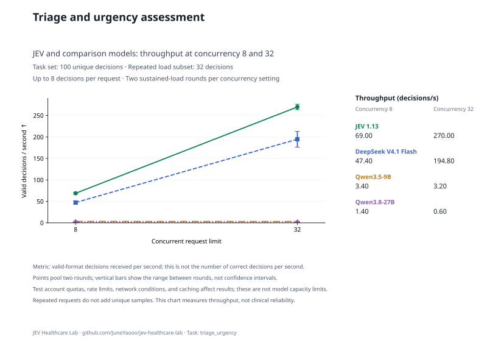

View both concurrency settings

**Table 2a | Triage and urgency assessment: up to 8 decisions per request, 32 load-test decisions, two rounds per setting.**

| Model | Configured concurrency | Throughput (decisions/s) ↑ | Full-response P95 (s) ↓ | Mean requests in flight |
| --- | ---: | ---: | ---: | ---: |
| JEV 1.13 | 8 | **69.00** | **1.557** | 7.99 |
| DeepSeek V4.1 Flash | 8 | 47.40 | 2.332 | 8.00 |
| Qwen3.5-9B | 8 | 3.40 | — | 1.91 |
| Qwen3.8-27B | 8 | 1.40 | — | 1.32 |
| JEV 1.13 | 32 | **270.00** | **1.559** | 31.98 |
| DeepSeek V4.1 Flash | 32 | 194.80 | 2.406 | 31.98 |
| Qwen3.5-9B | 32 | 3.20 | — | 1.67 |
| Qwen3.8-27B | 32 | 0.60 | — | 2.05 |

Configured concurrency is a worker limit; account quotas may reduce requests in flight. P95 excludes client-side quota waiting and is omitted when fewer than 20 complete responses are available.

[Task definition and data](docs/tasks/triage_urgency.md) · [Evaluation methods](docs/MEDICAL_LOAD.md) · [Raw records and pricing](results/medical-load-jev-gateway-v1/README.md)

## Patient message prioritization

**Table 3 | Patient message prioritization: 30 unique decisions from 30 source groups; up to 8 decisions per request. Accuracy uses concurrency 8; load testing uses concurrency 32.**

| Model | Accuracy (%) ↑ | Throughput (decisions/s) ↑ | Full-response P95 (s) ↓ | Cost (CNY/1,000 decisions) ↓ |
| --- | ---: | ---: | ---: | ---: |
| JEV 1.13 | 66.67 | 103.20 | 7.580 | **0.326** |
| DeepSeek V4.1 Flash | **70.00** | **209.35** | **2.736** | 1.063–2.126 |
| Qwen3.5-9B | 16.67 | 0.42 | — | 0.571 |
| Qwen3.8-27B | 66.67 | 0.54 | — | 3.356 |

Accuracy and cost use all 30 fixed decisions. Throughput and P95 use a prespecified subset of 30 decisions, repeated over two sustained-load rounds. Repeated calls do not increase the unique sample count. P95 starts at HTTP dispatch, excludes quota waiting, and is omitted below 20 responses.

Original option keys must match exactly: for example, `Patient #1` cannot be rewritten as `Patient_1`. Such output-contract errors count as incorrect, so scores reflect both judgment and direct API usability, not solely differences in medical reasoning.

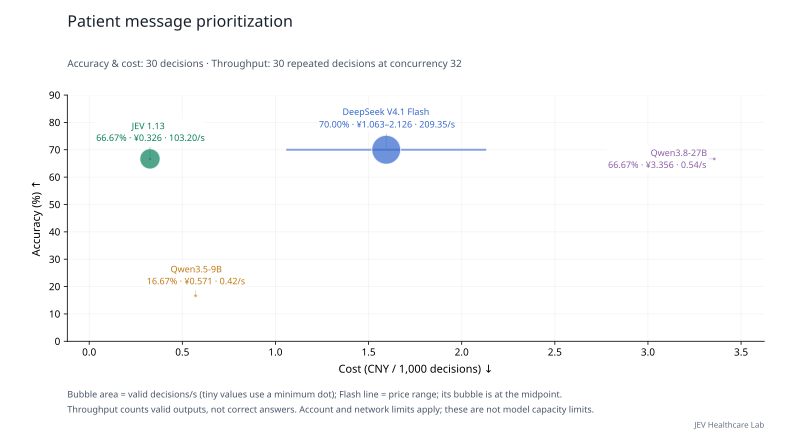

View both concurrency settings

**Table 3a | Patient message prioritization: up to 8 decisions per request, 30 load-test decisions, two rounds per setting.**

| Model | Configured concurrency | Throughput (decisions/s) ↑ | Full-response P95 (s) ↓ | Mean requests in flight |
| --- | ---: | ---: | ---: | ---: |
| JEV 1.13 | 8 | 10.75 | 18.868 | 8.00 |
| DeepSeek V4.1 Flash | 8 | **46.60** | **3.671** | 7.99 |
| Qwen3.5-9B | 8 | 0.31 | — | 0.37 |
| Qwen3.8-27B | 8 | 0.48 | — | 0.68 |
| JEV 1.13 | 32 | 103.20 | 7.580 | 31.99 |
| DeepSeek V4.1 Flash | 32 | **209.35** | **2.736** | 31.96 |
| Qwen3.5-9B | 32 | 0.42 | — | 0.33 |
| Qwen3.8-27B | 32 | 0.54 | — | 0.33 |

Configured concurrency is a worker limit; account quotas may reduce requests in flight. P95 excludes client-side quota waiting and is omitted when fewer than 20 complete responses are available.

[Task definition and data](docs/tasks/message_urgency_pair.md) · [Evaluation methods](docs/MEDICAL_LOAD.md) · [Raw records and pricing](results/medical-load-jev-gateway-v1/README.md)

## Diagnostic test selection

**Table 4 | Diagnostic test selection: 100 unique decisions from 100 source groups; up to 8 decisions per request. Accuracy uses concurrency 8; load testing uses concurrency 32.**

| Model | Accuracy (%) ↑ | Throughput (decisions/s) ↑ | Full-response P95 (s) ↓ | Cost (CNY/1,000 decisions) ↓ |
| --- | ---: | ---: | ---: | ---: |
| JEV 1.13 | **86.00** | 260.80 | **1.578** | **0.083** |
| DeepSeek V4.1 Flash | 81.00 | **269.23** | 1.635 | 0.209–0.419 |
| Qwen3.5-9B | 54.00 | 3.83 | 2.779 | 0.122 |
| Qwen3.8-27B | 78.00 | 2.00 | — | 0.684 |

Accuracy and cost use all 100 fixed decisions. Throughput and P95 use a prespecified subset of 32 decisions, repeated over two sustained-load rounds. Repeated calls do not increase the unique sample count. P95 starts at HTTP dispatch, excludes quota waiting, and is omitted below 20 responses.

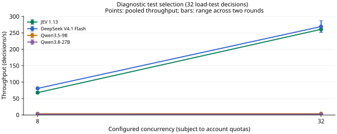

View both concurrency settings

**Table 4a | Diagnostic test selection: up to 8 decisions per request, 32 load-test decisions, two rounds per setting.**

| Model | Configured concurrency | Throughput (decisions/s) ↑ | Full-response P95 (s) ↓ | Mean requests in flight |
| --- | ---: | ---: | ---: | ---: |
| JEV 1.13 | 8 | 68.00 | 1.537 | 7.99 |
| DeepSeek V4.1 Flash | 8 | **80.90** | **1.271** | 7.99 |
| Qwen3.5-9B | 8 | 3.67 | 2.493 | 1.00 |
| Qwen3.8-27B | 8 | 2.00 | — | 0.72 |
| JEV 1.13 | 32 | 260.80 | **1.578** | 31.98 |
| DeepSeek V4.1 Flash | 32 | **269.23** | 1.635 | 31.98 |
| Qwen3.5-9B | 32 | 3.83 | 2.779 | 1.08 |
| Qwen3.8-27B | 32 | 2.00 | — | 0.70 |

Configured concurrency is a worker limit; account quotas may reduce requests in flight. P95 excludes client-side quota waiting and is omitted when fewer than 20 complete responses are available.

[Task definition and data](docs/tasks/examination_choice.md) · [Evaluation methods](docs/MEDICAL_LOAD.md) · [Raw records and pricing](results/medical-load-jev-gateway-v1/README.md)

## Disease staging and severity assessment

**Table 5 | Disease staging and severity assessment: 100 unique decisions from 99 source groups; up to 8 decisions per request. Accuracy uses concurrency 8; load testing uses concurrency 32.**

| Model | Accuracy (%) ↑ | Throughput (decisions/s) ↑ | Full-response P95 (s) ↓ | Cost (CNY/1,000 decisions) ↓ |
| --- | ---: | ---: | ---: | ---: |
| JEV 1.13 | **53.00** | 103.60 | 6.026 | **0.086** |
| DeepSeek V4.1 Flash | 51.00 | **119.38** | 5.390 | 0.217–0.434 |
| Qwen3.5-9B | 30.00 | 3.85 | **2.572** | 0.127 |
| Qwen3.8-27B | 51.00 | 0.80 | — | 0.714 |

Accuracy and cost use all 100 fixed decisions. Throughput and P95 use a prespecified subset of 32 decisions, repeated over two sustained-load rounds. Repeated calls do not increase the unique sample count. P95 starts at HTTP dispatch, excludes quota waiting, and is omitted below 20 responses.

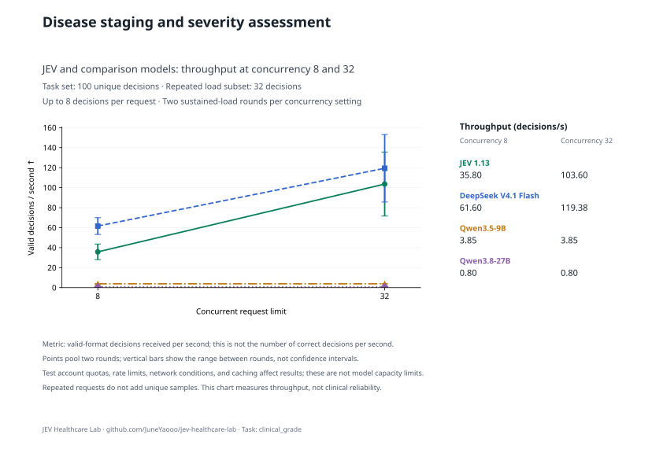

View both concurrency settings

**Table 5a | Disease staging and severity assessment: up to 8 decisions per request, 32 load-test decisions, two rounds per setting.**

| Model | Configured concurrency | Throughput (decisions/s) ↑ | Full-response P95 (s) ↓ | Mean requests in flight |
| --- | ---: | ---: | ---: | ---: |
| JEV 1.13 | 8 | 35.80 | 3.893 | 8.00 |
| DeepSeek V4.1 Flash | 8 | **61.60** | **1.810** | 7.99 |
| Qwen3.5-9B | 8 | 3.85 | 3.322 | 1.03 |
| Qwen3.8-27B | 8 | 0.80 | — | 2.55 |
| JEV 1.13 | 32 | 103.60 | 6.026 | 31.99 |
| DeepSeek V4.1 Flash | 32 | **119.38** | 5.390 | 31.99 |
| Qwen3.5-9B | 32 | 3.85 | **2.572** | 1.01 |
| Qwen3.8-27B | 32 | 0.80 | — | 1.88 |

Configured concurrency is a worker limit; account quotas may reduce requests in flight. P95 excludes client-side quota waiting and is omitted when fewer than 20 complete responses are available.

[Task definition and data](docs/tasks/clinical_grade.md) · [Evaluation methods](docs/MEDICAL_LOAD.md) · [Raw records and pricing](results/medical-load-jev-gateway-v1/README.md)

## Case diagnosis selection

**Table 6 | Case diagnosis selection: 200 unique decisions from 200 source groups; up to 8 decisions per request. Accuracy uses concurrency 8; load testing uses concurrency 32.**

| Model | Accuracy (%) ↑ | Throughput (decisions/s) ↑ | Full-response P95 (s) ↓ | Cost (CNY/1,000 decisions) ↓ |
| --- | ---: | ---: | ---: | ---: |
| JEV 1.13 | **78.50** | **216.00** | **1.961** | **0.258** |
| DeepSeek V4.1 Flash | 75.00 | 176.85 | 4.117 | 0.538–1.076 |
| Qwen3.5-9B | 58.00 | 1.65 | — | 0.300 |
| Qwen3.8-27B | 78.00 | 0.84 | — | 1.744 |

Accuracy and cost use all 200 fixed decisions. Throughput and P95 use a prespecified subset of 32 decisions, repeated over two sustained-load rounds. Repeated calls do not increase the unique sample count. P95 starts at HTTP dispatch, excludes quota waiting, and is omitted below 20 responses.

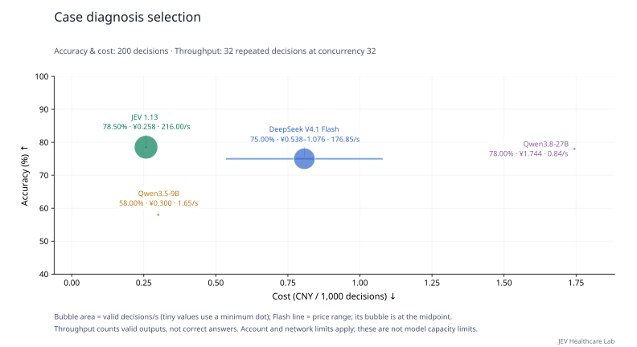

View both concurrency settings

**Table 6a | Case diagnosis selection: up to 8 decisions per request, 32 load-test decisions, two rounds per setting.**

| Model | Configured concurrency | Throughput (decisions/s) ↑ | Full-response P95 (s) ↓ | Mean requests in flight |
| --- | ---: | ---: | ---: | ---: |
| JEV 1.13 | 8 | **51.20** | **2.002** | 7.99 |
| DeepSeek V4.1 Flash | 8 | 32.10 | 4.716 | 7.99 |
| Qwen3.5-9B | 8 | 1.90 | — | 0.64 |
| Qwen3.8-27B | 8 | 0.96 | — | 0.55 |
| JEV 1.13 | 32 | **216.00** | **1.961** | 31.97 |
| DeepSeek V4.1 Flash | 32 | 176.85 | 4.117 | 31.97 |
| Qwen3.5-9B | 32 | 1.65 | — | 0.67 |
| Qwen3.8-27B | 32 | 0.84 | — | 0.29 |

Configured concurrency is a worker limit; account quotas may reduce requests in flight. P95 excludes client-side quota waiting and is omitted when fewer than 20 complete responses are available.

[Task definition and data](docs/tasks/diagnosis.md) · [Evaluation methods](docs/MEDICAL_LOAD.md) · [Raw records and pricing](results/medical-load-jev-gateway-v1/README.md)

## TCM syndrome classification

**Table 7 | TCM syndrome classification: 100 unique decisions from 100 source groups; up to 8 decisions per request. Accuracy uses concurrency 8; load testing uses concurrency 32.**

| Model | Accuracy (%) ↑ | Macro-F1 (%) ↑ | Throughput (decisions/s) ↑ | Full-response P95 (s) ↓ | Cost (CNY/1,000 decisions) ↓ |
| --- | ---: | ---: | ---: | ---: | ---: |
| JEV 1.13 | 28.00 | 19.20 | **104.20** | **3.614** | 1.072 |
| DeepSeek V4.1 Flash | **41.00** | **25.91** | 29.20 | 14.079 | 2.029–4.057 |
| Qwen3.5-9B | 27.00 | 15.23 | 0.59 | — | **1.042** |
| Qwen3.8-27B | 35.00 | 19.68 | 0.27 | — | 6.162 |

Accuracy and cost use all 100 fixed decisions. Throughput and P95 use a prespecified subset of 32 decisions, repeated over two sustained-load rounds. Repeated calls do not increase the unique sample count. P95 starts at HTTP dispatch, excludes quota waiting, and is omitted below 20 responses.

Macro-F1 equally weights classes present in this task’s reference labels. Candidate classes without reference examples do not receive additional zero-score entries; all models use the same class set.

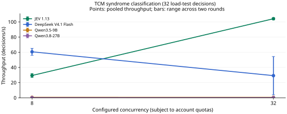

View both concurrency settings

**Table 7a | TCM syndrome classification: up to 8 decisions per request, 32 load-test decisions, two rounds per setting.**

| Model | Configured concurrency | Throughput (decisions/s) ↑ | Full-response P95 (s) ↓ | Mean requests in flight |
| --- | ---: | ---: | ---: | ---: |
| JEV 1.13 | 8 | 29.40 | 3.330 | 7.99 |
| DeepSeek V4.1 Flash | 8 | **60.60** | **1.407** | 7.99 |
| Qwen3.5-9B | 8 | 0.65 | — | 0.29 |
| Qwen3.8-27B | 8 | 0.27 | — | 0.20 |
| JEV 1.13 | 32 | **104.20** | **3.614** | 31.97 |
| DeepSeek V4.1 Flash | 32 | 29.20 | 14.079 | 31.99 |
| Qwen3.5-9B | 32 | 0.59 | — | 0.25 |
| Qwen3.8-27B | 32 | 0.27 | — | 0.22 |

Configured concurrency is a worker limit; account quotas may reduce requests in flight. P95 excludes client-side quota waiting and is omitted when fewer than 20 complete responses are available.

[Task definition and data](docs/tasks/tcm_syndrome.md) · [Evaluation methods](docs/MEDICAL_LOAD.md) · [Raw records and pricing](results/medical-load-jev-gateway-v1/README.md)

## Case etiology assessment

**Table 8 | Case etiology assessment: 100 unique decisions from 100 source groups; up to 8 decisions per request. Accuracy uses concurrency 8; load testing uses concurrency 32.**

| Model | Accuracy (%) ↑ | Throughput (decisions/s) ↑ | Full-response P95 (s) ↓ | Cost (CNY/1,000 decisions) ↓ |
| --- | ---: | ---: | ---: | ---: |
| JEV 1.13 | 80.00 | 175.20 | 2.931 | **0.091** |
| DeepSeek V4.1 Flash | 81.00 | **236.40** | **1.466** | 0.220–0.439 |
| Qwen3.5-9B | 56.00 | 4.03 | 2.108 | 0.128 |
| Qwen3.8-27B | **82.00** | 1.00 | — | 0.721 |

Accuracy and cost use all 100 fixed decisions. Throughput and P95 use a prespecified subset of 32 decisions, repeated over two sustained-load rounds. Repeated calls do not increase the unique sample count. P95 starts at HTTP dispatch, excludes quota waiting, and is omitted below 20 responses.

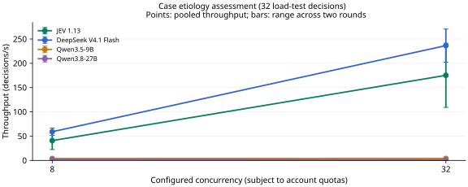

View both concurrency settings

**Table 8a | Case etiology assessment: up to 8 decisions per request, 32 load-test decisions, two rounds per setting.**

| Model | Configured concurrency | Throughput (decisions/s) ↑ | Full-response P95 (s) ↓ | Mean requests in flight |
| --- | ---: | ---: | ---: | ---: |
| JEV 1.13 | 8 | 40.80 | 2.470 | 8.00 |
| DeepSeek V4.1 Flash | 8 | **59.10** | **1.118** | 7.99 |
| Qwen3.5-9B | 8 | 3.80 | 2.966 | 1.07 |
| Qwen3.8-27B | 8 | 2.00 | — | 1.26 |
| JEV 1.13 | 32 | 175.20 | 2.931 | 31.99 |
| DeepSeek V4.1 Flash | 32 | **236.40** | **1.466** | 31.97 |
| Qwen3.5-9B | 32 | 4.03 | 2.108 | 0.96 |
| Qwen3.8-27B | 32 | 1.00 | — | 2.28 |

Configured concurrency is a worker limit; account quotas may reduce requests in flight. P95 excludes client-side quota waiting and is omitted when fewer than 20 complete responses are available.

[Task definition and data](docs/tasks/case_etiology.md) · [Evaluation methods](docs/MEDICAL_LOAD.md) · [Raw records and pricing](results/medical-load-jev-gateway-v1/README.md)

## TCM candidate pathogenesis assessment

**Table 9 | TCM candidate pathogenesis assessment: 100 unique decisions from 50 source groups; up to 8 decisions per request. Accuracy uses concurrency 8; load testing uses concurrency 32.**

| Model | Accuracy (%) ↑ | Macro-F1 (%) ↑ | Throughput (decisions/s) ↑ | Full-response P95 (s) ↓ | Cost (CNY/1,000 decisions) ↓ |
| --- | ---: | ---: | ---: | ---: | ---: |
| JEV 1.13 | 71.00 | 68.72 | 134.40 | **7.319** | **0.147** |
| DeepSeek V4.1 Flash | **78.00** | **78.00** | **155.00** | 7.781 | 0.359–0.719 |
| Qwen3.5-9B | 59.00 | 53.99 | 2.80 | — | 0.196 |
| Qwen3.8-27B | 70.00 | 69.21 | 0.97 | — | 1.131 |

Accuracy and cost use all 100 fixed decisions. Throughput and P95 use a prespecified subset of 32 decisions, repeated over two sustained-load rounds. Repeated calls do not increase the unique sample count. P95 starts at HTTP dispatch, excludes quota waiting, and is omitted below 20 responses.

Macro-F1 equally weights classes present in this task’s reference labels. Candidate classes without reference examples do not receive additional zero-score entries; all models use the same class set.

This task scores judgments about candidate TCM pathogenesis against existing annotations; it does not establish the ability to generate syndrome analyses or prescriptions freely.

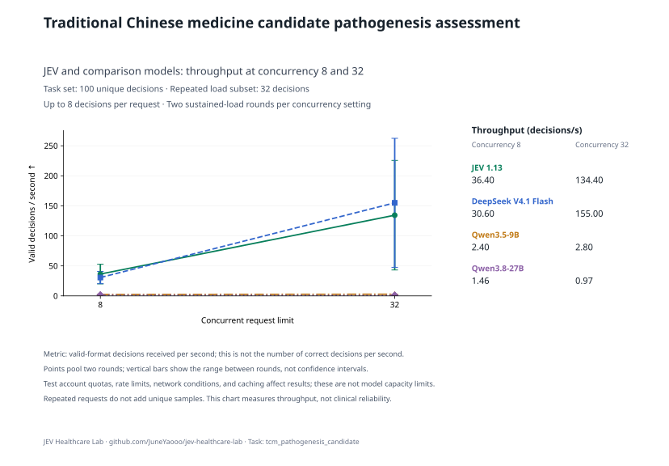

View both concurrency settings

**Table 9a | TCM candidate pathogenesis assessment: up to 8 decisions per request, 32 load-test decisions, two rounds per setting.**

| Model | Configured concurrency | Throughput (decisions/s) ↑ | Full-response P95 (s) ↓ | Mean requests in flight |
| --- | ---: | ---: | ---: | ---: |
| JEV 1.13 | 8 | **36.40** | 6.488 | 8.00 |
| DeepSeek V4.1 Flash | 8 | 30.60 | **6.432** | 8.00 |
| Qwen3.5-9B | 8 | 2.40 | — | 0.78 |
| Qwen3.8-27B | 8 | 1.46 | — | 0.84 |
| JEV 1.13 | 32 | 134.40 | **7.319** | 31.99 |
| DeepSeek V4.1 Flash | 32 | **155.00** | 7.781 | 31.99 |
| Qwen3.5-9B | 32 | 2.80 | — | 0.74 |
| Qwen3.8-27B | 32 | 0.97 | — | 1.18 |

Configured concurrency is a worker limit; account quotas may reduce requests in flight. P95 excludes client-side quota waiting and is omitted when fewer than 20 complete responses are available.

[Task definition and data](docs/tasks/tcm_pathogenesis_candidate.md) · [Evaluation methods](docs/MEDICAL_LOAD.md) · [Raw records and pricing](results/medical-load-jev-gateway-v1/README.md)

## Patient-specific contraindication assessment

**Table 10 | Patient-specific contraindication assessment: 54 unique decisions from 53 source groups; up to 8 decisions per request. Accuracy uses concurrency 8; load testing uses concurrency 32.**

| Model | Accuracy (%) ↑ | Throughput (decisions/s) ↑ | Full-response P95 (s) ↓ | Cost (CNY/1,000 decisions) ↓ |
| --- | ---: | ---: | ---: | ---: |
| JEV 1.13 | **77.78** | **260.20** | **1.577** | **0.086** |
| DeepSeek V4.1 Flash | 62.96 | 82.47 | 5.906 | 0.211–0.422 |
| Qwen3.5-9B | 38.89 | 3.35 | 3.133 | 0.123 |
| Qwen3.8-27B | 64.81 | 1.60 | — | 0.694 |

Accuracy and cost use all 54 fixed decisions. Throughput and P95 use a prespecified subset of 32 decisions, repeated over two sustained-load rounds. Repeated calls do not increase the unique sample count. P95 starts at HTTP dispatch, excludes quota waiting, and is omitted below 20 responses.

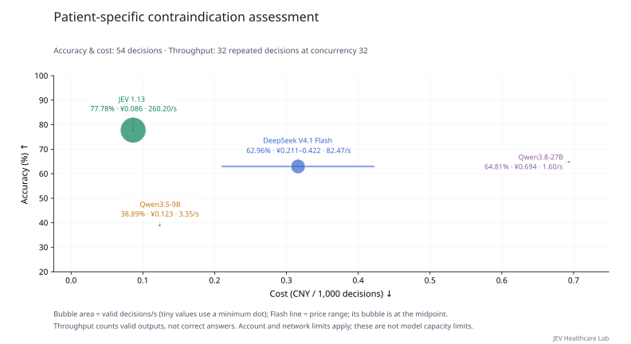

View both concurrency settings

**Table 10a | Patient-specific contraindication assessment: up to 8 decisions per request, 32 load-test decisions, two rounds per setting.**

| Model | Configured concurrency | Throughput (decisions/s) ↑ | Full-response P95 (s) ↓ | Mean requests in flight |
| --- | ---: | ---: | ---: | ---: |
| JEV 1.13 | 8 | **65.20** | **1.606** | 7.99 |
| DeepSeek V4.1 Flash | 8 | 56.50 | 2.225 | 7.99 |
| Qwen3.5-9B | 8 | 3.55 | 5.386 | 1.33 |
| Qwen3.8-27B | 8 | 2.00 | — | 1.00 |
| JEV 1.13 | 32 | **260.20** | **1.577** | 31.98 |
| DeepSeek V4.1 Flash | 32 | 82.47 | 5.906 | 31.99 |
| Qwen3.5-9B | 32 | 3.35 | 3.133 | 1.13 |
| Qwen3.8-27B | 32 | 1.60 | — | 0.95 |

Configured concurrency is a worker limit; account quotas may reduce requests in flight. P95 excludes client-side quota waiting and is omitted when fewer than 20 complete responses are available.

[Task definition and data](docs/tasks/patient_contraindication.md) · [Evaluation methods](docs/MEDICAL_LOAD.md) · [Raw records and pricing](results/medical-load-jev-gateway-v1/README.md)

## Treatment selection

**Table 11 | Treatment selection: 100 unique decisions from 100 source groups; up to 8 decisions per request. Accuracy uses concurrency 8; load testing uses concurrency 32.**

| Model | Accuracy (%) ↑ | Throughput (decisions/s) ↑ | Full-response P95 (s) ↓ | Cost (CNY/1,000 decisions) ↓ |
| --- | ---: | ---: | ---: | ---: |
| JEV 1.13 | **78.00** | **254.60** | **1.706** | **0.086** |
| DeepSeek V4.1 Flash | 73.00 | 178.57 | 3.063 | 0.214–0.428 |
| Qwen3.5-9B | 57.00 | 4.40 | 6.105 | 0.126 |
| Qwen3.8-27B | 72.00 | 2.00 | — | 0.704 |

Accuracy and cost use all 100 fixed decisions. Throughput and P95 use a prespecified subset of 32 decisions, repeated over two sustained-load rounds. Repeated calls do not increase the unique sample count. P95 starts at HTTP dispatch, excludes quota waiting, and is omitted below 20 responses.

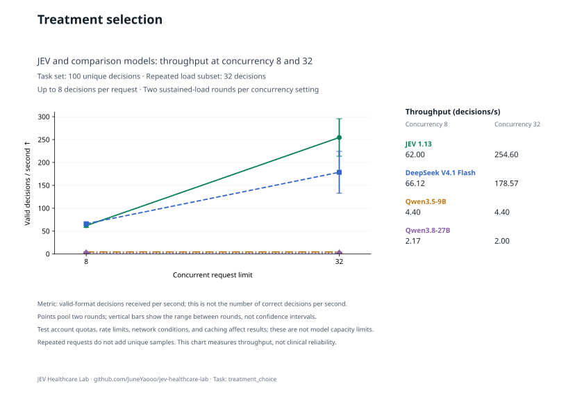

View both concurrency settings

**Table 11a | Treatment selection: up to 8 decisions per request, 32 load-test decisions, two rounds per setting.**

| Model | Configured concurrency | Throughput (decisions/s) ↑ | Full-response P95 (s) ↓ | Mean requests in flight |
| --- | ---: | ---: | ---: | ---: |
| JEV 1.13 | 8 | 62.00 | 1.627 | 7.99 |
| DeepSeek V4.1 Flash | 8 | **66.12** | **1.330** | 7.99 |
| Qwen3.5-9B | 8 | 4.40 | 4.483 | 1.22 |
| Qwen3.8-27B | 8 | 2.17 | — | 1.86 |
| JEV 1.13 | 32 | **254.60** | **1.706** | 31.98 |
| DeepSeek V4.1 Flash | 32 | 178.57 | 3.063 | 31.99 |
| Qwen3.5-9B | 32 | 4.40 | 6.105 | 1.31 |
| Qwen3.8-27B | 32 | 2.00 | — | 1.78 |

Configured concurrency is a worker limit; account quotas may reduce requests in flight. P95 excludes client-side quota waiting and is omitted when fewer than 20 complete responses are available.

[Task definition and data](docs/tasks/treatment_choice.md) · [Evaluation methods](docs/MEDICAL_LOAD.md) · [Raw records and pricing](results/medical-load-jev-gateway-v1/README.md)

## Medication selection

**Table 12 | Medication selection: 100 unique decisions from 100 source groups; up to 8 decisions per request. Accuracy uses concurrency 8; load testing uses concurrency 32.**

| Model | Accuracy (%) ↑ | Throughput (decisions/s) ↑ | Full-response P95 (s) ↓ | Cost (CNY/1,000 decisions) ↓ |
| --- | ---: | ---: | ---: | ---: |
| JEV 1.13 | **83.00** | 184.80 | 3.755 | **0.086** |
| DeepSeek V4.1 Flash | 62.00 | **271.43** | **1.135** | 0.218–0.436 |
| Qwen3.5-9B | 43.00 | 3.98 | 3.856 | 0.128 |
| Qwen3.8-27B | 64.00 | 1.80 | — | 0.718 |

Accuracy and cost use all 100 fixed decisions. Throughput and P95 use a prespecified subset of 32 decisions, repeated over two sustained-load rounds. Repeated calls do not increase the unique sample count. P95 starts at HTTP dispatch, excludes quota waiting, and is omitted below 20 responses.

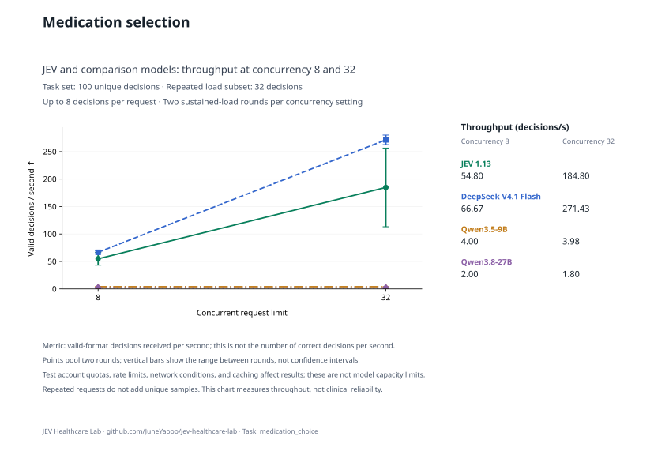

View both concurrency settings

**Table 12a | Medication selection: up to 8 decisions per request, 32 load-test decisions, two rounds per setting.**

| Model | Configured concurrency | Throughput (decisions/s) ↑ | Full-response P95 (s) ↓ | Mean requests in flight |
| --- | ---: | ---: | ---: | ---: |
| JEV 1.13 | 8 | 54.80 | 2.327 | 8.00 |
| DeepSeek V4.1 Flash | 8 | **66.67** | **1.265** | 7.99 |
| Qwen3.5-9B | 8 | 4.00 | 2.450 | 1.04 |
| Qwen3.8-27B | 8 | 2.00 | — | 0.69 |
| JEV 1.13 | 32 | 184.80 | 3.755 | 31.99 |
| DeepSeek V4.1 Flash | 32 | **271.43** | **1.135** | 31.97 |
| Qwen3.5-9B | 32 | 3.98 | 3.856 | 1.32 |
| Qwen3.8-27B | 32 | 1.80 | — | 0.81 |

Configured concurrency is a worker limit; account quotas may reduce requests in flight. P95 excludes client-side quota waiting and is omitted when fewer than 20 complete responses are available.

[Task definition and data](docs/tasks/medication_choice.md) · [Evaluation methods](docs/MEDICAL_LOAD.md) · [Raw records and pricing](results/medical-load-jev-gateway-v1/README.md)

## Fluid therapy selection

**Table 13 | Fluid therapy selection: 16 unique decisions from 15 source groups; up to 8 decisions per request. Accuracy uses concurrency 8; load testing uses concurrency 32.**

| Model | Accuracy (%) ↑ | Throughput (decisions/s) ↑ | Full-response P95 (s) ↓ | Cost (CNY/1,000 decisions) ↓ |
| --- | ---: | ---: | ---: | ---: |
| JEV 1.13 | **62.50** | **244.60** | **1.651** | **0.096** |
| DeepSeek V4.1 Flash | 43.75 | 193.07 | 3.903 | 0.237–0.475 |
| Qwen3.5-9B | 31.25 | 3.70 | — | 0.144 |
| Qwen3.8-27B | **62.50** | 1.80 | — | 0.812 |

Accuracy and cost use all 16 fixed decisions. Throughput and P95 use a prespecified subset of 16 decisions, repeated over two sustained-load rounds. Repeated calls do not increase the unique sample count. P95 starts at HTTP dispatch, excludes quota waiting, and is omitted below 20 responses.

Limited sample coverage makes this an exploratory comparison; it cannot provide a robust estimate of clinical reliability.

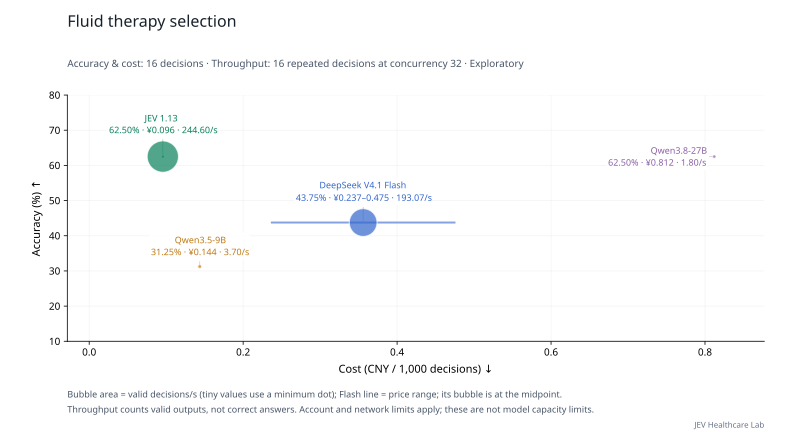

View both concurrency settings

**Table 13a | Fluid therapy selection: up to 8 decisions per request, 16 load-test decisions, two rounds per setting.**

| Model | Configured concurrency | Throughput (decisions/s) ↑ | Full-response P95 (s) ↓ | Mean requests in flight |
| --- | ---: | ---: | ---: | ---: |
| JEV 1.13 | 8 | 64.60 | 1.618 | 7.99 |
| DeepSeek V4.1 Flash | 8 | **76.75** | **1.174** | 7.99 |
| Qwen3.5-9B | 8 | 3.48 | — | 0.96 |
| Qwen3.8-27B | 8 | 1.80 | — | 0.85 |
| JEV 1.13 | 32 | **244.60** | **1.651** | 31.98 |
| DeepSeek V4.1 Flash | 32 | 193.07 | 3.903 | 31.98 |
| Qwen3.5-9B | 32 | 3.70 | — | 1.04 |
| Qwen3.8-27B | 32 | 1.80 | — | 0.72 |

Configured concurrency is a worker limit; account quotas may reduce requests in flight. P95 excludes client-side quota waiting and is omitted when fewer than 20 complete responses are available.

[Task definition and data](docs/tasks/fluid_plan.md) · [Evaluation methods](docs/MEDICAL_LOAD.md) · [Raw records and pricing](results/medical-load-jev-gateway-v1/README.md)

## Pharmacogenomic guideline recommendation selection

**Table 14 | Pharmacogenomic guideline recommendation selection: 100 unique decisions from 25 source groups; up to 8 decisions per request. Accuracy uses concurrency 8; load testing uses concurrency 32.**

| Model | Accuracy (%) ↑ | Throughput (decisions/s) ↑ | Full-response P95 (s) ↓ | Cost (CNY/1,000 decisions) ↓ |
| --- | ---: | ---: | ---: | ---: |
| JEV 1.13 | 56.00 | 155.40 | 3.638 | **0.139** |
| DeepSeek V4.1 Flash | 53.00 | **323.40** | **1.097** | 0.407–0.814 |
| Qwen3.5-9B | 34.00 | 1.80 | — | 0.230 |
| Qwen3.8-27B | **62.00** | 1.14 | — | 1.311 |

Accuracy and cost use all 100 fixed decisions. Throughput and P95 use a prespecified subset of 32 decisions, repeated over two sustained-load rounds. Repeated calls do not increase the unique sample count. P95 starts at HTTP dispatch, excludes quota waiting, and is omitted below 20 responses.

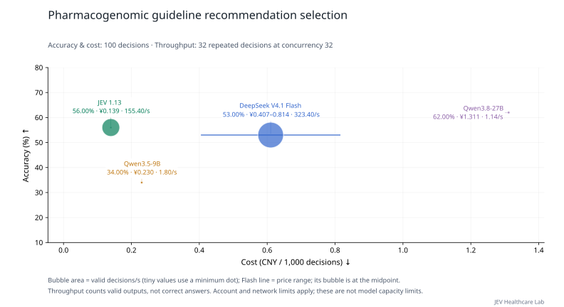

View both concurrency settings

**Table 14a | Pharmacogenomic guideline recommendation selection: up to 8 decisions per request, 32 load-test decisions, two rounds per setting.**

| Model | Configured concurrency | Throughput (decisions/s) ↑ | Full-response P95 (s) ↓ | Mean requests in flight |
| --- | ---: | ---: | ---: | ---: |
| JEV 1.13 | 8 | 43.80 | 4.255 | 7.99 |
| DeepSeek V4.1 Flash | 8 | **82.80** | **1.058** | 7.99 |
| Qwen3.5-9B | 8 | 2.40 | — | 0.76 |
| Qwen3.8-27B | 8 | 1.43 | — | 0.58 |
| JEV 1.13 | 32 | 155.40 | 3.638 | 31.98 |
| DeepSeek V4.1 Flash | 32 | **323.40** | **1.097** | 31.96 |
| Qwen3.5-9B | 32 | 1.80 | — | 0.57 |
| Qwen3.8-27B | 32 | 1.14 | — | 1.09 |

Configured concurrency is a worker limit; account quotas may reduce requests in flight. P95 excludes client-side quota waiting and is omitted when fewer than 20 complete responses are available.

[Task definition and data](docs/tasks/pgx_guideline_recommendation.md) · [Evaluation methods](docs/MEDICAL_LOAD.md) · [Raw records and pricing](results/medical-load-jev-gateway-v1/README.md)

## Administration route and method selection

**Table 15 | Administration route and method selection: 4 unique decisions from 4 source groups; up to 8 decisions per request. Accuracy uses concurrency 8; load testing uses concurrency 32.**

| Model | Accuracy (%) ↑ | Throughput (decisions/s) ↑ | Full-response P95 (s) ↓ | Cost (CNY/1,000 decisions) ↓ |
| --- | ---: | ---: | ---: | ---: |
| JEV 1.13 | **100.00** | 129.80 | 1.571 | **0.093** |
| DeepSeek V4.1 Flash | 75.00 | **164.90** | **1.102** | 0.229–0.457 |
| Qwen3.5-9B | 50.00 | 3.30 | 1.843 | 0.132 |
| Qwen3.8-27B | 50.00 | 1.30 | — | 0.749 |

Accuracy and cost use all 4 fixed decisions. Throughput and P95 use a prespecified subset of 4 decisions, repeated over two sustained-load rounds. Repeated calls do not increase the unique sample count. P95 starts at HTTP dispatch, excludes quota waiting, and is omitted below 20 responses.

Limited sample coverage makes this an exploratory comparison; it cannot provide a robust estimate of clinical reliability.

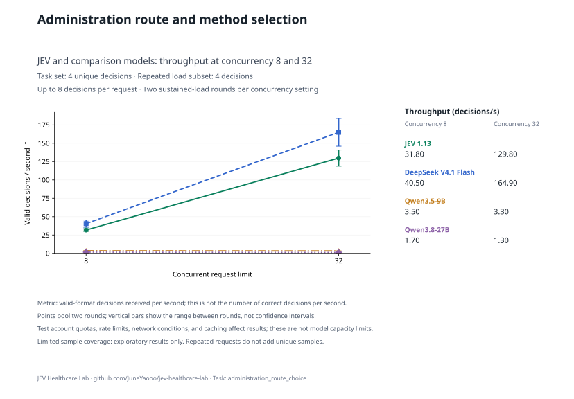

View both concurrency settings

**Table 15a | Administration route and method selection: up to 8 decisions per request, 4 load-test decisions, two rounds per setting.**

| Model | Configured concurrency | Throughput (decisions/s) ↑ | Full-response P95 (s) ↓ | Mean requests in flight |
| --- | ---: | ---: | ---: | ---: |
| JEV 1.13 | 8 | 31.80 | 1.628 | 8.00 |
| DeepSeek V4.1 Flash | 8 | **40.50** | **1.057** | 7.99 |
| Qwen3.5-9B | 8 | 3.50 | 1.776 | 0.99 |
| Qwen3.8-27B | 8 | 1.70 | — | 0.93 |
| JEV 1.13 | 32 | 129.80 | 1.571 | 31.98 |
| DeepSeek V4.1 Flash | 32 | **164.90** | **1.102** | 31.98 |
| Qwen3.5-9B | 32 | 3.30 | 1.843 | 1.03 |
| Qwen3.8-27B | 32 | 1.30 | — | 2.72 |

Configured concurrency is a worker limit; account quotas may reduce requests in flight. P95 excludes client-side quota waiting and is omitted when fewer than 20 complete responses are available.

[Task definition and data](docs/tasks/administration_route_choice.md) · [Evaluation methods](docs/MEDICAL_LOAD.md) · [Raw records and pricing](results/medical-load-jev-gateway-v1/README.md)

## Case complication assessment

**Table 16 | Case complication assessment: 100 unique decisions from 96 source groups; up to 8 decisions per request. Accuracy uses concurrency 8; load testing uses concurrency 32.**

| Model | Accuracy (%) ↑ | Throughput (decisions/s) ↑ | Full-response P95 (s) ↓ | Cost (CNY/1,000 decisions) ↓ |
| --- | ---: | ---: | ---: | ---: |
| JEV 1.13 | **90.00** | 188.60 | 3.744 | **0.089** |
| DeepSeek V4.1 Flash | 66.00 | **214.32** | 2.277 | 0.215–0.429 |
| Qwen3.5-9B | 53.00 | 3.55 | **2.224** | 0.126 |
| Qwen3.8-27B | 84.00 | 2.20 | — | 0.707 |

Accuracy and cost use all 100 fixed decisions. Throughput and P95 use a prespecified subset of 32 decisions, repeated over two sustained-load rounds. Repeated calls do not increase the unique sample count. P95 starts at HTTP dispatch, excludes quota waiting, and is omitted below 20 responses.

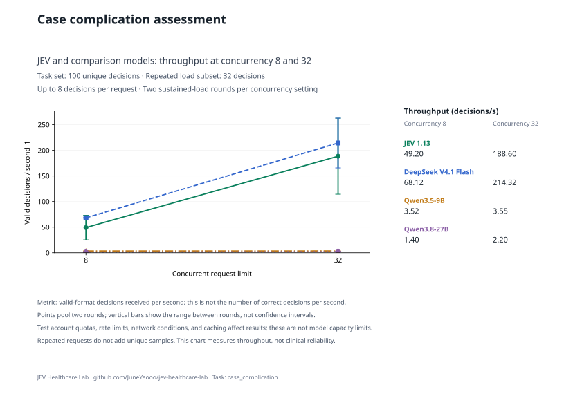

View both concurrency settings

**Table 16a | Case complication assessment: up to 8 decisions per request, 32 load-test decisions, two rounds per setting.**

| Model | Configured concurrency | Throughput (decisions/s) ↑ | Full-response P95 (s) ↓ | Mean requests in flight |
| --- | ---: | ---: | ---: | ---: |
| JEV 1.13 | 8 | 49.20 | 3.906 | 8.00 |
| DeepSeek V4.1 Flash | 8 | **68.12** | **1.268** | 7.99 |
| Qwen3.5-9B | 8 | 3.52 | 2.162 | 0.98 |
| Qwen3.8-27B | 8 | 1.40 | — | 1.79 |
| JEV 1.13 | 32 | 188.60 | 3.744 | 31.98 |
| DeepSeek V4.1 Flash | 32 | **214.32** | 2.277 | 31.98 |
| Qwen3.5-9B | 32 | 3.55 | **2.224** | 0.92 |
| Qwen3.8-27B | 32 | 2.20 | — | 0.88 |

Configured concurrency is a worker limit; account quotas may reduce requests in flight. P95 excludes client-side quota waiting and is omitted when fewer than 20 complete responses are available.

[Task definition and data](docs/tasks/case_complication.md) · [Evaluation methods](docs/MEDICAL_LOAD.md) · [Raw records and pricing](results/medical-load-jev-gateway-v1/README.md)

## Nursing intervention selection

**Table 17 | Nursing intervention selection: 42 unique decisions from 42 source groups; up to 8 decisions per request. Accuracy uses concurrency 8; load testing uses concurrency 32.**

| Model | Accuracy (%) ↑ | Throughput (decisions/s) ↑ | Full-response P95 (s) ↓ | Cost (CNY/1,000 decisions) ↓ |
| --- | ---: | ---: | ---: | ---: |
| JEV 1.13 | **88.10** | 205.40 | 2.843 | **0.090** |
| DeepSeek V4.1 Flash | 78.57 | **252.00** | **1.953** | 0.211–0.422 |
| Qwen3.5-9B | 57.14 | 4.80 | 2.056 | 0.123 |
| Qwen3.8-27B | 85.71 | 2.20 | — | 0.689 |

Accuracy and cost use all 42 fixed decisions. Throughput and P95 use a prespecified subset of 32 decisions, repeated over two sustained-load rounds. Repeated calls do not increase the unique sample count. P95 starts at HTTP dispatch, excludes quota waiting, and is omitted below 20 responses.

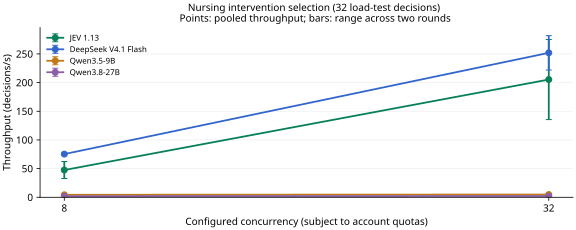

View both concurrency settings

**Table 17a | Nursing intervention selection: up to 8 decisions per request, 32 load-test decisions, two rounds per setting.**

| Model | Configured concurrency | Throughput (decisions/s) ↑ | Full-response P95 (s) ↓ | Mean requests in flight |
| --- | ---: | ---: | ---: | ---: |
| JEV 1.13 | 8 | 47.60 | 3.234 | 8.00 |
| DeepSeek V4.1 Flash | 8 | **75.40** | **1.294** | 8.00 |
| Qwen3.5-9B | 8 | 4.40 | 2.309 | 0.97 |
| Qwen3.8-27B | 8 | 2.00 | — | 0.67 |
| JEV 1.13 | 32 | 205.40 | 2.843 | 31.98 |
| DeepSeek V4.1 Flash | 32 | **252.00** | **1.953** | 31.98 |
| Qwen3.5-9B | 32 | 4.80 | 2.056 | 0.94 |
| Qwen3.8-27B | 32 | 2.20 | — | 0.85 |

Configured concurrency is a worker limit; account quotas may reduce requests in flight. P95 excludes client-side quota waiting and is omitted when fewer than 20 complete responses are available.

[Task definition and data](docs/tasks/nursing_priority.md) · [Evaluation methods](docs/MEDICAL_LOAD.md) · [Raw records and pricing](results/medical-load-jev-gateway-v1/README.md)

## Nutrition and diet selection

**Table 18 | Nutrition and diet selection: 11 unique decisions from 11 source groups; up to 8 decisions per request. Accuracy uses concurrency 8; load testing uses concurrency 32.**

| Model | Accuracy (%) ↑ | Throughput (decisions/s) ↑ | Full-response P95 (s) ↓ | Cost (CNY/1,000 decisions) ↓ |
| --- | ---: | ---: | ---: | ---: |
| JEV 1.13 | **63.64** | 100.28 | 4.526 | **0.097** |
| DeepSeek V4.1 Flash | **63.64** | **173.60** | 3.069 | 0.232–0.464 |
| Qwen3.5-9B | 27.27 | 3.70 | **2.063** | 0.135 |
| Qwen3.8-27B | **63.64** | 1.65 | — | 0.763 |

Accuracy and cost use all 11 fixed decisions. Throughput and P95 use a prespecified subset of 11 decisions, repeated over two sustained-load rounds. Repeated calls do not increase the unique sample count. P95 starts at HTTP dispatch, excludes quota waiting, and is omitted below 20 responses.

Limited sample coverage makes this an exploratory comparison; it cannot provide a robust estimate of clinical reliability.

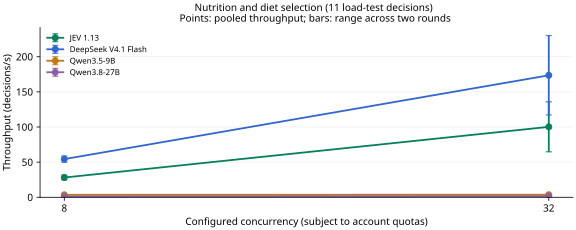

View both concurrency settings

**Table 18a | Nutrition and diet selection: up to 8 decisions per request, 11 load-test decisions, two rounds per setting.**

| Model | Configured concurrency | Throughput (decisions/s) ↑ | Full-response P95 (s) ↓ | Mean requests in flight |
| --- | ---: | ---: | ---: | ---: |
| JEV 1.13 | 8 | 28.15 | 3.279 | 8.00 |
| DeepSeek V4.1 Flash | 8 | **54.38** | **1.294** | 7.99 |
| Qwen3.5-9B | 8 | 3.58 | 2.082 | 0.94 |
| Qwen3.8-27B | 8 | 1.32 | — | 1.62 |
| JEV 1.13 | 32 | 100.28 | 4.526 | 31.99 |
| DeepSeek V4.1 Flash | 32 | **173.60** | 3.069 | 31.98 |
| Qwen3.5-9B | 32 | 3.70 | **2.063** | 0.94 |
| Qwen3.8-27B | 32 | 1.65 | — | 1.40 |

Configured concurrency is a worker limit; account quotas may reduce requests in flight. P95 excludes client-side quota waiting and is omitted when fewer than 20 complete responses are available.

[Task definition and data](docs/tasks/nutrition_plan.md) · [Evaluation methods](docs/MEDICAL_LOAD.md) · [Raw records and pricing](results/medical-load-jev-gateway-v1/README.md)

## Patient positioning selection

**Table 19 | Patient positioning selection: 10 unique decisions from 10 source groups; up to 8 decisions per request. Accuracy uses concurrency 8; load testing uses concurrency 32.**

| Model | Accuracy (%) ↑ | Throughput (decisions/s) ↑ | Full-response P95 (s) ↓ | Cost (CNY/1,000 decisions) ↓ |
| --- | ---: | ---: | ---: | ---: |
| JEV 1.13 | **100.00** | **178.65** | 1.521 | **0.084** |
| DeepSeek V4.1 Flash | 70.00 | 174.90 | **1.300** | 0.206–0.413 |
| Qwen3.5-9B | 30.00 | 3.33 | 2.114 | 0.126 |
| Qwen3.8-27B | 60.00 | 1.80 | — | 0.706 |

Accuracy and cost use all 10 fixed decisions. Throughput and P95 use a prespecified subset of 10 decisions, repeated over two sustained-load rounds. Repeated calls do not increase the unique sample count. P95 starts at HTTP dispatch, excludes quota waiting, and is omitted below 20 responses.

Limited sample coverage makes this an exploratory comparison; it cannot provide a robust estimate of clinical reliability.

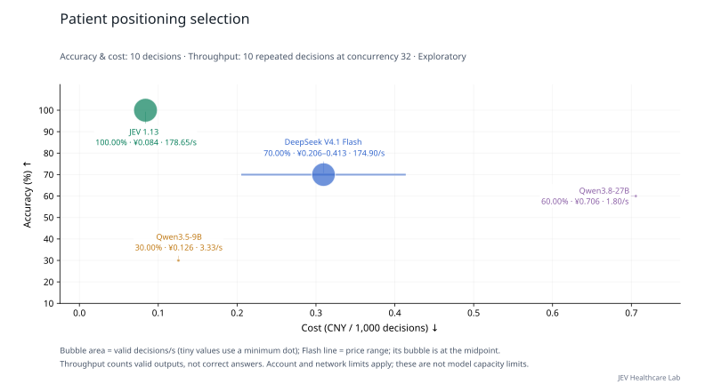

View both concurrency settings

**Table 19a | Patient positioning selection: up to 8 decisions per request, 10 load-test decisions, two rounds per setting.**

| Model | Configured concurrency | Throughput (decisions/s) ↑ | Full-response P95 (s) ↓ | Mean requests in flight |
| --- | ---: | ---: | ---: | ---: |
| JEV 1.13 | 8 | 46.25 | 1.432 | 7.99 |
| DeepSeek V4.1 Flash | 8 | **47.25** | **1.076** | 7.99 |
| Qwen3.5-9B | 8 | 3.23 | 2.361 | 1.10 |
| Qwen3.8-27B | 8 | 2.00 | — | 1.46 |
| JEV 1.13 | 32 | **178.65** | 1.521 | 31.98 |
| DeepSeek V4.1 Flash | 32 | 174.90 | **1.300** | 31.98 |
| Qwen3.5-9B | 32 | 3.33 | 2.114 | 1.04 |
| Qwen3.8-27B | 32 | 1.80 | — | 0.79 |

Configured concurrency is a worker limit; account quotas may reduce requests in flight. P95 excludes client-side quota waiting and is omitted when fewer than 20 complete responses are available.

[Task definition and data](docs/tasks/positioning_choice.md) · [Evaluation methods](docs/MEDICAL_LOAD.md) · [Raw records and pricing](results/medical-load-jev-gateway-v1/README.md)

## Clinical monitoring and treatment response assessment

**Table 20 | Clinical monitoring and treatment response assessment: 5 unique decisions from 5 source groups; up to 8 decisions per request. Accuracy uses concurrency 8; load testing uses concurrency 32.**

| Model | Accuracy (%) ↑ | Throughput (decisions/s) ↑ | Full-response P95 (s) ↓ | Cost (CNY/1,000 decisions) ↓ |
| --- | ---: | ---: | ---: | ---: |
| JEV 1.13 | 80.00 | 72.38 | 5.048 | **0.086** |
| DeepSeek V4.1 Flash | **100.00** | **161.75** | **1.620** | 0.208–0.416 |
| Qwen3.5-9B | 40.00 | 3.62 | 2.532 | 0.122 |
| Qwen3.8-27B | 80.00 | 1.50 | — | 0.686 |

Accuracy and cost use all 5 fixed decisions. Throughput and P95 use a prespecified subset of 5 decisions, repeated over two sustained-load rounds. Repeated calls do not increase the unique sample count. P95 starts at HTTP dispatch, excludes quota waiting, and is omitted below 20 responses.

Limited sample coverage makes this an exploratory comparison; it cannot provide a robust estimate of clinical reliability.

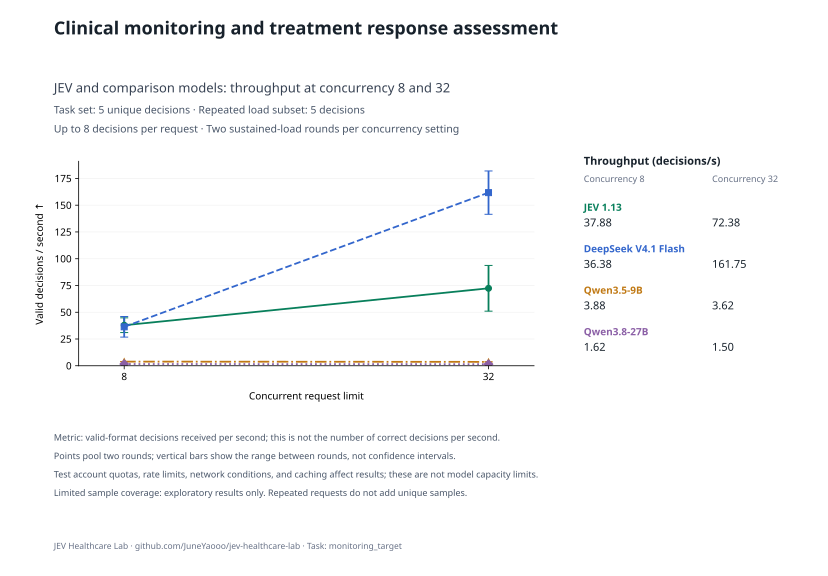

View both concurrency settings

**Table 20a | Clinical monitoring and treatment response assessment: up to 8 decisions per request, 5 load-test decisions, two rounds per setting.**

| Model | Configured concurrency | Throughput (decisions/s) ↑ | Full-response P95 (s) ↓ | Mean requests in flight |
| --- | ---: | ---: | ---: | ---: |
| JEV 1.13 | 8 | **37.88** | **1.820** | 8.00 |
| DeepSeek V4.1 Flash | 8 | 36.38 | 2.471 | 8.00 |
| Qwen3.5-9B | 8 | 3.88 | 2.303 | 1.10 |
| Qwen3.8-27B | 8 | 1.62 | — | 1.71 |
| JEV 1.13 | 32 | 72.38 | 5.048 | 31.99 |
| DeepSeek V4.1 Flash | 32 | **161.75** | **1.620** | 31.98 |
| Qwen3.5-9B | 32 | 3.62 | 2.532 | 1.25 |
| Qwen3.8-27B | 32 | 1.50 | — | 2.11 |

Configured concurrency is a worker limit; account quotas may reduce requests in flight. P95 excludes client-side quota waiting and is omitted when fewer than 20 complete responses are available.

[Task definition and data](docs/tasks/monitoring_target.md) · [Evaluation methods](docs/MEDICAL_LOAD.md) · [Raw records and pricing](results/medical-load-jev-gateway-v1/README.md)

## Infection prevention measures

**Table 21 | Infection prevention measures: 5 unique decisions from 5 source groups; up to 8 decisions per request. Accuracy uses concurrency 8; load testing uses concurrency 32.**

| Model | Accuracy (%) ↑ | Throughput (decisions/s) ↑ | Full-response P95 (s) ↓ | Cost (CNY/1,000 decisions) ↓ |
| --- | ---: | ---: | ---: | ---: |
| JEV 1.13 | **100.00** | **162.38** | **1.669** | **0.095** |
| DeepSeek V4.1 Flash | **100.00** | 150.00 | 1.916 | 0.231–0.462 |
| Qwen3.5-9B | 40.00 | 2.90 | 3.126 | 0.132 |
| Qwen3.8-27B | 80.00 | 1.88 | — | 0.746 |

Accuracy and cost use all 5 fixed decisions. Throughput and P95 use a prespecified subset of 5 decisions, repeated over two sustained-load rounds. Repeated calls do not increase the unique sample count. P95 starts at HTTP dispatch, excludes quota waiting, and is omitted below 20 responses.

Limited sample coverage makes this an exploratory comparison; it cannot provide a robust estimate of clinical reliability.

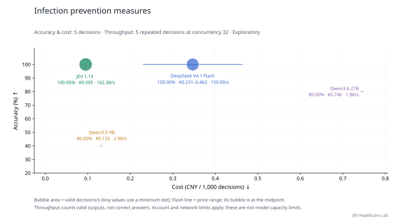

View both concurrency settings

**Table 21a | Infection prevention measures: up to 8 decisions per request, 5 load-test decisions, two rounds per setting.**

| Model | Configured concurrency | Throughput (decisions/s) ↑ | Full-response P95 (s) ↓ | Mean requests in flight |
| --- | ---: | ---: | ---: | ---: |
| JEV 1.13 | 8 | 43.12 | 1.553 | 7.99 |
| DeepSeek V4.1 Flash | 8 | **43.38** | **1.461** | 7.99 |
| Qwen3.5-9B | 8 | 2.70 | 17.789 | 1.13 |
| Qwen3.8-27B | 8 | 1.75 | — | 1.34 |
| JEV 1.13 | 32 | **162.38** | **1.669** | 31.99 |
| DeepSeek V4.1 Flash | 32 | 150.00 | 1.916 | 31.98 |
| Qwen3.5-9B | 32 | 2.90 | 3.126 | 1.18 |
| Qwen3.8-27B | 32 | 1.88 | — | 1.71 |

Configured concurrency is a worker limit; account quotas may reduce requests in flight. P95 excludes client-side quota waiting and is omitted when fewer than 20 complete responses are available.

[Task definition and data](docs/tasks/infection_precaution.md) · [Evaluation methods](docs/MEDICAL_LOAD.md) · [Raw records and pricing](results/medical-load-jev-gateway-v1/README.md)

## Follow-up testing and timing

**Table 22 | Follow-up testing and timing: 6 unique decisions from 6 source groups; up to 8 decisions per request. Accuracy uses concurrency 8; load testing uses concurrency 32.**

| Model | Accuracy (%) ↑ | Throughput (decisions/s) ↑ | Full-response P95 (s) ↓ | Cost (CNY/1,000 decisions) ↓ |
| --- | ---: | ---: | ---: | ---: |
| JEV 1.13 | **83.33** | **201.30** | **1.563** | **0.086** |
| DeepSeek V4.1 Flash | 50.00 | 163.80 | 2.535 | 0.222–0.444 |
| Qwen3.5-9B | 66.67 | 2.85 | 20.984 | 0.129 |
| Qwen3.8-27B | 66.67 | 1.95 | — | 0.727 |

Accuracy and cost use all 6 fixed decisions. Throughput and P95 use a prespecified subset of 6 decisions, repeated over two sustained-load rounds. Repeated calls do not increase the unique sample count. P95 starts at HTTP dispatch, excludes quota waiting, and is omitted below 20 responses.

Limited sample coverage makes this an exploratory comparison; it cannot provide a robust estimate of clinical reliability.

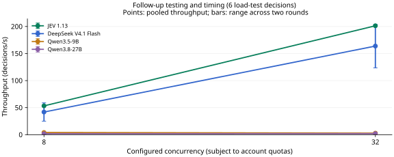

View both concurrency settings

**Table 22a | Follow-up testing and timing: up to 8 decisions per request, 6 load-test decisions, two rounds per setting.**

| Model | Configured concurrency | Throughput (decisions/s) ↑ | Full-response P95 (s) ↓ | Mean requests in flight |
| --- | ---: | ---: | ---: | ---: |
| JEV 1.13 | 8 | **53.25** | **1.538** | 8.00 |
| DeepSeek V4.1 Flash | 8 | 41.85 | 2.559 | 7.99 |
| Qwen3.5-9B | 8 | 4.05 | 3.424 | 1.09 |
| Qwen3.8-27B | 8 | 1.80 | — | 0.70 |
| JEV 1.13 | 32 | **201.30** | **1.563** | 31.98 |
| DeepSeek V4.1 Flash | 32 | 163.80 | 2.535 | 31.98 |
| Qwen3.5-9B | 32 | 2.85 | 20.984 | 2.07 |
| Qwen3.8-27B | 32 | 1.95 | — | 0.82 |

Configured concurrency is a worker limit; account quotas may reduce requests in flight. P95 excludes client-side quota waiting and is omitted when fewer than 20 complete responses are available.

[Task definition and data](docs/tasks/followup_plan.md) · [Evaluation methods](docs/MEDICAL_LOAD.md) · [Raw records and pricing](results/medical-load-jev-gateway-v1/README.md)

## Rehabilitation plan selection

**Table 23 | Rehabilitation plan selection: 4 unique decisions from 4 source groups; up to 8 decisions per request. Accuracy uses concurrency 8; load testing uses concurrency 32.**

| Model | Accuracy (%) ↑ | Throughput (decisions/s) ↑ | Full-response P95 (s) ↓ | Cost (CNY/1,000 decisions) ↓ |
| --- | ---: | ---: | ---: | ---: |
| JEV 1.13 | **100.00** | 127.50 | 1.673 | **0.100** |
| DeepSeek V4.1 Flash | **100.00** | **156.10** | **1.187** | 0.231–0.462 |
| Qwen3.5-9B | 50.00 | 3.30 | 2.197 | 0.132 |
| Qwen3.8-27B | 75.00 | 1.50 | — | 0.746 |

Accuracy and cost use all 4 fixed decisions. Throughput and P95 use a prespecified subset of 4 decisions, repeated over two sustained-load rounds. Repeated calls do not increase the unique sample count. P95 starts at HTTP dispatch, excludes quota waiting, and is omitted below 20 responses.

Limited sample coverage makes this an exploratory comparison; it cannot provide a robust estimate of clinical reliability.

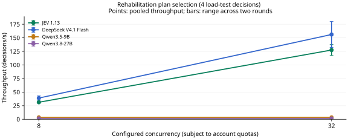

View both concurrency settings

**Table 23a | Rehabilitation plan selection: up to 8 decisions per request, 4 load-test decisions, two rounds per setting.**

| Model | Configured concurrency | Throughput (decisions/s) ↑ | Full-response P95 (s) ↓ | Mean requests in flight |
| --- | ---: | ---: | ---: | ---: |
| JEV 1.13 | 8 | 31.30 | 1.635 | 8.00 |
| DeepSeek V4.1 Flash | 8 | **39.00** | **1.150** | 7.99 |
| Qwen3.5-9B | 8 | 3.30 | 2.260 | 1.06 |
| Qwen3.8-27B | 8 | 1.50 | — | 1.84 |
| JEV 1.13 | 32 | 127.50 | 1.673 | 31.99 |
| DeepSeek V4.1 Flash | 32 | **156.10** | **1.187** | 31.98 |
| Qwen3.5-9B | 32 | 3.30 | 2.197 | 1.00 |
| Qwen3.8-27B | 32 | 1.50 | — | 2.08 |

Configured concurrency is a worker limit; account quotas may reduce requests in flight. P95 excludes client-side quota waiting and is omitted when fewer than 20 complete responses are available.

[Task definition and data](docs/tasks/rehabilitation_choice.md) · [Evaluation methods](docs/MEDICAL_LOAD.md) · [Raw records and pricing](results/medical-load-jev-gateway-v1/README.md)

## Preventive intervention selection

**Table 24 | Preventive intervention selection: 13 unique decisions from 13 source groups; up to 8 decisions per request. Accuracy uses concurrency 8; load testing uses concurrency 32.**

| Model | Accuracy (%) ↑ | Throughput (decisions/s) ↑ | Full-response P95 (s) ↓ | Cost (CNY/1,000 decisions) ↓ |
| --- | ---: | ---: | ---: | ---: |
| JEV 1.13 | **76.92** | 88.70 | 5.940 | **0.092** |
| DeepSeek V4.1 Flash | **76.92** | **163.95** | 2.995 | 0.224–0.447 |
| Qwen3.5-9B | 69.23 | 4.03 | **2.163** | 0.129 |
| Qwen3.8-27B | **76.92** | 0.97 | — | 0.724 |

Accuracy and cost use all 13 fixed decisions. Throughput and P95 use a prespecified subset of 13 decisions, repeated over two sustained-load rounds. Repeated calls do not increase the unique sample count. P95 starts at HTTP dispatch, excludes quota waiting, and is omitted below 20 responses.

Limited sample coverage makes this an exploratory comparison; it cannot provide a robust estimate of clinical reliability.

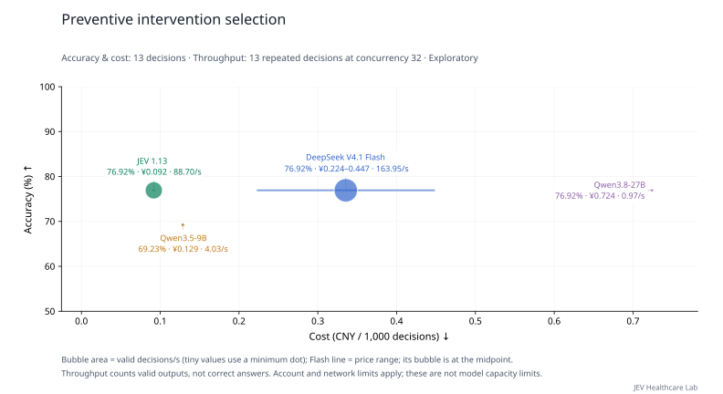

View both concurrency settings

**Table 24a | Preventive intervention selection: up to 8 decisions per request, 13 load-test decisions, two rounds per setting.**

| Model | Configured concurrency | Throughput (decisions/s) ↑ | Full-response P95 (s) ↓ | Mean requests in flight |
| --- | ---: | ---: | ---: | ---: |
| JEV 1.13 | 8 | 28.50 | 4.588 | 8.00 |
| DeepSeek V4.1 Flash | 8 | **53.10** | **1.482** | 7.99 |
| Qwen3.5-9B | 8 | 4.03 | 2.412 | 1.04 |
| Qwen3.8-27B | 8 | 0.97 | — | 2.71 |
| JEV 1.13 | 32 | 88.70 | 5.940 | 31.99 |
| DeepSeek V4.1 Flash | 32 | **163.95** | 2.995 | 31.98 |
| Qwen3.5-9B | 32 | 4.03 | **2.163** | 0.96 |
| Qwen3.8-27B | 32 | 0.97 | — | 1.97 |

Configured concurrency is a worker limit; account quotas may reduce requests in flight. P95 excludes client-side quota waiting and is omitted when fewer than 20 complete responses are available.

[Task definition and data](docs/tasks/prevention_choice.md) · [Evaluation methods](docs/MEDICAL_LOAD.md) · [Raw records and pricing](results/medical-load-jev-gateway-v1/README.md)

## Patient education and communication

**Table 25 | Patient education and communication: 11 unique decisions from 11 source groups; up to 8 decisions per request. Accuracy uses concurrency 8; load testing uses concurrency 32.**

| Model | Accuracy (%) ↑ | Throughput (decisions/s) ↑ | Full-response P95 (s) ↓ | Cost (CNY/1,000 decisions) ↓ |
| --- | ---: | ---: | ---: | ---: |
| JEV 1.13 | **90.91** | 173.38 | 1.678 | **0.100** |
| DeepSeek V4.1 Flash | **90.91** | **204.95** | **1.235** | 0.232–0.464 |
| Qwen3.5-9B | 81.82 | 3.38 | 2.043 | 0.132 |
| Qwen3.8-27B | **90.91** | 2.12 | — | 0.746 |

Accuracy and cost use all 11 fixed decisions. Throughput and P95 use a prespecified subset of 11 decisions, repeated over two sustained-load rounds. Repeated calls do not increase the unique sample count. P95 starts at HTTP dispatch, excludes quota waiting, and is omitted below 20 responses.

Limited sample coverage makes this an exploratory comparison; it cannot provide a robust estimate of clinical reliability.

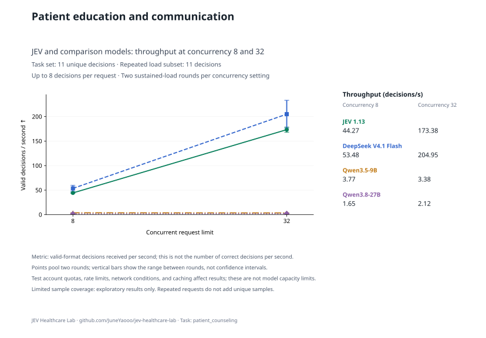

View both concurrency settings

**Table 25a | Patient education and communication: up to 8 decisions per request, 11 load-test decisions, two rounds per setting.**

| Model | Configured concurrency | Throughput (decisions/s) ↑ | Full-response P95 (s) ↓ | Mean requests in flight |
| --- | ---: | ---: | ---: | ---: |
| JEV 1.13 | 8 | 44.27 | 1.669 | 7.99 |
| DeepSeek V4.1 Flash | 8 | **53.48** | **1.086** | 7.99 |
| Qwen3.5-9B | 8 | 3.77 | 3.279 | 1.13 |
| Qwen3.8-27B | 8 | 1.65 | — | 1.25 |
| JEV 1.13 | 32 | 173.38 | 1.678 | 31.98 |
| DeepSeek V4.1 Flash | 32 | **204.95** | **1.235** | 31.98 |
| Qwen3.5-9B | 32 | 3.38 | 2.043 | 0.98 |
| Qwen3.8-27B | 32 | 2.12 | — | 0.81 |

Configured concurrency is a worker limit; account quotas may reduce requests in flight. P95 excludes client-side quota waiting and is omitted when fewer than 20 complete responses are available.

[Task definition and data](docs/tasks/patient_counseling.md) · [Evaluation methods](docs/MEDICAL_LOAD.md) · [Raw records and pricing](results/medical-load-jev-gateway-v1/README.md)

## Clinical trial prescreening and referral

**Table 26 | Clinical trial prescreening and referral: 100 unique decisions from 58 source groups; up to 8 decisions per request. Accuracy uses concurrency 8; load testing uses concurrency 32.**

| Model | Accuracy (%) ↑ | Macro-F1 (%) ↑ | Throughput (decisions/s) ↑ | Full-response P95 (s) ↓ | Cost (CNY/1,000 decisions) ↓ |
| --- | ---: | ---: | ---: | ---: | ---: |
| JEV 1.13 | 54.00 | 49.64 | **160.60** | **2.439** | **0.194** |
| DeepSeek V4.1 Flash | 58.00 | 55.23 | 76.00 | 7.781 | 0.605–1.211 |
| Qwen3.5-9B | 45.00 | 37.67 | 1.72 | — | 0.347 |
| Qwen3.8-27B | **60.00** | **57.91** | 0.57 | — | 1.929 |

Accuracy and cost use all 100 fixed decisions. Throughput and P95 use a prespecified subset of 32 decisions, repeated over two sustained-load rounds. Repeated calls do not increase the unique sample count. P95 starts at HTTP dispatch, excludes quota waiting, and is omitted below 20 responses.

Macro-F1 equally weights classes present in this task’s reference labels. Candidate classes without reference examples do not receive additional zero-score entries; all models use the same class set.

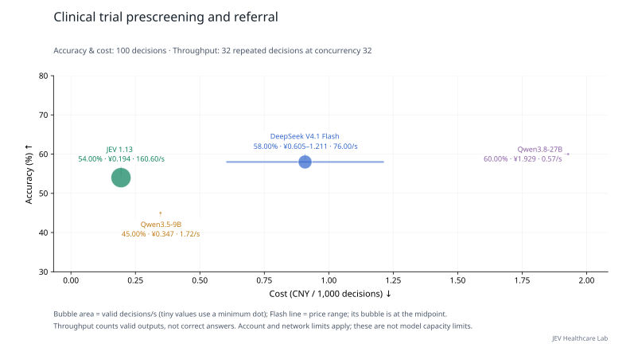

View both concurrency settings

**Table 26a | Clinical trial prescreening and referral: up to 8 decisions per request, 32 load-test decisions, two rounds per setting.**

| Model | Configured concurrency | Throughput (decisions/s) ↑ | Full-response P95 (s) ↓ | Mean requests in flight |
| --- | ---: | ---: | ---: | ---: |
| JEV 1.13 | 8 | **46.40** | **2.164** | 7.99 |
| DeepSeek V4.1 Flash | 8 | 39.20 | 3.585 | 8.00 |
| Qwen3.5-9B | 8 | 1.53 | — | 0.80 |
| Qwen3.8-27B | 8 | 0.86 | — | 0.70 |
| JEV 1.13 | 32 | **160.60** | **2.439** | 31.98 |
| DeepSeek V4.1 Flash | 32 | 76.00 | 7.781 | 31.99 |
| Qwen3.5-9B | 32 | 1.72 | — | 0.54 |
| Qwen3.8-27B | 32 | 0.57 | — | 0.90 |

Configured concurrency is a worker limit; account quotas may reduce requests in flight. P95 excludes client-side quota waiting and is omitted when fewer than 20 complete responses are available.

[Task definition and data](docs/tasks/trial_referral.md) · [Evaluation methods](docs/MEDICAL_LOAD.md) · [Raw records and pricing](results/medical-load-jev-gateway-v1/README.md)

## Multiple trial referrals for one patient

**Table 27 | Multiple trial referrals for one patient: 64 unique decisions from 8 source groups; up to 8 decisions per request. Accuracy uses concurrency 8; load testing uses concurrency 32.**

| Model | Accuracy (%) ↑ | Macro-F1 (%) ↑ | Throughput (decisions/s) ↑ | Full-response P95 (s) ↓ | Cost (CNY/1,000 decisions) ↓ |
| --- | ---: | ---: | ---: | ---: | ---: |
| JEV 1.13 | 67.19 | 47.74 | 205.60 | **1.938** | **0.165** |
| DeepSeek V4.1 Flash | **75.00** | **57.13** | **255.60** | 2.322 | 0.550–1.101 |
| Qwen3.5-9B | **75.00** | 51.47 | 1.74 | — | 0.297 |
| Qwen3.8-27B | 73.44 | 54.31 | 0.96 | — | 1.733 |

Accuracy and cost use all 64 fixed decisions. Throughput and P95 use a prespecified subset of 32 decisions, repeated over two sustained-load rounds. Repeated calls do not increase the unique sample count. P95 starts at HTTP dispatch, excludes quota waiting, and is omitted below 20 responses.

Limited sample coverage makes this an exploratory comparison; it cannot provide a robust estimate of clinical reliability.

Each of eight simulated patients is paired with eight registered trials. Patient context is sent once in a shared state, with one question per candidate trial. Reference labels are the upstream categories “irrelevant / potentially suitable / likely suitable for referral,” not expert assessments of individual eligibility criteria. This panel may overlap with the original trial referral set and is excluded from the overview chart.

The three reference classes contain 49, 9, and 6 items. Always predicting “irrelevant” yields 76.56% accuracy and 28.91% Macro-F1. Read accuracy alongside Macro-F1 to assess whether a model identifies the less common suitable referral cases.

Macro-F1 equally weights classes present in this task’s reference labels. Candidate classes without reference examples do not receive additional zero-score entries; all models use the same class set.

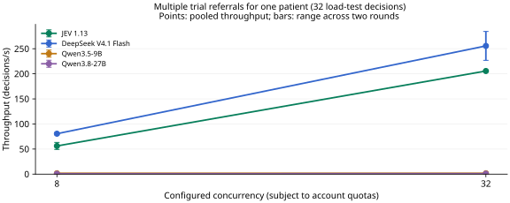

View both concurrency settings

**Table 27a | Multiple trial referrals for one patient: up to 8 decisions per request, 32 load-test decisions, two rounds per setting.**

| Model | Configured concurrency | Throughput (decisions/s) ↑ | Full-response P95 (s) ↓ | Mean requests in flight |
| --- | ---: | ---: | ---: | ---: |
| JEV 1.13 | 8 | 56.20 | 1.949 | 7.99 |
| DeepSeek V4.1 Flash | 8 | **80.60** | **1.231** | 7.99 |
| Qwen3.5-9B | 8 | 1.74 | — | 0.59 |
| Qwen3.8-27B | 8 | 0.78 | — | 0.51 |
| JEV 1.13 | 32 | 205.60 | **1.938** | 31.98 |
| DeepSeek V4.1 Flash | 32 | **255.60** | 2.322 | 31.96 |
| Qwen3.5-9B | 32 | 1.74 | — | 0.50 |
| Qwen3.8-27B | 32 | 0.96 | — | 0.40 |

Configured concurrency is a worker limit; account quotas may reduce requests in flight. P95 excludes client-side quota waiting and is omitted when fewer than 20 complete responses are available.

[Task definition and data](docs/tasks/trial_shared_patient.md) · [Evaluation methods](docs/MEDICAL_LOAD.md) · [Raw records and pricing](results/medical-load-jev-gateway-v1/README.md)

## Informed consent and privacy decisions

**Table 28 | Informed consent and privacy decisions: 3 unique decisions from 3 source groups; up to 8 decisions per request. Accuracy uses concurrency 8; load testing uses concurrency 32.**

| Model | Accuracy (%) ↑ | Throughput (decisions/s) ↑ | Full-response P95 (s) ↓ | Cost (CNY/1,000 decisions) ↓ |
| --- | ---: | ---: | ---: | ---: |
| JEV 1.13 | **100.00** | 73.58 | 2.601 | **0.098** |
| DeepSeek V4.1 Flash | **100.00** | **90.45** | **2.031** | 0.257–0.514 |
| Qwen3.5-9B | **100.00** | 2.77 | 2.618 | 0.143 |
| Qwen3.8-27B | **100.00** | 0.75 | — | 0.817 |

Accuracy and cost use all 3 fixed decisions. Throughput and P95 use a prespecified subset of 3 decisions, repeated over two sustained-load rounds. Repeated calls do not increase the unique sample count. P95 starts at HTTP dispatch, excludes quota waiting, and is omitted below 20 responses.

Limited sample coverage makes this an exploratory comparison; it cannot provide a robust estimate of clinical reliability.

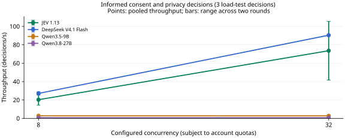

View both concurrency settings

**Table 28a | Informed consent and privacy decisions: up to 8 decisions per request, 3 load-test decisions, two rounds per setting.**

| Model | Configured concurrency | Throughput (decisions/s) ↑ | Full-response P95 (s) ↓ | Mean requests in flight |
| --- | ---: | ---: | ---: | ---: |
| JEV 1.13 | 8 | 20.32 | 2.492 | 8.00 |
| DeepSeek V4.1 Flash | 8 | **27.15** | 2.079 | 7.99 |
| Qwen3.5-9B | 8 | 2.85 | **1.363** | 0.93 |
| Qwen3.8-27B | 8 | 0.75 | — | 3.29 |
| JEV 1.13 | 32 | 73.58 | 2.601 | 31.99 |
| DeepSeek V4.1 Flash | 32 | **90.45** | **2.031** | 31.98 |
| Qwen3.5-9B | 32 | 2.77 | 2.618 | 1.09 |
| Qwen3.8-27B | 32 | 0.75 | — | 3.59 |

Configured concurrency is a worker limit; account quotas may reduce requests in flight. P95 excludes client-side quota waiting and is omitted when fewer than 20 complete responses are available.

[Task definition and data](docs/tasks/consent_action.md) · [Evaluation methods](docs/MEDICAL_LOAD.md) · [Raw records and pricing](results/medical-load-jev-gateway-v1/README.md)
