# JEV Healthcare Lab

**简体中文** | [English](README.en.md)

**评估 JEV 在医疗场景中的表现**：围绕分诊、诊断、用药、护理与临床试验筛选等具体任务，考察它的判断准确率、持续吞吐和使用成本，并与 DeepSeek Flash、Qwen 对照。

## 项目背景与目的

JEV 是 TypeSafe 推出的旗舰模型，官方将其定位为面向软件决策的 System One 模型：输入上下文（state）和类型化问题，直接返回程序可使用的结构化结果。其接口提供 Choice、Score、Noul 三类问题，并支持围绕同一份上下文并行处理多个独立判断。[官方介绍](https://docs.typesafe.ai/introduction)

医疗工作流包含许多范围明确的判断，例如识别就医紧急程度、判断方案禁忌、选择下一步检查，以及筛选患者可能适合的临床试验。这些任务为检验 JEV 的结构化决策能力提供了具体场景：输出能否直接被程序读取，以及判断本身是否正确，都需要通过医疗题目验证。

从接口设计和本次任务表现看，JEV 很适合高频、结构化、边界明确的决策场景：将上下文转为明确选项上的判断，再由程序组合成筛选、分流或审核流程。它在具体医疗任务上的适用程度，仍需结合各任务的准确率与错误类型判断。

本项目希望回答三个问题：JEV 在哪些医疗任务上表现较好，在哪些任务上仍有短板；多题处理与持续并发时，准确率、吞吐和成本如何取舍；同一患者材料供多个问题共享的处理方式，在医疗筛选任务中表现如何。为此，项目公开固定题集、数据来源、评分方法与原始结果，便于复算和比较。

当前评测聚焦有明确选项与标准答案的 Choice 任务；Score、Noul 和置信度校准尚未纳入验证。结果用于研究与原型选型，不构成临床有效性验证。

欢迎补充医疗场景、数据集或评测建议，也欢迎告诉我们你希望看到哪些场景。请在 [Issues](https://github.com/JuneYaooo/jev-healthcare-lab/issues) 中提出，项目会定期补充场景与评测结果。

## 评测结果

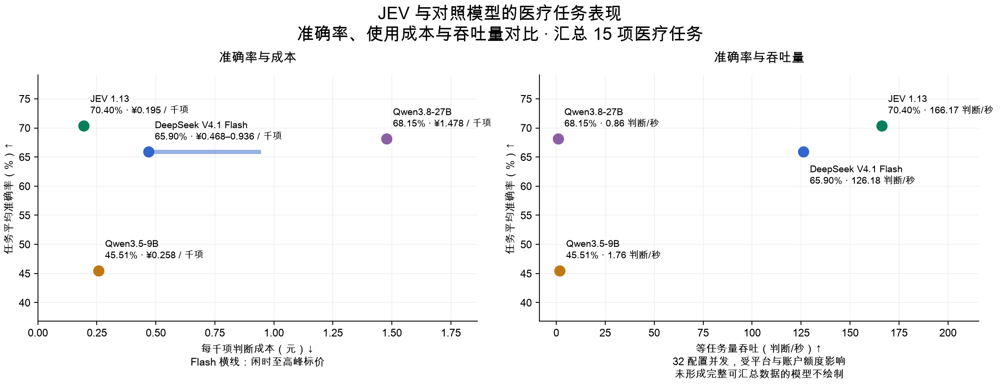

**汇总范围：26 项主评测任务中，15 项题量不少于 20，纳入本图；其余 11 项仅有 3–16 题，仍在下方完整结果表中展示。** 这一筛选用于减少小样本任务对任务平均结果的影响。新增的“同一患者多项试验筛选”单独展示，因可能与既有题集重合，不计入本图。

本轮覆盖 26 个既有医疗任务的 1,514 项判断，另加 8 位模拟患者的 64 项试验转介判断。数据包含考试病例、模拟患者与公开标注，尚非临床部署验证。

完整题集已完成的模型：JEV 1.13、DeepSeek V4.1 Flash、Qwen3.5-9B、Qwen3.8-27B。

三项任务体现出不同取舍（完整速度、成本及 Qwen 对比见表 1）：

- [患者方案禁忌判断](#patient_contraindication)：JEV 准确率 77.78%，Flash 为 62.96%；本次 JEV 的 32 并发吞吐更高。
- [用药方案选择](#medication_choice)：JEV 准确率 83.00%，Flash 为 62.00%；本次 JEV 的 32 并发吞吐更低。
- [中医证型判断](#tcm_syndrome)：JEV 准确率 28.00%，Flash 为 41.00%；本次 JEV 的 32 并发吞吐更高。

准确率按模型原样输出计分，非法选项也算错；它同时反映判断与输出可用性。吞吐表示每秒收到的合法判断数，**不等于每秒正确判断数**。成本按新病例、无缓存折扣的输入与输出用量折算，单位为人民币；Flash 区间对应闲时与高峰标价。

**测试账户限制：本次测试受账户额度、请求限流及共享服务条件影响，部分性能指标可能无法充分反映模型能力，尤其是响应速度和吞吐量。** 表中数值是当前测试条件下的观测结果，不代表模型的性能上限，模型间的速度差距也不能直接外推到其他部署条件。Qwen 本次账户上限分别为 8 万／4 万 token 每分钟；网络与供应商缓存也会影响结果。

**表 1｜医疗任务总览。准确率与成本来自完整题集的 8 并发多题测试；吞吐取预先指定的 32 并发档、两轮持续负载结果。点击任务进入详细结果。**

<table>
<thead><tr><th>医疗场景</th><th>具体任务</th><th>独立题量</th><th>模型</th><th>准确率 (%) ↑</th><th>吞吐量 (判断/秒) ↑</th><th>成本 (元/千项判断) ↓</th></tr></thead>
<tbody>
<tr><td rowspan="8">接诊与分诊</td><td rowspan="4"><a href="#triage_urgency">分诊与就医紧急程度判断</a></td><td rowspan="4" align="right">100</td><td>JEV 1.13</td><td align="right">66.00</td><td align="right"><strong>270.00</strong></td><td align="right"><strong>0.086</strong></td></tr>
<tr><td>DeepSeek V4.1 Flash</td><td align="right">58.00</td><td align="right">194.80</td><td align="right">0.308–0.615</td></tr>
<tr><td>Qwen3.5-9B</td><td align="right">54.00</td><td align="right">3.20</td><td align="right">0.175</td></tr>
<tr><td>Qwen3.8-27B</td><td align="right"><strong>69.00</strong></td><td align="right">0.60</td><td align="right">0.900</td></tr>
<tr><td rowspan="4"><a href="#message_urgency_pair">患者消息处理优先级</a></td><td rowspan="4" align="right">30</td><td>JEV 1.13</td><td align="right">66.67</td><td align="right">103.20</td><td align="right"><strong>0.326</strong></td></tr>
<tr><td>DeepSeek V4.1 Flash</td><td align="right"><strong>70.00</strong></td><td align="right"><strong>209.35</strong></td><td align="right">1.063–2.126</td></tr>
<tr><td>Qwen3.5-9B</td><td align="right">16.67</td><td align="right">0.42</td><td align="right">0.571</td></tr>
<tr><td>Qwen3.8-27B</td><td align="right">66.67</td><td align="right">0.54</td><td align="right">3.356</td></tr>
<tr><td rowspan="4">检查与检验</td><td rowspan="4"><a href="#examination_choice">检查方案选择</a></td><td rowspan="4" align="right">100</td><td>JEV 1.13</td><td align="right"><strong>86.00</strong></td><td align="right">260.80</td><td align="right"><strong>0.083</strong></td></tr>
<tr><td>DeepSeek V4.1 Flash</td><td align="right">81.00</td><td align="right"><strong>269.23</strong></td><td align="right">0.209–0.419</td></tr>
<tr><td>Qwen3.5-9B</td><td align="right">54.00</td><td align="right">3.83</td><td align="right">0.122</td></tr>
<tr><td>Qwen3.8-27B</td><td align="right">78.00</td><td align="right">2.00</td><td align="right">0.684</td></tr>
<tr><td rowspan="20">诊断与鉴别</td><td rowspan="4"><a href="#clinical_grade">疾病分期与严重程度判断</a></td><td rowspan="4" align="right">100</td><td>JEV 1.13</td><td align="right"><strong>53.00</strong></td><td align="right">103.60</td><td align="right"><strong>0.086</strong></td></tr>
<tr><td>DeepSeek V4.1 Flash</td><td align="right">51.00</td><td align="right"><strong>119.38</strong></td><td align="right">0.217–0.434</td></tr>
<tr><td>Qwen3.5-9B</td><td align="right">30.00</td><td align="right">3.85</td><td align="right">0.127</td></tr>
<tr><td>Qwen3.8-27B</td><td align="right">51.00</td><td align="right">0.80</td><td align="right">0.714</td></tr>
<tr><td rowspan="4"><a href="#diagnosis">病例诊断选择</a></td><td rowspan="4" align="right">200</td><td>JEV 1.13</td><td align="right"><strong>78.50</strong></td><td align="right"><strong>216.00</strong></td><td align="right"><strong>0.258</strong></td></tr>
<tr><td>DeepSeek V4.1 Flash</td><td align="right">75.00</td><td align="right">176.85</td><td align="right">0.538–1.076</td></tr>
<tr><td>Qwen3.5-9B</td><td align="right">58.00</td><td align="right">1.65</td><td align="right">0.300</td></tr>
<tr><td>Qwen3.8-27B</td><td align="right">78.00</td><td align="right">0.84</td><td align="right">1.744</td></tr>
<tr><td rowspan="4"><a href="#tcm_syndrome">中医证型判断</a></td><td rowspan="4" align="right">100</td><td>JEV 1.13</td><td align="right">28.00</td><td align="right"><strong>104.20</strong></td><td align="right">1.072</td></tr>
<tr><td>DeepSeek V4.1 Flash</td><td align="right"><strong>41.00</strong></td><td align="right">29.20</td><td align="right">2.029–4.057</td></tr>
<tr><td>Qwen3.5-9B</td><td align="right">27.00</td><td align="right">0.59</td><td align="right"><strong>1.042</strong></td></tr>
<tr><td>Qwen3.8-27B</td><td align="right">35.00</td><td align="right">0.27</td><td align="right">6.162</td></tr>
<tr><td rowspan="4"><a href="#case_etiology">病例病因判断</a></td><td rowspan="4" align="right">100</td><td>JEV 1.13</td><td align="right">80.00</td><td align="right">175.20</td><td align="right"><strong>0.091</strong></td></tr>
<tr><td>DeepSeek V4.1 Flash</td><td align="right">81.00</td><td align="right"><strong>236.40</strong></td><td align="right">0.220–0.439</td></tr>
<tr><td>Qwen3.5-9B</td><td align="right">56.00</td><td align="right">4.03</td><td align="right">0.128</td></tr>
<tr><td>Qwen3.8-27B</td><td align="right"><strong>82.00</strong></td><td align="right">1.00</td><td align="right">0.721</td></tr>
<tr><td rowspan="4"><a href="#tcm_pathogenesis_candidate">中医候选病机判断</a></td><td rowspan="4" align="right">100</td><td>JEV 1.13</td><td align="right">71.00</td><td align="right">134.40</td><td align="right"><strong>0.147</strong></td></tr>
<tr><td>DeepSeek V4.1 Flash</td><td align="right"><strong>78.00</strong></td><td align="right"><strong>155.00</strong></td><td align="right">0.359–0.719</td></tr>
<tr><td>Qwen3.5-9B</td><td align="right">59.00</td><td align="right">2.80</td><td align="right">0.196</td></tr>
<tr><td>Qwen3.8-27B</td><td align="right">70.00</td><td align="right">0.97</td><td align="right">1.131</td></tr>
<tr><td rowspan="24">治疗与用药</td><td rowspan="4"><a href="#patient_contraindication">患者方案禁忌判断</a></td><td rowspan="4" align="right">54</td><td>JEV 1.13</td><td align="right"><strong>77.78</strong></td><td align="right"><strong>260.20</strong></td><td align="right"><strong>0.086</strong></td></tr>
<tr><td>DeepSeek V4.1 Flash</td><td align="right">62.96</td><td align="right">82.47</td><td align="right">0.211–0.422</td></tr>
<tr><td>Qwen3.5-9B</td><td align="right">38.89</td><td align="right">3.35</td><td align="right">0.123</td></tr>
<tr><td>Qwen3.8-27B</td><td align="right">64.81</td><td align="right">1.60</td><td align="right">0.694</td></tr>
<tr><td rowspan="4"><a href="#treatment_choice">治疗方案选择</a></td><td rowspan="4" align="right">100</td><td>JEV 1.13</td><td align="right"><strong>78.00</strong></td><td align="right"><strong>254.60</strong></td><td align="right"><strong>0.086</strong></td></tr>
<tr><td>DeepSeek V4.1 Flash</td><td align="right">73.00</td><td align="right">178.57</td><td align="right">0.214–0.428</td></tr>
<tr><td>Qwen3.5-9B</td><td align="right">57.00</td><td align="right">4.40</td><td align="right">0.126</td></tr>
<tr><td>Qwen3.8-27B</td><td align="right">72.00</td><td align="right">2.00</td><td align="right">0.704</td></tr>
<tr><td rowspan="4"><a href="#medication_choice">用药方案选择</a></td><td rowspan="4" align="right">100</td><td>JEV 1.13</td><td align="right"><strong>83.00</strong></td><td align="right">184.80</td><td align="right"><strong>0.086</strong></td></tr>
<tr><td>DeepSeek V4.1 Flash</td><td align="right">62.00</td><td align="right"><strong>271.43</strong></td><td align="right">0.218–0.436</td></tr>
<tr><td>Qwen3.5-9B</td><td align="right">43.00</td><td align="right">3.98</td><td align="right">0.128</td></tr>
<tr><td>Qwen3.8-27B</td><td align="right">64.00</td><td align="right">1.80</td><td align="right">0.718</td></tr>
<tr><td rowspan="4"><a href="#fluid_plan">补液方案选择</a></td><td rowspan="4" align="right">16</td><td>JEV 1.13</td><td align="right"><strong>62.50</strong></td><td align="right"><strong>244.60</strong></td><td align="right"><strong>0.096</strong></td></tr>
<tr><td>DeepSeek V4.1 Flash</td><td align="right">43.75</td><td align="right">193.07</td><td align="right">0.237–0.475</td></tr>
<tr><td>Qwen3.5-9B</td><td align="right">31.25</td><td align="right">3.70</td><td align="right">0.144</td></tr>
<tr><td>Qwen3.8-27B</td><td align="right"><strong>62.50</strong></td><td align="right">1.80</td><td align="right">0.812</td></tr>
<tr><td rowspan="4"><a href="#pgx_guideline_recommendation">药物基因结果对应的指南建议选择</a></td><td rowspan="4" align="right">100</td><td>JEV 1.13</td><td align="right">56.00</td><td align="right">155.40</td><td align="right"><strong>0.139</strong></td></tr>
<tr><td>DeepSeek V4.1 Flash</td><td align="right">53.00</td><td align="right"><strong>323.40</strong></td><td align="right">0.407–0.814</td></tr>
<tr><td>Qwen3.5-9B</td><td align="right">34.00</td><td align="right">1.80</td><td align="right">0.230</td></tr>
<tr><td>Qwen3.8-27B</td><td align="right"><strong>62.00</strong></td><td align="right">1.14</td><td align="right">1.311</td></tr>
<tr><td rowspan="4"><a href="#administration_route_choice">给药途径与实施方法选择</a></td><td rowspan="4" align="right">4</td><td>JEV 1.13</td><td align="right"><strong>100.00</strong></td><td align="right">129.80</td><td align="right"><strong>0.093</strong></td></tr>
<tr><td>DeepSeek V4.1 Flash</td><td align="right">75.00</td><td align="right"><strong>164.90</strong></td><td align="right">0.229–0.457</td></tr>
<tr><td>Qwen3.5-9B</td><td align="right">50.00</td><td align="right">3.30</td><td align="right">0.132</td></tr>
<tr><td>Qwen3.8-27B</td><td align="right">50.00</td><td align="right">1.30</td><td align="right">0.749</td></tr>
<tr><td rowspan="24">住院与护理</td><td rowspan="4"><a href="#case_complication">病例并发症判断</a></td><td rowspan="4" align="right">100</td><td>JEV 1.13</td><td align="right"><strong>90.00</strong></td><td align="right">188.60</td><td align="right"><strong>0.089</strong></td></tr>
<tr><td>DeepSeek V4.1 Flash</td><td align="right">66.00</td><td align="right"><strong>214.32</strong></td><td align="right">0.215–0.429</td></tr>
<tr><td>Qwen3.5-9B</td><td align="right">53.00</td><td align="right">3.55</td><td align="right">0.126</td></tr>
<tr><td>Qwen3.8-27B</td><td align="right">84.00</td><td align="right">2.20</td><td align="right">0.707</td></tr>
<tr><td rowspan="4"><a href="#nursing_priority">护理措施选择</a></td><td rowspan="4" align="right">42</td><td>JEV 1.13</td><td align="right"><strong>88.10</strong></td><td align="right">205.40</td><td align="right"><strong>0.090</strong></td></tr>
<tr><td>DeepSeek V4.1 Flash</td><td align="right">78.57</td><td align="right"><strong>252.00</strong></td><td align="right">0.211–0.422</td></tr>
<tr><td>Qwen3.5-9B</td><td align="right">57.14</td><td align="right">4.80</td><td align="right">0.123</td></tr>
<tr><td>Qwen3.8-27B</td><td align="right">85.71</td><td align="right">2.20</td><td align="right">0.689</td></tr>
<tr><td rowspan="4"><a href="#nutrition_plan">营养与饮食方案选择</a></td><td rowspan="4" align="right">11</td><td>JEV 1.13</td><td align="right"><strong>63.64</strong></td><td align="right">100.28</td><td align="right"><strong>0.097</strong></td></tr>
<tr><td>DeepSeek V4.1 Flash</td><td align="right"><strong>63.64</strong></td><td align="right"><strong>173.60</strong></td><td align="right">0.232–0.464</td></tr>
<tr><td>Qwen3.5-9B</td><td align="right">27.27</td><td align="right">3.70</td><td align="right">0.135</td></tr>
<tr><td>Qwen3.8-27B</td><td align="right"><strong>63.64</strong></td><td align="right">1.65</td><td align="right">0.763</td></tr>
<tr><td rowspan="4"><a href="#positioning_choice">护理与操作体位选择</a></td><td rowspan="4" align="right">10</td><td>JEV 1.13</td><td align="right"><strong>100.00</strong></td><td align="right"><strong>178.65</strong></td><td align="right"><strong>0.084</strong></td></tr>
<tr><td>DeepSeek V4.1 Flash</td><td align="right">70.00</td><td align="right">174.90</td><td align="right">0.206–0.413</td></tr>
<tr><td>Qwen3.5-9B</td><td align="right">30.00</td><td align="right">3.33</td><td align="right">0.126</td></tr>
<tr><td>Qwen3.8-27B</td><td align="right">60.00</td><td align="right">1.80</td><td align="right">0.706</td></tr>
<tr><td rowspan="4"><a href="#monitoring_target">病情监测与疗效判断</a></td><td rowspan="4" align="right">5</td><td>JEV 1.13</td><td align="right">80.00</td><td align="right">72.38</td><td align="right"><strong>0.086</strong></td></tr>
<tr><td>DeepSeek V4.1 Flash</td><td align="right"><strong>100.00</strong></td><td align="right"><strong>161.75</strong></td><td align="right">0.208–0.416</td></tr>
<tr><td>Qwen3.5-9B</td><td align="right">40.00</td><td align="right">3.62</td><td align="right">0.122</td></tr>
<tr><td>Qwen3.8-27B</td><td align="right">80.00</td><td align="right">1.50</td><td align="right">0.686</td></tr>
<tr><td rowspan="4"><a href="#infection_precaution">感染防控措施选择</a></td><td rowspan="4" align="right">5</td><td>JEV 1.13</td><td align="right"><strong>100.00</strong></td><td align="right"><strong>162.38</strong></td><td align="right"><strong>0.095</strong></td></tr>
<tr><td>DeepSeek V4.1 Flash</td><td align="right"><strong>100.00</strong></td><td align="right">150.00</td><td align="right">0.231–0.462</td></tr>
<tr><td>Qwen3.5-9B</td><td align="right">40.00</td><td align="right">2.90</td><td align="right">0.132</td></tr>
<tr><td>Qwen3.8-27B</td><td align="right">80.00</td><td align="right">1.88</td><td align="right">0.746</td></tr>
<tr><td rowspan="16">出院与随访</td><td rowspan="4"><a href="#followup_plan">复查项目与随访时机选择</a></td><td rowspan="4" align="right">6</td><td>JEV 1.13</td><td align="right"><strong>83.33</strong></td><td align="right"><strong>201.30</strong></td><td align="right"><strong>0.086</strong></td></tr>
<tr><td>DeepSeek V4.1 Flash</td><td align="right">50.00</td><td align="right">163.80</td><td align="right">0.222–0.444</td></tr>
<tr><td>Qwen3.5-9B</td><td align="right">66.67</td><td align="right">2.85</td><td align="right">0.129</td></tr>
<tr><td>Qwen3.8-27B</td><td align="right">66.67</td><td align="right">1.95</td><td align="right">0.727</td></tr>
<tr><td rowspan="4"><a href="#rehabilitation_choice">康复训练方案选择</a></td><td rowspan="4" align="right">4</td><td>JEV 1.13</td><td align="right"><strong>100.00</strong></td><td align="right">127.50</td><td align="right"><strong>0.100</strong></td></tr>
<tr><td>DeepSeek V4.1 Flash</td><td align="right"><strong>100.00</strong></td><td align="right"><strong>156.10</strong></td><td align="right">0.231–0.462</td></tr>
<tr><td>Qwen3.5-9B</td><td align="right">50.00</td><td align="right">3.30</td><td align="right">0.132</td></tr>
<tr><td>Qwen3.8-27B</td><td align="right">75.00</td><td align="right">1.50</td><td align="right">0.746</td></tr>
<tr><td rowspan="4"><a href="#prevention_choice">预防措施选择</a></td><td rowspan="4" align="right">13</td><td>JEV 1.13</td><td align="right"><strong>76.92</strong></td><td align="right">88.70</td><td align="right"><strong>0.092</strong></td></tr>
<tr><td>DeepSeek V4.1 Flash</td><td align="right"><strong>76.92</strong></td><td align="right"><strong>163.95</strong></td><td align="right">0.224–0.447</td></tr>
<tr><td>Qwen3.5-9B</td><td align="right">69.23</td><td align="right">4.03</td><td align="right">0.129</td></tr>
<tr><td>Qwen3.8-27B</td><td align="right"><strong>76.92</strong></td><td align="right">0.97</td><td align="right">0.724</td></tr>
<tr><td rowspan="4"><a href="#patient_counseling">健康教育与沟通行动选择</a></td><td rowspan="4" align="right">11</td><td>JEV 1.13</td><td align="right"><strong>90.91</strong></td><td align="right">173.38</td><td align="right"><strong>0.100</strong></td></tr>
<tr><td>DeepSeek V4.1 Flash</td><td align="right"><strong>90.91</strong></td><td align="right"><strong>204.95</strong></td><td align="right">0.232–0.464</td></tr>
<tr><td>Qwen3.5-9B</td><td align="right">81.82</td><td align="right">3.38</td><td align="right">0.132</td></tr>
<tr><td>Qwen3.8-27B</td><td align="right"><strong>90.91</strong></td><td align="right">2.12</td><td align="right">0.746</td></tr>
<tr><td rowspan="8">临床试验筛选</td><td rowspan="4"><a href="#trial_referral">患者临床试验初筛与转介判断</a></td><td rowspan="4" align="right">100</td><td>JEV 1.13</td><td align="right">54.00</td><td align="right"><strong>160.60</strong></td><td align="right"><strong>0.194</strong></td></tr>
<tr><td>DeepSeek V4.1 Flash</td><td align="right">58.00</td><td align="right">76.00</td><td align="right">0.605–1.211</td></tr>
<tr><td>Qwen3.5-9B</td><td align="right">45.00</td><td align="right">1.72</td><td align="right">0.347</td></tr>
<tr><td>Qwen3.8-27B</td><td align="right"><strong>60.00</strong></td><td align="right">0.57</td><td align="right">1.929</td></tr>
<tr><td rowspan="4"><a href="#trial_shared_patient">同一患者的多项试验转介筛选</a></td><td rowspan="4" align="right">64</td><td>JEV 1.13</td><td align="right">67.19</td><td align="right">205.60</td><td align="right"><strong>0.165</strong></td></tr>
<tr><td>DeepSeek V4.1 Flash</td><td align="right"><strong>75.00</strong></td><td align="right"><strong>255.60</strong></td><td align="right">0.550–1.101</td></tr>
<tr><td>Qwen3.5-9B</td><td align="right"><strong>75.00</strong></td><td align="right">1.74</td><td align="right">0.297</td></tr>
<tr><td>Qwen3.8-27B</td><td align="right">73.44</td><td align="right">0.96</td><td align="right">1.733</td></tr>
<tr><td rowspan="4">病历与医疗质量控制</td><td rowspan="4"><a href="#consent_action">知情同意与隐私处置选择</a></td><td rowspan="4" align="right">3</td><td>JEV 1.13</td><td align="right"><strong>100.00</strong></td><td align="right">73.58</td><td align="right"><strong>0.098</strong></td></tr>
<tr><td>DeepSeek V4.1 Flash</td><td align="right"><strong>100.00</strong></td><td align="right"><strong>90.45</strong></td><td align="right">0.257–0.514</td></tr>
<tr><td>Qwen3.5-9B</td><td align="right"><strong>100.00</strong></td><td align="right">2.77</td><td align="right">0.143</td></tr>
<tr><td>Qwen3.8-27B</td><td align="right"><strong>100.00</strong></td><td align="right">0.75</td><td align="right">0.817</td></tr>
</tbody>
</table>

粗体表示同一任务、同一并发档内已测模型的最优观测值，并列最优均加粗；不表示统计显著性。成本区间重叠、无法确定最低者时不加粗。

“—”表示本轮未获得完整数据或样本不足。独立题量指不重复的判断项，不表示统计独立，也不等于独立患者数；患者／来源组数见每个任务表题。少于 20 题仅作探索性比较。三个空任务（剂量适宜性、危急值升级、就诊科室分流）暂不计分。

[评估方法与适用边界](docs/MEDICAL_LOAD.md) · [数据集与许可](docs/datasets/README.md) · [原始响应与复算](results/medical-load-jev-gateway-v1/README.md)

## 分诊与就医紧急程度判断

**表 2｜分诊与就医紧急程度判断：100 项独立判断，62 个来源组；每请求最多 8 项。准确率测试配置 8 并发，负载测试配置 32 并发。**

| 模型 | 准确率 (%) ↑ | Macro-F1 (%) ↑ | 吞吐量 (判断/秒) ↑ | 完整响应 P95 (秒) ↓ | 成本 (元/千项判断) ↓ |
| --- | ---: | ---: | ---: | ---: | ---: |
| JEV 1.13 | 66.00 | 62.84 | **270.00** | **1.559** | **0.086** |
| DeepSeek V4.1 Flash | 58.00 | 54.61 | 194.80 | 2.406 | 0.308–0.615 |
| Qwen3.5-9B | 54.00 | 54.82 | 3.20 | — | 0.175 |
| Qwen3.8-27B | **69.00** | **68.99** | 0.60 | — | 0.900 |

准确率和成本来自完整的 100 项固定题集；吞吐与 P95 来自其中预先选定的 32 项判断，持续循环施压两轮。重复调用不增加独立题量。P95 从实际发出计时，不含额度排队；不足 20 个响应时留空。

Macro-F1 对本任务金标中出现的类别等权平均；没有金标样本的候选类别不另加零分项，各模型使用相同类别集合。

查看本任务的两个并发档

**表 2a｜分诊与就医紧急程度判断：每请求最多 8 项，负载题集 32 项，各档两轮。**

| 模型 | 配置并发 | 吞吐量 (判断/秒) ↑ | 完整响应 P95 (秒) ↓ | 实际平均同时请求数 |
| --- | ---: | ---: | ---: | ---: |
| JEV 1.13 | 8 | **69.00** | **1.557** | 7.99 |
| DeepSeek V4.1 Flash | 8 | 47.40 | 2.332 | 8.00 |
| Qwen3.5-9B | 8 | 3.40 | — | 1.91 |
| Qwen3.8-27B | 8 | 1.40 | — | 1.32 |
| JEV 1.13 | 32 | **270.00** | **1.559** | 31.98 |
| DeepSeek V4.1 Flash | 32 | 194.80 | 2.406 | 31.98 |
| Qwen3.5-9B | 32 | 3.20 | — | 1.67 |
| Qwen3.8-27B | 32 | 0.60 | — | 2.05 |

配置并发是工作器上限；实际在途请求可能因账户额度更少。P95 不含客户端额度等待；不足 20 个完整响应时不报告 P95。

[任务定义与数据](docs/tasks/triage_urgency.md) · [评估方法](docs/MEDICAL_LOAD.md) · [原始记录与计价依据](results/medical-load-jev-gateway-v1/README.md)

## 患者消息处理优先级

**表 3｜患者消息处理优先级：30 项独立判断，30 个来源组；每请求最多 8 项。准确率测试配置 8 并发，负载测试配置 32 并发。**

| 模型 | 准确率 (%) ↑ | 吞吐量 (判断/秒) ↑ | 完整响应 P95 (秒) ↓ | 成本 (元/千项判断) ↓ |
| --- | ---: | ---: | ---: | ---: |
| JEV 1.13 | 66.67 | 103.20 | 7.580 | **0.326** |
| DeepSeek V4.1 Flash | **70.00** | **209.35** | **2.736** | 1.063–2.126 |
| Qwen3.5-9B | 16.67 | 0.42 | — | 0.571 |
| Qwen3.8-27B | 66.67 | 0.54 | — | 3.356 |

准确率和成本来自完整的 30 项固定题集；吞吐与 P95 来自其中预先选定的 30 项判断，持续循环施压两轮。重复调用不增加独立题量。P95 从实际发出计时，不含额度排队；不足 20 个响应时留空。

本任务严格区分原始选项键，例如 `Patient #1` 不能改写成 `Patient_1`。这类输出合约错误也按错计，因此成绩同时反映判断和接口可直接使用的程度，不能全部归因于医学推理差异。

查看本任务的两个并发档

**表 3a｜患者消息处理优先级：每请求最多 8 项，负载题集 30 项，各档两轮。**

| 模型 | 配置并发 | 吞吐量 (判断/秒) ↑ | 完整响应 P95 (秒) ↓ | 实际平均同时请求数 |
| --- | ---: | ---: | ---: | ---: |
| JEV 1.13 | 8 | 10.75 | 18.868 | 8.00 |
| DeepSeek V4.1 Flash | 8 | **46.60** | **3.671** | 7.99 |
| Qwen3.5-9B | 8 | 0.31 | — | 0.37 |
| Qwen3.8-27B | 8 | 0.48 | — | 0.68 |
| JEV 1.13 | 32 | 103.20 | 7.580 | 31.99 |
| DeepSeek V4.1 Flash | 32 | **209.35** | **2.736** | 31.96 |
| Qwen3.5-9B | 32 | 0.42 | — | 0.33 |
| Qwen3.8-27B | 32 | 0.54 | — | 0.33 |

配置并发是工作器上限；实际在途请求可能因账户额度更少。P95 不含客户端额度等待；不足 20 个完整响应时不报告 P95。

[任务定义与数据](docs/tasks/message_urgency_pair.md) · [评估方法](docs/MEDICAL_LOAD.md) · [原始记录与计价依据](results/medical-load-jev-gateway-v1/README.md)

## 检查方案选择

**表 4｜检查方案选择：100 项独立判断，100 个来源组；每请求最多 8 项。准确率测试配置 8 并发，负载测试配置 32 并发。**

| 模型 | 准确率 (%) ↑ | 吞吐量 (判断/秒) ↑ | 完整响应 P95 (秒) ↓ | 成本 (元/千项判断) ↓ |
| --- | ---: | ---: | ---: | ---: |
| JEV 1.13 | **86.00** | 260.80 | **1.578** | **0.083** |
| DeepSeek V4.1 Flash | 81.00 | **269.23** | 1.635 | 0.209–0.419 |
| Qwen3.5-9B | 54.00 | 3.83 | 2.779 | 0.122 |
| Qwen3.8-27B | 78.00 | 2.00 | — | 0.684 |

准确率和成本来自完整的 100 项固定题集；吞吐与 P95 来自其中预先选定的 32 项判断，持续循环施压两轮。重复调用不增加独立题量。P95 从实际发出计时，不含额度排队；不足 20 个响应时留空。

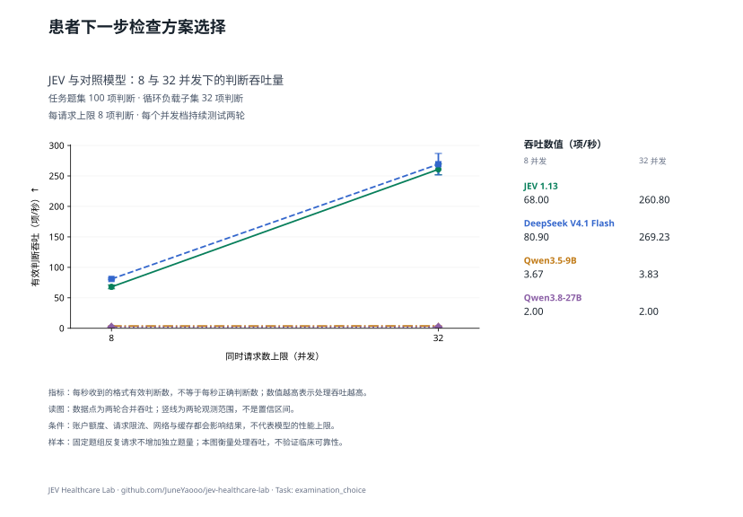

查看本任务的两个并发档

**表 4a｜检查方案选择：每请求最多 8 项，负载题集 32 项，各档两轮。**

| 模型 | 配置并发 | 吞吐量 (判断/秒) ↑ | 完整响应 P95 (秒) ↓ | 实际平均同时请求数 |
| --- | ---: | ---: | ---: | ---: |
| JEV 1.13 | 8 | 68.00 | 1.537 | 7.99 |
| DeepSeek V4.1 Flash | 8 | **80.90** | **1.271** | 7.99 |
| Qwen3.5-9B | 8 | 3.67 | 2.493 | 1.00 |
| Qwen3.8-27B | 8 | 2.00 | — | 0.72 |
| JEV 1.13 | 32 | 260.80 | **1.578** | 31.98 |
| DeepSeek V4.1 Flash | 32 | **269.23** | 1.635 | 31.98 |
| Qwen3.5-9B | 32 | 3.83 | 2.779 | 1.08 |
| Qwen3.8-27B | 32 | 2.00 | — | 0.70 |

配置并发是工作器上限；实际在途请求可能因账户额度更少。P95 不含客户端额度等待；不足 20 个完整响应时不报告 P95。

[任务定义与数据](docs/tasks/examination_choice.md) · [评估方法](docs/MEDICAL_LOAD.md) · [原始记录与计价依据](results/medical-load-jev-gateway-v1/README.md)

## 疾病分期与严重程度判断

**表 5｜疾病分期与严重程度判断：100 项独立判断，99 个来源组；每请求最多 8 项。准确率测试配置 8 并发，负载测试配置 32 并发。**

| 模型 | 准确率 (%) ↑ | 吞吐量 (判断/秒) ↑ | 完整响应 P95 (秒) ↓ | 成本 (元/千项判断) ↓ |
| --- | ---: | ---: | ---: | ---: |
| JEV 1.13 | **53.00** | 103.60 | 6.026 | **0.086** |
| DeepSeek V4.1 Flash | 51.00 | **119.38** | 5.390 | 0.217–0.434 |
| Qwen3.5-9B | 30.00 | 3.85 | **2.572** | 0.127 |
| Qwen3.8-27B | 51.00 | 0.80 | — | 0.714 |

准确率和成本来自完整的 100 项固定题集；吞吐与 P95 来自其中预先选定的 32 项判断，持续循环施压两轮。重复调用不增加独立题量。P95 从实际发出计时，不含额度排队；不足 20 个响应时留空。

查看本任务的两个并发档

**表 5a｜疾病分期与严重程度判断：每请求最多 8 项，负载题集 32 项，各档两轮。**

| 模型 | 配置并发 | 吞吐量 (判断/秒) ↑ | 完整响应 P95 (秒) ↓ | 实际平均同时请求数 |
| --- | ---: | ---: | ---: | ---: |
| JEV 1.13 | 8 | 35.80 | 3.893 | 8.00 |
| DeepSeek V4.1 Flash | 8 | **61.60** | **1.810** | 7.99 |
| Qwen3.5-9B | 8 | 3.85 | 3.322 | 1.03 |
| Qwen3.8-27B | 8 | 0.80 | — | 2.55 |
| JEV 1.13 | 32 | 103.60 | 6.026 | 31.99 |
| DeepSeek V4.1 Flash | 32 | **119.38** | 5.390 | 31.99 |
| Qwen3.5-9B | 32 | 3.85 | **2.572** | 1.01 |
| Qwen3.8-27B | 32 | 0.80 | — | 1.88 |

配置并发是工作器上限；实际在途请求可能因账户额度更少。P95 不含客户端额度等待；不足 20 个完整响应时不报告 P95。

[任务定义与数据](docs/tasks/clinical_grade.md) · [评估方法](docs/MEDICAL_LOAD.md) · [原始记录与计价依据](results/medical-load-jev-gateway-v1/README.md)

## 病例诊断选择

**表 6｜病例诊断选择：200 项独立判断，200 个来源组；每请求最多 8 项。准确率测试配置 8 并发，负载测试配置 32 并发。**

| 模型 | 准确率 (%) ↑ | 吞吐量 (判断/秒) ↑ | 完整响应 P95 (秒) ↓ | 成本 (元/千项判断) ↓ |
| --- | ---: | ---: | ---: | ---: |
| JEV 1.13 | **78.50** | **216.00** | **1.961** | **0.258** |
| DeepSeek V4.1 Flash | 75.00 | 176.85 | 4.117 | 0.538–1.076 |
| Qwen3.5-9B | 58.00 | 1.65 | — | 0.300 |
| Qwen3.8-27B | 78.00 | 0.84 | — | 1.744 |

准确率和成本来自完整的 200 项固定题集；吞吐与 P95 来自其中预先选定的 32 项判断，持续循环施压两轮。重复调用不增加独立题量。P95 从实际发出计时，不含额度排队；不足 20 个响应时留空。

查看本任务的两个并发档

**表 6a｜病例诊断选择：每请求最多 8 项，负载题集 32 项，各档两轮。**

| 模型 | 配置并发 | 吞吐量 (判断/秒) ↑ | 完整响应 P95 (秒) ↓ | 实际平均同时请求数 |
| --- | ---: | ---: | ---: | ---: |
| JEV 1.13 | 8 | **51.20** | **2.002** | 7.99 |
| DeepSeek V4.1 Flash | 8 | 32.10 | 4.716 | 7.99 |
| Qwen3.5-9B | 8 | 1.90 | — | 0.64 |
| Qwen3.8-27B | 8 | 0.96 | — | 0.55 |
| JEV 1.13 | 32 | **216.00** | **1.961** | 31.97 |
| DeepSeek V4.1 Flash | 32 | 176.85 | 4.117 | 31.97 |
| Qwen3.5-9B | 32 | 1.65 | — | 0.67 |
| Qwen3.8-27B | 32 | 0.84 | — | 0.29 |

配置并发是工作器上限；实际在途请求可能因账户额度更少。P95 不含客户端额度等待；不足 20 个完整响应时不报告 P95。

[任务定义与数据](docs/tasks/diagnosis.md) · [评估方法](docs/MEDICAL_LOAD.md) · [原始记录与计价依据](results/medical-load-jev-gateway-v1/README.md)

## 中医证型判断

**表 7｜中医证型判断：100 项独立判断，100 个来源组；每请求最多 8 项。准确率测试配置 8 并发，负载测试配置 32 并发。**

| 模型 | 准确率 (%) ↑ | Macro-F1 (%) ↑ | 吞吐量 (判断/秒) ↑ | 完整响应 P95 (秒) ↓ | 成本 (元/千项判断) ↓ |
| --- | ---: | ---: | ---: | ---: | ---: |
| JEV 1.13 | 28.00 | 19.20 | **104.20** | **3.614** | 1.072 |
| DeepSeek V4.1 Flash | **41.00** | **25.91** | 29.20 | 14.079 | 2.029–4.057 |
| Qwen3.5-9B | 27.00 | 15.23 | 0.59 | — | **1.042** |
| Qwen3.8-27B | 35.00 | 19.68 | 0.27 | — | 6.162 |

准确率和成本来自完整的 100 项固定题集；吞吐与 P95 来自其中预先选定的 32 项判断，持续循环施压两轮。重复调用不增加独立题量。P95 从实际发出计时，不含额度排队；不足 20 个响应时留空。

Macro-F1 对本任务金标中出现的类别等权平均；没有金标样本的候选类别不另加零分项，各模型使用相同类别集合。

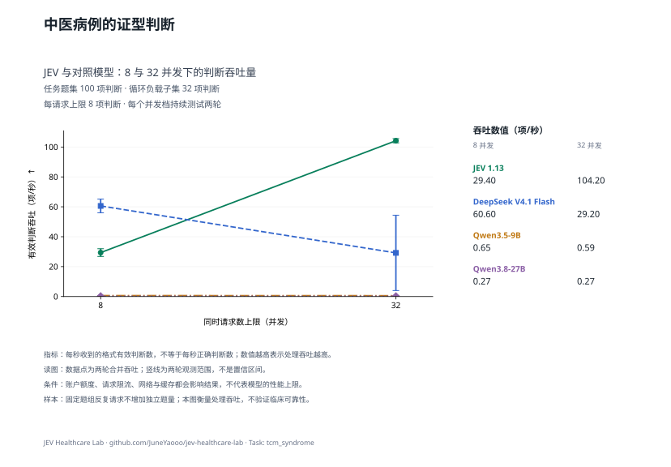

查看本任务的两个并发档

**表 7a｜中医证型判断：每请求最多 8 项，负载题集 32 项，各档两轮。**

| 模型 | 配置并发 | 吞吐量 (判断/秒) ↑ | 完整响应 P95 (秒) ↓ | 实际平均同时请求数 |
| --- | ---: | ---: | ---: | ---: |
| JEV 1.13 | 8 | 29.40 | 3.330 | 7.99 |
| DeepSeek V4.1 Flash | 8 | **60.60** | **1.407** | 7.99 |
| Qwen3.5-9B | 8 | 0.65 | — | 0.29 |
| Qwen3.8-27B | 8 | 0.27 | — | 0.20 |
| JEV 1.13 | 32 | **104.20** | **3.614** | 31.97 |
| DeepSeek V4.1 Flash | 32 | 29.20 | 14.079 | 31.99 |
| Qwen3.5-9B | 32 | 0.59 | — | 0.25 |
| Qwen3.8-27B | 32 | 0.27 | — | 0.22 |

配置并发是工作器上限；实际在途请求可能因账户额度更少。P95 不含客户端额度等待；不足 20 个完整响应时不报告 P95。

[任务定义与数据](docs/tasks/tcm_syndrome.md) · [评估方法](docs/MEDICAL_LOAD.md) · [原始记录与计价依据](results/medical-load-jev-gateway-v1/README.md)

## 病例病因判断

**表 8｜病例病因判断：100 项独立判断，100 个来源组；每请求最多 8 项。准确率测试配置 8 并发，负载测试配置 32 并发。**

| 模型 | 准确率 (%) ↑ | 吞吐量 (判断/秒) ↑ | 完整响应 P95 (秒) ↓ | 成本 (元/千项判断) ↓ |
| --- | ---: | ---: | ---: | ---: |
| JEV 1.13 | 80.00 | 175.20 | 2.931 | **0.091** |
| DeepSeek V4.1 Flash | 81.00 | **236.40** | **1.466** | 0.220–0.439 |
| Qwen3.5-9B | 56.00 | 4.03 | 2.108 | 0.128 |
| Qwen3.8-27B | **82.00** | 1.00 | — | 0.721 |

准确率和成本来自完整的 100 项固定题集；吞吐与 P95 来自其中预先选定的 32 项判断，持续循环施压两轮。重复调用不增加独立题量。P95 从实际发出计时，不含额度排队；不足 20 个响应时留空。

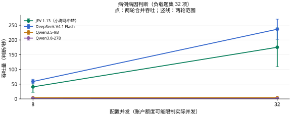

查看本任务的两个并发档

**表 8a｜病例病因判断：每请求最多 8 项，负载题集 32 项，各档两轮。**

| 模型 | 配置并发 | 吞吐量 (判断/秒) ↑ | 完整响应 P95 (秒) ↓ | 实际平均同时请求数 |
| --- | ---: | ---: | ---: | ---: |
| JEV 1.13 | 8 | 40.80 | 2.470 | 8.00 |
| DeepSeek V4.1 Flash | 8 | **59.10** | **1.118** | 7.99 |
| Qwen3.5-9B | 8 | 3.80 | 2.966 | 1.07 |
| Qwen3.8-27B | 8 | 2.00 | — | 1.26 |
| JEV 1.13 | 32 | 175.20 | 2.931 | 31.99 |
| DeepSeek V4.1 Flash | 32 | **236.40** | **1.466** | 31.97 |
| Qwen3.5-9B | 32 | 4.03 | 2.108 | 0.96 |
| Qwen3.8-27B | 32 | 1.00 | — | 2.28 |

配置并发是工作器上限；实际在途请求可能因账户额度更少。P95 不含客户端额度等待；不足 20 个完整响应时不报告 P95。

[任务定义与数据](docs/tasks/case_etiology.md) · [评估方法](docs/MEDICAL_LOAD.md) · [原始记录与计价依据](results/medical-load-jev-gateway-v1/README.md)

## 中医候选病机判断

**表 9｜中医候选病机判断：100 项独立判断，50 个来源组；每请求最多 8 项。准确率测试配置 8 并发，负载测试配置 32 并发。**

| 模型 | 准确率 (%) ↑ | Macro-F1 (%) ↑ | 吞吐量 (判断/秒) ↑ | 完整响应 P95 (秒) ↓ | 成本 (元/千项判断) ↓ |
| --- | ---: | ---: | ---: | ---: | ---: |
| JEV 1.13 | 71.00 | 68.72 | 134.40 | **7.319** | **0.147** |
| DeepSeek V4.1 Flash | **78.00** | **78.00** | **155.00** | 7.781 | 0.359–0.719 |
| Qwen3.5-9B | 59.00 | 53.99 | 2.80 | — | 0.196 |
| Qwen3.8-27B | 70.00 | 69.21 | 0.97 | — | 1.131 |

准确率和成本来自完整的 100 项固定题集；吞吐与 P95 来自其中预先选定的 32 项判断，持续循环施压两轮。重复调用不增加独立题量。P95 从实际发出计时，不含额度排队；不足 20 个响应时留空。

Macro-F1 对本任务金标中出现的类别等权平均；没有金标样本的候选类别不另加零分项，各模型使用相同类别集合。

这是候选病机的判断任务，按既有标注计分；不能由此推导自由生成辨证与处方的能力。

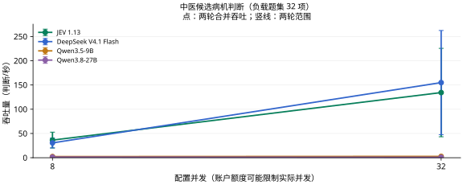

查看本任务的两个并发档

**表 9a｜中医候选病机判断：每请求最多 8 项，负载题集 32 项，各档两轮。**

| 模型 | 配置并发 | 吞吐量 (判断/秒) ↑ | 完整响应 P95 (秒) ↓ | 实际平均同时请求数 |
| --- | ---: | ---: | ---: | ---: |
| JEV 1.13 | 8 | **36.40** | 6.488 | 8.00 |
| DeepSeek V4.1 Flash | 8 | 30.60 | **6.432** | 8.00 |
| Qwen3.5-9B | 8 | 2.40 | — | 0.78 |
| Qwen3.8-27B | 8 | 1.46 | — | 0.84 |
| JEV 1.13 | 32 | 134.40 | **7.319** | 31.99 |
| DeepSeek V4.1 Flash | 32 | **155.00** | 7.781 | 31.99 |
| Qwen3.5-9B | 32 | 2.80 | — | 0.74 |
| Qwen3.8-27B | 32 | 0.97 | — | 1.18 |

配置并发是工作器上限；实际在途请求可能因账户额度更少。P95 不含客户端额度等待；不足 20 个完整响应时不报告 P95。

[任务定义与数据](docs/tasks/tcm_pathogenesis_candidate.md) · [评估方法](docs/MEDICAL_LOAD.md) · [原始记录与计价依据](results/medical-load-jev-gateway-v1/README.md)

## 患者方案禁忌判断

**表 10｜患者方案禁忌判断：54 项独立判断，53 个来源组；每请求最多 8 项。准确率测试配置 8 并发，负载测试配置 32 并发。**

| 模型 | 准确率 (%) ↑ | 吞吐量 (判断/秒) ↑ | 完整响应 P95 (秒) ↓ | 成本 (元/千项判断) ↓ |
| --- | ---: | ---: | ---: | ---: |
| JEV 1.13 | **77.78** | **260.20** | **1.577** | **0.086** |
| DeepSeek V4.1 Flash | 62.96 | 82.47 | 5.906 | 0.211–0.422 |
| Qwen3.5-9B | 38.89 | 3.35 | 3.133 | 0.123 |
| Qwen3.8-27B | 64.81 | 1.60 | — | 0.694 |

准确率和成本来自完整的 54 项固定题集；吞吐与 P95 来自其中预先选定的 32 项判断，持续循环施压两轮。重复调用不增加独立题量。P95 从实际发出计时，不含额度排队；不足 20 个响应时留空。

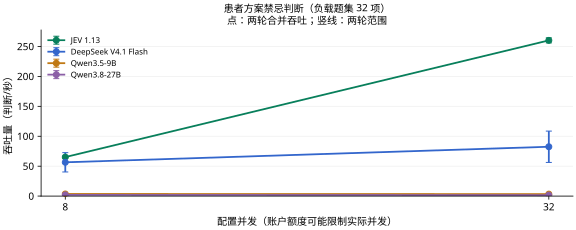

查看本任务的两个并发档

**表 10a｜患者方案禁忌判断：每请求最多 8 项，负载题集 32 项，各档两轮。**

| 模型 | 配置并发 | 吞吐量 (判断/秒) ↑ | 完整响应 P95 (秒) ↓ | 实际平均同时请求数 |
| --- | ---: | ---: | ---: | ---: |
| JEV 1.13 | 8 | **65.20** | **1.606** | 7.99 |
| DeepSeek V4.1 Flash | 8 | 56.50 | 2.225 | 7.99 |
| Qwen3.5-9B | 8 | 3.55 | 5.386 | 1.33 |
| Qwen3.8-27B | 8 | 2.00 | — | 1.00 |
| JEV 1.13 | 32 | **260.20** | **1.577** | 31.98 |
| DeepSeek V4.1 Flash | 32 | 82.47 | 5.906 | 31.99 |
| Qwen3.5-9B | 32 | 3.35 | 3.133 | 1.13 |
| Qwen3.8-27B | 32 | 1.60 | — | 0.95 |

配置并发是工作器上限；实际在途请求可能因账户额度更少。P95 不含客户端额度等待；不足 20 个完整响应时不报告 P95。

[任务定义与数据](docs/tasks/patient_contraindication.md) · [评估方法](docs/MEDICAL_LOAD.md) · [原始记录与计价依据](results/medical-load-jev-gateway-v1/README.md)

## 治疗方案选择

**表 11｜治疗方案选择：100 项独立判断，100 个来源组；每请求最多 8 项。准确率测试配置 8 并发，负载测试配置 32 并发。**

| 模型 | 准确率 (%) ↑ | 吞吐量 (判断/秒) ↑ | 完整响应 P95 (秒) ↓ | 成本 (元/千项判断) ↓ |
| --- | ---: | ---: | ---: | ---: |
| JEV 1.13 | **78.00** | **254.60** | **1.706** | **0.086** |
| DeepSeek V4.1 Flash | 73.00 | 178.57 | 3.063 | 0.214–0.428 |
| Qwen3.5-9B | 57.00 | 4.40 | 6.105 | 0.126 |
| Qwen3.8-27B | 72.00 | 2.00 | — | 0.704 |

准确率和成本来自完整的 100 项固定题集；吞吐与 P95 来自其中预先选定的 32 项判断，持续循环施压两轮。重复调用不增加独立题量。P95 从实际发出计时，不含额度排队；不足 20 个响应时留空。

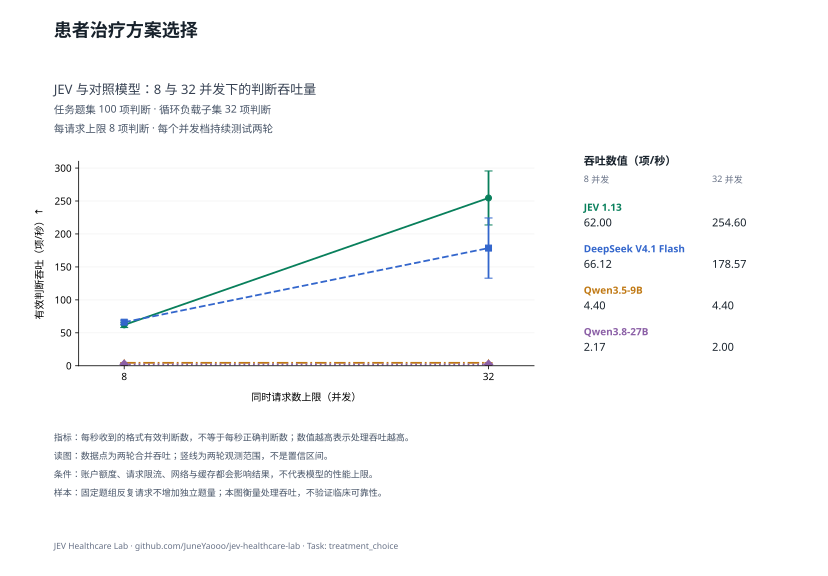

查看本任务的两个并发档

**表 11a｜治疗方案选择：每请求最多 8 项，负载题集 32 项，各档两轮。**

| 模型 | 配置并发 | 吞吐量 (判断/秒) ↑ | 完整响应 P95 (秒) ↓ | 实际平均同时请求数 |
| --- | ---: | ---: | ---: | ---: |
| JEV 1.13 | 8 | 62.00 | 1.627 | 7.99 |
| DeepSeek V4.1 Flash | 8 | **66.12** | **1.330** | 7.99 |
| Qwen3.5-9B | 8 | 4.40 | 4.483 | 1.22 |
| Qwen3.8-27B | 8 | 2.17 | — | 1.86 |
| JEV 1.13 | 32 | **254.60** | **1.706** | 31.98 |
| DeepSeek V4.1 Flash | 32 | 178.57 | 3.063 | 31.99 |
| Qwen3.5-9B | 32 | 4.40 | 6.105 | 1.31 |
| Qwen3.8-27B | 32 | 2.00 | — | 1.78 |

配置并发是工作器上限；实际在途请求可能因账户额度更少。P95 不含客户端额度等待；不足 20 个完整响应时不报告 P95。

[任务定义与数据](docs/tasks/treatment_choice.md) · [评估方法](docs/MEDICAL_LOAD.md) · [原始记录与计价依据](results/medical-load-jev-gateway-v1/README.md)

## 用药方案选择

**表 12｜用药方案选择：100 项独立判断，100 个来源组；每请求最多 8 项。准确率测试配置 8 并发，负载测试配置 32 并发。**

| 模型 | 准确率 (%) ↑ | 吞吐量 (判断/秒) ↑ | 完整响应 P95 (秒) ↓ | 成本 (元/千项判断) ↓ |
| --- | ---: | ---: | ---: | ---: |
| JEV 1.13 | **83.00** | 184.80 | 3.755 | **0.086** |
| DeepSeek V4.1 Flash | 62.00 | **271.43** | **1.135** | 0.218–0.436 |
| Qwen3.5-9B | 43.00 | 3.98 | 3.856 | 0.128 |
| Qwen3.8-27B | 64.00 | 1.80 | — | 0.718 |

准确率和成本来自完整的 100 项固定题集；吞吐与 P95 来自其中预先选定的 32 项判断，持续循环施压两轮。重复调用不增加独立题量。P95 从实际发出计时，不含额度排队；不足 20 个响应时留空。

查看本任务的两个并发档

**表 12a｜用药方案选择：每请求最多 8 项，负载题集 32 项，各档两轮。**

| 模型 | 配置并发 | 吞吐量 (判断/秒) ↑ | 完整响应 P95 (秒) ↓ | 实际平均同时请求数 |
| --- | ---: | ---: | ---: | ---: |
| JEV 1.13 | 8 | 54.80 | 2.327 | 8.00 |
| DeepSeek V4.1 Flash | 8 | **66.67** | **1.265** | 7.99 |
| Qwen3.5-9B | 8 | 4.00 | 2.450 | 1.04 |
| Qwen3.8-27B | 8 | 2.00 | — | 0.69 |
| JEV 1.13 | 32 | 184.80 | 3.755 | 31.99 |
| DeepSeek V4.1 Flash | 32 | **271.43** | **1.135** | 31.97 |
| Qwen3.5-9B | 32 | 3.98 | 3.856 | 1.32 |
| Qwen3.8-27B | 32 | 1.80 | — | 0.81 |

配置并发是工作器上限；实际在途请求可能因账户额度更少。P95 不含客户端额度等待；不足 20 个完整响应时不报告 P95。

[任务定义与数据](docs/tasks/medication_choice.md) · [评估方法](docs/MEDICAL_LOAD.md) · [原始记录与计价依据](results/medical-load-jev-gateway-v1/README.md)

## 补液方案选择

**表 13｜补液方案选择：16 项独立判断，15 个来源组；每请求最多 8 项。准确率测试配置 8 并发，负载测试配置 32 并发。**

| 模型 | 准确率 (%) ↑ | 吞吐量 (判断/秒) ↑ | 完整响应 P95 (秒) ↓ | 成本 (元/千项判断) ↓ |
| --- | ---: | ---: | ---: | ---: |
| JEV 1.13 | **62.50** | **244.60** | **1.651** | **0.096** |
| DeepSeek V4.1 Flash | 43.75 | 193.07 | 3.903 | 0.237–0.475 |
| Qwen3.5-9B | 31.25 | 3.70 | — | 0.144 |
| Qwen3.8-27B | **62.50** | 1.80 | — | 0.812 |

准确率和成本来自完整的 16 项固定题集；吞吐与 P95 来自其中预先选定的 16 项判断，持续循环施压两轮。重复调用不增加独立题量。P95 从实际发出计时，不含额度排队；不足 20 个响应时留空。

样本覆盖有限，只作探索性比较，尤其不能据此稳定估计临床可靠性。

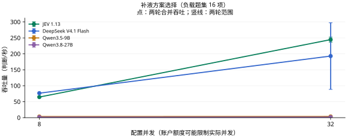

查看本任务的两个并发档

**表 13a｜补液方案选择：每请求最多 8 项，负载题集 16 项，各档两轮。**

| 模型 | 配置并发 | 吞吐量 (判断/秒) ↑ | 完整响应 P95 (秒) ↓ | 实际平均同时请求数 |
| --- | ---: | ---: | ---: | ---: |
| JEV 1.13 | 8 | 64.60 | 1.618 | 7.99 |
| DeepSeek V4.1 Flash | 8 | **76.75** | **1.174** | 7.99 |
| Qwen3.5-9B | 8 | 3.48 | — | 0.96 |
| Qwen3.8-27B | 8 | 1.80 | — | 0.85 |
| JEV 1.13 | 32 | **244.60** | **1.651** | 31.98 |
| DeepSeek V4.1 Flash | 32 | 193.07 | 3.903 | 31.98 |
| Qwen3.5-9B | 32 | 3.70 | — | 1.04 |
| Qwen3.8-27B | 32 | 1.80 | — | 0.72 |

配置并发是工作器上限；实际在途请求可能因账户额度更少。P95 不含客户端额度等待；不足 20 个完整响应时不报告 P95。

[任务定义与数据](docs/tasks/fluid_plan.md) · [评估方法](docs/MEDICAL_LOAD.md) · [原始记录与计价依据](results/medical-load-jev-gateway-v1/README.md)

## 药物基因结果对应的指南建议选择

**表 14｜药物基因结果对应的指南建议选择：100 项独立判断，25 个来源组；每请求最多 8 项。准确率测试配置 8 并发，负载测试配置 32 并发。**

| 模型 | 准确率 (%) ↑ | 吞吐量 (判断/秒) ↑ | 完整响应 P95 (秒) ↓ | 成本 (元/千项判断) ↓ |
| --- | ---: | ---: | ---: | ---: |
| JEV 1.13 | 56.00 | 155.40 | 3.638 | **0.139** |
| DeepSeek V4.1 Flash | 53.00 | **323.40** | **1.097** | 0.407–0.814 |
| Qwen3.5-9B | 34.00 | 1.80 | — | 0.230 |
| Qwen3.8-27B | **62.00** | 1.14 | — | 1.311 |

准确率和成本来自完整的 100 项固定题集；吞吐与 P95 来自其中预先选定的 32 项判断，持续循环施压两轮。重复调用不增加独立题量。P95 从实际发出计时，不含额度排队；不足 20 个响应时留空。

查看本任务的两个并发档

**表 14a｜药物基因结果对应的指南建议选择：每请求最多 8 项，负载题集 32 项，各档两轮。**

| 模型 | 配置并发 | 吞吐量 (判断/秒) ↑ | 完整响应 P95 (秒) ↓ | 实际平均同时请求数 |
| --- | ---: | ---: | ---: | ---: |
| JEV 1.13 | 8 | 43.80 | 4.255 | 7.99 |
| DeepSeek V4.1 Flash | 8 | **82.80** | **1.058** | 7.99 |
| Qwen3.5-9B | 8 | 2.40 | — | 0.76 |
| Qwen3.8-27B | 8 | 1.43 | — | 0.58 |
| JEV 1.13 | 32 | 155.40 | 3.638 | 31.98 |
| DeepSeek V4.1 Flash | 32 | **323.40** | **1.097** | 31.96 |
| Qwen3.5-9B | 32 | 1.80 | — | 0.57 |
| Qwen3.8-27B | 32 | 1.14 | — | 1.09 |

配置并发是工作器上限；实际在途请求可能因账户额度更少。P95 不含客户端额度等待；不足 20 个完整响应时不报告 P95。

[任务定义与数据](docs/tasks/pgx_guideline_recommendation.md) · [评估方法](docs/MEDICAL_LOAD.md) · [原始记录与计价依据](results/medical-load-jev-gateway-v1/README.md)

## 给药途径与实施方法选择

**表 15｜给药途径与实施方法选择：4 项独立判断，4 个来源组；每请求最多 8 项。准确率测试配置 8 并发，负载测试配置 32 并发。**

| 模型 | 准确率 (%) ↑ | 吞吐量 (判断/秒) ↑ | 完整响应 P95 (秒) ↓ | 成本 (元/千项判断) ↓ |
| --- | ---: | ---: | ---: | ---: |
| JEV 1.13 | **100.00** | 129.80 | 1.571 | **0.093** |
| DeepSeek V4.1 Flash | 75.00 | **164.90** | **1.102** | 0.229–0.457 |
| Qwen3.5-9B | 50.00 | 3.30 | 1.843 | 0.132 |
| Qwen3.8-27B | 50.00 | 1.30 | — | 0.749 |

准确率和成本来自完整的 4 项固定题集；吞吐与 P95 来自其中预先选定的 4 项判断，持续循环施压两轮。重复调用不增加独立题量。P95 从实际发出计时，不含额度排队；不足 20 个响应时留空。

样本覆盖有限，只作探索性比较，尤其不能据此稳定估计临床可靠性。

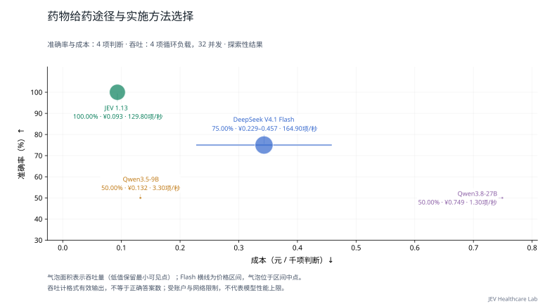

查看本任务的两个并发档

**表 15a｜给药途径与实施方法选择：每请求最多 8 项，负载题集 4 项，各档两轮。**

| 模型 | 配置并发 | 吞吐量 (判断/秒) ↑ | 完整响应 P95 (秒) ↓ | 实际平均同时请求数 |
| --- | ---: | ---: | ---: | ---: |
| JEV 1.13 | 8 | 31.80 | 1.628 | 8.00 |
| DeepSeek V4.1 Flash | 8 | **40.50** | **1.057** | 7.99 |
| Qwen3.5-9B | 8 | 3.50 | 1.776 | 0.99 |
| Qwen3.8-27B | 8 | 1.70 | — | 0.93 |
| JEV 1.13 | 32 | 129.80 | 1.571 | 31.98 |
| DeepSeek V4.1 Flash | 32 | **164.90** | **1.102** | 31.98 |
| Qwen3.5-9B | 32 | 3.30 | 1.843 | 1.03 |
| Qwen3.8-27B | 32 | 1.30 | — | 2.72 |

配置并发是工作器上限；实际在途请求可能因账户额度更少。P95 不含客户端额度等待；不足 20 个完整响应时不报告 P95。

[任务定义与数据](docs/tasks/administration_route_choice.md) · [评估方法](docs/MEDICAL_LOAD.md) · [原始记录与计价依据](results/medical-load-jev-gateway-v1/README.md)

## 病例并发症判断

**表 16｜病例并发症判断：100 项独立判断，96 个来源组；每请求最多 8 项。准确率测试配置 8 并发，负载测试配置 32 并发。**

| 模型 | 准确率 (%) ↑ | 吞吐量 (判断/秒) ↑ | 完整响应 P95 (秒) ↓ | 成本 (元/千项判断) ↓ |
| --- | ---: | ---: | ---: | ---: |
| JEV 1.13 | **90.00** | 188.60 | 3.744 | **0.089** |
| DeepSeek V4.1 Flash | 66.00 | **214.32** | 2.277 | 0.215–0.429 |
| Qwen3.5-9B | 53.00 | 3.55 | **2.224** | 0.126 |
| Qwen3.8-27B | 84.00 | 2.20 | — | 0.707 |

准确率和成本来自完整的 100 项固定题集；吞吐与 P95 来自其中预先选定的 32 项判断，持续循环施压两轮。重复调用不增加独立题量。P95 从实际发出计时，不含额度排队；不足 20 个响应时留空。

查看本任务的两个并发档

**表 16a｜病例并发症判断：每请求最多 8 项，负载题集 32 项，各档两轮。**

| 模型 | 配置并发 | 吞吐量 (判断/秒) ↑ | 完整响应 P95 (秒) ↓ | 实际平均同时请求数 |
| --- | ---: | ---: | ---: | ---: |
| JEV 1.13 | 8 | 49.20 | 3.906 | 8.00 |
| DeepSeek V4.1 Flash | 8 | **68.12** | **1.268** | 7.99 |
| Qwen3.5-9B | 8 | 3.52 | 2.162 | 0.98 |
| Qwen3.8-27B | 8 | 1.40 | — | 1.79 |
| JEV 1.13 | 32 | 188.60 | 3.744 | 31.98 |
| DeepSeek V4.1 Flash | 32 | **214.32** | 2.277 | 31.98 |
| Qwen3.5-9B | 32 | 3.55 | **2.224** | 0.92 |
| Qwen3.8-27B | 32 | 2.20 | — | 0.88 |

配置并发是工作器上限；实际在途请求可能因账户额度更少。P95 不含客户端额度等待；不足 20 个完整响应时不报告 P95。

[任务定义与数据](docs/tasks/case_complication.md) · [评估方法](docs/MEDICAL_LOAD.md) · [原始记录与计价依据](results/medical-load-jev-gateway-v1/README.md)

## 护理措施选择

**表 17｜护理措施选择：42 项独立判断，42 个来源组；每请求最多 8 项。准确率测试配置 8 并发，负载测试配置 32 并发。**

| 模型 | 准确率 (%) ↑ | 吞吐量 (判断/秒) ↑ | 完整响应 P95 (秒) ↓ | 成本 (元/千项判断) ↓ |
| --- | ---: | ---: | ---: | ---: |
| JEV 1.13 | **88.10** | 205.40 | 2.843 | **0.090** |
| DeepSeek V4.1 Flash | 78.57 | **252.00** | **1.953** | 0.211–0.422 |
| Qwen3.5-9B | 57.14 | 4.80 | 2.056 | 0.123 |
| Qwen3.8-27B | 85.71 | 2.20 | — | 0.689 |

准确率和成本来自完整的 42 项固定题集；吞吐与 P95 来自其中预先选定的 32 项判断，持续循环施压两轮。重复调用不增加独立题量。P95 从实际发出计时，不含额度排队；不足 20 个响应时留空。

查看本任务的两个并发档

**表 17a｜护理措施选择：每请求最多 8 项，负载题集 32 项，各档两轮。**

| 模型 | 配置并发 | 吞吐量 (判断/秒) ↑ | 完整响应 P95 (秒) ↓ | 实际平均同时请求数 |
| --- | ---: | ---: | ---: | ---: |
| JEV 1.13 | 8 | 47.60 | 3.234 | 8.00 |
| DeepSeek V4.1 Flash | 8 | **75.40** | **1.294** | 8.00 |
| Qwen3.5-9B | 8 | 4.40 | 2.309 | 0.97 |
| Qwen3.8-27B | 8 | 2.00 | — | 0.67 |
| JEV 1.13 | 32 | 205.40 | 2.843 | 31.98 |
| DeepSeek V4.1 Flash | 32 | **252.00** | **1.953** | 31.98 |
| Qwen3.5-9B | 32 | 4.80 | 2.056 | 0.94 |
| Qwen3.8-27B | 32 | 2.20 | — | 0.85 |

配置并发是工作器上限；实际在途请求可能因账户额度更少。P95 不含客户端额度等待；不足 20 个完整响应时不报告 P95。

[任务定义与数据](docs/tasks/nursing_priority.md) · [评估方法](docs/MEDICAL_LOAD.md) · [原始记录与计价依据](results/medical-load-jev-gateway-v1/README.md)

## 营养与饮食方案选择

**表 18｜营养与饮食方案选择：11 项独立判断，11 个来源组；每请求最多 8 项。准确率测试配置 8 并发，负载测试配置 32 并发。**

| 模型 | 准确率 (%) ↑ | 吞吐量 (判断/秒) ↑ | 完整响应 P95 (秒) ↓ | 成本 (元/千项判断) ↓ |
| --- | ---: | ---: | ---: | ---: |
| JEV 1.13 | **63.64** | 100.28 | 4.526 | **0.097** |
| DeepSeek V4.1 Flash | **63.64** | **173.60** | 3.069 | 0.232–0.464 |
| Qwen3.5-9B | 27.27 | 3.70 | **2.063** | 0.135 |
| Qwen3.8-27B | **63.64** | 1.65 | — | 0.763 |

准确率和成本来自完整的 11 项固定题集；吞吐与 P95 来自其中预先选定的 11 项判断，持续循环施压两轮。重复调用不增加独立题量。P95 从实际发出计时，不含额度排队；不足 20 个响应时留空。

样本覆盖有限，只作探索性比较，尤其不能据此稳定估计临床可靠性。

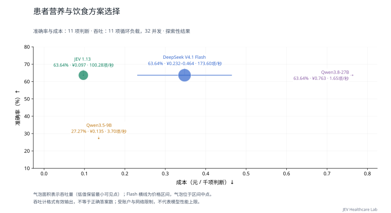

查看本任务的两个并发档

**表 18a｜营养与饮食方案选择：每请求最多 8 项，负载题集 11 项，各档两轮。**

| 模型 | 配置并发 | 吞吐量 (判断/秒) ↑ | 完整响应 P95 (秒) ↓ | 实际平均同时请求数 |
| --- | ---: | ---: | ---: | ---: |
| JEV 1.13 | 8 | 28.15 | 3.279 | 8.00 |
| DeepSeek V4.1 Flash | 8 | **54.38** | **1.294** | 7.99 |
| Qwen3.5-9B | 8 | 3.58 | 2.082 | 0.94 |
| Qwen3.8-27B | 8 | 1.32 | — | 1.62 |
| JEV 1.13 | 32 | 100.28 | 4.526 | 31.99 |
| DeepSeek V4.1 Flash | 32 | **173.60** | 3.069 | 31.98 |
| Qwen3.5-9B | 32 | 3.70 | **2.063** | 0.94 |
| Qwen3.8-27B | 32 | 1.65 | — | 1.40 |

配置并发是工作器上限；实际在途请求可能因账户额度更少。P95 不含客户端额度等待；不足 20 个完整响应时不报告 P95。

[任务定义与数据](docs/tasks/nutrition_plan.md) · [评估方法](docs/MEDICAL_LOAD.md) · [原始记录与计价依据](results/medical-load-jev-gateway-v1/README.md)

## 护理与操作体位选择

**表 19｜护理与操作体位选择：10 项独立判断，10 个来源组；每请求最多 8 项。准确率测试配置 8 并发，负载测试配置 32 并发。**

| 模型 | 准确率 (%) ↑ | 吞吐量 (判断/秒) ↑ | 完整响应 P95 (秒) ↓ | 成本 (元/千项判断) ↓ |
| --- | ---: | ---: | ---: | ---: |
| JEV 1.13 | **100.00** | **178.65** | 1.521 | **0.084** |
| DeepSeek V4.1 Flash | 70.00 | 174.90 | **1.300** | 0.206–0.413 |
| Qwen3.5-9B | 30.00 | 3.33 | 2.114 | 0.126 |
| Qwen3.8-27B | 60.00 | 1.80 | — | 0.706 |

准确率和成本来自完整的 10 项固定题集；吞吐与 P95 来自其中预先选定的 10 项判断，持续循环施压两轮。重复调用不增加独立题量。P95 从实际发出计时，不含额度排队；不足 20 个响应时留空。

样本覆盖有限，只作探索性比较，尤其不能据此稳定估计临床可靠性。

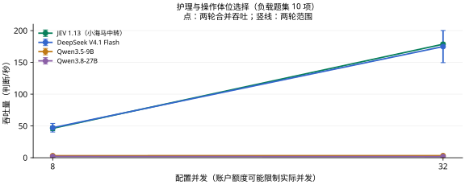

查看本任务的两个并发档

**表 19a｜护理与操作体位选择：每请求最多 8 项，负载题集 10 项，各档两轮。**

| 模型 | 配置并发 | 吞吐量 (判断/秒) ↑ | 完整响应 P95 (秒) ↓ | 实际平均同时请求数 |
| --- | ---: | ---: | ---: | ---: |
| JEV 1.13 | 8 | 46.25 | 1.432 | 7.99 |
| DeepSeek V4.1 Flash | 8 | **47.25** | **1.076** | 7.99 |
| Qwen3.5-9B | 8 | 3.23 | 2.361 | 1.10 |
| Qwen3.8-27B | 8 | 2.00 | — | 1.46 |
| JEV 1.13 | 32 | **178.65** | 1.521 | 31.98 |
| DeepSeek V4.1 Flash | 32 | 174.90 | **1.300** | 31.98 |
| Qwen3.5-9B | 32 | 3.33 | 2.114 | 1.04 |
| Qwen3.8-27B | 32 | 1.80 | — | 0.79 |

配置并发是工作器上限；实际在途请求可能因账户额度更少。P95 不含客户端额度等待；不足 20 个完整响应时不报告 P95。

[任务定义与数据](docs/tasks/positioning_choice.md) · [评估方法](docs/MEDICAL_LOAD.md) · [原始记录与计价依据](results/medical-load-jev-gateway-v1/README.md)

## 病情监测与疗效判断

**表 20｜病情监测与疗效判断：5 项独立判断，5 个来源组；每请求最多 8 项。准确率测试配置 8 并发，负载测试配置 32 并发。**

| 模型 | 准确率 (%) ↑ | 吞吐量 (判断/秒) ↑ | 完整响应 P95 (秒) ↓ | 成本 (元/千项判断) ↓ |
| --- | ---: | ---: | ---: | ---: |
| JEV 1.13 | 80.00 | 72.38 | 5.048 | **0.086** |
| DeepSeek V4.1 Flash | **100.00** | **161.75** | **1.620** | 0.208–0.416 |
| Qwen3.5-9B | 40.00 | 3.62 | 2.532 | 0.122 |
| Qwen3.8-27B | 80.00 | 1.50 | — | 0.686 |

准确率和成本来自完整的 5 项固定题集；吞吐与 P95 来自其中预先选定的 5 项判断，持续循环施压两轮。重复调用不增加独立题量。P95 从实际发出计时，不含额度排队；不足 20 个响应时留空。

样本覆盖有限，只作探索性比较，尤其不能据此稳定估计临床可靠性。

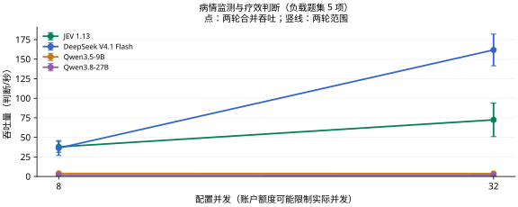

查看本任务的两个并发档

**表 20a｜病情监测与疗效判断：每请求最多 8 项，负载题集 5 项，各档两轮。**

| 模型 | 配置并发 | 吞吐量 (判断/秒) ↑ | 完整响应 P95 (秒) ↓ | 实际平均同时请求数 |
| --- | ---: | ---: | ---: | ---: |
| JEV 1.13 | 8 | **37.88** | **1.820** | 8.00 |
| DeepSeek V4.1 Flash | 8 | 36.38 | 2.471 | 8.00 |
| Qwen3.5-9B | 8 | 3.88 | 2.303 | 1.10 |
| Qwen3.8-27B | 8 | 1.62 | — | 1.71 |
| JEV 1.13 | 32 | 72.38 | 5.048 | 31.99 |
| DeepSeek V4.1 Flash | 32 | **161.75** | **1.620** | 31.98 |
| Qwen3.5-9B | 32 | 3.62 | 2.532 | 1.25 |
| Qwen3.8-27B | 32 | 1.50 | — | 2.11 |

配置并发是工作器上限；实际在途请求可能因账户额度更少。P95 不含客户端额度等待；不足 20 个完整响应时不报告 P95。

[任务定义与数据](docs/tasks/monitoring_target.md) · [评估方法](docs/MEDICAL_LOAD.md) · [原始记录与计价依据](results/medical-load-jev-gateway-v1/README.md)

## 感染防控措施选择

**表 21｜感染防控措施选择：5 项独立判断，5 个来源组；每请求最多 8 项。准确率测试配置 8 并发，负载测试配置 32 并发。**

| 模型 | 准确率 (%) ↑ | 吞吐量 (判断/秒) ↑ | 完整响应 P95 (秒) ↓ | 成本 (元/千项判断) ↓ |
| --- | ---: | ---: | ---: | ---: |
| JEV 1.13 | **100.00** | **162.38** | **1.669** | **0.095** |
| DeepSeek V4.1 Flash | **100.00** | 150.00 | 1.916 | 0.231–0.462 |
| Qwen3.5-9B | 40.00 | 2.90 | 3.126 | 0.132 |
| Qwen3.8-27B | 80.00 | 1.88 | — | 0.746 |

准确率和成本来自完整的 5 项固定题集；吞吐与 P95 来自其中预先选定的 5 项判断，持续循环施压两轮。重复调用不增加独立题量。P95 从实际发出计时，不含额度排队；不足 20 个响应时留空。

样本覆盖有限，只作探索性比较，尤其不能据此稳定估计临床可靠性。

查看本任务的两个并发档

**表 21a｜感染防控措施选择：每请求最多 8 项，负载题集 5 项，各档两轮。**

| 模型 | 配置并发 | 吞吐量 (判断/秒) ↑ | 完整响应 P95 (秒) ↓ | 实际平均同时请求数 |
| --- | ---: | ---: | ---: | ---: |
| JEV 1.13 | 8 | 43.12 | 1.553 | 7.99 |
| DeepSeek V4.1 Flash | 8 | **43.38** | **1.461** | 7.99 |
| Qwen3.5-9B | 8 | 2.70 | 17.789 | 1.13 |
| Qwen3.8-27B | 8 | 1.75 | — | 1.34 |
| JEV 1.13 | 32 | **162.38** | **1.669** | 31.99 |
| DeepSeek V4.1 Flash | 32 | 150.00 | 1.916 | 31.98 |
| Qwen3.5-9B | 32 | 2.90 | 3.126 | 1.18 |
| Qwen3.8-27B | 32 | 1.88 | — | 1.71 |

配置并发是工作器上限；实际在途请求可能因账户额度更少。P95 不含客户端额度等待；不足 20 个完整响应时不报告 P95。

[任务定义与数据](docs/tasks/infection_precaution.md) · [评估方法](docs/MEDICAL_LOAD.md) · [原始记录与计价依据](results/medical-load-jev-gateway-v1/README.md)

## 复查项目与随访时机选择

**表 22｜复查项目与随访时机选择：6 项独立判断，6 个来源组；每请求最多 8 项。准确率测试配置 8 并发，负载测试配置 32 并发。**

| 模型 | 准确率 (%) ↑ | 吞吐量 (判断/秒) ↑ | 完整响应 P95 (秒) ↓ | 成本 (元/千项判断) ↓ |
| --- | ---: | ---: | ---: | ---: |
| JEV 1.13 | **83.33** | **201.30** | **1.563** | **0.086** |
| DeepSeek V4.1 Flash | 50.00 | 163.80 | 2.535 | 0.222–0.444 |
| Qwen3.5-9B | 66.67 | 2.85 | 20.984 | 0.129 |
| Qwen3.8-27B | 66.67 | 1.95 | — | 0.727 |

准确率和成本来自完整的 6 项固定题集；吞吐与 P95 来自其中预先选定的 6 项判断，持续循环施压两轮。重复调用不增加独立题量。P95 从实际发出计时，不含额度排队；不足 20 个响应时留空。

样本覆盖有限，只作探索性比较，尤其不能据此稳定估计临床可靠性。

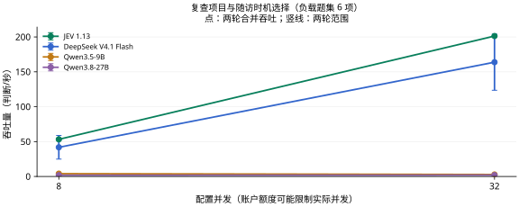

查看本任务的两个并发档

**表 22a｜复查项目与随访时机选择：每请求最多 8 项，负载题集 6 项，各档两轮。**

| 模型 | 配置并发 | 吞吐量 (判断/秒) ↑ | 完整响应 P95 (秒) ↓ | 实际平均同时请求数 |
| --- | ---: | ---: | ---: | ---: |
| JEV 1.13 | 8 | **53.25** | **1.538** | 8.00 |
| DeepSeek V4.1 Flash | 8 | 41.85 | 2.559 | 7.99 |
| Qwen3.5-9B | 8 | 4.05 | 3.424 | 1.09 |
| Qwen3.8-27B | 8 | 1.80 | — | 0.70 |
| JEV 1.13 | 32 | **201.30** | **1.563** | 31.98 |
| DeepSeek V4.1 Flash | 32 | 163.80 | 2.535 | 31.98 |
| Qwen3.5-9B | 32 | 2.85 | 20.984 | 2.07 |
| Qwen3.8-27B | 32 | 1.95 | — | 0.82 |

配置并发是工作器上限；实际在途请求可能因账户额度更少。P95 不含客户端额度等待；不足 20 个完整响应时不报告 P95。

[任务定义与数据](docs/tasks/followup_plan.md) · [评估方法](docs/MEDICAL_LOAD.md) · [原始记录与计价依据](results/medical-load-jev-gateway-v1/README.md)

## 康复训练方案选择

**表 23｜康复训练方案选择：4 项独立判断，4 个来源组；每请求最多 8 项。准确率测试配置 8 并发，负载测试配置 32 并发。**

| 模型 | 准确率 (%) ↑ | 吞吐量 (判断/秒) ↑ | 完整响应 P95 (秒) ↓ | 成本 (元/千项判断) ↓ |
| --- | ---: | ---: | ---: | ---: |
| JEV 1.13 | **100.00** | 127.50 | 1.673 | **0.100** |
| DeepSeek V4.1 Flash | **100.00** | **156.10** | **1.187** | 0.231–0.462 |
| Qwen3.5-9B | 50.00 | 3.30 | 2.197 | 0.132 |
| Qwen3.8-27B | 75.00 | 1.50 | — | 0.746 |

准确率和成本来自完整的 4 项固定题集；吞吐与 P95 来自其中预先选定的 4 项判断，持续循环施压两轮。重复调用不增加独立题量。P95 从实际发出计时，不含额度排队；不足 20 个响应时留空。

样本覆盖有限，只作探索性比较，尤其不能据此稳定估计临床可靠性。

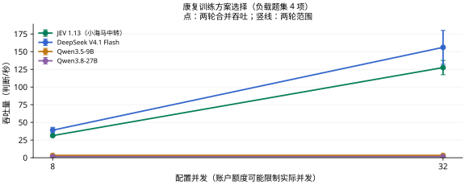

查看本任务的两个并发档

**表 23a｜康复训练方案选择：每请求最多 8 项，负载题集 4 项，各档两轮。**

| 模型 | 配置并发 | 吞吐量 (判断/秒) ↑ | 完整响应 P95 (秒) ↓ | 实际平均同时请求数 |
| --- | ---: | ---: | ---: | ---: |
| JEV 1.13 | 8 | 31.30 | 1.635 | 8.00 |
| DeepSeek V4.1 Flash | 8 | **39.00** | **1.150** | 7.99 |
| Qwen3.5-9B | 8 | 3.30 | 2.260 | 1.06 |
| Qwen3.8-27B | 8 | 1.50 | — | 1.84 |
| JEV 1.13 | 32 | 127.50 | 1.673 | 31.99 |
| DeepSeek V4.1 Flash | 32 | **156.10** | **1.187** | 31.98 |
| Qwen3.5-9B | 32 | 3.30 | 2.197 | 1.00 |
| Qwen3.8-27B | 32 | 1.50 | — | 2.08 |

配置并发是工作器上限；实际在途请求可能因账户额度更少。P95 不含客户端额度等待；不足 20 个完整响应时不报告 P95。

[任务定义与数据](docs/tasks/rehabilitation_choice.md) · [评估方法](docs/MEDICAL_LOAD.md) · [原始记录与计价依据](results/medical-load-jev-gateway-v1/README.md)

## 预防措施选择

**表 24｜预防措施选择：13 项独立判断，13 个来源组；每请求最多 8 项。准确率测试配置 8 并发，负载测试配置 32 并发。**

| 模型 | 准确率 (%) ↑ | 吞吐量 (判断/秒) ↑ | 完整响应 P95 (秒) ↓ | 成本 (元/千项判断) ↓ |
| --- | ---: | ---: | ---: | ---: |
| JEV 1.13 | **76.92** | 88.70 | 5.940 | **0.092** |
| DeepSeek V4.1 Flash | **76.92** | **163.95** | 2.995 | 0.224–0.447 |
| Qwen3.5-9B | 69.23 | 4.03 | **2.163** | 0.129 |
| Qwen3.8-27B | **76.92** | 0.97 | — | 0.724 |

准确率和成本来自完整的 13 项固定题集；吞吐与 P95 来自其中预先选定的 13 项判断，持续循环施压两轮。重复调用不增加独立题量。P95 从实际发出计时，不含额度排队；不足 20 个响应时留空。

样本覆盖有限，只作探索性比较，尤其不能据此稳定估计临床可靠性。

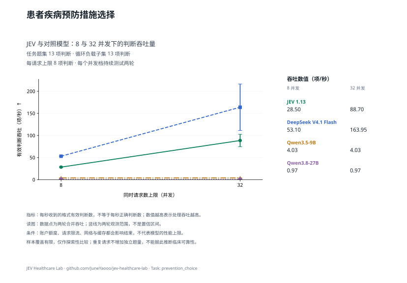

查看本任务的两个并发档

**表 24a｜预防措施选择：每请求最多 8 项，负载题集 13 项，各档两轮。**

| 模型 | 配置并发 | 吞吐量 (判断/秒) ↑ | 完整响应 P95 (秒) ↓ | 实际平均同时请求数 |
| --- | ---: | ---: | ---: | ---: |
| JEV 1.13 | 8 | 28.50 | 4.588 | 8.00 |
| DeepSeek V4.1 Flash | 8 | **53.10** | **1.482** | 7.99 |
| Qwen3.5-9B | 8 | 4.03 | 2.412 | 1.04 |
| Qwen3.8-27B | 8 | 0.97 | — | 2.71 |
| JEV 1.13 | 32 | 88.70 | 5.940 | 31.99 |
| DeepSeek V4.1 Flash | 32 | **163.95** | 2.995 | 31.98 |
| Qwen3.5-9B | 32 | 4.03 | **2.163** | 0.96 |
| Qwen3.8-27B | 32 | 0.97 | — | 1.97 |

配置并发是工作器上限；实际在途请求可能因账户额度更少。P95 不含客户端额度等待；不足 20 个完整响应时不报告 P95。

[任务定义与数据](docs/tasks/prevention_choice.md) · [评估方法](docs/MEDICAL_LOAD.md) · [原始记录与计价依据](results/medical-load-jev-gateway-v1/README.md)

## 健康教育与沟通行动选择

**表 25｜健康教育与沟通行动选择：11 项独立判断，11 个来源组；每请求最多 8 项。准确率测试配置 8 并发，负载测试配置 32 并发。**

| 模型 | 准确率 (%) ↑ | 吞吐量 (判断/秒) ↑ | 完整响应 P95 (秒) ↓ | 成本 (元/千项判断) ↓ |
| --- | ---: | ---: | ---: | ---: |
| JEV 1.13 | **90.91** | 173.38 | 1.678 | **0.100** |
| DeepSeek V4.1 Flash | **90.91** | **204.95** | **1.235** | 0.232–0.464 |
| Qwen3.5-9B | 81.82 | 3.38 | 2.043 | 0.132 |
| Qwen3.8-27B | **90.91** | 2.12 | — | 0.746 |

准确率和成本来自完整的 11 项固定题集；吞吐与 P95 来自其中预先选定的 11 项判断，持续循环施压两轮。重复调用不增加独立题量。P95 从实际发出计时，不含额度排队；不足 20 个响应时留空。

样本覆盖有限，只作探索性比较，尤其不能据此稳定估计临床可靠性。

查看本任务的两个并发档

**表 25a｜健康教育与沟通行动选择：每请求最多 8 项，负载题集 11 项，各档两轮。**

| 模型 | 配置并发 | 吞吐量 (判断/秒) ↑ | 完整响应 P95 (秒) ↓ | 实际平均同时请求数 |
| --- | ---: | ---: | ---: | ---: |
| JEV 1.13 | 8 | 44.27 | 1.669 | 7.99 |
| DeepSeek V4.1 Flash | 8 | **53.48** | **1.086** | 7.99 |
| Qwen3.5-9B | 8 | 3.77 | 3.279 | 1.13 |
| Qwen3.8-27B | 8 | 1.65 | — | 1.25 |
| JEV 1.13 | 32 | 173.38 | 1.678 | 31.98 |
| DeepSeek V4.1 Flash | 32 | **204.95** | **1.235** | 31.98 |
| Qwen3.5-9B | 32 | 3.38 | 2.043 | 0.98 |
| Qwen3.8-27B | 32 | 2.12 | — | 0.81 |

配置并发是工作器上限；实际在途请求可能因账户额度更少。P95 不含客户端额度等待；不足 20 个完整响应时不报告 P95。

[任务定义与数据](docs/tasks/patient_counseling.md) · [评估方法](docs/MEDICAL_LOAD.md) · [原始记录与计价依据](results/medical-load-jev-gateway-v1/README.md)

## 患者临床试验初筛与转介判断

**表 26｜患者临床试验初筛与转介判断：100 项独立判断，58 个来源组；每请求最多 8 项。准确率测试配置 8 并发，负载测试配置 32 并发。**

| 模型 | 准确率 (%) ↑ | Macro-F1 (%) ↑ | 吞吐量 (判断/秒) ↑ | 完整响应 P95 (秒) ↓ | 成本 (元/千项判断) ↓ |
| --- | ---: | ---: | ---: | ---: | ---: |
| JEV 1.13 | 54.00 | 49.64 | **160.60** | **2.439** | **0.194** |
| DeepSeek V4.1 Flash | 58.00 | 55.23 | 76.00 | 7.781 | 0.605–1.211 |
| Qwen3.5-9B | 45.00 | 37.67 | 1.72 | — | 0.347 |
| Qwen3.8-27B | **60.00** | **57.91** | 0.57 | — | 1.929 |

准确率和成本来自完整的 100 项固定题集；吞吐与 P95 来自其中预先选定的 32 项判断，持续循环施压两轮。重复调用不增加独立题量。P95 从实际发出计时，不含额度排队；不足 20 个响应时留空。

Macro-F1 对本任务金标中出现的类别等权平均；没有金标样本的候选类别不另加零分项，各模型使用相同类别集合。

查看本任务的两个并发档

**表 26a｜患者临床试验初筛与转介判断：每请求最多 8 项，负载题集 32 项，各档两轮。**

| 模型 | 配置并发 | 吞吐量 (判断/秒) ↑ | 完整响应 P95 (秒) ↓ | 实际平均同时请求数 |
| --- | ---: | ---: | ---: | ---: |
| JEV 1.13 | 8 | **46.40** | **2.164** | 7.99 |
| DeepSeek V4.1 Flash | 8 | 39.20 | 3.585 | 8.00 |
| Qwen3.5-9B | 8 | 1.53 | — | 0.80 |
| Qwen3.8-27B | 8 | 0.86 | — | 0.70 |
| JEV 1.13 | 32 | **160.60** | **2.439** | 31.98 |
| DeepSeek V4.1 Flash | 32 | 76.00 | 7.781 | 31.99 |
| Qwen3.5-9B | 32 | 1.72 | — | 0.54 |
| Qwen3.8-27B | 32 | 0.57 | — | 0.90 |

配置并发是工作器上限；实际在途请求可能因账户额度更少。P95 不含客户端额度等待；不足 20 个完整响应时不报告 P95。

[任务定义与数据](docs/tasks/trial_referral.md) · [评估方法](docs/MEDICAL_LOAD.md) · [原始记录与计价依据](results/medical-load-jev-gateway-v1/README.md)

## 同一患者的多项试验转介筛选

**表 27｜同一患者的多项试验转介筛选：64 项独立判断，8 个来源组；每请求最多 8 项。准确率测试配置 8 并发，负载测试配置 32 并发。**

| 模型 | 准确率 (%) ↑ | Macro-F1 (%) ↑ | 吞吐量 (判断/秒) ↑ | 完整响应 P95 (秒) ↓ | 成本 (元/千项判断) ↓ |
| --- | ---: | ---: | ---: | ---: | ---: |
| JEV 1.13 | 67.19 | 47.74 | 205.60 | **1.938** | **0.165** |
| DeepSeek V4.1 Flash | **75.00** | **57.13** | **255.60** | 2.322 | 0.550–1.101 |
| Qwen3.5-9B | **75.00** | 51.47 | 1.74 | — | 0.297 |
| Qwen3.8-27B | 73.44 | 54.31 | 0.96 | — | 1.733 |

准确率和成本来自完整的 64 项固定题集；吞吐与 P95 来自其中预先选定的 32 项判断，持续循环施压两轮。重复调用不增加独立题量。P95 从实际发出计时，不含额度排队；不足 20 个响应时留空。

样本覆盖有限，只作探索性比较，尤其不能据此稳定估计临床可靠性。

8 位模拟患者各对应 8 项真实注册试验。患者材料放在共享 state 中，只传一次；每个问题对应一项候选试验。金标为上游的“不相关／可能适合／很可能适合转介”，不是逐条入排标准的专家判定。与原试验转介题集可能重合，不另计入总体图。

三类金标分别为 49、9、6 项；全部回答“不相关”的多数类基线为准确率 76.56%、Macro-F1 28.91%。因此需结合 Macro-F1 判断模型是否识别了较少见的适合转介案例，不能仅看准确率。

Macro-F1 对本任务金标中出现的类别等权平均；没有金标样本的候选类别不另加零分项，各模型使用相同类别集合。

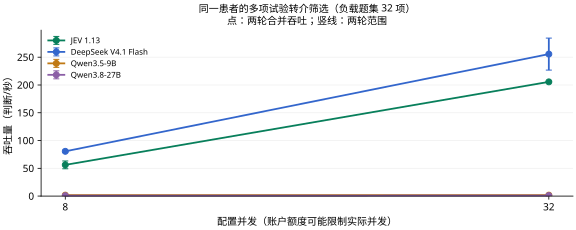

查看本任务的两个并发档

**表 27a｜同一患者的多项试验转介筛选：每请求最多 8 项，负载题集 32 项，各档两轮。**

| 模型 | 配置并发 | 吞吐量 (判断/秒) ↑ | 完整响应 P95 (秒) ↓ | 实际平均同时请求数 |
| --- | ---: | ---: | ---: | ---: |
| JEV 1.13 | 8 | 56.20 | 1.949 | 7.99 |
| DeepSeek V4.1 Flash | 8 | **80.60** | **1.231** | 7.99 |
| Qwen3.5-9B | 8 | 1.74 | — | 0.59 |
| Qwen3.8-27B | 8 | 0.78 | — | 0.51 |
| JEV 1.13 | 32 | 205.60 | **1.938** | 31.98 |
| DeepSeek V4.1 Flash | 32 | **255.60** | 2.322 | 31.96 |
| Qwen3.5-9B | 32 | 1.74 | — | 0.50 |
| Qwen3.8-27B | 32 | 0.96 | — | 0.40 |

配置并发是工作器上限；实际在途请求可能因账户额度更少。P95 不含客户端额度等待；不足 20 个完整响应时不报告 P95。

[任务定义与数据](docs/tasks/trial_shared_patient.md) · [评估方法](docs/MEDICAL_LOAD.md) · [原始记录与计价依据](results/medical-load-jev-gateway-v1/README.md)

## 知情同意与隐私处置选择

**表 28｜知情同意与隐私处置选择：3 项独立判断，3 个来源组；每请求最多 8 项。准确率测试配置 8 并发，负载测试配置 32 并发。**

| 模型 | 准确率 (%) ↑ | 吞吐量 (判断/秒) ↑ | 完整响应 P95 (秒) ↓ | 成本 (元/千项判断) ↓ |
| --- | ---: | ---: | ---: | ---: |
| JEV 1.13 | **100.00** | 73.58 | 2.601 | **0.098** |
| DeepSeek V4.1 Flash | **100.00** | **90.45** | **2.031** | 0.257–0.514 |
| Qwen3.5-9B | **100.00** | 2.77 | 2.618 | 0.143 |
| Qwen3.8-27B | **100.00** | 0.75 | — | 0.817 |

准确率和成本来自完整的 3 项固定题集；吞吐与 P95 来自其中预先选定的 3 项判断，持续循环施压两轮。重复调用不增加独立题量。P95 从实际发出计时，不含额度排队；不足 20 个响应时留空。

样本覆盖有限，只作探索性比较，尤其不能据此稳定估计临床可靠性。

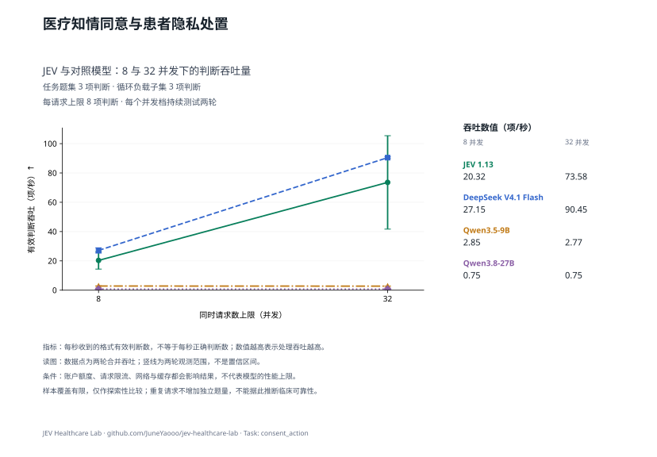

查看本任务的两个并发档

**表 28a｜知情同意与隐私处置选择：每请求最多 8 项，负载题集 3 项，各档两轮。**

| 模型 | 配置并发 | 吞吐量 (判断/秒) ↑ | 完整响应 P95 (秒) ↓ | 实际平均同时请求数 |
| --- | ---: | ---: | ---: | ---: |
| JEV 1.13 | 8 | 20.32 | 2.492 | 8.00 |
| DeepSeek V4.1 Flash | 8 | **27.15** | 2.079 | 7.99 |
| Qwen3.5-9B | 8 | 2.85 | **1.363** | 0.93 |
| Qwen3.8-27B | 8 | 0.75 | — | 3.29 |
| JEV 1.13 | 32 | 73.58 | 2.601 | 31.99 |
| DeepSeek V4.1 Flash | 32 | **90.45** | **2.031** | 31.98 |
| Qwen3.5-9B | 32 | 2.77 | 2.618 | 1.09 |
| Qwen3.8-27B | 32 | 0.75 | — | 3.59 |

配置并发是工作器上限；实际在途请求可能因账户额度更少。P95 不含客户端额度等待；不足 20 个完整响应时不报告 P95。

[任务定义与数据](docs/tasks/consent_action.md) · [评估方法](docs/MEDICAL_LOAD.md) · [原始记录与计价依据](results/medical-load-jev-gateway-v1/README.md)

[Linux.do 社区](https://linux.do/)
