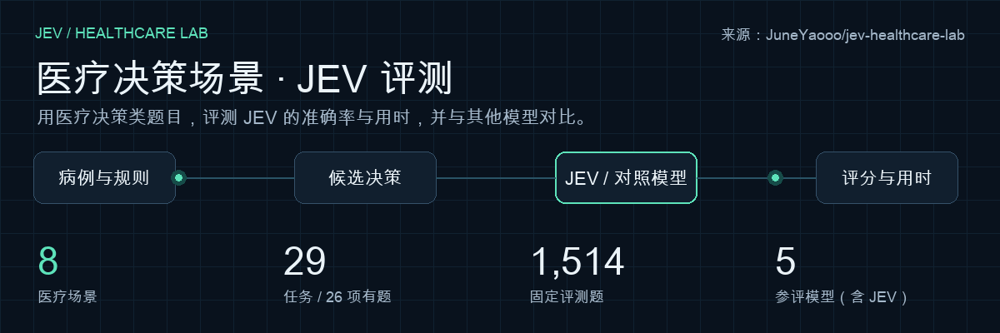
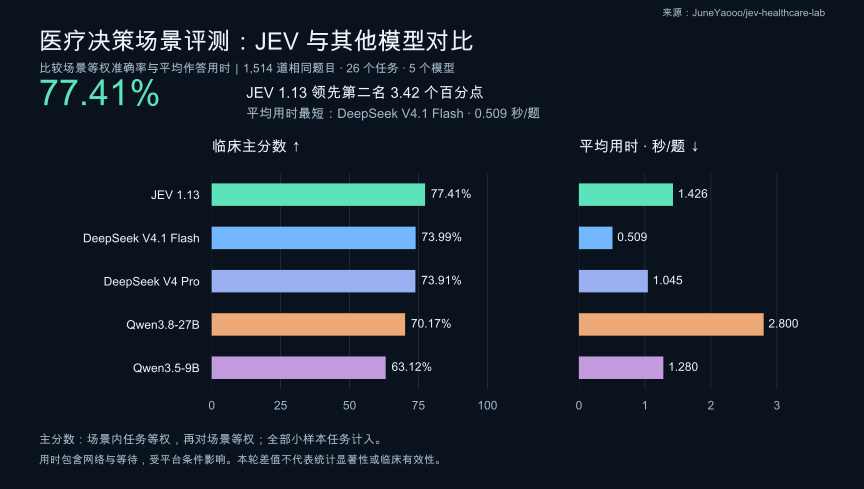
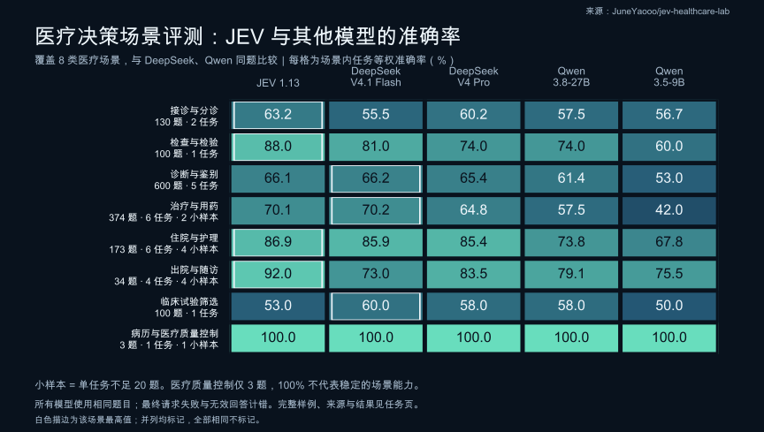
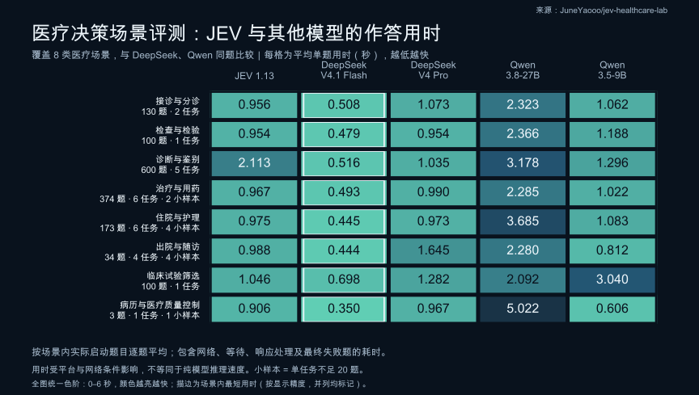

# Jev Healthcare Lab

本项目从公开数据集中筛选并整理医疗决策类题目，用于评测 **JEV 模型在医疗场景中的决策表现**，并与其他模型逐任务比较准确率和完整运行耗时。题目要求模型根据病例、检查结果或规则材料，从给定候选中选择判断或行动。

评测按 **8 个医疗场景、29 个任务**组织：从接诊与分诊、检查与检验、诊断与鉴别，到治疗与用药、住院与护理、出院与随访，并涵盖临床试验筛选和病历与医疗质量控制。

目前 **26 个任务有题，共 1,514 题**（中文 1,080 题），来自 11 个数据来源；另有 3 个任务待补。任务另按 7 个能力标签标注。全部有题任务计入总分，其中 11 个不足 20 题，标记为小样本。已完成 5 个模型的同题评测。

[场景与任务](#场景与任务) · [评测方案：请求与提示词](docs/EVALUATION.md) · [任务说明与样例](docs/tasks/README.md) · [数据集说明与样例](docs/datasets/README.md) · [辅助任务](docs/tasks/AUXILIARY.md)

## 评测速览

**JEV 1.13 本轮主分数最高：77.41%**，领先第二名 3.42 个百分点。**DeepSeek V4.1 Flash 平均用时最短：0.509 秒/题**。

主分数按场景内任务等权、再对场景等权计算；全部 26 个有题任务计入。11 个任务不足 20 题，医疗质量控制场景仅 3 题。以上为本轮观测结果，不代表统计显著性或临床有效性；用时受网络和平台服务条件影响。

[完整模型结果](docs/MODEL_RESULTS.md) · [逐题原始记录](results/clinical-v1/README.md) · [图表数据](assets/readme/metrics-v1.json)

## 能力维度

场景表示医疗流程环节；能力标签描述判断方式，可以重叠。任务是逐项比较的单位，数据来源或语言子集不重复算作独立任务。

| 能力维度 | 关联任务数（含待补） |
| --- | --- |
| 分类与标准化 | 3 |
| 临床候选方案 | 15 |
| 资格与适宜性 | 4 |
| 证据与一致性 | 1 |
| 风险与升级 | 4 |
| 规则与数值 | 2 |
| 流程与下一步行动 | 9 |

## 场景与任务

先看 **准确率 ↑**，再看 **平均用时 ↓**。每个场景分成两张表，模型顺序保持一致。**加粗**表示该任务的最高准确率或最短用时；按显示精度并列时同时加粗，全部相同则不标记。

用时单位为秒，包含网络、响应处理和重试。⚠ 表示该模型在此任务有请求失败或无效回答，失败计错且耗时保留；不能只凭较短用时判断优劣。标为“小样本”的任务不足 20 题，仍计入总分，结果可能波动较大；— 表示尚无数据。点击任务名称查看详情，展开场景末尾的来源表查看数据集。

| 医疗场景 | 有题任务 / 定义任务 | 题数 |
| --- | --- | --- |
| 接诊与分诊 | 2 / 3 | 130 |
| 检查与检验 | 1 / 2 | 100 |
| 诊断与鉴别 | 5 / 5 | 600 |
| 治疗与用药 | 6 / 7 | 374 |
| 住院与护理 | 6 / 6 | 173 |
| 出院与随访 | 4 / 4 | 34 |
| 临床试验筛选 | 1 / 1 | 100 |
| 病历与医疗质量控制 | 1 / 1 | 3 |

### 接诊与分诊

**准确率 ↑ · 越高越好**

| 任务 | 题数 | JEV 1.13 | DeepSeek V4.1 Flash | DeepSeek V4 Pro | Qwen3.5-9B | Qwen3.8-27B |
| --- | ---: | ---: | ---: | ---: | ---: | ---: |
| [分诊与就医紧急程度判断](docs/tasks/triage_urgency.md) | 100 | 63.00% | 61.00% | 57.00% | 50.00% ⚠ | **65.00%** |
| [首诊科室选择](docs/tasks/department_routing.md) | 0 · 待补 | — | — | — | — | — |
| [患者消息处理优先级](docs/tasks/message_urgency_pair.md) | 30 | **63.33%** | 50.00% | **63.33%** | **63.33%** | 50.00% |

**平均用时 ↓ · 秒，越低越好**

| 任务 | 题数 | JEV 1.13 | DeepSeek V4.1 Flash | DeepSeek V4 Pro | Qwen3.5-9B | Qwen3.8-27B |
| --- | ---: | ---: | ---: | ---: | ---: | ---: |
| [分诊与就医紧急程度判断](docs/tasks/triage_urgency.md) | 100 | 0.971 | **0.511** | 1.003 | 1.075 ⚠ | 2.201 |
| [首诊科室选择](docs/tasks/department_routing.md) | 0 · 待补 | — | — | — | — | — |
| [患者消息处理优先级](docs/tasks/message_urgency_pair.md) | 30 | 0.906 | **0.496** | 1.306 | 1.020 | 2.728 |

数据来源与能力维度

| 任务 | 能力维度 | 题数 | 状态 | 数据集来源（题数） |
| --- | --- | --- | --- | --- |
| [分诊与就医紧急程度判断](docs/tasks/triage_urgency.md) | 风险与升级 | 100 | 计入总分 | [CARE-Bench](docs/datasets/care_bench.md)†（100） |
| [首诊科室选择](docs/tasks/department_routing.md) | 临床候选方案 | 0 | 待补 | 待补数据 |
| [患者消息处理优先级](docs/tasks/message_urgency_pair.md) | 风险与升级 | 30 | 计入总分 | [PMR-Synth annotated pairs](docs/datasets/pmr_synth.md)†（30） |

† 非商业附加来源。来源后的数字为实际题数。

### 检查与检验

**准确率 ↑ · 越高越好**

| 任务 | 题数 | JEV 1.13 | DeepSeek V4.1 Flash | DeepSeek V4 Pro | Qwen3.5-9B | Qwen3.8-27B |
| --- | ---: | ---: | ---: | ---: | ---: | ---: |
| [危急检验结果处置选择](docs/tasks/critical_result_escalation.md) | 0 · 待补 | — | — | — | — | — |
| [检查方案选择](docs/tasks/examination_choice.md) | 100 | **88.00%** | 81.00% ⚠ | 74.00% | 60.00% | 74.00% |

**平均用时 ↓ · 秒，越低越好**

| 任务 | 题数 | JEV 1.13 | DeepSeek V4.1 Flash | DeepSeek V4 Pro | Qwen3.5-9B | Qwen3.8-27B |
| --- | ---: | ---: | ---: | ---: | ---: | ---: |
| [危急检验结果处置选择](docs/tasks/critical_result_escalation.md) | 0 · 待补 | — | — | — | — | — |
| [检查方案选择](docs/tasks/examination_choice.md) | 100 | 0.954 | **0.479** ⚠ | 0.954 | 1.188 | 2.366 |

数据来源与能力维度

| 任务 | 能力维度 | 题数 | 状态 | 数据集来源（题数） |
| --- | --- | --- | --- | --- |
| [危急检验结果处置选择](docs/tasks/critical_result_escalation.md) | 风险与升级 | 0 | 待补 | 待补数据 |
| [检查方案选择](docs/tasks/examination_choice.md) | 临床候选方案 | 100 | 计入总分 | [CMB-Exam（中文病例单选子集）](docs/datasets/cmb.md)（19）；[CNMLEQA-10k（中文案例分析子集）](docs/datasets/cnmleqa.md)（81） |

† 非商业附加来源。来源后的数字为实际题数。

### 诊断与鉴别

**准确率 ↑ · 越高越好**

| 任务 | 题数 | JEV 1.13 | DeepSeek V4.1 Flash | DeepSeek V4 Pro | Qwen3.5-9B | Qwen3.8-27B |
| --- | ---: | ---: | ---: | ---: | ---: | ---: |
| [疾病分期与严重程度判断](docs/tasks/clinical_grade.md) | 100 | **62.00%** | 50.00% ⚠ | 53.00% | 34.00% ⚠ | 43.00% |
| [病例诊断选择](docs/tasks/diagnosis.md) | 200 | 79.50% | **84.00%** | 81.00% | 66.00% | 77.00% |
| [中医证型判断](docs/tasks/tcm_syndrome.md) | 100 | **38.00%** | 37.00% | 30.00% | 29.00% ⚠ | 31.00% |
| [病例病因判断](docs/tasks/case_etiology.md) | 100 | **84.00%** | **84.00%** | **84.00%** | 66.00% | 81.00% |
| [中医候选病机判断](docs/tasks/tcm_pathogenesis_candidate.md) | 100 | 67.00% | 76.00% | **79.00%** | 70.00% | 75.00% |

**平均用时 ↓ · 秒，越低越好**

| 任务 | 题数 | JEV 1.13 | DeepSeek V4.1 Flash | DeepSeek V4 Pro | Qwen3.5-9B | Qwen3.8-27B |
| --- | ---: | ---: | ---: | ---: | ---: | ---: |
| [疾病分期与严重程度判断](docs/tasks/clinical_grade.md) | 100 | 1.336 | **0.470** ⚠ | 0.949 | 1.469 ⚠ | 2.685 |
| [病例诊断选择](docs/tasks/diagnosis.md) | 200 | 1.047 | **0.586** | 0.994 | 1.283 | 3.025 |
| [中医证型判断](docs/tasks/tcm_syndrome.md) | 100 | 3.838 | **0.546** | 1.162 | 1.143 ⚠ | 4.763 |
| [病例病因判断](docs/tasks/case_etiology.md) | 100 | 3.744 | **0.478** | 1.012 | 1.585 | 1.808 |
| [中医候选病机判断](docs/tasks/tcm_pathogenesis_candidate.md) | 100 | 1.666 | **0.430** | 1.101 | 1.012 | 3.760 |

数据来源与能力维度

| 任务 | 能力维度 | 题数 | 状态 | 数据集来源（题数） |
| --- | --- | --- | --- | --- |
| [疾病分期与严重程度判断](docs/tasks/clinical_grade.md) | 规则与数值 | 100 | 计入总分 | [CMB-Exam（中文病例单选子集）](docs/datasets/cmb.md)（70）；[CNMLEQA-10k（中文案例分析子集）](docs/datasets/cnmleqa.md)（30） |
| [病例诊断选择](docs/tasks/diagnosis.md) | 临床候选方案 | 200 | 计入总分 | [CMB-Exam（中文病例单选子集）](docs/datasets/cmb.md)（50）；[CNMLEQA-10k（中文案例分析子集）](docs/datasets/cnmleqa.md)（50）；[DDXPlus](docs/datasets/ddxplus.md)（100） |
| [中医证型判断](docs/tasks/tcm_syndrome.md) | 临床候选方案 | 100 | 计入总分 | [TCM-SD](docs/datasets/tcm_sd.md)†（100） |
| [病例病因判断](docs/tasks/case_etiology.md) | 临床候选方案 | 100 | 计入总分 | [CMB-Exam（中文病例单选子集）](docs/datasets/cmb.md)（50）；[CNMLEQA-10k（中文案例分析子集）](docs/datasets/cnmleqa.md)（50） |
| [中医候选病机判断](docs/tasks/tcm_pathogenesis_candidate.md) | 分类与标准化 | 100 | 计入总分 | [TCMEval-SDT](docs/datasets/tcmeval_sdt.md)（100） |

† 非商业附加来源。来源后的数字为实际题数。

### 治疗与用药

**准确率 ↑ · 越高越好**

| 任务 | 题数 | JEV 1.13 | DeepSeek V4.1 Flash | DeepSeek V4 Pro | Qwen3.5-9B | Qwen3.8-27B |
| --- | ---: | ---: | ---: | ---: | ---: | ---: |
| [患者方案禁忌判断](docs/tasks/patient_contraindication.md) | 54 | **79.63%** | 74.07% | 66.67% | 46.30% | 64.81% |
| [患者剂量适宜性判断](docs/tasks/dose_appropriateness.md) | 0 · 待补 | — | — | — | — | — |
| [治疗方案选择](docs/tasks/treatment_choice.md) | 100 | 78.00% | **82.00%** | 74.00% | 51.00% | 72.00% |
| [用药方案选择](docs/tasks/medication_choice.md) | 100 | **83.00%** | 80.00% | 72.00% | 47.00% | 73.00% |
| [补液方案选择](docs/tasks/fluid_plan.md) | 16 · 小样本 | 50.00% | **56.25%** ⚠ | 50.00% | 18.75% | 31.25% |
| [药物基因结果对应的指南建议选择](docs/tasks/pgx_guideline_recommendation.md) | 100 | **55.00%** | 54.00% | 51.00% | 39.00% | 54.00% |
| [给药途径与实施方法选择](docs/tasks/administration_route_choice.md) | 4 · 小样本 | **75.00%** | **75.00%** | **75.00%** | 50.00% | 50.00% |

**平均用时 ↓ · 秒，越低越好**

| 任务 | 题数 | JEV 1.13 | DeepSeek V4.1 Flash | DeepSeek V4 Pro | Qwen3.5-9B | Qwen3.8-27B |
| --- | ---: | ---: | ---: | ---: | ---: | ---: |
| [患者方案禁忌判断](docs/tasks/patient_contraindication.md) | 54 | 1.009 | **0.487** | 0.951 | 0.729 | 1.701 |
| [患者剂量适宜性判断](docs/tasks/dose_appropriateness.md) | 0 · 待补 | — | — | — | — | — |
| [治疗方案选择](docs/tasks/treatment_choice.md) | 100 | 0.923 | **0.454** | 0.946 | 0.861 | 2.486 |
| [用药方案选择](docs/tasks/medication_choice.md) | 100 | 0.960 | **0.519** | 0.978 | 1.217 | 1.595 |
| [补液方案选择](docs/tasks/fluid_plan.md) | 16 · 小样本 | 0.980 | **0.589** ⚠ | 0.910 | 2.595 | 1.992 |
| [药物基因结果对应的指南建议选择](docs/tasks/pgx_guideline_recommendation.md) | 100 | 0.993 | **0.492** | 1.084 | 0.865 | 3.176 |
| [给药途径与实施方法选择](docs/tasks/administration_route_choice.md) | 4 · 小样本 | 0.946 | **0.576** | 0.883 | 1.762 | 1.334 |

数据来源与能力维度

| 任务 | 能力维度 | 题数 | 状态 | 数据集来源（题数） |
| --- | --- | --- | --- | --- |
| [患者方案禁忌判断](docs/tasks/patient_contraindication.md) | 资格与适宜性 | 54 | 计入总分 | [CMB-Exam（中文病例单选子集）](docs/datasets/cmb.md)（33）；[CNMLEQA-10k（中文案例分析子集）](docs/datasets/cnmleqa.md)（21） |
| [患者剂量适宜性判断](docs/tasks/dose_appropriateness.md) | 资格与适宜性 | 0 | 待补 | 待补数据 |
| [治疗方案选择](docs/tasks/treatment_choice.md) | 临床候选方案 | 100 | 计入总分 | [CMB-Exam（中文病例单选子集）](docs/datasets/cmb.md)（46）；[CNMLEQA-10k（中文案例分析子集）](docs/datasets/cnmleqa.md)（54） |
| [用药方案选择](docs/tasks/medication_choice.md) | 临床候选方案 | 100 | 计入总分 | [CMB-Exam（中文病例单选子集）](docs/datasets/cmb.md)（12）；[CNMLEQA-10k（中文案例分析子集）](docs/datasets/cnmleqa.md)（88） |
| [补液方案选择](docs/tasks/fluid_plan.md) | 规则与数值 | 16 | 计入总分（小样本） | [CMB-Exam（中文病例单选子集）](docs/datasets/cmb.md)（9）；[CNMLEQA-10k（中文案例分析子集）](docs/datasets/cnmleqa.md)（7） |
| [药物基因结果对应的指南建议选择](docs/tasks/pgx_guideline_recommendation.md) | 资格与适宜性 | 100 | 计入总分 | [CPIC curated pharmacogenomic tables](docs/datasets/cpic.md)（100） |
| [给药途径与实施方法选择](docs/tasks/administration_route_choice.md) | 临床候选方案、流程与下一步行动 | 4 | 计入总分（小样本） | [CMB-Exam（中文病例单选子集）](docs/datasets/cmb.md)（3）；[CNMLEQA-10k（中文案例分析子集）](docs/datasets/cnmleqa.md)（1） |

† 非商业附加来源。来源后的数字为实际题数。

### 住院与护理

**准确率 ↑ · 越高越好**

| 任务 | 题数 | JEV 1.13 | DeepSeek V4.1 Flash | DeepSeek V4 Pro | Qwen3.5-9B | Qwen3.8-27B |
| --- | ---: | ---: | ---: | ---: | ---: | ---: |
| [病例并发症判断](docs/tasks/case_complication.md) | 100 | **93.00%** | 89.00% | 89.00% | 70.00% | 84.00% |
| [护理措施选择](docs/tasks/nursing_priority.md) | 42 | **85.71%** | 73.81% | 80.95% | 71.43% | 83.33% |
| [营养与饮食方案选择](docs/tasks/nutrition_plan.md) | 11 · 小样本 | **72.73%** | **72.73%** | **72.73%** | 45.45% | 45.45% |
| [护理与操作体位选择](docs/tasks/positioning_choice.md) | 10 · 小样本 | **90.00%** | 80.00% | **90.00%** | 60.00% | 70.00% |
| [病情监测与疗效判断](docs/tasks/monitoring_target.md) | 5 · 小样本 | 80.00% | **100.00%** | 80.00% | 60.00% | 60.00% |
| [感染防控措施选择](docs/tasks/infection_precaution.md) | 5 · 小样本 | 100.00% | 100.00% | 100.00% | 100.00% | 100.00% |

**平均用时 ↓ · 秒，越低越好**

| 任务 | 题数 | JEV 1.13 | DeepSeek V4.1 Flash | DeepSeek V4 Pro | Qwen3.5-9B | Qwen3.8-27B |
| --- | ---: | ---: | ---: | ---: | ---: | ---: |
| [病例并发症判断](docs/tasks/case_complication.md) | 100 | 1.018 | **0.439** | 0.960 | 1.173 | 2.439 |
| [护理措施选择](docs/tasks/nursing_priority.md) | 42 | 0.918 | **0.452** | 0.966 | 0.869 | 7.995 |
| [营养与饮食方案选择](docs/tasks/nutrition_plan.md) | 11 · 小样本 | 0.848 | **0.445** | 1.165 | 1.335 | 1.470 |
| [护理与操作体位选择](docs/tasks/positioning_choice.md) | 10 · 小样本 | 0.985 | **0.474** | 0.740 | 0.967 | 1.409 |
| [病情监测与疗效判断](docs/tasks/monitoring_target.md) | 5 · 小样本 | 0.843 | **0.433** | 1.363 | 0.716 | 4.005 |
| [感染防控措施选择](docs/tasks/infection_precaution.md) | 5 · 小样本 | 0.990 | **0.465** | 0.945 | 1.124 | 1.498 |

数据来源与能力维度

| 任务 | 能力维度 | 题数 | 状态 | 数据集来源（题数） |
| --- | --- | --- | --- | --- |
| [病例并发症判断](docs/tasks/case_complication.md) | 风险与升级 | 100 | 计入总分 | [CMB-Exam（中文病例单选子集）](docs/datasets/cmb.md)（64）；[CNMLEQA-10k（中文案例分析子集）](docs/datasets/cnmleqa.md)（36） |
| [护理措施选择](docs/tasks/nursing_priority.md) | 流程与下一步行动 | 42 | 计入总分 | [CMB-Exam（中文病例单选子集）](docs/datasets/cmb.md)（42） |
| [营养与饮食方案选择](docs/tasks/nutrition_plan.md) | 分类与标准化 | 11 | 计入总分（小样本） | [CMB-Exam（中文病例单选子集）](docs/datasets/cmb.md)（10）；[CNMLEQA-10k（中文案例分析子集）](docs/datasets/cnmleqa.md)（1） |
| [护理与操作体位选择](docs/tasks/positioning_choice.md) | 分类与标准化 | 10 | 计入总分（小样本） | [CMB-Exam（中文病例单选子集）](docs/datasets/cmb.md)（8）；[CNMLEQA-10k（中文案例分析子集）](docs/datasets/cnmleqa.md)（2） |
| [病情监测与疗效判断](docs/tasks/monitoring_target.md) | 临床候选方案、流程与下一步行动 | 5 | 计入总分（小样本） | [CMB-Exam（中文病例单选子集）](docs/datasets/cmb.md)（5） |
| [感染防控措施选择](docs/tasks/infection_precaution.md) | 临床候选方案、流程与下一步行动 | 5 | 计入总分（小样本） | [CMB-Exam（中文病例单选子集）](docs/datasets/cmb.md)（4）；[CNMLEQA-10k（中文案例分析子集）](docs/datasets/cnmleqa.md)（1） |

† 非商业附加来源。来源后的数字为实际题数。

### 出院与随访

**准确率 ↑ · 越高越好**

| 任务 | 题数 | JEV 1.13 | DeepSeek V4.1 Flash | DeepSeek V4 Pro | Qwen3.5-9B | Qwen3.8-27B |
| --- | ---: | ---: | ---: | ---: | ---: | ---: |
| [复查项目与随访时机选择](docs/tasks/followup_plan.md) | 6 · 小样本 | **83.33%** | 66.67% | **83.33%** | 50.00% | **83.33%** |
| [康复训练方案选择](docs/tasks/rehabilitation_choice.md) | 4 · 小样本 | **100.00%** | 50.00% | 75.00% | 75.00% | 50.00% |
| [预防措施选择](docs/tasks/prevention_choice.md) | 13 · 小样本 | 84.62% | 84.62% | 84.62% | 76.92% | **92.31%** |
| [健康教育与沟通行动选择](docs/tasks/patient_counseling.md) | 11 · 小样本 | **100.00%** | 90.91% | 90.91% | **100.00%** | 90.91% |

**平均用时 ↓ · 秒，越低越好**

| 任务 | 题数 | JEV 1.13 | DeepSeek V4.1 Flash | DeepSeek V4 Pro | Qwen3.5-9B | Qwen3.8-27B |
| --- | ---: | ---: | ---: | ---: | ---: | ---: |
| [复查项目与随访时机选择](docs/tasks/followup_plan.md) | 6 · 小样本 | 0.989 | **0.468** | 0.983 | 0.709 | 5.576 |
| [康复训练方案选择](docs/tasks/rehabilitation_choice.md) | 4 · 小样本 | 0.860 | **0.503** | 0.963 | 0.630 | 1.835 |
| [预防措施选择](docs/tasks/prevention_choice.md) | 13 · 小样本 | 0.898 | **0.432** | 0.881 | 0.720 | 1.407 |
| [健康教育与沟通行动选择](docs/tasks/patient_counseling.md) | 11 · 小样本 | 1.140 | **0.423** | 3.157 | 1.043 | 1.674 |

数据来源与能力维度

| 任务 | 能力维度 | 题数 | 状态 | 数据集来源（题数） |
| --- | --- | --- | --- | --- |
| [复查项目与随访时机选择](docs/tasks/followup_plan.md) | 临床候选方案、流程与下一步行动 | 6 | 计入总分（小样本） | [CMB-Exam（中文病例单选子集）](docs/datasets/cmb.md)（3）；[CNMLEQA-10k（中文案例分析子集）](docs/datasets/cnmleqa.md)（2）；[MedMCQA](docs/datasets/medmcqa.md)（1） |
| [康复训练方案选择](docs/tasks/rehabilitation_choice.md) | 临床候选方案、流程与下一步行动 | 4 | 计入总分（小样本） | [CMB-Exam（中文病例单选子集）](docs/datasets/cmb.md)（4） |
| [预防措施选择](docs/tasks/prevention_choice.md) | 临床候选方案、流程与下一步行动 | 13 | 计入总分（小样本） | [CMB-Exam（中文病例单选子集）](docs/datasets/cmb.md)（10）；[CNMLEQA-10k（中文案例分析子集）](docs/datasets/cnmleqa.md)（2）；[MedMCQA](docs/datasets/medmcqa.md)（1） |
| [健康教育与沟通行动选择](docs/tasks/patient_counseling.md) | 临床候选方案、流程与下一步行动 | 11 | 计入总分（小样本） | [CMB-Exam（中文病例单选子集）](docs/datasets/cmb.md)（11） |

† 非商业附加来源。来源后的数字为实际题数。

### 临床试验筛选

**准确率 ↑ · 越高越好**

| 任务 | 题数 | JEV 1.13 | DeepSeek V4.1 Flash | DeepSeek V4 Pro | Qwen3.5-9B | Qwen3.8-27B |
| --- | ---: | ---: | ---: | ---: | ---: | ---: |
| [患者临床试验初筛与转介判断](docs/tasks/trial_referral.md) | 100 | 53.00% | **60.00%** | 58.00% | 50.00% ⚠ | 58.00% ⚠ |

**平均用时 ↓ · 秒，越低越好**

| 任务 | 题数 | JEV 1.13 | DeepSeek V4.1 Flash | DeepSeek V4 Pro | Qwen3.5-9B | Qwen3.8-27B |
| --- | ---: | ---: | ---: | ---: | ---: | ---: |
| [患者临床试验初筛与转介判断](docs/tasks/trial_referral.md) | 100 | 1.046 | **0.698** | 1.282 | 3.040 ⚠ | 2.092 ⚠ |

数据来源与能力维度

| 任务 | 能力维度 | 题数 | 状态 | 数据集来源（题数） |
| --- | --- | --- | --- | --- |
| [患者临床试验初筛与转介判断](docs/tasks/trial_referral.md) | 资格与适宜性、证据与一致性 | 100 | 计入总分 | [TrialGPT SIGIR](docs/datasets/trialgpt.md)（100） |

† 非商业附加来源。来源后的数字为实际题数。

### 病历与医疗质量控制

**准确率 ↑ · 越高越好**

| 任务 | 题数 | JEV 1.13 | DeepSeek V4.1 Flash | DeepSeek V4 Pro | Qwen3.5-9B | Qwen3.8-27B |
| --- | ---: | ---: | ---: | ---: | ---: | ---: |
| [知情同意与隐私处置选择](docs/tasks/consent_action.md) | 3 · 小样本 | 100.00% | 100.00% | 100.00% | 100.00% | 100.00% |

**平均用时 ↓ · 秒，越低越好**

| 任务 | 题数 | JEV 1.13 | DeepSeek V4.1 Flash | DeepSeek V4 Pro | Qwen3.5-9B | Qwen3.8-27B |
| --- | ---: | ---: | ---: | ---: | ---: | ---: |
| [知情同意与隐私处置选择](docs/tasks/consent_action.md) | 3 · 小样本 | 0.906 | **0.350** | 0.967 | 0.606 | 5.022 |

数据来源与能力维度

| 任务 | 能力维度 | 题数 | 状态 | 数据集来源（题数） |
| --- | --- | --- | --- | --- |
| [知情同意与隐私处置选择](docs/tasks/consent_action.md) | 临床候选方案、流程与下一步行动 | 3 | 计入总分（小样本） | [CMB-Exam（中文病例单选子集）](docs/datasets/cmb.md)（1）；[PrinciplismQA](docs/datasets/principlismqa.md)（2） |

† 非商业附加来源。来源后的数字为实际题数。

## 模型得分与耗时对比

每个模型使用相同题目、候选项和许可范围，分别报告逐任务准确率、完整决策耗时（均值、P50、P95）、任务总耗时及失败率。多阶段调用、工具与重试计入完整决策耗时，运行配置随结果保存。

病例诊断的两个来源子集合并为一个任务。汇总先对场景内所有有题任务等权，再对有分数场景等权；小样本同样计入，空任务不计零分。小样本任务与其他任务具有相同权重，个别题目对其成绩的影响更大。固定语义分类额外报告 F1、召回、混淆矩阵与多数类基线；A/B/C 等随题变化的选项不报告临床类别 F1。

请求格式、完整提示词、模型参数、重试与计分计时口径见 [评测方案](docs/EVALUATION.md)。

| 模型 | 临床主分数 ↑ | 平均秒 ↓ | P95 秒 ↓ | 有效回答 / 题数 |
| --- | ---: | ---: | ---: | ---: |
| JEV 1.13 | **77.41%** | 1.426 | 4.092 | 1514 / 1514 |
| DeepSeek V4.1 Flash | 73.99% | **0.509** | **0.759** | 1505 / 1514 |
| DeepSeek V4 Pro | 73.91% | 1.045 | 1.522 | 1514 / 1514 |
| Qwen3.5-9B | 63.12% | 1.280 | 4.098 | 1493 / 1514 |
| Qwen3.8-27B | 70.17% | 2.800 | 6.496 | 1513 / 1514 |

生成式对照模型均关闭思考；每模型并发 8。主分数为场景等权汇总，不是全部题目的简单准确率。加粗仅标记本轮较优数值，不代表差异具有统计显著性。耗时为实际 API 调用的客户端时间，包含网络和重试；不同服务商和运行时段分别记录。

[全部逐任务得分与耗时](docs/MODEL_RESULTS.md) · [原始响应与运行配置](results/clinical-v1/README.md)

## 许可

第三方数据保留各自的原始许可；见 [第三方声明](THIRD_PARTY_NOTICES.md) 和包内 LICENSE-DATA.md。
