# Jev Healthcare Lab

比较 JEV、DeepSeek Flash 与 Qwen 在具体医疗决策任务上的**准确率、持续吞吐和使用成本**。每次请求同时处理多项判断，多个请求持续并发；结果按医疗任务分别呈现。

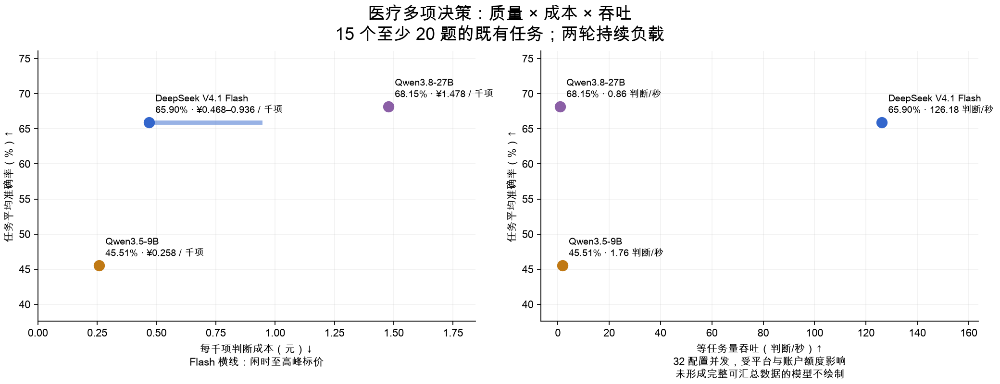

本轮覆盖 26 个既有医疗任务的 1,514 项判断，另加 8 位模拟患者的 64 项试验转介判断。数据包含考试病例、模拟患者与公开标注，尚非临床部署验证。

完整题集已完成的模型：DeepSeek V4.1 Flash、Qwen3.5-9B、Qwen3.8-27B。

**本轮尚未完成：JEV 1.13。** 相应成绩留空，当前尚不能完成四模型对比。[既有 JEV／Flash 阶段性测试](results/sustained-throughput-v1/README.md)另行保留。

准确率按模型原样输出计分，非法选项也算错；它同时反映判断与输出可用性。吞吐表示每秒收到的合法判断数，**不等于每秒正确判断数**。成本按新病例、无缓存折扣的输入与输出用量折算，单位为人民币；Flash 区间对应闲时与高峰标价。

吞吐为固定题组反复请求的服务实测，受网络、供应商缓存与账户额度影响。Qwen 本次账户上限分别为 8 万／4 万 token 每分钟；因此结果可用于比较当前接入条件，不能用于宣称模型的极限吞吐。

**表 1｜医疗任务总览。准确率与成本来自完整题集的 8 并发多题测试；吞吐取预先指定的 32 并发档、两轮持续负载结果。点击任务进入详细结果。**

| 医疗场景 | 具体任务 | 独立题量 | 模型 | 准确率 (%) ↑ | 吞吐量 (判断/秒) ↑ | 成本 (元/千项判断) ↓ |
| --- | --- | ---: | --- | ---: | ---: | ---: |
| 接诊与分诊 | [分诊与就医紧急程度判断](#triage_urgency) | 100 | JEV 1.13 | — | — | — |
| 接诊与分诊 | [分诊与就医紧急程度判断](#triage_urgency) | 100 | DeepSeek V4.1 Flash | 58.00 | 194.80 | 0.308–0.615 |
| 接诊与分诊 | [分诊与就医紧急程度判断](#triage_urgency) | 100 | Qwen3.5-9B | 54.00 | 3.20 | 0.175 |
| 接诊与分诊 | [分诊与就医紧急程度判断](#triage_urgency) | 100 | Qwen3.8-27B | 69.00 | 0.60 | 0.900 |
| 接诊与分诊 | [患者消息处理优先级](#message_urgency_pair) | 30 | JEV 1.13 | — | — | — |
| 接诊与分诊 | [患者消息处理优先级](#message_urgency_pair) | 30 | DeepSeek V4.1 Flash | 70.00 | 209.35 | 1.063–2.126 |
| 接诊与分诊 | [患者消息处理优先级](#message_urgency_pair) | 30 | Qwen3.5-9B | 16.67 | 0.42 | 0.571 |
| 接诊与分诊 | [患者消息处理优先级](#message_urgency_pair) | 30 | Qwen3.8-27B | 66.67 | 0.54 | 3.356 |
| 检查与检验 | [检查方案选择](#examination_choice) | 100 | JEV 1.13 | — | — | — |
| 检查与检验 | [检查方案选择](#examination_choice) | 100 | DeepSeek V4.1 Flash | 81.00 | 269.23 | 0.209–0.419 |
| 检查与检验 | [检查方案选择](#examination_choice) | 100 | Qwen3.5-9B | 54.00 | 3.83 | 0.122 |
| 检查与检验 | [检查方案选择](#examination_choice) | 100 | Qwen3.8-27B | 78.00 | 2.00 | 0.684 |
| 诊断与鉴别 | [疾病分期与严重程度判断](#clinical_grade) | 100 | JEV 1.13 | — | — | — |
| 诊断与鉴别 | [疾病分期与严重程度判断](#clinical_grade) | 100 | DeepSeek V4.1 Flash | 51.00 | 119.38 | 0.217–0.434 |
| 诊断与鉴别 | [疾病分期与严重程度判断](#clinical_grade) | 100 | Qwen3.5-9B | 30.00 | 3.85 | 0.127 |
| 诊断与鉴别 | [疾病分期与严重程度判断](#clinical_grade) | 100 | Qwen3.8-27B | 51.00 | 0.80 | 0.714 |
| 诊断与鉴别 | [病例诊断选择](#diagnosis) | 200 | JEV 1.13 | — | — | — |
| 诊断与鉴别 | [病例诊断选择](#diagnosis) | 200 | DeepSeek V4.1 Flash | 75.00 | 176.85 | 0.538–1.076 |
| 诊断与鉴别 | [病例诊断选择](#diagnosis) | 200 | Qwen3.5-9B | 58.00 | 1.65 | 0.300 |
| 诊断与鉴别 | [病例诊断选择](#diagnosis) | 200 | Qwen3.8-27B | 78.00 | 0.84 | 1.744 |
| 诊断与鉴别 | [中医证型判断](#tcm_syndrome) | 100 | JEV 1.13 | — | — | — |
| 诊断与鉴别 | [中医证型判断](#tcm_syndrome) | 100 | DeepSeek V4.1 Flash | 41.00 | 29.20 | 2.029–4.057 |
| 诊断与鉴别 | [中医证型判断](#tcm_syndrome) | 100 | Qwen3.5-9B | 27.00 | 0.59 | 1.042 |
| 诊断与鉴别 | [中医证型判断](#tcm_syndrome) | 100 | Qwen3.8-27B | 35.00 | 0.27 | 6.162 |
| 诊断与鉴别 | [病例病因判断](#case_etiology) | 100 | JEV 1.13 | — | — | — |
| 诊断与鉴别 | [病例病因判断](#case_etiology) | 100 | DeepSeek V4.1 Flash | 81.00 | 236.40 | 0.220–0.439 |
| 诊断与鉴别 | [病例病因判断](#case_etiology) | 100 | Qwen3.5-9B | 56.00 | 4.03 | 0.128 |
| 诊断与鉴别 | [病例病因判断](#case_etiology) | 100 | Qwen3.8-27B | 82.00 | 1.00 | 0.721 |
| 诊断与鉴别 | [中医候选病机判断](#tcm_pathogenesis_candidate) | 100 | JEV 1.13 | — | — | — |
| 诊断与鉴别 | [中医候选病机判断](#tcm_pathogenesis_candidate) | 100 | DeepSeek V4.1 Flash | 78.00 | 155.00 | 0.359–0.719 |
| 诊断与鉴别 | [中医候选病机判断](#tcm_pathogenesis_candidate) | 100 | Qwen3.5-9B | 59.00 | 2.80 | 0.196 |
| 诊断与鉴别 | [中医候选病机判断](#tcm_pathogenesis_candidate) | 100 | Qwen3.8-27B | 70.00 | 0.97 | 1.131 |
| 治疗与用药 | [患者方案禁忌判断](#patient_contraindication) | 54 | JEV 1.13 | — | — | — |
| 治疗与用药 | [患者方案禁忌判断](#patient_contraindication) | 54 | DeepSeek V4.1 Flash | 62.96 | 82.47 | 0.211–0.422 |
| 治疗与用药 | [患者方案禁忌判断](#patient_contraindication) | 54 | Qwen3.5-9B | 38.89 | 3.35 | 0.123 |
| 治疗与用药 | [患者方案禁忌判断](#patient_contraindication) | 54 | Qwen3.8-27B | 64.81 | 1.60 | 0.694 |
| 治疗与用药 | [治疗方案选择](#treatment_choice) | 100 | JEV 1.13 | — | — | — |
| 治疗与用药 | [治疗方案选择](#treatment_choice) | 100 | DeepSeek V4.1 Flash | 73.00 | 178.57 | 0.214–0.428 |
| 治疗与用药 | [治疗方案选择](#treatment_choice) | 100 | Qwen3.5-9B | 57.00 | 4.40 | 0.126 |
| 治疗与用药 | [治疗方案选择](#treatment_choice) | 100 | Qwen3.8-27B | 72.00 | 2.00 | 0.704 |
| 治疗与用药 | [用药方案选择](#medication_choice) | 100 | JEV 1.13 | — | — | — |
| 治疗与用药 | [用药方案选择](#medication_choice) | 100 | DeepSeek V4.1 Flash | 62.00 | 271.43 | 0.218–0.436 |
| 治疗与用药 | [用药方案选择](#medication_choice) | 100 | Qwen3.5-9B | 43.00 | 3.98 | 0.128 |
| 治疗与用药 | [用药方案选择](#medication_choice) | 100 | Qwen3.8-27B | 64.00 | 1.80 | 0.718 |
| 治疗与用药 | [补液方案选择](#fluid_plan) | 16 | JEV 1.13 | — | — | — |
| 治疗与用药 | [补液方案选择](#fluid_plan) | 16 | DeepSeek V4.1 Flash | 43.75 | 193.07 | 0.237–0.475 |
| 治疗与用药 | [补液方案选择](#fluid_plan) | 16 | Qwen3.5-9B | 31.25 | 3.70 | 0.144 |
| 治疗与用药 | [补液方案选择](#fluid_plan) | 16 | Qwen3.8-27B | 62.50 | 1.80 | 0.812 |
| 治疗与用药 | [药物基因结果对应的指南建议选择](#pgx_guideline_recommendation) | 100 | JEV 1.13 | — | — | — |
| 治疗与用药 | [药物基因结果对应的指南建议选择](#pgx_guideline_recommendation) | 100 | DeepSeek V4.1 Flash | 53.00 | 323.40 | 0.407–0.814 |
| 治疗与用药 | [药物基因结果对应的指南建议选择](#pgx_guideline_recommendation) | 100 | Qwen3.5-9B | 34.00 | 1.80 | 0.230 |
| 治疗与用药 | [药物基因结果对应的指南建议选择](#pgx_guideline_recommendation) | 100 | Qwen3.8-27B | 62.00 | 1.14 | 1.311 |
| 治疗与用药 | [给药途径与实施方法选择](#administration_route_choice) | 4 | JEV 1.13 | — | — | — |
| 治疗与用药 | [给药途径与实施方法选择](#administration_route_choice) | 4 | DeepSeek V4.1 Flash | 75.00 | 164.90 | 0.229–0.457 |
| 治疗与用药 | [给药途径与实施方法选择](#administration_route_choice) | 4 | Qwen3.5-9B | 50.00 | 3.30 | 0.132 |
| 治疗与用药 | [给药途径与实施方法选择](#administration_route_choice) | 4 | Qwen3.8-27B | 50.00 | 1.30 | 0.749 |
| 住院与护理 | [病例并发症判断](#case_complication) | 100 | JEV 1.13 | — | — | — |
| 住院与护理 | [病例并发症判断](#case_complication) | 100 | DeepSeek V4.1 Flash | 66.00 | 214.32 | 0.215–0.429 |
| 住院与护理 | [病例并发症判断](#case_complication) | 100 | Qwen3.5-9B | 53.00 | 3.55 | 0.126 |
| 住院与护理 | [病例并发症判断](#case_complication) | 100 | Qwen3.8-27B | 84.00 | 2.20 | 0.707 |
| 住院与护理 | [护理措施选择](#nursing_priority) | 42 | JEV 1.13 | — | — | — |
| 住院与护理 | [护理措施选择](#nursing_priority) | 42 | DeepSeek V4.1 Flash | 78.57 | 252.00 | 0.211–0.422 |
| 住院与护理 | [护理措施选择](#nursing_priority) | 42 | Qwen3.5-9B | 57.14 | 4.80 | 0.123 |
| 住院与护理 | [护理措施选择](#nursing_priority) | 42 | Qwen3.8-27B | 85.71 | 2.20 | 0.689 |
| 住院与护理 | [营养与饮食方案选择](#nutrition_plan) | 11 | JEV 1.13 | — | — | — |
| 住院与护理 | [营养与饮食方案选择](#nutrition_plan) | 11 | DeepSeek V4.1 Flash | 63.64 | 173.60 | 0.232–0.464 |
| 住院与护理 | [营养与饮食方案选择](#nutrition_plan) | 11 | Qwen3.5-9B | 27.27 | 3.70 | 0.135 |
| 住院与护理 | [营养与饮食方案选择](#nutrition_plan) | 11 | Qwen3.8-27B | 63.64 | 1.65 | 0.763 |
| 住院与护理 | [护理与操作体位选择](#positioning_choice) | 10 | JEV 1.13 | — | — | — |
| 住院与护理 | [护理与操作体位选择](#positioning_choice) | 10 | DeepSeek V4.1 Flash | 70.00 | 174.90 | 0.206–0.413 |
| 住院与护理 | [护理与操作体位选择](#positioning_choice) | 10 | Qwen3.5-9B | 30.00 | 3.33 | 0.126 |
| 住院与护理 | [护理与操作体位选择](#positioning_choice) | 10 | Qwen3.8-27B | 60.00 | 1.80 | 0.706 |
| 住院与护理 | [病情监测与疗效判断](#monitoring_target) | 5 | JEV 1.13 | — | — | — |
| 住院与护理 | [病情监测与疗效判断](#monitoring_target) | 5 | DeepSeek V4.1 Flash | 100.00 | 161.75 | 0.208–0.416 |
| 住院与护理 | [病情监测与疗效判断](#monitoring_target) | 5 | Qwen3.5-9B | 40.00 | 3.62 | 0.122 |
| 住院与护理 | [病情监测与疗效判断](#monitoring_target) | 5 | Qwen3.8-27B | 80.00 | 1.50 | 0.686 |
| 住院与护理 | [感染防控措施选择](#infection_precaution) | 5 | JEV 1.13 | — | — | — |
| 住院与护理 | [感染防控措施选择](#infection_precaution) | 5 | DeepSeek V4.1 Flash | 100.00 | 150.00 | 0.231–0.462 |
| 住院与护理 | [感染防控措施选择](#infection_precaution) | 5 | Qwen3.5-9B | 40.00 | 2.90 | 0.132 |
| 住院与护理 | [感染防控措施选择](#infection_precaution) | 5 | Qwen3.8-27B | 80.00 | 1.88 | 0.746 |
| 出院与随访 | [复查项目与随访时机选择](#followup_plan) | 6 | JEV 1.13 | — | — | — |
| 出院与随访 | [复查项目与随访时机选择](#followup_plan) | 6 | DeepSeek V4.1 Flash | 50.00 | 163.80 | 0.222–0.444 |
| 出院与随访 | [复查项目与随访时机选择](#followup_plan) | 6 | Qwen3.5-9B | 66.67 | 2.85 | 0.129 |
| 出院与随访 | [复查项目与随访时机选择](#followup_plan) | 6 | Qwen3.8-27B | 66.67 | 1.95 | 0.727 |
| 出院与随访 | [康复训练方案选择](#rehabilitation_choice) | 4 | JEV 1.13 | — | — | — |
| 出院与随访 | [康复训练方案选择](#rehabilitation_choice) | 4 | DeepSeek V4.1 Flash | 100.00 | 156.10 | 0.231–0.462 |
| 出院与随访 | [康复训练方案选择](#rehabilitation_choice) | 4 | Qwen3.5-9B | 50.00 | 3.30 | 0.132 |
| 出院与随访 | [康复训练方案选择](#rehabilitation_choice) | 4 | Qwen3.8-27B | 75.00 | 1.50 | 0.746 |
| 出院与随访 | [预防措施选择](#prevention_choice) | 13 | JEV 1.13 | — | — | — |
| 出院与随访 | [预防措施选择](#prevention_choice) | 13 | DeepSeek V4.1 Flash | 76.92 | 163.95 | 0.224–0.447 |
| 出院与随访 | [预防措施选择](#prevention_choice) | 13 | Qwen3.5-9B | 69.23 | 4.03 | 0.129 |
| 出院与随访 | [预防措施选择](#prevention_choice) | 13 | Qwen3.8-27B | 76.92 | 0.97 | 0.724 |
| 出院与随访 | [健康教育与沟通行动选择](#patient_counseling) | 11 | JEV 1.13 | — | — | — |
| 出院与随访 | [健康教育与沟通行动选择](#patient_counseling) | 11 | DeepSeek V4.1 Flash | 90.91 | 204.95 | 0.232–0.464 |
| 出院与随访 | [健康教育与沟通行动选择](#patient_counseling) | 11 | Qwen3.5-9B | 81.82 | 3.38 | 0.132 |
| 出院与随访 | [健康教育与沟通行动选择](#patient_counseling) | 11 | Qwen3.8-27B | 90.91 | 2.12 | 0.746 |
| 临床试验筛选 | [患者临床试验初筛与转介判断](#trial_referral) | 100 | JEV 1.13 | — | — | — |
| 临床试验筛选 | [患者临床试验初筛与转介判断](#trial_referral) | 100 | DeepSeek V4.1 Flash | 58.00 | 76.00 | 0.605–1.211 |
| 临床试验筛选 | [患者临床试验初筛与转介判断](#trial_referral) | 100 | Qwen3.5-9B | 45.00 | 1.72 | 0.347 |
| 临床试验筛选 | [患者临床试验初筛与转介判断](#trial_referral) | 100 | Qwen3.8-27B | 60.00 | 0.57 | 1.929 |
| 临床试验筛选 | [同一患者的多项试验转介筛选](#trial_shared_patient) | 64 | JEV 1.13 | — | — | — |
| 临床试验筛选 | [同一患者的多项试验转介筛选](#trial_shared_patient) | 64 | DeepSeek V4.1 Flash | 75.00 | 255.60 | 0.550–1.101 |
| 临床试验筛选 | [同一患者的多项试验转介筛选](#trial_shared_patient) | 64 | Qwen3.5-9B | 75.00 | 1.74 | 0.297 |
| 临床试验筛选 | [同一患者的多项试验转介筛选](#trial_shared_patient) | 64 | Qwen3.8-27B | 73.44 | 0.96 | 1.733 |
| 病历与医疗质量控制 | [知情同意与隐私处置选择](#consent_action) | 3 | JEV 1.13 | — | — | — |
| 病历与医疗质量控制 | [知情同意与隐私处置选择](#consent_action) | 3 | DeepSeek V4.1 Flash | 100.00 | 90.45 | 0.257–0.514 |
| 病历与医疗质量控制 | [知情同意与隐私处置选择](#consent_action) | 3 | Qwen3.5-9B | 100.00 | 2.77 | 0.143 |
| 病历与医疗质量控制 | [知情同意与隐私处置选择](#consent_action) | 3 | Qwen3.8-27B | 100.00 | 0.75 | 0.817 |

“—”表示本轮未获得完整数据或样本不足。独立题量指不重复的判断项，不表示统计独立，也不等于独立患者数；患者／来源组数见每个任务表题。少于 20 题仅作探索性比较。三个空任务（剂量适宜性、危急值升级、就诊科室分流）暂不计分。

[评估方法与适用边界](docs/MEDICAL_LOAD.md) · [数据集与许可](docs/datasets/README.md) · [原始响应与复算](results/medical-load-v2/README.md)

## 分诊与就医紧急程度判断

**表 2｜分诊与就医紧急程度判断：100 项独立判断，62 个来源组；每请求最多 8 项。准确率测试配置 8 并发，负载测试配置 32 并发。**

| 模型 | 准确率 (%) ↑ | Macro-F1 (%) ↑ | 吞吐量 (判断/秒) ↑ | 完整响应 P95 (秒) ↓ | 成本 (元/千项判断) ↓ |
| --- | ---: | ---: | ---: | ---: | ---: |
| JEV 1.13 | — | — | — | — | — |
| DeepSeek V4.1 Flash | 58.00 | 54.61 | 194.80 | 2.406 | 0.308–0.615 |
| Qwen3.5-9B | 54.00 | 54.82 | 3.20 | — | 0.175 |
| Qwen3.8-27B | 69.00 | 68.99 | 0.60 | — | 0.900 |

准确率和成本来自完整的 100 项固定题集；吞吐与 P95 来自其中预先选定的 32 项判断，持续循环施压两轮。重复调用不增加独立题量。P95 从实际发出计时，不含额度排队；不足 20 个响应时留空。

Macro-F1 对本任务金标中出现的类别等权平均；没有金标样本的候选类别不另加零分项，各模型使用相同类别集合。

查看本任务的两个并发档

**表 2a｜分诊与就医紧急程度判断：每请求最多 8 项，负载题集 32 项，各档两轮。**

| 模型 | 配置并发 | 吞吐量 (判断/秒) ↑ | 完整响应 P95 (秒) ↓ | 实际平均同时请求数 |
| --- | ---: | ---: | ---: | ---: |
| JEV 1.13 | 8 | — | — | — |
| DeepSeek V4.1 Flash | 8 | 47.40 | 2.332 | 8.00 |
| Qwen3.5-9B | 8 | 3.40 | — | 1.91 |
| Qwen3.8-27B | 8 | 1.40 | — | 1.32 |
| JEV 1.13 | 32 | — | — | — |
| DeepSeek V4.1 Flash | 32 | 194.80 | 2.406 | 31.98 |
| Qwen3.5-9B | 32 | 3.20 | — | 1.67 |
| Qwen3.8-27B | 32 | 0.60 | — | 2.05 |

配置并发是工作器上限；实际在途请求可能因账户额度更少。P95 不含客户端额度等待；不足 20 个完整响应时不报告 P95。

[任务定义与数据](docs/tasks/triage_urgency.md) · [评估方法](docs/MEDICAL_LOAD.md) · [原始记录与计价依据](results/medical-load-v2/README.md)

## 患者消息处理优先级

**表 3｜患者消息处理优先级：30 项独立判断，30 个来源组；每请求最多 8 项。准确率测试配置 8 并发，负载测试配置 32 并发。**

| 模型 | 准确率 (%) ↑ | 吞吐量 (判断/秒) ↑ | 完整响应 P95 (秒) ↓ | 成本 (元/千项判断) ↓ |
| --- | ---: | ---: | ---: | ---: |
| JEV 1.13 | — | — | — | — |
| DeepSeek V4.1 Flash | 70.00 | 209.35 | 2.736 | 1.063–2.126 |
| Qwen3.5-9B | 16.67 | 0.42 | — | 0.571 |
| Qwen3.8-27B | 66.67 | 0.54 | — | 3.356 |

准确率和成本来自完整的 30 项固定题集；吞吐与 P95 来自其中预先选定的 30 项判断，持续循环施压两轮。重复调用不增加独立题量。P95 从实际发出计时，不含额度排队；不足 20 个响应时留空。

本任务严格区分原始选项键，例如 `Patient #1` 不能改写成 `Patient_1`。这类输出合约错误也按错计，因此成绩同时反映判断和接口可直接使用的程度，不能全部归因于医学推理差异。

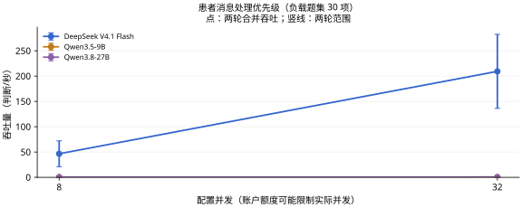

查看本任务的两个并发档

**表 3a｜患者消息处理优先级：每请求最多 8 项，负载题集 30 项，各档两轮。**

| 模型 | 配置并发 | 吞吐量 (判断/秒) ↑ | 完整响应 P95 (秒) ↓ | 实际平均同时请求数 |
| --- | ---: | ---: | ---: | ---: |
| JEV 1.13 | 8 | — | — | — |
| DeepSeek V4.1 Flash | 8 | 46.60 | 3.671 | 7.99 |
| Qwen3.5-9B | 8 | 0.31 | — | 0.37 |
| Qwen3.8-27B | 8 | 0.48 | — | 0.68 |
| JEV 1.13 | 32 | — | — | — |
| DeepSeek V4.1 Flash | 32 | 209.35 | 2.736 | 31.96 |
| Qwen3.5-9B | 32 | 0.42 | — | 0.33 |
| Qwen3.8-27B | 32 | 0.54 | — | 0.33 |

配置并发是工作器上限；实际在途请求可能因账户额度更少。P95 不含客户端额度等待；不足 20 个完整响应时不报告 P95。

[任务定义与数据](docs/tasks/message_urgency_pair.md) · [评估方法](docs/MEDICAL_LOAD.md) · [原始记录与计价依据](results/medical-load-v2/README.md)

## 检查方案选择

**表 4｜检查方案选择：100 项独立判断，100 个来源组；每请求最多 8 项。准确率测试配置 8 并发，负载测试配置 32 并发。**

| 模型 | 准确率 (%) ↑ | 吞吐量 (判断/秒) ↑ | 完整响应 P95 (秒) ↓ | 成本 (元/千项判断) ↓ |
| --- | ---: | ---: | ---: | ---: |
| JEV 1.13 | — | — | — | — |
| DeepSeek V4.1 Flash | 81.00 | 269.23 | 1.635 | 0.209–0.419 |
| Qwen3.5-9B | 54.00 | 3.83 | 2.779 | 0.122 |
| Qwen3.8-27B | 78.00 | 2.00 | — | 0.684 |

准确率和成本来自完整的 100 项固定题集；吞吐与 P95 来自其中预先选定的 32 项判断，持续循环施压两轮。重复调用不增加独立题量。P95 从实际发出计时，不含额度排队；不足 20 个响应时留空。

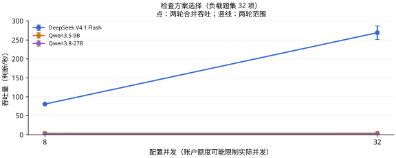

查看本任务的两个并发档

**表 4a｜检查方案选择：每请求最多 8 项，负载题集 32 项，各档两轮。**

| 模型 | 配置并发 | 吞吐量 (判断/秒) ↑ | 完整响应 P95 (秒) ↓ | 实际平均同时请求数 |
| --- | ---: | ---: | ---: | ---: |
| JEV 1.13 | 8 | — | — | — |
| DeepSeek V4.1 Flash | 8 | 80.90 | 1.271 | 7.99 |
| Qwen3.5-9B | 8 | 3.67 | 2.493 | 1.00 |
| Qwen3.8-27B | 8 | 2.00 | — | 0.72 |
| JEV 1.13 | 32 | — | — | — |
| DeepSeek V4.1 Flash | 32 | 269.23 | 1.635 | 31.98 |
| Qwen3.5-9B | 32 | 3.83 | 2.779 | 1.08 |
| Qwen3.8-27B | 32 | 2.00 | — | 0.70 |

配置并发是工作器上限；实际在途请求可能因账户额度更少。P95 不含客户端额度等待；不足 20 个完整响应时不报告 P95。

[任务定义与数据](docs/tasks/examination_choice.md) · [评估方法](docs/MEDICAL_LOAD.md) · [原始记录与计价依据](results/medical-load-v2/README.md)

## 疾病分期与严重程度判断

**表 5｜疾病分期与严重程度判断：100 项独立判断，99 个来源组；每请求最多 8 项。准确率测试配置 8 并发，负载测试配置 32 并发。**

| 模型 | 准确率 (%) ↑ | 吞吐量 (判断/秒) ↑ | 完整响应 P95 (秒) ↓ | 成本 (元/千项判断) ↓ |
| --- | ---: | ---: | ---: | ---: |
| JEV 1.13 | — | — | — | — |
| DeepSeek V4.1 Flash | 51.00 | 119.38 | 5.390 | 0.217–0.434 |
| Qwen3.5-9B | 30.00 | 3.85 | 2.572 | 0.127 |
| Qwen3.8-27B | 51.00 | 0.80 | — | 0.714 |

准确率和成本来自完整的 100 项固定题集；吞吐与 P95 来自其中预先选定的 32 项判断，持续循环施压两轮。重复调用不增加独立题量。P95 从实际发出计时，不含额度排队；不足 20 个响应时留空。

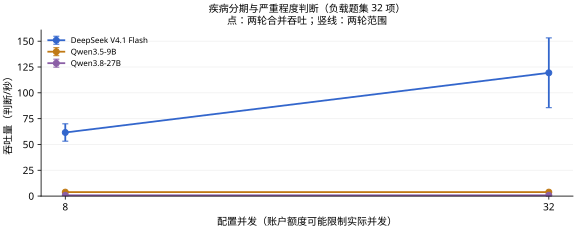

查看本任务的两个并发档

**表 5a｜疾病分期与严重程度判断：每请求最多 8 项，负载题集 32 项，各档两轮。**

| 模型 | 配置并发 | 吞吐量 (判断/秒) ↑ | 完整响应 P95 (秒) ↓ | 实际平均同时请求数 |
| --- | ---: | ---: | ---: | ---: |
| JEV 1.13 | 8 | — | — | — |
| DeepSeek V4.1 Flash | 8 | 61.60 | 1.810 | 7.99 |
| Qwen3.5-9B | 8 | 3.85 | 3.322 | 1.03 |
| Qwen3.8-27B | 8 | 0.80 | — | 2.55 |
| JEV 1.13 | 32 | — | — | — |
| DeepSeek V4.1 Flash | 32 | 119.38 | 5.390 | 31.99 |
| Qwen3.5-9B | 32 | 3.85 | 2.572 | 1.01 |
| Qwen3.8-27B | 32 | 0.80 | — | 1.88 |

配置并发是工作器上限；实际在途请求可能因账户额度更少。P95 不含客户端额度等待；不足 20 个完整响应时不报告 P95。

[任务定义与数据](docs/tasks/clinical_grade.md) · [评估方法](docs/MEDICAL_LOAD.md) · [原始记录与计价依据](results/medical-load-v2/README.md)

## 病例诊断选择

**表 6｜病例诊断选择：200 项独立判断，200 个来源组；每请求最多 8 项。准确率测试配置 8 并发，负载测试配置 32 并发。**

| 模型 | 准确率 (%) ↑ | 吞吐量 (判断/秒) ↑ | 完整响应 P95 (秒) ↓ | 成本 (元/千项判断) ↓ |
| --- | ---: | ---: | ---: | ---: |
| JEV 1.13 | — | — | — | — |
| DeepSeek V4.1 Flash | 75.00 | 176.85 | 4.117 | 0.538–1.076 |
| Qwen3.5-9B | 58.00 | 1.65 | — | 0.300 |
| Qwen3.8-27B | 78.00 | 0.84 | — | 1.744 |

准确率和成本来自完整的 200 项固定题集；吞吐与 P95 来自其中预先选定的 32 项判断，持续循环施压两轮。重复调用不增加独立题量。P95 从实际发出计时，不含额度排队；不足 20 个响应时留空。

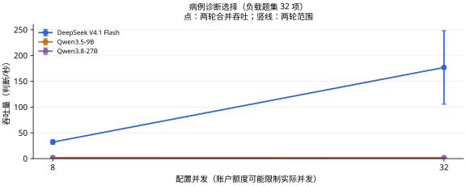

查看本任务的两个并发档

**表 6a｜病例诊断选择：每请求最多 8 项，负载题集 32 项，各档两轮。**

| 模型 | 配置并发 | 吞吐量 (判断/秒) ↑ | 完整响应 P95 (秒) ↓ | 实际平均同时请求数 |
| --- | ---: | ---: | ---: | ---: |
| JEV 1.13 | 8 | — | — | — |
| DeepSeek V4.1 Flash | 8 | 32.10 | 4.716 | 7.99 |
| Qwen3.5-9B | 8 | 1.90 | — | 0.64 |
| Qwen3.8-27B | 8 | 0.96 | — | 0.55 |
| JEV 1.13 | 32 | — | — | — |
| DeepSeek V4.1 Flash | 32 | 176.85 | 4.117 | 31.97 |
| Qwen3.5-9B | 32 | 1.65 | — | 0.67 |
| Qwen3.8-27B | 32 | 0.84 | — | 0.29 |

配置并发是工作器上限；实际在途请求可能因账户额度更少。P95 不含客户端额度等待；不足 20 个完整响应时不报告 P95。

[任务定义与数据](docs/tasks/diagnosis.md) · [评估方法](docs/MEDICAL_LOAD.md) · [原始记录与计价依据](results/medical-load-v2/README.md)

## 中医证型判断

**表 7｜中医证型判断：100 项独立判断，100 个来源组；每请求最多 8 项。准确率测试配置 8 并发，负载测试配置 32 并发。**

| 模型 | 准确率 (%) ↑ | Macro-F1 (%) ↑ | 吞吐量 (判断/秒) ↑ | 完整响应 P95 (秒) ↓ | 成本 (元/千项判断) ↓ |
| --- | ---: | ---: | ---: | ---: | ---: |
| JEV 1.13 | — | — | — | — | — |
| DeepSeek V4.1 Flash | 41.00 | 25.91 | 29.20 | 14.079 | 2.029–4.057 |
| Qwen3.5-9B | 27.00 | 15.23 | 0.59 | — | 1.042 |
| Qwen3.8-27B | 35.00 | 19.68 | 0.27 | — | 6.162 |

准确率和成本来自完整的 100 项固定题集；吞吐与 P95 来自其中预先选定的 32 项判断，持续循环施压两轮。重复调用不增加独立题量。P95 从实际发出计时，不含额度排队；不足 20 个响应时留空。

Macro-F1 对本任务金标中出现的类别等权平均；没有金标样本的候选类别不另加零分项，各模型使用相同类别集合。

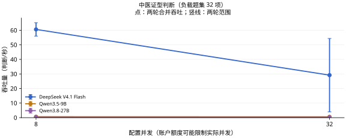

查看本任务的两个并发档

**表 7a｜中医证型判断：每请求最多 8 项，负载题集 32 项，各档两轮。**

| 模型 | 配置并发 | 吞吐量 (判断/秒) ↑ | 完整响应 P95 (秒) ↓ | 实际平均同时请求数 |
| --- | ---: | ---: | ---: | ---: |
| JEV 1.13 | 8 | — | — | — |
| DeepSeek V4.1 Flash | 8 | 60.60 | 1.407 | 7.99 |
| Qwen3.5-9B | 8 | 0.65 | — | 0.29 |
| Qwen3.8-27B | 8 | 0.27 | — | 0.20 |
| JEV 1.13 | 32 | — | — | — |
| DeepSeek V4.1 Flash | 32 | 29.20 | 14.079 | 31.99 |
| Qwen3.5-9B | 32 | 0.59 | — | 0.25 |
| Qwen3.8-27B | 32 | 0.27 | — | 0.22 |

配置并发是工作器上限；实际在途请求可能因账户额度更少。P95 不含客户端额度等待；不足 20 个完整响应时不报告 P95。

[任务定义与数据](docs/tasks/tcm_syndrome.md) · [评估方法](docs/MEDICAL_LOAD.md) · [原始记录与计价依据](results/medical-load-v2/README.md)

## 病例病因判断

**表 8｜病例病因判断：100 项独立判断，100 个来源组；每请求最多 8 项。准确率测试配置 8 并发，负载测试配置 32 并发。**

| 模型 | 准确率 (%) ↑ | 吞吐量 (判断/秒) ↑ | 完整响应 P95 (秒) ↓ | 成本 (元/千项判断) ↓ |
| --- | ---: | ---: | ---: | ---: |
| JEV 1.13 | — | — | — | — |
| DeepSeek V4.1 Flash | 81.00 | 236.40 | 1.466 | 0.220–0.439 |
| Qwen3.5-9B | 56.00 | 4.03 | 2.108 | 0.128 |
| Qwen3.8-27B | 82.00 | 1.00 | — | 0.721 |

准确率和成本来自完整的 100 项固定题集；吞吐与 P95 来自其中预先选定的 32 项判断，持续循环施压两轮。重复调用不增加独立题量。P95 从实际发出计时，不含额度排队；不足 20 个响应时留空。

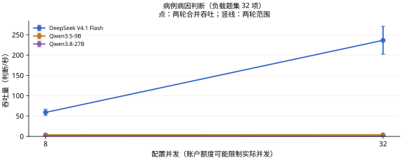

查看本任务的两个并发档

**表 8a｜病例病因判断：每请求最多 8 项，负载题集 32 项，各档两轮。**

| 模型 | 配置并发 | 吞吐量 (判断/秒) ↑ | 完整响应 P95 (秒) ↓ | 实际平均同时请求数 |
| --- | ---: | ---: | ---: | ---: |
| JEV 1.13 | 8 | — | — | — |
| DeepSeek V4.1 Flash | 8 | 59.10 | 1.118 | 7.99 |
| Qwen3.5-9B | 8 | 3.80 | 2.966 | 1.07 |
| Qwen3.8-27B | 8 | 2.00 | — | 1.26 |
| JEV 1.13 | 32 | — | — | — |
| DeepSeek V4.1 Flash | 32 | 236.40 | 1.466 | 31.97 |
| Qwen3.5-9B | 32 | 4.03 | 2.108 | 0.96 |
| Qwen3.8-27B | 32 | 1.00 | — | 2.28 |

配置并发是工作器上限；实际在途请求可能因账户额度更少。P95 不含客户端额度等待；不足 20 个完整响应时不报告 P95。

[任务定义与数据](docs/tasks/case_etiology.md) · [评估方法](docs/MEDICAL_LOAD.md) · [原始记录与计价依据](results/medical-load-v2/README.md)

## 中医候选病机判断

**表 9｜中医候选病机判断：100 项独立判断，50 个来源组；每请求最多 8 项。准确率测试配置 8 并发，负载测试配置 32 并发。**

| 模型 | 准确率 (%) ↑ | Macro-F1 (%) ↑ | 吞吐量 (判断/秒) ↑ | 完整响应 P95 (秒) ↓ | 成本 (元/千项判断) ↓ |
| --- | ---: | ---: | ---: | ---: | ---: |
| JEV 1.13 | — | — | — | — | — |
| DeepSeek V4.1 Flash | 78.00 | 78.00 | 155.00 | 7.781 | 0.359–0.719 |
| Qwen3.5-9B | 59.00 | 53.99 | 2.80 | — | 0.196 |
| Qwen3.8-27B | 70.00 | 69.21 | 0.97 | — | 1.131 |

准确率和成本来自完整的 100 项固定题集；吞吐与 P95 来自其中预先选定的 32 项判断，持续循环施压两轮。重复调用不增加独立题量。P95 从实际发出计时，不含额度排队；不足 20 个响应时留空。

Macro-F1 对本任务金标中出现的类别等权平均；没有金标样本的候选类别不另加零分项，各模型使用相同类别集合。

这是候选病机的判断任务，按既有标注计分；不能由此推导自由生成辨证与处方的能力。

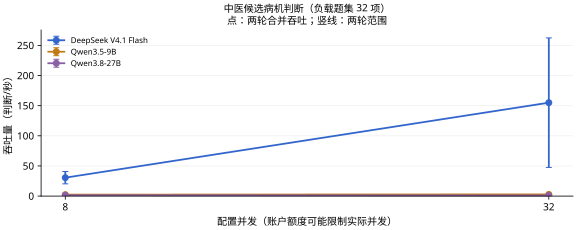

查看本任务的两个并发档

**表 9a｜中医候选病机判断：每请求最多 8 项，负载题集 32 项，各档两轮。**

| 模型 | 配置并发 | 吞吐量 (判断/秒) ↑ | 完整响应 P95 (秒) ↓ | 实际平均同时请求数 |
| --- | ---: | ---: | ---: | ---: |
| JEV 1.13 | 8 | — | — | — |
| DeepSeek V4.1 Flash | 8 | 30.60 | 6.432 | 8.00 |
| Qwen3.5-9B | 8 | 2.40 | — | 0.78 |
| Qwen3.8-27B | 8 | 1.46 | — | 0.84 |
| JEV 1.13 | 32 | — | — | — |
| DeepSeek V4.1 Flash | 32 | 155.00 | 7.781 | 31.99 |
| Qwen3.5-9B | 32 | 2.80 | — | 0.74 |
| Qwen3.8-27B | 32 | 0.97 | — | 1.18 |

配置并发是工作器上限；实际在途请求可能因账户额度更少。P95 不含客户端额度等待；不足 20 个完整响应时不报告 P95。

[任务定义与数据](docs/tasks/tcm_pathogenesis_candidate.md) · [评估方法](docs/MEDICAL_LOAD.md) · [原始记录与计价依据](results/medical-load-v2/README.md)

## 患者方案禁忌判断

**表 10｜患者方案禁忌判断：54 项独立判断，53 个来源组；每请求最多 8 项。准确率测试配置 8 并发，负载测试配置 32 并发。**

| 模型 | 准确率 (%) ↑ | 吞吐量 (判断/秒) ↑ | 完整响应 P95 (秒) ↓ | 成本 (元/千项判断) ↓ |
| --- | ---: | ---: | ---: | ---: |
| JEV 1.13 | — | — | — | — |
| DeepSeek V4.1 Flash | 62.96 | 82.47 | 5.906 | 0.211–0.422 |
| Qwen3.5-9B | 38.89 | 3.35 | 3.133 | 0.123 |
| Qwen3.8-27B | 64.81 | 1.60 | — | 0.694 |

准确率和成本来自完整的 54 项固定题集；吞吐与 P95 来自其中预先选定的 32 项判断，持续循环施压两轮。重复调用不增加独立题量。P95 从实际发出计时，不含额度排队；不足 20 个响应时留空。

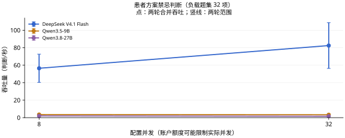

查看本任务的两个并发档

**表 10a｜患者方案禁忌判断：每请求最多 8 项，负载题集 32 项，各档两轮。**

| 模型 | 配置并发 | 吞吐量 (判断/秒) ↑ | 完整响应 P95 (秒) ↓ | 实际平均同时请求数 |
| --- | ---: | ---: | ---: | ---: |
| JEV 1.13 | 8 | — | — | — |
| DeepSeek V4.1 Flash | 8 | 56.50 | 2.225 | 7.99 |
| Qwen3.5-9B | 8 | 3.55 | 5.386 | 1.33 |
| Qwen3.8-27B | 8 | 2.00 | — | 1.00 |
| JEV 1.13 | 32 | — | — | — |
| DeepSeek V4.1 Flash | 32 | 82.47 | 5.906 | 31.99 |
| Qwen3.5-9B | 32 | 3.35 | 3.133 | 1.13 |
| Qwen3.8-27B | 32 | 1.60 | — | 0.95 |

配置并发是工作器上限；实际在途请求可能因账户额度更少。P95 不含客户端额度等待；不足 20 个完整响应时不报告 P95。

[任务定义与数据](docs/tasks/patient_contraindication.md) · [评估方法](docs/MEDICAL_LOAD.md) · [原始记录与计价依据](results/medical-load-v2/README.md)

## 治疗方案选择

**表 11｜治疗方案选择：100 项独立判断，100 个来源组；每请求最多 8 项。准确率测试配置 8 并发，负载测试配置 32 并发。**

| 模型 | 准确率 (%) ↑ | 吞吐量 (判断/秒) ↑ | 完整响应 P95 (秒) ↓ | 成本 (元/千项判断) ↓ |
| --- | ---: | ---: | ---: | ---: |
| JEV 1.13 | — | — | — | — |
| DeepSeek V4.1 Flash | 73.00 | 178.57 | 3.063 | 0.214–0.428 |
| Qwen3.5-9B | 57.00 | 4.40 | 6.105 | 0.126 |
| Qwen3.8-27B | 72.00 | 2.00 | — | 0.704 |

准确率和成本来自完整的 100 项固定题集；吞吐与 P95 来自其中预先选定的 32 项判断，持续循环施压两轮。重复调用不增加独立题量。P95 从实际发出计时，不含额度排队；不足 20 个响应时留空。

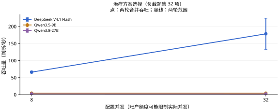

查看本任务的两个并发档

**表 11a｜治疗方案选择：每请求最多 8 项，负载题集 32 项，各档两轮。**

| 模型 | 配置并发 | 吞吐量 (判断/秒) ↑ | 完整响应 P95 (秒) ↓ | 实际平均同时请求数 |
| --- | ---: | ---: | ---: | ---: |
| JEV 1.13 | 8 | — | — | — |
| DeepSeek V4.1 Flash | 8 | 66.12 | 1.330 | 7.99 |
| Qwen3.5-9B | 8 | 4.40 | 4.483 | 1.22 |
| Qwen3.8-27B | 8 | 2.17 | — | 1.86 |
| JEV 1.13 | 32 | — | — | — |
| DeepSeek V4.1 Flash | 32 | 178.57 | 3.063 | 31.99 |
| Qwen3.5-9B | 32 | 4.40 | 6.105 | 1.31 |
| Qwen3.8-27B | 32 | 2.00 | — | 1.78 |

配置并发是工作器上限；实际在途请求可能因账户额度更少。P95 不含客户端额度等待；不足 20 个完整响应时不报告 P95。

[任务定义与数据](docs/tasks/treatment_choice.md) · [评估方法](docs/MEDICAL_LOAD.md) · [原始记录与计价依据](results/medical-load-v2/README.md)

## 用药方案选择

**表 12｜用药方案选择：100 项独立判断，100 个来源组；每请求最多 8 项。准确率测试配置 8 并发，负载测试配置 32 并发。**

| 模型 | 准确率 (%) ↑ | 吞吐量 (判断/秒) ↑ | 完整响应 P95 (秒) ↓ | 成本 (元/千项判断) ↓ |
| --- | ---: | ---: | ---: | ---: |
| JEV 1.13 | — | — | — | — |
| DeepSeek V4.1 Flash | 62.00 | 271.43 | 1.135 | 0.218–0.436 |
| Qwen3.5-9B | 43.00 | 3.98 | 3.856 | 0.128 |
| Qwen3.8-27B | 64.00 | 1.80 | — | 0.718 |

准确率和成本来自完整的 100 项固定题集；吞吐与 P95 来自其中预先选定的 32 项判断，持续循环施压两轮。重复调用不增加独立题量。P95 从实际发出计时，不含额度排队；不足 20 个响应时留空。

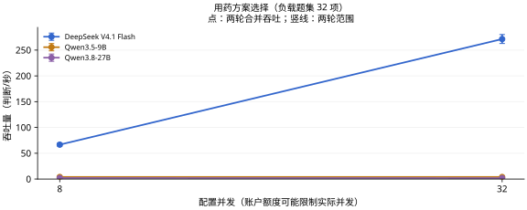

查看本任务的两个并发档

**表 12a｜用药方案选择：每请求最多 8 项，负载题集 32 项，各档两轮。**

| 模型 | 配置并发 | 吞吐量 (判断/秒) ↑ | 完整响应 P95 (秒) ↓ | 实际平均同时请求数 |
| --- | ---: | ---: | ---: | ---: |
| JEV 1.13 | 8 | — | — | — |
| DeepSeek V4.1 Flash | 8 | 66.67 | 1.265 | 7.99 |
| Qwen3.5-9B | 8 | 4.00 | 2.450 | 1.04 |
| Qwen3.8-27B | 8 | 2.00 | — | 0.69 |
| JEV 1.13 | 32 | — | — | — |
| DeepSeek V4.1 Flash | 32 | 271.43 | 1.135 | 31.97 |
| Qwen3.5-9B | 32 | 3.98 | 3.856 | 1.32 |
| Qwen3.8-27B | 32 | 1.80 | — | 0.81 |

配置并发是工作器上限；实际在途请求可能因账户额度更少。P95 不含客户端额度等待；不足 20 个完整响应时不报告 P95。

[任务定义与数据](docs/tasks/medication_choice.md) · [评估方法](docs/MEDICAL_LOAD.md) · [原始记录与计价依据](results/medical-load-v2/README.md)

## 补液方案选择

**表 13｜补液方案选择：16 项独立判断，15 个来源组；每请求最多 8 项。准确率测试配置 8 并发，负载测试配置 32 并发。**

| 模型 | 准确率 (%) ↑ | 吞吐量 (判断/秒) ↑ | 完整响应 P95 (秒) ↓ | 成本 (元/千项判断) ↓ |
| --- | ---: | ---: | ---: | ---: |
| JEV 1.13 | — | — | — | — |
| DeepSeek V4.1 Flash | 43.75 | 193.07 | 3.903 | 0.237–0.475 |
| Qwen3.5-9B | 31.25 | 3.70 | — | 0.144 |
| Qwen3.8-27B | 62.50 | 1.80 | — | 0.812 |

准确率和成本来自完整的 16 项固定题集；吞吐与 P95 来自其中预先选定的 16 项判断，持续循环施压两轮。重复调用不增加独立题量。P95 从实际发出计时，不含额度排队；不足 20 个响应时留空。

样本覆盖有限，只作探索性比较，尤其不能据此稳定估计临床可靠性。

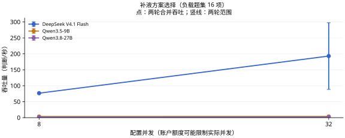

查看本任务的两个并发档

**表 13a｜补液方案选择：每请求最多 8 项，负载题集 16 项，各档两轮。**

| 模型 | 配置并发 | 吞吐量 (判断/秒) ↑ | 完整响应 P95 (秒) ↓ | 实际平均同时请求数 |
| --- | ---: | ---: | ---: | ---: |
| JEV 1.13 | 8 | — | — | — |
| DeepSeek V4.1 Flash | 8 | 76.75 | 1.174 | 7.99 |
| Qwen3.5-9B | 8 | 3.48 | — | 0.96 |
| Qwen3.8-27B | 8 | 1.80 | — | 0.85 |
| JEV 1.13 | 32 | — | — | — |
| DeepSeek V4.1 Flash | 32 | 193.07 | 3.903 | 31.98 |
| Qwen3.5-9B | 32 | 3.70 | — | 1.04 |
| Qwen3.8-27B | 32 | 1.80 | — | 0.72 |

配置并发是工作器上限；实际在途请求可能因账户额度更少。P95 不含客户端额度等待；不足 20 个完整响应时不报告 P95。

[任务定义与数据](docs/tasks/fluid_plan.md) · [评估方法](docs/MEDICAL_LOAD.md) · [原始记录与计价依据](results/medical-load-v2/README.md)

## 药物基因结果对应的指南建议选择

**表 14｜药物基因结果对应的指南建议选择：100 项独立判断，25 个来源组；每请求最多 8 项。准确率测试配置 8 并发，负载测试配置 32 并发。**

| 模型 | 准确率 (%) ↑ | 吞吐量 (判断/秒) ↑ | 完整响应 P95 (秒) ↓ | 成本 (元/千项判断) ↓ |
| --- | ---: | ---: | ---: | ---: |
| JEV 1.13 | — | — | — | — |
| DeepSeek V4.1 Flash | 53.00 | 323.40 | 1.097 | 0.407–0.814 |
| Qwen3.5-9B | 34.00 | 1.80 | — | 0.230 |
| Qwen3.8-27B | 62.00 | 1.14 | — | 1.311 |

准确率和成本来自完整的 100 项固定题集；吞吐与 P95 来自其中预先选定的 32 项判断，持续循环施压两轮。重复调用不增加独立题量。P95 从实际发出计时，不含额度排队；不足 20 个响应时留空。

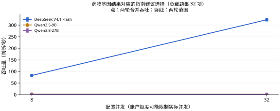

查看本任务的两个并发档

**表 14a｜药物基因结果对应的指南建议选择：每请求最多 8 项，负载题集 32 项，各档两轮。**

| 模型 | 配置并发 | 吞吐量 (判断/秒) ↑ | 完整响应 P95 (秒) ↓ | 实际平均同时请求数 |
| --- | ---: | ---: | ---: | ---: |
| JEV 1.13 | 8 | — | — | — |
| DeepSeek V4.1 Flash | 8 | 82.80 | 1.058 | 7.99 |
| Qwen3.5-9B | 8 | 2.40 | — | 0.76 |
| Qwen3.8-27B | 8 | 1.43 | — | 0.58 |
| JEV 1.13 | 32 | — | — | — |
| DeepSeek V4.1 Flash | 32 | 323.40 | 1.097 | 31.96 |
| Qwen3.5-9B | 32 | 1.80 | — | 0.57 |
| Qwen3.8-27B | 32 | 1.14 | — | 1.09 |

配置并发是工作器上限；实际在途请求可能因账户额度更少。P95 不含客户端额度等待；不足 20 个完整响应时不报告 P95。

[任务定义与数据](docs/tasks/pgx_guideline_recommendation.md) · [评估方法](docs/MEDICAL_LOAD.md) · [原始记录与计价依据](results/medical-load-v2/README.md)

## 给药途径与实施方法选择

**表 15｜给药途径与实施方法选择：4 项独立判断，4 个来源组；每请求最多 8 项。准确率测试配置 8 并发，负载测试配置 32 并发。**

| 模型 | 准确率 (%) ↑ | 吞吐量 (判断/秒) ↑ | 完整响应 P95 (秒) ↓ | 成本 (元/千项判断) ↓ |
| --- | ---: | ---: | ---: | ---: |
| JEV 1.13 | — | — | — | — |
| DeepSeek V4.1 Flash | 75.00 | 164.90 | 1.102 | 0.229–0.457 |
| Qwen3.5-9B | 50.00 | 3.30 | 1.843 | 0.132 |
| Qwen3.8-27B | 50.00 | 1.30 | — | 0.749 |

准确率和成本来自完整的 4 项固定题集；吞吐与 P95 来自其中预先选定的 4 项判断，持续循环施压两轮。重复调用不增加独立题量。P95 从实际发出计时，不含额度排队；不足 20 个响应时留空。

样本覆盖有限，只作探索性比较，尤其不能据此稳定估计临床可靠性。

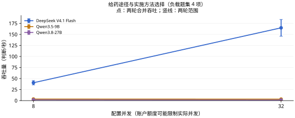

查看本任务的两个并发档

**表 15a｜给药途径与实施方法选择：每请求最多 8 项，负载题集 4 项，各档两轮。**

| 模型 | 配置并发 | 吞吐量 (判断/秒) ↑ | 完整响应 P95 (秒) ↓ | 实际平均同时请求数 |
| --- | ---: | ---: | ---: | ---: |
| JEV 1.13 | 8 | — | — | — |
| DeepSeek V4.1 Flash | 8 | 40.50 | 1.057 | 7.99 |
| Qwen3.5-9B | 8 | 3.50 | 1.776 | 0.99 |
| Qwen3.8-27B | 8 | 1.70 | — | 0.93 |
| JEV 1.13 | 32 | — | — | — |
| DeepSeek V4.1 Flash | 32 | 164.90 | 1.102 | 31.98 |
| Qwen3.5-9B | 32 | 3.30 | 1.843 | 1.03 |
| Qwen3.8-27B | 32 | 1.30 | — | 2.72 |

配置并发是工作器上限；实际在途请求可能因账户额度更少。P95 不含客户端额度等待；不足 20 个完整响应时不报告 P95。

[任务定义与数据](docs/tasks/administration_route_choice.md) · [评估方法](docs/MEDICAL_LOAD.md) · [原始记录与计价依据](results/medical-load-v2/README.md)

## 病例并发症判断

**表 16｜病例并发症判断：100 项独立判断，96 个来源组；每请求最多 8 项。准确率测试配置 8 并发，负载测试配置 32 并发。**

| 模型 | 准确率 (%) ↑ | 吞吐量 (判断/秒) ↑ | 完整响应 P95 (秒) ↓ | 成本 (元/千项判断) ↓ |
| --- | ---: | ---: | ---: | ---: |
| JEV 1.13 | — | — | — | — |
| DeepSeek V4.1 Flash | 66.00 | 214.32 | 2.277 | 0.215–0.429 |
| Qwen3.5-9B | 53.00 | 3.55 | 2.224 | 0.126 |
| Qwen3.8-27B | 84.00 | 2.20 | — | 0.707 |

准确率和成本来自完整的 100 项固定题集；吞吐与 P95 来自其中预先选定的 32 项判断，持续循环施压两轮。重复调用不增加独立题量。P95 从实际发出计时，不含额度排队；不足 20 个响应时留空。

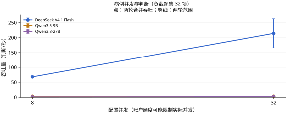

查看本任务的两个并发档

**表 16a｜病例并发症判断：每请求最多 8 项，负载题集 32 项，各档两轮。**

| 模型 | 配置并发 | 吞吐量 (判断/秒) ↑ | 完整响应 P95 (秒) ↓ | 实际平均同时请求数 |
| --- | ---: | ---: | ---: | ---: |
| JEV 1.13 | 8 | — | — | — |
| DeepSeek V4.1 Flash | 8 | 68.12 | 1.268 | 7.99 |
| Qwen3.5-9B | 8 | 3.52 | 2.162 | 0.98 |
| Qwen3.8-27B | 8 | 1.40 | — | 1.79 |
| JEV 1.13 | 32 | — | — | — |
| DeepSeek V4.1 Flash | 32 | 214.32 | 2.277 | 31.98 |
| Qwen3.5-9B | 32 | 3.55 | 2.224 | 0.92 |
| Qwen3.8-27B | 32 | 2.20 | — | 0.88 |

配置并发是工作器上限；实际在途请求可能因账户额度更少。P95 不含客户端额度等待；不足 20 个完整响应时不报告 P95。

[任务定义与数据](docs/tasks/case_complication.md) · [评估方法](docs/MEDICAL_LOAD.md) · [原始记录与计价依据](results/medical-load-v2/README.md)

## 护理措施选择

**表 17｜护理措施选择：42 项独立判断，42 个来源组；每请求最多 8 项。准确率测试配置 8 并发，负载测试配置 32 并发。**

| 模型 | 准确率 (%) ↑ | 吞吐量 (判断/秒) ↑ | 完整响应 P95 (秒) ↓ | 成本 (元/千项判断) ↓ |
| --- | ---: | ---: | ---: | ---: |
| JEV 1.13 | — | — | — | — |
| DeepSeek V4.1 Flash | 78.57 | 252.00 | 1.953 | 0.211–0.422 |
| Qwen3.5-9B | 57.14 | 4.80 | 2.056 | 0.123 |
| Qwen3.8-27B | 85.71 | 2.20 | — | 0.689 |

准确率和成本来自完整的 42 项固定题集；吞吐与 P95 来自其中预先选定的 32 项判断，持续循环施压两轮。重复调用不增加独立题量。P95 从实际发出计时，不含额度排队；不足 20 个响应时留空。

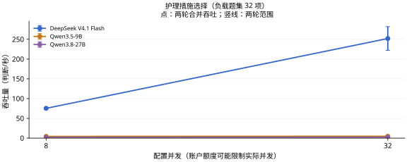

查看本任务的两个并发档

**表 17a｜护理措施选择：每请求最多 8 项，负载题集 32 项，各档两轮。**

| 模型 | 配置并发 | 吞吐量 (判断/秒) ↑ | 完整响应 P95 (秒) ↓ | 实际平均同时请求数 |
| --- | ---: | ---: | ---: | ---: |
| JEV 1.13 | 8 | — | — | — |
| DeepSeek V4.1 Flash | 8 | 75.40 | 1.294 | 8.00 |
| Qwen3.5-9B | 8 | 4.40 | 2.309 | 0.97 |
| Qwen3.8-27B | 8 | 2.00 | — | 0.67 |
| JEV 1.13 | 32 | — | — | — |
| DeepSeek V4.1 Flash | 32 | 252.00 | 1.953 | 31.98 |
| Qwen3.5-9B | 32 | 4.80 | 2.056 | 0.94 |
| Qwen3.8-27B | 32 | 2.20 | — | 0.85 |

配置并发是工作器上限；实际在途请求可能因账户额度更少。P95 不含客户端额度等待；不足 20 个完整响应时不报告 P95。

[任务定义与数据](docs/tasks/nursing_priority.md) · [评估方法](docs/MEDICAL_LOAD.md) · [原始记录与计价依据](results/medical-load-v2/README.md)

## 营养与饮食方案选择

**表 18｜营养与饮食方案选择：11 项独立判断，11 个来源组；每请求最多 8 项。准确率测试配置 8 并发，负载测试配置 32 并发。**

| 模型 | 准确率 (%) ↑ | 吞吐量 (判断/秒) ↑ | 完整响应 P95 (秒) ↓ | 成本 (元/千项判断) ↓ |
| --- | ---: | ---: | ---: | ---: |
| JEV 1.13 | — | — | — | — |
| DeepSeek V4.1 Flash | 63.64 | 173.60 | 3.069 | 0.232–0.464 |
| Qwen3.5-9B | 27.27 | 3.70 | 2.063 | 0.135 |
| Qwen3.8-27B | 63.64 | 1.65 | — | 0.763 |

准确率和成本来自完整的 11 项固定题集；吞吐与 P95 来自其中预先选定的 11 项判断，持续循环施压两轮。重复调用不增加独立题量。P95 从实际发出计时，不含额度排队；不足 20 个响应时留空。

样本覆盖有限，只作探索性比较，尤其不能据此稳定估计临床可靠性。

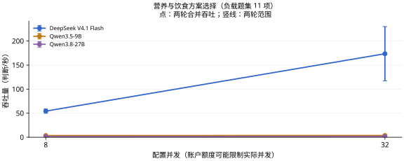

查看本任务的两个并发档

**表 18a｜营养与饮食方案选择：每请求最多 8 项，负载题集 11 项，各档两轮。**

| 模型 | 配置并发 | 吞吐量 (判断/秒) ↑ | 完整响应 P95 (秒) ↓ | 实际平均同时请求数 |
| --- | ---: | ---: | ---: | ---: |
| JEV 1.13 | 8 | — | — | — |
| DeepSeek V4.1 Flash | 8 | 54.38 | 1.294 | 7.99 |
| Qwen3.5-9B | 8 | 3.58 | 2.082 | 0.94 |
| Qwen3.8-27B | 8 | 1.32 | — | 1.62 |
| JEV 1.13 | 32 | — | — | — |
| DeepSeek V4.1 Flash | 32 | 173.60 | 3.069 | 31.98 |
| Qwen3.5-9B | 32 | 3.70 | 2.063 | 0.94 |
| Qwen3.8-27B | 32 | 1.65 | — | 1.40 |

配置并发是工作器上限；实际在途请求可能因账户额度更少。P95 不含客户端额度等待；不足 20 个完整响应时不报告 P95。

[任务定义与数据](docs/tasks/nutrition_plan.md) · [评估方法](docs/MEDICAL_LOAD.md) · [原始记录与计价依据](results/medical-load-v2/README.md)

## 护理与操作体位选择

**表 19｜护理与操作体位选择：10 项独立判断，10 个来源组；每请求最多 8 项。准确率测试配置 8 并发，负载测试配置 32 并发。**

| 模型 | 准确率 (%) ↑ | 吞吐量 (判断/秒) ↑ | 完整响应 P95 (秒) ↓ | 成本 (元/千项判断) ↓ |
| --- | ---: | ---: | ---: | ---: |
| JEV 1.13 | — | — | — | — |
| DeepSeek V4.1 Flash | 70.00 | 174.90 | 1.300 | 0.206–0.413 |
| Qwen3.5-9B | 30.00 | 3.33 | 2.114 | 0.126 |
| Qwen3.8-27B | 60.00 | 1.80 | — | 0.706 |

准确率和成本来自完整的 10 项固定题集；吞吐与 P95 来自其中预先选定的 10 项判断，持续循环施压两轮。重复调用不增加独立题量。P95 从实际发出计时，不含额度排队；不足 20 个响应时留空。

样本覆盖有限，只作探索性比较，尤其不能据此稳定估计临床可靠性。

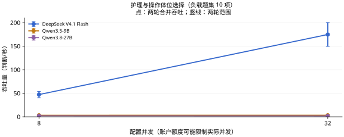

查看本任务的两个并发档

**表 19a｜护理与操作体位选择：每请求最多 8 项，负载题集 10 项，各档两轮。**

| 模型 | 配置并发 | 吞吐量 (判断/秒) ↑ | 完整响应 P95 (秒) ↓ | 实际平均同时请求数 |
| --- | ---: | ---: | ---: | ---: |
| JEV 1.13 | 8 | — | — | — |
| DeepSeek V4.1 Flash | 8 | 47.25 | 1.076 | 7.99 |
| Qwen3.5-9B | 8 | 3.23 | 2.361 | 1.10 |
| Qwen3.8-27B | 8 | 2.00 | — | 1.46 |
| JEV 1.13 | 32 | — | — | — |
| DeepSeek V4.1 Flash | 32 | 174.90 | 1.300 | 31.98 |
| Qwen3.5-9B | 32 | 3.33 | 2.114 | 1.04 |
| Qwen3.8-27B | 32 | 1.80 | — | 0.79 |

配置并发是工作器上限；实际在途请求可能因账户额度更少。P95 不含客户端额度等待；不足 20 个完整响应时不报告 P95。

[任务定义与数据](docs/tasks/positioning_choice.md) · [评估方法](docs/MEDICAL_LOAD.md) · [原始记录与计价依据](results/medical-load-v2/README.md)

## 病情监测与疗效判断

**表 20｜病情监测与疗效判断：5 项独立判断，5 个来源组；每请求最多 8 项。准确率测试配置 8 并发，负载测试配置 32 并发。**

| 模型 | 准确率 (%) ↑ | 吞吐量 (判断/秒) ↑ | 完整响应 P95 (秒) ↓ | 成本 (元/千项判断) ↓ |
| --- | ---: | ---: | ---: | ---: |
| JEV 1.13 | — | — | — | — |
| DeepSeek V4.1 Flash | 100.00 | 161.75 | 1.620 | 0.208–0.416 |
| Qwen3.5-9B | 40.00 | 3.62 | 2.532 | 0.122 |
| Qwen3.8-27B | 80.00 | 1.50 | — | 0.686 |

准确率和成本来自完整的 5 项固定题集；吞吐与 P95 来自其中预先选定的 5 项判断，持续循环施压两轮。重复调用不增加独立题量。P95 从实际发出计时，不含额度排队；不足 20 个响应时留空。

样本覆盖有限，只作探索性比较，尤其不能据此稳定估计临床可靠性。

查看本任务的两个并发档

**表 20a｜病情监测与疗效判断：每请求最多 8 项，负载题集 5 项，各档两轮。**

| 模型 | 配置并发 | 吞吐量 (判断/秒) ↑ | 完整响应 P95 (秒) ↓ | 实际平均同时请求数 |
| --- | ---: | ---: | ---: | ---: |
| JEV 1.13 | 8 | — | — | — |
| DeepSeek V4.1 Flash | 8 | 36.38 | 2.471 | 8.00 |
| Qwen3.5-9B | 8 | 3.88 | 2.303 | 1.10 |
| Qwen3.8-27B | 8 | 1.62 | — | 1.71 |
| JEV 1.13 | 32 | — | — | — |
| DeepSeek V4.1 Flash | 32 | 161.75 | 1.620 | 31.98 |
| Qwen3.5-9B | 32 | 3.62 | 2.532 | 1.25 |
| Qwen3.8-27B | 32 | 1.50 | — | 2.11 |

配置并发是工作器上限；实际在途请求可能因账户额度更少。P95 不含客户端额度等待；不足 20 个完整响应时不报告 P95。

[任务定义与数据](docs/tasks/monitoring_target.md) · [评估方法](docs/MEDICAL_LOAD.md) · [原始记录与计价依据](results/medical-load-v2/README.md)

## 感染防控措施选择

**表 21｜感染防控措施选择：5 项独立判断，5 个来源组；每请求最多 8 项。准确率测试配置 8 并发，负载测试配置 32 并发。**

| 模型 | 准确率 (%) ↑ | 吞吐量 (判断/秒) ↑ | 完整响应 P95 (秒) ↓ | 成本 (元/千项判断) ↓ |
| --- | ---: | ---: | ---: | ---: |
| JEV 1.13 | — | — | — | — |
| DeepSeek V4.1 Flash | 100.00 | 150.00 | 1.916 | 0.231–0.462 |
| Qwen3.5-9B | 40.00 | 2.90 | 3.126 | 0.132 |
| Qwen3.8-27B | 80.00 | 1.88 | — | 0.746 |

准确率和成本来自完整的 5 项固定题集；吞吐与 P95 来自其中预先选定的 5 项判断，持续循环施压两轮。重复调用不增加独立题量。P95 从实际发出计时，不含额度排队；不足 20 个响应时留空。

样本覆盖有限，只作探索性比较，尤其不能据此稳定估计临床可靠性。

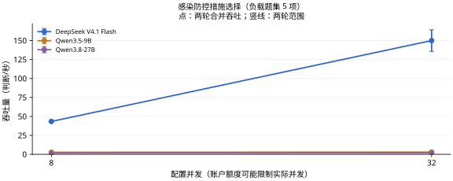

查看本任务的两个并发档

**表 21a｜感染防控措施选择：每请求最多 8 项，负载题集 5 项，各档两轮。**

| 模型 | 配置并发 | 吞吐量 (判断/秒) ↑ | 完整响应 P95 (秒) ↓ | 实际平均同时请求数 |
| --- | ---: | ---: | ---: | ---: |
| JEV 1.13 | 8 | — | — | — |
| DeepSeek V4.1 Flash | 8 | 43.38 | 1.461 | 7.99 |
| Qwen3.5-9B | 8 | 2.70 | 17.789 | 1.13 |
| Qwen3.8-27B | 8 | 1.75 | — | 1.34 |
| JEV 1.13 | 32 | — | — | — |
| DeepSeek V4.1 Flash | 32 | 150.00 | 1.916 | 31.98 |
| Qwen3.5-9B | 32 | 2.90 | 3.126 | 1.18 |
| Qwen3.8-27B | 32 | 1.88 | — | 1.71 |

配置并发是工作器上限；实际在途请求可能因账户额度更少。P95 不含客户端额度等待；不足 20 个完整响应时不报告 P95。

[任务定义与数据](docs/tasks/infection_precaution.md) · [评估方法](docs/MEDICAL_LOAD.md) · [原始记录与计价依据](results/medical-load-v2/README.md)

## 复查项目与随访时机选择

**表 22｜复查项目与随访时机选择：6 项独立判断，6 个来源组；每请求最多 8 项。准确率测试配置 8 并发，负载测试配置 32 并发。**

| 模型 | 准确率 (%) ↑ | 吞吐量 (判断/秒) ↑ | 完整响应 P95 (秒) ↓ | 成本 (元/千项判断) ↓ |
| --- | ---: | ---: | ---: | ---: |
| JEV 1.13 | — | — | — | — |
| DeepSeek V4.1 Flash | 50.00 | 163.80 | 2.535 | 0.222–0.444 |
| Qwen3.5-9B | 66.67 | 2.85 | 20.984 | 0.129 |
| Qwen3.8-27B | 66.67 | 1.95 | — | 0.727 |

准确率和成本来自完整的 6 项固定题集；吞吐与 P95 来自其中预先选定的 6 项判断，持续循环施压两轮。重复调用不增加独立题量。P95 从实际发出计时，不含额度排队；不足 20 个响应时留空。

样本覆盖有限，只作探索性比较，尤其不能据此稳定估计临床可靠性。

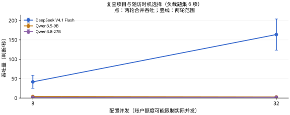

查看本任务的两个并发档

**表 22a｜复查项目与随访时机选择：每请求最多 8 项，负载题集 6 项，各档两轮。**

| 模型 | 配置并发 | 吞吐量 (判断/秒) ↑ | 完整响应 P95 (秒) ↓ | 实际平均同时请求数 |
| --- | ---: | ---: | ---: | ---: |
| JEV 1.13 | 8 | — | — | — |
| DeepSeek V4.1 Flash | 8 | 41.85 | 2.559 | 7.99 |
| Qwen3.5-9B | 8 | 4.05 | 3.424 | 1.09 |
| Qwen3.8-27B | 8 | 1.80 | — | 0.70 |
| JEV 1.13 | 32 | — | — | — |
| DeepSeek V4.1 Flash | 32 | 163.80 | 2.535 | 31.98 |
| Qwen3.5-9B | 32 | 2.85 | 20.984 | 2.07 |
| Qwen3.8-27B | 32 | 1.95 | — | 0.82 |

配置并发是工作器上限；实际在途请求可能因账户额度更少。P95 不含客户端额度等待；不足 20 个完整响应时不报告 P95。

[任务定义与数据](docs/tasks/followup_plan.md) · [评估方法](docs/MEDICAL_LOAD.md) · [原始记录与计价依据](results/medical-load-v2/README.md)

## 康复训练方案选择

**表 23｜康复训练方案选择：4 项独立判断，4 个来源组；每请求最多 8 项。准确率测试配置 8 并发，负载测试配置 32 并发。**

| 模型 | 准确率 (%) ↑ | 吞吐量 (判断/秒) ↑ | 完整响应 P95 (秒) ↓ | 成本 (元/千项判断) ↓ |
| --- | ---: | ---: | ---: | ---: |
| JEV 1.13 | — | — | — | — |
| DeepSeek V4.1 Flash | 100.00 | 156.10 | 1.187 | 0.231–0.462 |
| Qwen3.5-9B | 50.00 | 3.30 | 2.197 | 0.132 |
| Qwen3.8-27B | 75.00 | 1.50 | — | 0.746 |

准确率和成本来自完整的 4 项固定题集；吞吐与 P95 来自其中预先选定的 4 项判断，持续循环施压两轮。重复调用不增加独立题量。P95 从实际发出计时，不含额度排队；不足 20 个响应时留空。

样本覆盖有限，只作探索性比较，尤其不能据此稳定估计临床可靠性。

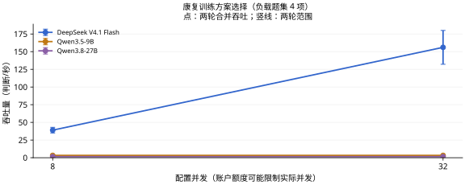

查看本任务的两个并发档

**表 23a｜康复训练方案选择：每请求最多 8 项，负载题集 4 项，各档两轮。**

| 模型 | 配置并发 | 吞吐量 (判断/秒) ↑ | 完整响应 P95 (秒) ↓ | 实际平均同时请求数 |
| --- | ---: | ---: | ---: | ---: |
| JEV 1.13 | 8 | — | — | — |
| DeepSeek V4.1 Flash | 8 | 39.00 | 1.150 | 7.99 |
| Qwen3.5-9B | 8 | 3.30 | 2.260 | 1.06 |
| Qwen3.8-27B | 8 | 1.50 | — | 1.84 |
| JEV 1.13 | 32 | — | — | — |
| DeepSeek V4.1 Flash | 32 | 156.10 | 1.187 | 31.98 |
| Qwen3.5-9B | 32 | 3.30 | 2.197 | 1.00 |
| Qwen3.8-27B | 32 | 1.50 | — | 2.08 |

配置并发是工作器上限；实际在途请求可能因账户额度更少。P95 不含客户端额度等待；不足 20 个完整响应时不报告 P95。

[任务定义与数据](docs/tasks/rehabilitation_choice.md) · [评估方法](docs/MEDICAL_LOAD.md) · [原始记录与计价依据](results/medical-load-v2/README.md)

## 预防措施选择

**表 24｜预防措施选择：13 项独立判断，13 个来源组；每请求最多 8 项。准确率测试配置 8 并发，负载测试配置 32 并发。**

| 模型 | 准确率 (%) ↑ | 吞吐量 (判断/秒) ↑ | 完整响应 P95 (秒) ↓ | 成本 (元/千项判断) ↓ |
| --- | ---: | ---: | ---: | ---: |
| JEV 1.13 | — | — | — | — |
| DeepSeek V4.1 Flash | 76.92 | 163.95 | 2.995 | 0.224–0.447 |
| Qwen3.5-9B | 69.23 | 4.03 | 2.163 | 0.129 |
| Qwen3.8-27B | 76.92 | 0.97 | — | 0.724 |

准确率和成本来自完整的 13 项固定题集；吞吐与 P95 来自其中预先选定的 13 项判断，持续循环施压两轮。重复调用不增加独立题量。P95 从实际发出计时，不含额度排队；不足 20 个响应时留空。

样本覆盖有限，只作探索性比较，尤其不能据此稳定估计临床可靠性。

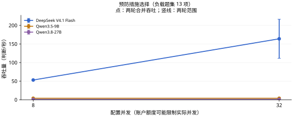

查看本任务的两个并发档

**表 24a｜预防措施选择：每请求最多 8 项，负载题集 13 项，各档两轮。**

| 模型 | 配置并发 | 吞吐量 (判断/秒) ↑ | 完整响应 P95 (秒) ↓ | 实际平均同时请求数 |
| --- | ---: | ---: | ---: | ---: |
| JEV 1.13 | 8 | — | — | — |
| DeepSeek V4.1 Flash | 8 | 53.10 | 1.482 | 7.99 |
| Qwen3.5-9B | 8 | 4.03 | 2.412 | 1.04 |
| Qwen3.8-27B | 8 | 0.97 | — | 2.71 |
| JEV 1.13 | 32 | — | — | — |
| DeepSeek V4.1 Flash | 32 | 163.95 | 2.995 | 31.98 |
| Qwen3.5-9B | 32 | 4.03 | 2.163 | 0.96 |
| Qwen3.8-27B | 32 | 0.97 | — | 1.97 |

配置并发是工作器上限；实际在途请求可能因账户额度更少。P95 不含客户端额度等待；不足 20 个完整响应时不报告 P95。

[任务定义与数据](docs/tasks/prevention_choice.md) · [评估方法](docs/MEDICAL_LOAD.md) · [原始记录与计价依据](results/medical-load-v2/README.md)

## 健康教育与沟通行动选择

**表 25｜健康教育与沟通行动选择：11 项独立判断，11 个来源组；每请求最多 8 项。准确率测试配置 8 并发，负载测试配置 32 并发。**

| 模型 | 准确率 (%) ↑ | 吞吐量 (判断/秒) ↑ | 完整响应 P95 (秒) ↓ | 成本 (元/千项判断) ↓ |
| --- | ---: | ---: | ---: | ---: |
| JEV 1.13 | — | — | — | — |
| DeepSeek V4.1 Flash | 90.91 | 204.95 | 1.235 | 0.232–0.464 |
| Qwen3.5-9B | 81.82 | 3.38 | 2.043 | 0.132 |
| Qwen3.8-27B | 90.91 | 2.12 | — | 0.746 |

准确率和成本来自完整的 11 项固定题集；吞吐与 P95 来自其中预先选定的 11 项判断，持续循环施压两轮。重复调用不增加独立题量。P95 从实际发出计时，不含额度排队；不足 20 个响应时留空。

样本覆盖有限，只作探索性比较，尤其不能据此稳定估计临床可靠性。

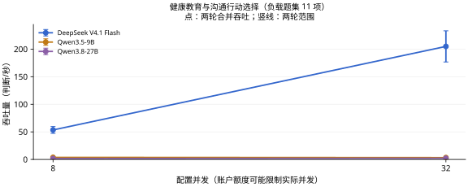

查看本任务的两个并发档

**表 25a｜健康教育与沟通行动选择：每请求最多 8 项，负载题集 11 项，各档两轮。**

| 模型 | 配置并发 | 吞吐量 (判断/秒) ↑ | 完整响应 P95 (秒) ↓ | 实际平均同时请求数 |
| --- | ---: | ---: | ---: | ---: |
| JEV 1.13 | 8 | — | — | — |
| DeepSeek V4.1 Flash | 8 | 53.48 | 1.086 | 7.99 |
| Qwen3.5-9B | 8 | 3.77 | 3.279 | 1.13 |
| Qwen3.8-27B | 8 | 1.65 | — | 1.25 |
| JEV 1.13 | 32 | — | — | — |
| DeepSeek V4.1 Flash | 32 | 204.95 | 1.235 | 31.98 |
| Qwen3.5-9B | 32 | 3.38 | 2.043 | 0.98 |
| Qwen3.8-27B | 32 | 2.12 | — | 0.81 |

配置并发是工作器上限；实际在途请求可能因账户额度更少。P95 不含客户端额度等待；不足 20 个完整响应时不报告 P95。

[任务定义与数据](docs/tasks/patient_counseling.md) · [评估方法](docs/MEDICAL_LOAD.md) · [原始记录与计价依据](results/medical-load-v2/README.md)

## 患者临床试验初筛与转介判断

**表 26｜患者临床试验初筛与转介判断：100 项独立判断，58 个来源组；每请求最多 8 项。准确率测试配置 8 并发，负载测试配置 32 并发。**

| 模型 | 准确率 (%) ↑ | Macro-F1 (%) ↑ | 吞吐量 (判断/秒) ↑ | 完整响应 P95 (秒) ↓ | 成本 (元/千项判断) ↓ |
| --- | ---: | ---: | ---: | ---: | ---: |
| JEV 1.13 | — | — | — | — | — |
| DeepSeek V4.1 Flash | 58.00 | 55.23 | 76.00 | 7.781 | 0.605–1.211 |
| Qwen3.5-9B | 45.00 | 37.67 | 1.72 | — | 0.347 |
| Qwen3.8-27B | 60.00 | 57.91 | 0.57 | — | 1.929 |

准确率和成本来自完整的 100 项固定题集；吞吐与 P95 来自其中预先选定的 32 项判断，持续循环施压两轮。重复调用不增加独立题量。P95 从实际发出计时，不含额度排队；不足 20 个响应时留空。

Macro-F1 对本任务金标中出现的类别等权平均；没有金标样本的候选类别不另加零分项，各模型使用相同类别集合。

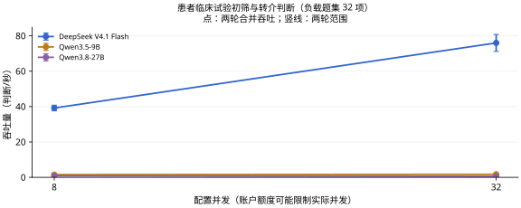

查看本任务的两个并发档

**表 26a｜患者临床试验初筛与转介判断：每请求最多 8 项，负载题集 32 项，各档两轮。**

| 模型 | 配置并发 | 吞吐量 (判断/秒) ↑ | 完整响应 P95 (秒) ↓ | 实际平均同时请求数 |
| --- | ---: | ---: | ---: | ---: |
| JEV 1.13 | 8 | — | — | — |
| DeepSeek V4.1 Flash | 8 | 39.20 | 3.585 | 8.00 |
| Qwen3.5-9B | 8 | 1.53 | — | 0.80 |
| Qwen3.8-27B | 8 | 0.86 | — | 0.70 |
| JEV 1.13 | 32 | — | — | — |
| DeepSeek V4.1 Flash | 32 | 76.00 | 7.781 | 31.99 |
| Qwen3.5-9B | 32 | 1.72 | — | 0.54 |
| Qwen3.8-27B | 32 | 0.57 | — | 0.90 |

配置并发是工作器上限；实际在途请求可能因账户额度更少。P95 不含客户端额度等待；不足 20 个完整响应时不报告 P95。

[任务定义与数据](docs/tasks/trial_referral.md) · [评估方法](docs/MEDICAL_LOAD.md) · [原始记录与计价依据](results/medical-load-v2/README.md)

## 同一患者的多项试验转介筛选

**表 27｜同一患者的多项试验转介筛选：64 项独立判断，8 个来源组；每请求最多 8 项。准确率测试配置 8 并发，负载测试配置 32 并发。**

| 模型 | 准确率 (%) ↑ | Macro-F1 (%) ↑ | 吞吐量 (判断/秒) ↑ | 完整响应 P95 (秒) ↓ | 成本 (元/千项判断) ↓ |
| --- | ---: | ---: | ---: | ---: | ---: |
| JEV 1.13 | — | — | — | — | — |
| DeepSeek V4.1 Flash | 75.00 | 57.13 | 255.60 | 2.322 | 0.550–1.101 |
| Qwen3.5-9B | 75.00 | 51.47 | 1.74 | — | 0.297 |
| Qwen3.8-27B | 73.44 | 54.31 | 0.96 | — | 1.733 |

准确率和成本来自完整的 64 项固定题集；吞吐与 P95 来自其中预先选定的 32 项判断，持续循环施压两轮。重复调用不增加独立题量。P95 从实际发出计时，不含额度排队；不足 20 个响应时留空。

样本覆盖有限，只作探索性比较，尤其不能据此稳定估计临床可靠性。

8 位模拟患者各对应 8 项真实注册试验。患者材料放在共享 state 中，只传一次；每个问题对应一项候选试验。金标为上游的“不相关／可能适合／很可能适合转介”，不是逐条入排标准的专家判定。与原试验转介题集可能重合，不另计入总体图。

三类金标分别为 49、9、6 项；全部回答“不相关”的多数类基线为准确率 76.56%、Macro-F1 28.91%。因此需结合 Macro-F1 判断模型是否识别了较少见的适合转介案例，不能仅看准确率。

Macro-F1 对本任务金标中出现的类别等权平均；没有金标样本的候选类别不另加零分项，各模型使用相同类别集合。

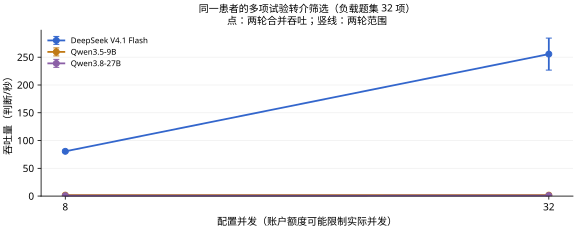

查看本任务的两个并发档

**表 27a｜同一患者的多项试验转介筛选：每请求最多 8 项，负载题集 32 项，各档两轮。**

| 模型 | 配置并发 | 吞吐量 (判断/秒) ↑ | 完整响应 P95 (秒) ↓ | 实际平均同时请求数 |
| --- | ---: | ---: | ---: | ---: |
| JEV 1.13 | 8 | — | — | — |
| DeepSeek V4.1 Flash | 8 | 80.60 | 1.231 | 7.99 |
| Qwen3.5-9B | 8 | 1.74 | — | 0.59 |
| Qwen3.8-27B | 8 | 0.78 | — | 0.51 |
| JEV 1.13 | 32 | — | — | — |
| DeepSeek V4.1 Flash | 32 | 255.60 | 2.322 | 31.96 |
| Qwen3.5-9B | 32 | 1.74 | — | 0.50 |
| Qwen3.8-27B | 32 | 0.96 | — | 0.40 |

配置并发是工作器上限；实际在途请求可能因账户额度更少。P95 不含客户端额度等待；不足 20 个完整响应时不报告 P95。

[任务定义与数据](docs/tasks/trial_shared_patient.md) · [评估方法](docs/MEDICAL_LOAD.md) · [原始记录与计价依据](results/medical-load-v2/README.md)

## 知情同意与隐私处置选择

**表 28｜知情同意与隐私处置选择：3 项独立判断，3 个来源组；每请求最多 8 项。准确率测试配置 8 并发，负载测试配置 32 并发。**

| 模型 | 准确率 (%) ↑ | 吞吐量 (判断/秒) ↑ | 完整响应 P95 (秒) ↓ | 成本 (元/千项判断) ↓ |
| --- | ---: | ---: | ---: | ---: |
| JEV 1.13 | — | — | — | — |
| DeepSeek V4.1 Flash | 100.00 | 90.45 | 2.031 | 0.257–0.514 |
| Qwen3.5-9B | 100.00 | 2.77 | 2.618 | 0.143 |
| Qwen3.8-27B | 100.00 | 0.75 | — | 0.817 |

准确率和成本来自完整的 3 项固定题集；吞吐与 P95 来自其中预先选定的 3 项判断，持续循环施压两轮。重复调用不增加独立题量。P95 从实际发出计时，不含额度排队；不足 20 个响应时留空。

样本覆盖有限，只作探索性比较，尤其不能据此稳定估计临床可靠性。

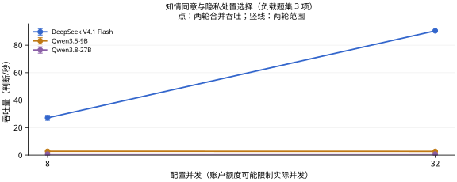

查看本任务的两个并发档

**表 28a｜知情同意与隐私处置选择：每请求最多 8 项，负载题集 3 项，各档两轮。**

| 模型 | 配置并发 | 吞吐量 (判断/秒) ↑ | 完整响应 P95 (秒) ↓ | 实际平均同时请求数 |
| --- | ---: | ---: | ---: | ---: |
| JEV 1.13 | 8 | — | — | — |
| DeepSeek V4.1 Flash | 8 | 27.15 | 2.079 | 7.99 |
| Qwen3.5-9B | 8 | 2.85 | 1.363 | 0.93 |
| Qwen3.8-27B | 8 | 0.75 | — | 3.29 |
| JEV 1.13 | 32 | — | — | — |
| DeepSeek V4.1 Flash | 32 | 90.45 | 2.031 | 31.98 |
| Qwen3.5-9B | 32 | 2.77 | 2.618 | 1.09 |
| Qwen3.8-27B | 32 | 0.75 | — | 3.59 |

配置并发是工作器上限；实际在途请求可能因账户额度更少。P95 不含客户端额度等待；不足 20 个完整响应时不报告 P95。

[任务定义与数据](docs/tasks/consent_action.md) · [评估方法](docs/MEDICAL_LOAD.md) · [原始记录与计价依据](results/medical-load-v2/README.md)
