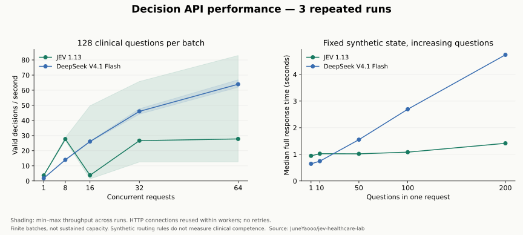

# 决策 API 性能补充测试

[首页](../README.md) · [测试协议与数据](PERFORMANCE.md) · [完整原始记录](../results/performance-v1/README.md)

测试日期：2026-10-12（Asia/Shanghai）。JEV 1.13 与 DeepSeek V4.1 Flash 共 3,870 次请求，60 个测试单元。每档 3 轮，各单元顺序预先随机化，模型不同时运行。下表全部由原始响应离线复核生成。

## 临床单题并发扩展

复用开放许可临床子集的 128 道题，每档、每轮均相同。单题提示词与原临床测试一致。HTTP 连接在每个工作线程内复用，每单元新建连接池；首个连接计时。无自动重试。吞吐为三轮有效决策总数除以三轮墙钟总和，失败保留在准确率分母。此为有限批次测试，64 路时仅约两波请求，不能据此认定持续服务容量。

| 并发 | 模型 | 有效决策/秒 | 正确决策/秒 | 准确率 | 有效率 | P50 秒 | P95 秒 | P99 秒 | 429 |
| --- | --- | --- | --- | --- | --- | --- | --- | --- | --- |
| 1 | JEV 1.13 | 3.63 | 2.94 | 80.99% | 100.00% | 0.261 | 0.315 | 0.630 | 0 |
| 1 | DeepSeek V4.1 Flash | 1.80 | 1.34 | 74.48% | 100.00% | 0.539 | 0.782 | 1.023 | 0 |
| 8 | JEV 1.13 | 27.71 | 22.30 | 80.47% | 100.00% | 0.248 | 0.713 | 0.795 | 0 |
| 8 | DeepSeek V4.1 Flash | 13.97 | 10.40 | 74.48% | 100.00% | 0.533 | 0.800 | 0.929 | 0 |
| 16 | JEV 1.13 | 3.76 | 3.02 | 80.21% | 99.74% | 0.253 | 0.914 | 1.740 | 0 |
| 16 | DeepSeek V4.1 Flash | 26.08 | 19.22 | 73.70% | 100.00% | 0.523 | 0.857 | 1.134 | 0 |
| 32 | JEV 1.13 | 26.64 | 21.34 | 79.69% | 99.48% | 0.289 | 1.508 | 2.254 | 0 |
| 32 | DeepSeek V4.1 Flash | 46.02 | 34.51 | 75.00% | 100.00% | 0.572 | 0.819 | 1.004 | 0 |
| 64 | JEV 1.13 | 27.78 | 22.20 | 79.69% | 99.74% | 0.593 | 1.867 | 2.166 | 0 |
| 64 | DeepSeek V4.1 Flash | 63.95 | 48.13 | 75.26% | 100.00% | 0.702 | 1.103 | 1.515 | 0 |

P50/P95/P99 是排除客户端任务队列的完整请求耗时，包含序列化、网络、服务端处理、读取及校验。384 次请求合并统计；重复题不构成 384 道独立样本。以下整批时间包含排队与调度：

| 并发 | 模型 | 每轮批次秒（最小–最大） | 每轮有效决策/秒（最小–最大） | 请求失败 / 超时 / 无效输出 |
| --- | --- | --- | --- | --- |
| 1 | JEV 1.13 | 34.14–36.43 | 3.51–3.75 | 0 / 0 / 0 |
| 1 | DeepSeek V4.1 Flash | 70.39–72.56 | 1.76–1.82 | 0 / 0 / 0 |
| 8 | JEV 1.13 | 4.47–4.79 | 26.70–28.65 | 0 / 0 / 0 |
| 8 | DeepSeek V4.1 Flash | 8.97–9.44 | 13.56–14.27 | 0 / 0 / 0 |
| 16 | JEV 1.13 | 2.58–96.30 | 1.32–49.69 | 1 / 0 / 0 |
| 16 | DeepSeek V4.1 Flash | 4.87–4.98 | 25.72–26.30 | 0 / 0 / 0 |
| 32 | JEV 1.13 | 1.95–10.05 | 12.53–65.78 | 0 / 2 / 0 |
| 32 | DeepSeek V4.1 Flash | 2.68–2.90 | 44.14–47.77 | 0 / 0 / 0 |
| 64 | JEV 1.13 | 1.54–10.07 | 12.61–82.94 | 0 / 1 / 0 |
| 64 | DeepSeek V4.1 Flash | 1.91–2.07 | 61.94–66.89 | 0 / 0 / 0 |

### 失败与长尾记录

| 模型 | 组别/档位/轮次 | 状态 | 完整请求秒 | HTTP / 错误类型 | 原始记录 |
| --- | --- | --- | --- | --- | --- |
| JEV 1.13 | concurrency/16/2 | request_error | 96.297 | ConnectionError | [cell-024](../results/performance-v1/cell-024.jsonl) |
| JEV 1.13 | concurrency/32/2 | timeout | 10.041 | — | [cell-037](../results/performance-v1/cell-037.jsonl) |
| JEV 1.13 | concurrency/32/2 | timeout | 10.044 | — | [cell-037](../results/performance-v1/cell-037.jsonl) |
| JEV 1.13 | concurrency/64/3 | timeout | 10.058 | — | [cell-051](../results/performance-v1/cell-051.jsonl) |

单次长尾即使没有进入合并 P99，也会拖慢整批完成；上方吞吐保留这种影响。网络错误只报告客户端观测，不能据此定位供应商内部故障。

## 单请求多问题扩展

3 份原创合成文档受理看板，各含 200 条不同记录及四条路由规则。每份看板在 1、10、50、100、200 问时材料完全相同，仅增加问题；答案由规则机械计算。任务是多记录路由，不是“一份真实病历的 200 项临床判断”。这组测量输出规模与处理效率，不能作为临床能力证据。

| 问题数 | 模型 | 完整请求秒中位数 | 完整请求秒范围 | 有效决策/秒 | 逐项准确率 | 完整返回 | 全项正确 |
| --- | --- | --- | --- | --- | --- | --- | --- |
| 1 | JEV 1.13 | 0.944 | 0.94–1.10 | 1.00 | 100.00% | 3/3 | 3/3 |
| 1 | DeepSeek V4.1 Flash | 0.644 | 0.63–0.81 | 1.44 | 100.00% | 3/3 | 3/3 |
| 10 | JEV 1.13 | 1.023 | 0.88–1.13 | 9.90 | 100.00% | 3/3 | 3/3 |
| 10 | DeepSeek V4.1 Flash | 0.743 | 0.56–0.89 | 13.65 | 96.67% | 3/3 | 2/3 |
| 50 | JEV 1.13 | 1.018 | 0.98–1.18 | 47.24 | 100.00% | 3/3 | 3/3 |
| 50 | DeepSeek V4.1 Flash | 1.550 | 1.49–1.68 | 31.72 | 100.00% | 3/3 | 3/3 |
| 100 | JEV 1.13 | 1.081 | 1.04–1.10 | 92.84 | 100.00% | 3/3 | 3/3 |
| 100 | DeepSeek V4.1 Flash | 2.694 | 2.54–2.78 | 37.40 | 100.00% | 3/3 | 3/3 |
| 200 | JEV 1.13 | 1.414 | 1.25–1.44 | 145.80 | 100.00% | 3/3 | 3/3 |
| 200 | DeepSeek V4.1 Flash | 4.738 | 4.52–4.92 | 42.28 | 100.00% | 3/3 | 3/3 |

每档只有 3 个请求，因此不展示多问题组的 P95/P99，也不作显著性判断。LLM 关闭思考，输出上限 max(256, 32 × 问题数)，200 问为 6,400 token；计时等到整个 JSON 接收并校验完成，不使用首 token 时间。

## 用量与成本

按 2026-10-12 官方价目估算美元成本，非账单。JEV 输入 $0.042/M、输出免费；Flash 用量区分缓存命中、未命中及输出，表中为闲时至高峰价格上下界，不按客户端请求时间猜测服务端计费时段。失败响应缺用量时不填完整单位成本；“已报告用量费用”仍列出，并标明缺失数。价格来源：[TypeSafe](https://docs.typesafe.ai/models)、[DeepSeek](https://api-docs.deepseek.com/quick_start/pricing/)。

| 组别/档位 | 模型 | 每千有效决策 USD | 每千正确决策 USD | 已报告用量费用 USD | 缺用量请求 |
| --- | --- | --- | --- | --- | --- |
| concurrency/1 | JEV 1.13 | 0.0245 | 0.0302 | 0.009390–0.009390 | 0 |
| concurrency/1 | DeepSeek V4.1 Flash | 0.0342–0.0684 | 0.0459–0.0918 | 0.013133–0.026266 | 0 |
| concurrency/8 | JEV 1.13 | 0.0245 | 0.0304 | 0.009390–0.009390 | 0 |
| concurrency/8 | DeepSeek V4.1 Flash | 0.0342–0.0684 | 0.0459–0.0918 | 0.013134–0.026267 | 0 |
| concurrency/16 | JEV 1.13 | —（用量缺失） | —（用量缺失） | 0.009370–0.009370 | 1 |
| concurrency/16 | DeepSeek V4.1 Flash | 0.0342–0.0684 | 0.0464–0.0928 | 0.013133–0.026266 | 0 |
| concurrency/32 | JEV 1.13 | —（用量缺失） | —（用量缺失） | 0.009345–0.009345 | 2 |
| concurrency/32 | DeepSeek V4.1 Flash | 0.0342–0.0684 | 0.0456–0.0912 | 0.013133–0.026266 | 0 |
| concurrency/64 | JEV 1.13 | —（用量缺失） | —（用量缺失） | 0.009370–0.009370 | 1 |
| concurrency/64 | DeepSeek V4.1 Flash | 0.0342–0.0684 | 0.0454–0.0909 | 0.013135–0.026270 | 0 |
| fanout/1 | JEV 1.13 | 0.2925 | 0.2925 | 0.000878–0.000878 | 0 |
| fanout/1 | DeepSeek V4.1 Flash | 0.4522–0.9045 | 0.4522–0.9045 | 0.001357–0.002713 | 0 |
| fanout/10 | JEV 1.13 | 0.0324 | 0.0324 | 0.000972–0.000972 | 0 |
| fanout/10 | DeepSeek V4.1 Flash | 0.0705–0.1409 | 0.0729–0.1458 | 0.002114–0.004227 | 0 |
| fanout/50 | JEV 1.13 | 0.0093 | 0.0093 | 0.001390–0.001390 | 0 |
| fanout/50 | DeepSeek V4.1 Flash | 0.0139–0.0278 | 0.0139–0.0278 | 0.002086–0.004172 | 0 |
| fanout/100 | JEV 1.13 | 0.0064 | 0.0064 | 0.001913–0.001913 | 0 |
| fanout/100 | DeepSeek V4.1 Flash | 0.0114–0.0229 | 0.0114–0.0229 | 0.003434–0.006869 | 0 |
| fanout/200 | JEV 1.13 | 0.0049 | 0.0049 | 0.002959–0.002959 | 0 |
| fanout/200 | DeepSeek V4.1 Flash | 0.0072–0.0144 | 0.0072–0.0144 | 0.004306–0.008612 | 0 |

## 解释边界

原临床榜单的准确率与耗时仍有效，但仅覆盖单题 Choice、8 路并发与原运行环境。本轮改变了连接复用方式和样本规模，不把两轮绝对时间差解释为模型版本进步。

结果包含客户端、跨服务商网络路径、连接建立与缓存影响，不等同于 GPU 推理时间。模型与档位随机交错可缓解时段偏差，不能消除网络和服务端负载差异。没有测开放到达流量、持续饱和、长时间稳定性、真实病历多字段判断、Score/Noul 或概率校准。

重复使用题目与规则会触发服务商自动缓存；原始 usage 保留缓存命中。没有关闭缓存或把重复题称为冷缓存测试。失败不会自动重试，也不按是否答对筛选重跑。

预检曾将临床单题改成统一多问题 JSON 提示，发现选项键遵守率下降；在冻结正式协议前停止该试跑，恢复原临床提示与输出形状。预检不计入以上结果，其记录与当时代码保留在 [预检档案](../results/performance-pilot-v1/README.md)。
