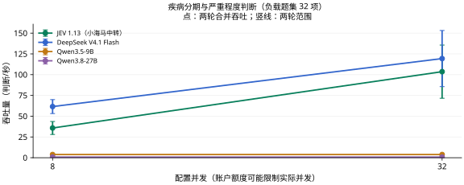

# 疾病分期与严重程度判断

[返回首页](../../README.md) · [主评测任务](README.md) · [辅助与暂停任务](AUXILIARY.md) · [数据集目录](../datasets/README.md)

**当前用途：临床主评测。** 根据病例作出临床分级，方向适合主评测；不同分期体系应分层，考试金标不证明现行临床有效性。

## 任务是什么

根据病例从原选项中选择疾病分期、严重程度分度或功能分级。

| 项目 | 说明 |
| --- | --- |
| 任务 ID | `clinical_grade` |
| 医疗场景 | 诊断与鉴别 |
| 能力维度 | 规则与数值 |
| 评测类别 | 临床判断与行动 |
| 当前题数 / 目标题数 | 100 / 100 |
| 来源组数 | 99 |
| 语种 | 中文 100 题 |
| 数据范围 | 开放许可部分 100 题 |

## 数据集来源

| 数据集说明 | 收录题数 | 上游入口 |
| --- | --- | --- |
| [CMB-Exam（中文病例单选子集）](../datasets/cmb.md) | 70 | [原始来源](https://github.com/FreedomIntelligence/CMB) |
| [CNMLEQA-10k（中文案例分析子集）](../datasets/cnmleqa.md) | 30 | [原始来源](https://doi.org/10.5281/zenodo.18951465) |

## 如何作答与评分

根据材料从 `request.questions.decision.criteria` 选择一个选项键。`gold` 不向模型发送。缺失或无效回答按错计。本轮指标见下方任务表；固定临床类别与题内位置选项分开处理。

本轮按任务报告；少于 20 题作为探索性结果，不计入首页汇总图。

当前比较的材料、计分和额度条件见[医疗多问题评估方法](../MEDICAL_LOAD.md)。

## 多问题与并发性能

<a id="clinical_grade"></a>

### 当前多题评测

**表 5｜疾病分期与严重程度判断：100 项独立判断，99 个来源组；每请求最多 8 项。准确率测试配置 8 并发，负载测试配置 32 并发。**

| 模型 | 准确率 (%) ↑ | 吞吐量 (判断/秒) ↑ | 完整响应 P95 (秒) ↓ | 成本 (元/千项判断) ↓ |
| --- | ---: | ---: | ---: | ---: |
| JEV 1.13（小海马中转） | 53.00 | 103.60 | 6.026 | 0.086 |
| DeepSeek V4.1 Flash | 51.00 | 119.38 | 5.390 | 0.217–0.434 |
| Qwen3.5-9B | 30.00 | 3.85 | 2.572 | 0.127 |
| Qwen3.8-27B | 51.00 | 0.80 | — | 0.714 |

准确率和成本来自完整的 100 项固定题集；吞吐与 P95 来自其中预先选定的 32 项判断，持续循环施压两轮。重复调用不增加独立题量。P95 从实际发出计时，不含额度排队；不足 20 个响应时留空。



<details>
<summary>查看本任务的两个并发档</summary>

**表 5a｜疾病分期与严重程度判断：每请求最多 8 项，负载题集 32 项，各档两轮。**

| 模型 | 配置并发 | 吞吐量 (判断/秒) ↑ | 完整响应 P95 (秒) ↓ | 实际平均同时请求数 |
| --- | ---: | ---: | ---: | ---: |
| JEV 1.13（小海马中转） | 8 | 35.80 | 3.893 | 8.00 |
| DeepSeek V4.1 Flash | 8 | 61.60 | 1.810 | 7.99 |
| Qwen3.5-9B | 8 | 3.85 | 3.322 | 1.03 |
| Qwen3.8-27B | 8 | 0.80 | — | 2.55 |
| JEV 1.13（小海马中转） | 32 | 103.60 | 6.026 | 31.99 |
| DeepSeek V4.1 Flash | 32 | 119.38 | 5.390 | 31.99 |
| Qwen3.5-9B | 32 | 3.85 | 2.572 | 1.01 |
| Qwen3.8-27B | 32 | 0.80 | — | 1.88 |

配置并发是工作器上限；实际在途请求可能因账户额度更少。P95 不含客户端额度等待；不足 20 个完整响应时不报告 P95。

</details>

[评估方法](../../docs/MEDICAL_LOAD.md) · [原始记录与计价依据](../../results/medical-load-jev-gateway-v1/README.md)

JEV 经小海马中转，返回版本为 `jev-1.13.0`；成本按官方标价估算，非中转账单。渠道与测试日期差异见评估方法。

[历史单题测试](../MODEL_RESULTS.md) · [历史有限批次测试](../TASK_PERFORMANCE.md)；与本轮分开归档。

## 收录样例

以下为当前评测集中实际收录的一题，展示适配后的请求格式。为便于阅读，选取较短记录；样例不代表全任务的难度或类别分布，材料与选项未截断或改写。

题目 ID：`clinical_grade:cmb:official_test:850`；语种：中文；来源组：`zh_exam_case:5f0dac8dcc1b92625d5bc576`。

### 模型输入

只把以下 `request` 对象发送给模型。`state` 是输入材料，`questions.decision` 包含问题、选项和输出类型。

```json
{
  "questions": {
    "decision": {
      "criteria": {
        "A": "Ⅰ期",
        "B": "Ⅱa",
        "C": "Ⅱb",
        "D": "Ⅲa",
        "E": "Ⅲb"
      },
      "instructions": "根据病例从原选项中选择疾病分期、严重程度分度或功能分级。",
      "type": "choice"
    }
  },
  "state": {
    "clinical_question": "患者23岁，停经3个月，阴道流血2周，查子宫大小超过妊周，阴道可见2cm×2cm紫蓝结节，宫旁无异常，侵葡的分期为（ ）。"
  }
}
```

### 标准答案与预测格式

原始标注映射后的正确选项键为 `C`，对应选项：

```json
"Ⅱb"
```

评分用预测文件每行包含题目 ID 与模型选择的选项键。下面使用标准答案演示文件格式，不是模型运行结果：

```json
{"id": "clinical_grade:cmb:official_test:850", "choice": "C"}
```

### 样例溯源

[上游资源](https://raw.githubusercontent.com/FreedomIntelligence/CMB/6c8ece46097dae736c6805dd3b831e1a38c08971/data/CMB.zip) · [数据集说明](../datasets/cmb.md)

以下信息用于追溯材料、划分和答案来源，不作为模型输入。`locator` 是原文件中的定位信息：

```json
{
  "data_license": "Apache-2.0",
  "distribution": "open",
  "gold_origin": "upstream_annotation",
  "independent_clinical_review": false,
  "locator": {
    "answer_field": "answer",
    "answer_json_index": 850,
    "json_index": 850,
    "question_id": 851,
    "supporting_resources": [
      "cmb__CMB-test-choice-answer.json"
    ],
    "zip_member": "CMB/CMB-Exam/CMB-test/CMB-test-choice-question-merge.json"
  },
  "material_kind": "medical_examination_vignettes",
  "resource": "cmb__CMB.zip",
  "resource_sha256": "c2e4288127fa5e6c03cc3659d893b0bbb19e699f74fdadce8e7fa10ac5bfdd94",
  "resource_url": "https://raw.githubusercontent.com/FreedomIntelligence/CMB/6c8ece46097dae736c6805dd3b831e1a38c08971/data/CMB.zip",
  "source_id": "cmb",
  "source_url": "https://github.com/FreedomIntelligence/CMB",
  "split": "official_test",
  "upstream_group": "5f0dac8dcc1b92625d5bc576",
  "upstream_id": "official_test:850",
  "version": "6c8ece46097dae736c6805dd3b831e1a38c08971"
}
```

## 覆盖与使用边界

题数是决策问题数，来源组可能是病例、文档、句子或指南条目，不应一律视为独立患者。答案沿用上游标注或机械映射，尚未经过本项目独立医生逐题审核。

当前标准标签分布：A 5 题、B 11 题、C 23 题、D 23 题、E 8 题、opa 5 题、opb 6 题、opc 5 题、opd 9 题、ope 5 题。

**[CMB-Exam（中文病例单选子集）](../datasets/cmb.md)**：中文医疗考试病例题；不是医院原始病历。只选病例决策单选题，排除 CMB-Clin 自由生成任务。 答案依据：固定 GitHub 测试题与公开更正版答案按 id 连接，并核对考试类别、科目和题型；完整保留原选项及答案。任务归属按公开规则筛选，不新增临床金标。 新任务另使用官方验证和训练文件；上游训练划分明确标记为本地评测保留子集，不冒称官方测试。

**[CNMLEQA-10k（中文案例分析子集）](../datasets/cnmleqa.md)**：中文执业医师考试整编病例题；上游有案例/知识题型标注，不是真实就诊结果。 答案依据：只选原 question_type=案例分析的记录；沿用 opa—ope 和 answer，保留每题 source、年份与原始 UUID；没有官方训练/测试划分，不冒称官方测试。 增加病例分期、病因、并发症、禁忌、护理和补液相关单选子集；沿用原答案，不把生成任务转换为自造金标。

## 调研过的其他来源

这些来源尚未为本任务提供题目；不能据此计入覆盖数量或视为已授权分发。

| 来源说明 | 登记情况 |
| --- | --- |
| [CMedCalc-Bench](../datasets/cmedcalc.md) | 公开仓库未见明确数据许可；原文与合成混合 |

## 数据文件

[本任务全部记录](../../benchmarks/medical_decision_v1/tasks/clinical_grade/samples.jsonl) · [任务定义与统计](../../benchmarks/medical_decision_v1/tasks/clinical_grade/task.json) · [格式与使用方法](../REPRODUCING.md)

[返回首页](../../README.md)
