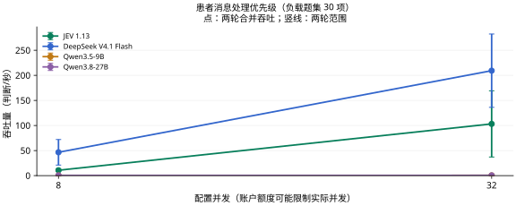

# 患者消息处理优先级

[返回首页](../../README.md) · [主评测任务](README.md) · [辅助与暂停任务](AUXILIARY.md) · [数据集目录](../datasets/README.md)

**当前用途：临床主评测。** 有病历背景和优先处理动作，方向适合；只有 30 对、两个收件箱且消息为合成，需单列探索性结果。

## 任务是什么

给定两条患者消息及各自病历背景，选择应优先处理的消息；当前子集为人工合成消息及上游临床人员比较标注。

| 项目 | 说明 |
| --- | --- |
| 任务 ID | `message_urgency_pair` |
| 医疗场景 | 接诊与分诊 |
| 能力维度 | 风险与升级 |
| 评测类别 | 临床判断与行动 |
| 当前题数 / 目标题数 | 30 / 100 |
| 来源组数 | 30 |
| 语种 | 英语 30 题 |
| 数据范围 | 非商业研究附加集 30 题 |

## 数据集来源

| 数据集说明 | 收录题数 | 上游入口 |
| --- | --- | --- |
| [PMR-Synth annotated pairs](../datasets/pmr_synth.md) | 30 | [原始来源](https://huggingface.co/datasets/PortalPal-AI/PMP-Synth-AllPairs-Annotated) |

## 如何作答与评分

根据材料从 `request.questions.decision.criteria` 选择一个选项键。`gold` 不向模型发送。缺失或无效回答按错计。本轮指标见下方任务表；固定临床类别与题内位置选项分开处理。

本轮按任务报告；少于 20 题作为探索性结果，不计入首页汇总图。

当前比较的材料、计分和额度条件见[医疗多问题评估方法](../MEDICAL_LOAD.md)。

## 多问题与并发性能

<a id="message_urgency_pair"></a>

### 当前多题评测

**表 3｜患者消息处理优先级：30 项独立判断，30 个来源组；每请求最多 8 项。准确率测试配置 8 并发，负载测试配置 32 并发。**

| 模型 | 准确率 (%) ↑ | 吞吐量 (判断/秒) ↑ | 完整响应 P95 (秒) ↓ | 成本 (元/千项判断) ↓ |
| --- | ---: | ---: | ---: | ---: |
| JEV 1.13 | 66.67 | 103.20 | 7.580 | 0.326 |
| DeepSeek V4.1 Flash | 70.00 | 209.35 | 2.736 | 1.063–2.126 |
| Qwen3.5-9B | 16.67 | 0.42 | — | 0.571 |
| Qwen3.8-27B | 66.67 | 0.54 | — | 3.356 |

准确率和成本来自完整的 30 项固定题集；吞吐与 P95 来自其中预先选定的 30 项判断，持续循环施压两轮。重复调用不增加独立题量。P95 从实际发出计时，不含额度排队；不足 20 个响应时留空。

本任务严格区分原始选项键，例如 `Patient #1` 不能改写成 `Patient_1`。这类输出合约错误也按错计，因此成绩同时反映判断和接口可直接使用的程度，不能全部归因于医学推理差异。



<details>
<summary>查看本任务的两个并发档</summary>

**表 3a｜患者消息处理优先级：每请求最多 8 项，负载题集 30 项，各档两轮。**

| 模型 | 配置并发 | 吞吐量 (判断/秒) ↑ | 完整响应 P95 (秒) ↓ | 实际平均同时请求数 |
| --- | ---: | ---: | ---: | ---: |
| JEV 1.13 | 8 | 10.75 | 18.868 | 8.00 |
| DeepSeek V4.1 Flash | 8 | 46.60 | 3.671 | 7.99 |
| Qwen3.5-9B | 8 | 0.31 | — | 0.37 |
| Qwen3.8-27B | 8 | 0.48 | — | 0.68 |
| JEV 1.13 | 32 | 103.20 | 7.580 | 31.99 |
| DeepSeek V4.1 Flash | 32 | 209.35 | 2.736 | 31.96 |
| Qwen3.5-9B | 32 | 0.42 | — | 0.33 |
| Qwen3.8-27B | 32 | 0.54 | — | 0.33 |

配置并发是工作器上限；实际在途请求可能因账户额度更少。P95 不含客户端额度等待；不足 20 个完整响应时不报告 P95。

</details>

[评估方法](../../docs/MEDICAL_LOAD.md) · [原始记录与计价依据](../../results/medical-load-jev-gateway-v1/README.md)

JEV 返回版本为 `jev-1.13.0`；成本按官方标价估算，非实际账单。渠道与测试日期差异见评估方法。

[历史单题测试](../MODEL_RESULTS.md) · [历史有限批次测试](../TASK_PERFORMANCE.md)；与本轮分开归档。

## 收录样例

以下为当前评测集中实际收录的一题，展示适配后的请求格式。为便于阅读，选取较短记录；样例不代表全任务的难度或类别分布，材料与选项未截断或改写。

题目 ID：`message_urgency_pair:pmr_synth:A:175`；语种：英语；来源组：`pmr_synth:fc8f0c897ec65af988dece01`。

### 模型输入

只把以下 `request` 对象发送给模型。`state` 是输入材料，`questions.decision` 包含问题、选项和输出类型。

```json
{
  "questions": {
    "decision": {
      "criteria": {
        "Patient #1": "Prioritize patient 1",
        "Patient #2": "Prioritize patient 2"
      },
      "instructions": "给定两条患者消息及各自病历背景，选择应优先处理的消息；当前子集为人工合成消息及上游临床人员比较标注。",
      "type": "choice"
    }
  },
  "state": {
    "patient_1": {
      "ehr": "###Demographics###\nAge: Between 35 - 40    \nGender: Female\n    \n###Full Active Problem List###:\nLeft tubal pregnancy without intrauterine pregnancy\n\n###Recent Encounters (Max 10)###\n\nDiagnoses (Past Year): Reactive depression (situational)\nDiagnoses (Older): Multiple benign nevi - IUD (intrauterine device) in place - Onychocryptosis - Intrauterine contraceptive device threads lost, initial encounter - Cherry angioma - Abnormal ultrasound - Encounter for postpartum care of lactating mother\n\n###Medications (Outpatient)###\n\nActive (Start Date Before Message, Not Yet Ended):\n    \n-BUPROPION HCL XL 150 MG 24 HR TABLET, EXTENDED RELEASE\n-FLUOXETINE 20 MG CAPSULE\n-LEVONORGESTREL 0.15 MG-ETHINYL ESTRADIOL 30 MCG TABLETS,3 MOS PACK(91)",
      "message": "I just had my first period after giving birth and I've been having pretty heavy bleeding for 4 days now. I am soaking through many more pads per day than normal. I feel like everytime I go to the bathroom there is just so much blood and I dont know what to do. My flow has not slowed down at all. is this normal??"
    },
    "patient_2": {
      "ehr": "###Demographics###\nAge: Between 30 - 35    \nGender: Female\n    \n###Full Active Problem List###:\nHealth care maintenance - Subclinical hypothyroidism - Acanthosis nigricans - BMI 38.0-38.9,adult - Left knee pain - Mixed hyperlipidemia - Infertility management - Rh negative, antepartum - Prenatal care\n\n###Recent Encounters (Max 10)###\n\nDiagnoses (Past Year): Prenatal care in second trimester - History of infertility - History of miscarriage - Pregnancy of unknown anatomic location - Male factor infertility - Pregnancy, unspecified gestational age - Prenatal care in first trimester - BMI 40.0-44.9, adult\nDiagnoses (Older): \n\n###Medications (Outpatient)###\n\nActive (Start Date Before Message, Not Yet Ended):\n    \n*No Active Medications*",
      "message": "Hi Doctor, \n\nSo I am having some unexpected bleeding I need to chat with you about. I had sex with my girlfriend last night and I'm not sure if this is normal but I was just wondering if I should go to the doctor because I'm bleeding like I have my period. It doesn't seem heavy but it started right after we finished having sex. Is this cause for concern? \n\nAlso, I need to update my physical address in the system. Can I do this over the portal? \n\nThanks."
    }
  }
}
```

### 标准答案与预测格式

原始标注映射后的正确选项键为 `Patient #1`，对应选项：

```json
"Prioritize patient 1"
```

评分用预测文件每行包含题目 ID 与模型选择的选项键。下面使用标准答案演示文件格式，不是模型运行结果：

```json
{"id": "message_urgency_pair:pmr_synth:A:175", "choice": "Patient #1"}
```

### 样例溯源

[上游资源](https://huggingface.co/datasets/PortalPal-AI/PMP-Synth-AllPairs-Annotated/resolve/0a0347fdc9cd0639348ffa54fe3988a7b45b2a18/data/INBOX_A-00000-of-00001.parquet) · [数据集说明](../datasets/pmr_synth.md)

以下信息用于追溯材料、划分和答案来源，不作为模型输入。`locator` 是原文件中的定位信息：

```json
{
  "data_license": "CC-BY-NC-4.0",
  "distribution": "research_noncommercial",
  "gold_origin": "upstream_annotation",
  "independent_clinical_review": false,
  "locator": {
    "answer_field": "Label",
    "inbox": "INBOX_A",
    "row_index_zero_based": 175
  },
  "material_kind": "synthetic_messages_with_ehr_context",
  "resource": "pmr_synth__INBOX_A-00000-of-00001.parquet",
  "resource_sha256": "f381a6f2ec8e55214086282e7ffe7f7bd94ec737535ccb91dae86db50cdd8dc2",
  "resource_url": "https://huggingface.co/datasets/PortalPal-AI/PMP-Synth-AllPairs-Annotated/resolve/0a0347fdc9cd0639348ffa54fe3988a7b45b2a18/data/INBOX_A-00000-of-00001.parquet",
  "source_id": "pmr_synth",
  "source_url": "https://huggingface.co/datasets/PortalPal-AI/PMP-Synth-AllPairs-Annotated",
  "split": "published_inboxes_train_test_mapping_unresolved",
  "upstream_group": "fc8f0c897ec65af988dece01",
  "upstream_id": "A:175",
  "version": "0a0347fdc9cd0639348ffa54fe3988a7b45b2a18"
}
```

## 覆盖与使用边界

题数是决策问题数，来源组可能是病例、文档、句子或指南条目，不应一律视为独立患者。答案沿用上游标注或机械映射，尚未经过本项目独立医生逐题审核。

当前标准标签分布：Patient #1 20 题、Patient #2 10 题。

当前可用题目不足目标数量，保留实际题量；比较细小差异时须同时报告样本数。

**[PMR-Synth annotated pairs](../datasets/pmr_synth.md)**：人工合成患者消息，配对去标识病历背景；不能称为真实患者发出的消息。 答案依据：沿用 Label 字段的 Patient #1 / Patient #2；每条消息与病历最多出现一次。

公开 INBOX_A/B 与论文 train/test 的对应未确认；不得视为未暴露官方测试集。保留原始 inbox 标记；60 条消息至多组成 30 个不重复材料的比较，仍只来自两个收件箱。

## 调研过的其他来源

这些来源尚未为本任务提供题目；不能据此计入覆盖数量或视为已授权分发。

| 来源说明 | 登记情况 |
| --- | --- |
| [PMR-Bench Reddit Test Pairs](../datasets/pmr_bench.md) | 论文 §3.2.1 明确：Reddit 等级由 GPT-5 根据医生回复推导，再配对；并非逐对医生直接标注。本轮保留研究引用，不作为人工金标补入。 |

## 数据文件

[本任务全部记录](../../benchmarks/medical_decision_v1/tasks/message_urgency_pair/samples.jsonl) · [任务定义与统计](../../benchmarks/medical_decision_v1/tasks/message_urgency_pair/task.json) · [格式与使用方法](../REPRODUCING.md)

[返回首页](../../README.md)
