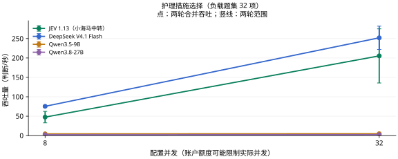

# 护理措施选择

[返回首页](../../README.md) · [主评测任务](README.md) · [辅助与暂停任务](AUXILIARY.md) · [数据集目录](../datasets/README.md)

**当前用途：临床主评测。** 含首要措施和一般正确措施，题名不应全部称优先级；42 题，适合护理决策子类。

## 任务是什么

根据病例从原选项中选择正确、首要或最合适的护理措施；不生成护理文书。

| 项目 | 说明 |
| --- | --- |
| 任务 ID | `nursing_priority` |
| 医疗场景 | 住院与护理 |
| 能力维度 | 流程与下一步行动 |
| 评测类别 | 临床判断与行动 |
| 当前题数 / 目标题数 | 42 / 100 |
| 来源组数 | 42 |
| 语种 | 中文 42 题 |
| 数据范围 | 开放许可部分 42 题 |

## 数据集来源

| 数据集说明 | 收录题数 | 上游入口 |
| --- | --- | --- |
| [CMB-Exam（中文病例单选子集）](../datasets/cmb.md) | 42 | [原始来源](https://github.com/FreedomIntelligence/CMB) |

## 如何作答与评分

根据材料从 `request.questions.decision.criteria` 选择一个选项键。`gold` 不向模型发送。缺失或无效回答按错计。本轮指标见下方任务表；固定临床类别与题内位置选项分开处理。

本轮按任务报告；少于 20 题作为探索性结果，不计入首页汇总图。

当前比较的材料、计分和额度条件见[医疗多问题评估方法](../MEDICAL_LOAD.md)。

## 多问题与并发性能

<a id="nursing_priority"></a>

### 当前多题评测

**表 17｜护理措施选择：42 项独立判断，42 个来源组；每请求最多 8 项。准确率测试配置 8 并发，负载测试配置 32 并发。**

| 模型 | 准确率 (%) ↑ | 吞吐量 (判断/秒) ↑ | 完整响应 P95 (秒) ↓ | 成本 (元/千项判断) ↓ |
| --- | ---: | ---: | ---: | ---: |
| JEV 1.13 | **88.10** | 205.40 | 2.843 | **0.090** |
| DeepSeek V4.1 Flash | 78.57 | **252.00** | **1.953** | 0.211–0.422 |
| Qwen3.5-9B | 57.14 | 4.80 | 2.056 | 0.123 |
| Qwen3.8-27B | 85.71 | 2.20 | — | 0.689 |

准确率和成本来自完整的 42 项固定题集；吞吐与 P95 来自其中预先选定的 32 项判断，持续循环施压两轮。重复调用不增加独立题量。P95 从实际发出计时，不含额度排队；不足 20 个响应时留空。



<details>
<summary>查看本任务的两个并发档</summary>

**表 17a｜护理措施选择：每请求最多 8 项，负载题集 32 项，各档两轮。**

| 模型 | 配置并发 | 吞吐量 (判断/秒) ↑ | 完整响应 P95 (秒) ↓ | 实际平均同时请求数 |
| --- | ---: | ---: | ---: | ---: |
| JEV 1.13 | 8 | 47.60 | 3.234 | 8.00 |
| DeepSeek V4.1 Flash | 8 | **75.40** | **1.294** | 8.00 |
| Qwen3.5-9B | 8 | 4.40 | 2.309 | 0.97 |
| Qwen3.8-27B | 8 | 2.00 | — | 0.67 |
| JEV 1.13 | 32 | 205.40 | 2.843 | 31.98 |
| DeepSeek V4.1 Flash | 32 | **252.00** | **1.953** | 31.98 |
| Qwen3.5-9B | 32 | 4.80 | 2.056 | 0.94 |
| Qwen3.8-27B | 32 | 2.20 | — | 0.85 |

配置并发是工作器上限；实际在途请求可能因账户额度更少。P95 不含客户端额度等待；不足 20 个完整响应时不报告 P95。

</details>

[评估方法](../../docs/MEDICAL_LOAD.md) · [原始记录与计价依据](../../results/medical-load-jev-gateway-v1/README.md)

JEV 返回版本为 `jev-1.13.0`；成本按官方标价估算，非实际账单。渠道与测试日期差异见评估方法。

粗体表示同一任务、同一并发档内已测模型的最优观测值，并列最优均加粗；不表示统计显著性。成本区间重叠、无法确定最低者时不加粗。

[历史单题测试](../MODEL_RESULTS.md) · [历史有限批次测试](../TASK_PERFORMANCE.md)；与本轮分开归档。

## 收录样例

以下为当前评测集中实际收录的一题，展示适配后的请求格式。为便于阅读，选取较短记录；样例不代表全任务的难度或类别分布，材料与选项未截断或改写。

题目 ID：`nursing_priority:cmb:upstream_train_reserved_for_local_evaluation:124881`；语种：中文；来源组：`zh_exam_case:9001e36f742053835822e28d`。

### 模型输入

只把以下 `request` 对象发送给模型。`state` 是输入材料，`questions.decision` 包含问题、选项和输出类型。

```json
{
  "questions": {
    "decision": {
      "criteria": {
        "A": "化疗",
        "B": "手术治疗",
        "C": "中药治疗",
        "D": "放疗",
        "E": "放化疗结合"
      },
      "instructions": "根据病例从原选项中选择正确、首要或最合适的护理措施；不生成护理文书。",
      "type": "choice"
    }
  },
  "state": {
    "clinical_question": "患者，女，55岁。因绝经5年后岀现阴道不规则流血入院，经检查诊断为子宫内膜癌。患者咨询本病最常用的治疗方案，护士正确的回答是"
  }
}
```

### 标准答案与预测格式

原始标注映射后的正确选项键为 `B`，对应选项：

```json
"手术治疗"
```

评分用预测文件每行包含题目 ID 与模型选择的选项键。下面使用标准答案演示文件格式，不是模型运行结果：

```json
{"id": "nursing_priority:cmb:upstream_train_reserved_for_local_evaluation:124881", "choice": "B"}
```

### 样例溯源

[上游资源](https://raw.githubusercontent.com/FreedomIntelligence/CMB/6c8ece46097dae736c6805dd3b831e1a38c08971/data/CMB.zip) · [数据集说明](../datasets/cmb.md)

以下信息用于追溯材料、划分和答案来源，不作为模型输入。`locator` 是原文件中的定位信息：

```json
{
  "data_license": "Apache-2.0",
  "distribution": "open",
  "gold_origin": "upstream_annotation",
  "independent_clinical_review": false,
  "locator": {
    "answer_field": "answer",
    "json_index": 124881,
    "zip_member": "CMB/CMB-Exam/CMB-train/CMB-train-merge.json"
  },
  "material_kind": "medical_examination_vignettes",
  "resource": "cmb__CMB.zip",
  "resource_sha256": "c2e4288127fa5e6c03cc3659d893b0bbb19e699f74fdadce8e7fa10ac5bfdd94",
  "resource_url": "https://raw.githubusercontent.com/FreedomIntelligence/CMB/6c8ece46097dae736c6805dd3b831e1a38c08971/data/CMB.zip",
  "source_id": "cmb",
  "source_url": "https://github.com/FreedomIntelligence/CMB",
  "split": "upstream_train_reserved_for_local_evaluation",
  "upstream_group": "9001e36f742053835822e28d",
  "upstream_id": "upstream_train_reserved_for_local_evaluation:124881",
  "version": "6c8ece46097dae736c6805dd3b831e1a38c08971"
}
```

## 覆盖与使用边界

题数是决策问题数，来源组可能是病例、文档、句子或指南条目，不应一律视为独立患者。答案沿用上游标注或机械映射，尚未经过本项目独立医生逐题审核。

当前标准标签分布：A 4 题、B 14 题、C 5 题、D 11 题、E 8 题。

当前可用题目不足目标数量，保留实际题量；比较细小差异时须同时报告样本数。

**[CMB-Exam（中文病例单选子集）](../datasets/cmb.md)**：中文医疗考试病例题；不是医院原始病历。只选病例决策单选题，排除 CMB-Clin 自由生成任务。 答案依据：固定 GitHub 测试题与公开更正版答案按 id 连接，并核对考试类别、科目和题型；完整保留原选项及答案。任务归属按公开规则筛选，不新增临床金标。 新任务另使用官方验证和训练文件；上游训练划分明确标记为本地评测保留子集，不冒称官方测试。

## 调研过的其他来源

这些来源尚未为本任务提供题目；不能据此计入覆盖数量或视为已授权分发。

| 来源说明 | 登记情况 |
| --- | --- |
| [CNMLEQA-10k（中文案例分析子集）](../datasets/cnmleqa.md) | 本任务暂无收录，是否适用需按任务定义核验。 |

## 数据文件

[本任务全部记录](../../benchmarks/medical_decision_v1/tasks/nursing_priority/samples.jsonl) · [任务定义与统计](../../benchmarks/medical_decision_v1/tasks/nursing_priority/task.json) · [格式与使用方法](../REPRODUCING.md)

[返回首页](../../README.md)
