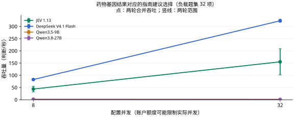

# 药物基因结果对应的指南建议选择

[返回首页](../../README.md) · [主评测任务](README.md) · [辅助与暂停任务](AUXILIARY.md) · [数据集目录](../datasets/README.md)

**当前用途：临床主评测。** 输出用药建议，方向适合但为固定指南规则选择，无完整患者记录；应与病例治疗分层而非声称个体处方能力。

## 任务是什么

给定药物、人群及基因结果，选择 CPIC 固定快照中对应的原始用药建议；不外推为完整个体处方。

| 项目 | 说明 |
| --- | --- |
| 任务 ID | `pgx_guideline_recommendation` |
| 医疗场景 | 治疗与用药 |
| 能力维度 | 资格与适宜性 |
| 评测类别 | 临床判断与行动 |
| 当前题数 / 目标题数 | 100 / 100 |
| 来源组数 | 25 |
| 语种 | 英语 100 题 |
| 数据范围 | 开放许可部分 100 题 |

## 数据集来源

| 数据集说明 | 收录题数 | 上游入口 |
| --- | --- | --- |
| [CPIC curated pharmacogenomic tables](../datasets/cpic.md) | 100 | [原始来源](https://www.clinpgx.org/cpic) |

## 如何作答与评分

根据材料从 `request.questions.decision.criteria` 选择一个选项键。`gold` 不向模型发送。缺失或无效回答按错计。本轮指标见下方任务表；固定临床类别与题内位置选项分开处理。

本轮按任务报告；少于 20 题作为探索性结果，不计入首页汇总图。

当前比较的材料、计分和额度条件见[医疗多问题评估方法](../MEDICAL_LOAD.md)。

## 多问题与并发性能

<a id="pgx_guideline_recommendation"></a>

### 当前多题评测

**表 14｜药物基因结果对应的指南建议选择：100 项独立判断，25 个来源组；每请求最多 8 项。准确率测试配置 8 并发，负载测试配置 32 并发。**

| 模型 | 准确率 (%) ↑ | 吞吐量 (判断/秒) ↑ | 完整响应 P95 (秒) ↓ | 成本 (元/千项判断) ↓ |
| --- | ---: | ---: | ---: | ---: |
| JEV 1.13 | 56.00 | 155.40 | 3.638 | **0.139** |
| DeepSeek V4.1 Flash | 53.00 | **323.40** | **1.097** | 0.407–0.814 |
| Qwen3.5-9B | 34.00 | 1.80 | — | 0.230 |
| Qwen3.8-27B | **62.00** | 1.14 | — | 1.311 |

准确率和成本来自完整的 100 项固定题集；吞吐与 P95 来自其中预先选定的 32 项判断，持续循环施压两轮。重复调用不增加独立题量。P95 从实际发出计时，不含额度排队；不足 20 个响应时留空。



<details>
<summary>查看本任务的两个并发档</summary>

**表 14a｜药物基因结果对应的指南建议选择：每请求最多 8 项，负载题集 32 项，各档两轮。**

| 模型 | 配置并发 | 吞吐量 (判断/秒) ↑ | 完整响应 P95 (秒) ↓ | 实际平均同时请求数 |
| --- | ---: | ---: | ---: | ---: |
| JEV 1.13 | 8 | 43.80 | 4.255 | 7.99 |
| DeepSeek V4.1 Flash | 8 | **82.80** | **1.058** | 7.99 |
| Qwen3.5-9B | 8 | 2.40 | — | 0.76 |
| Qwen3.8-27B | 8 | 1.43 | — | 0.58 |
| JEV 1.13 | 32 | 155.40 | 3.638 | 31.98 |
| DeepSeek V4.1 Flash | 32 | **323.40** | **1.097** | 31.96 |
| Qwen3.5-9B | 32 | 1.80 | — | 0.57 |
| Qwen3.8-27B | 32 | 1.14 | — | 1.09 |

配置并发是工作器上限；实际在途请求可能因账户额度更少。P95 不含客户端额度等待；不足 20 个完整响应时不报告 P95。

</details>

[评估方法](../../docs/MEDICAL_LOAD.md) · [原始记录与计价依据](../../results/medical-load-jev-gateway-v1/README.md)

JEV 返回版本为 `jev-1.13.0`；成本按官方标价估算，非实际账单。渠道与测试日期差异见评估方法。

粗体表示同一任务、同一并发档内已测模型的最优观测值，并列最优均加粗；不表示统计显著性。成本区间重叠、无法确定最低者时不加粗。

[历史单题测试](../MODEL_RESULTS.md) · [历史有限批次测试](../TASK_PERFORMANCE.md)；与本轮分开归档。

## 收录样例

以下为当前评测集中实际收录的一题，展示适配后的请求格式。为便于阅读，选取较短记录；样例不代表全任务的难度或类别分布，材料与选项未截断或改写。

题目 ID：`pgx_guideline_recommendation:cpic:8479701`；语种：英语；来源组：`cpic:guideline:https://www.clinpgx.org/guideline/PA166251444`。

### 模型输入

只把以下 `request` 对象发送给模型。`state` 是输入材料，`questions.decision` 包含问题、选项和输出类型。

```json
{
  "questions": {
    "decision": {
      "criteria": {
        "action_0": "Abacavir is not recommended",
        "action_1": "Use abacavir per standard dosing guidelines"
      },
      "instructions": "给定药物、人群及基因结果，选择 CPIC 固定快照中对应的原始用药建议；不外推为完整个体处方。",
      "type": "choice"
    }
  },
  "state": {
    "drug": "abacavir",
    "gene_results": {
      "HLA-B": "*57:01 negative"
    },
    "guideline": "HLA-B and Abacavir",
    "population": "general",
    "reference_snapshot": "CPIC API v1, 2026-10-10"
  }
}
```

### 标准答案与预测格式

原始标注映射后的正确选项键为 `action_1`，对应选项：

```json
"Use abacavir per standard dosing guidelines"
```

评分用预测文件每行包含题目 ID 与模型选择的选项键。下面使用标准答案演示文件格式，不是模型运行结果：

```json
{"id": "pgx_guideline_recommendation:cpic:8479701", "choice": "action_1"}
```

### 样例溯源

[上游资源](https://api.cpicpgx.org/v1/recommendation_view?order=recommendationid) · [数据集说明](../datasets/cpic.md)

以下信息用于追溯材料、划分和答案来源，不作为模型输入。`locator` 是原文件中的定位信息：

```json
{
  "data_license": "CC0-1.0",
  "distribution": "open",
  "gold_origin": "upstream_annotation",
  "independent_clinical_review": false,
  "locator": {
    "candidate_json_indices": [
      0,
      1
    ],
    "json_index": 0,
    "recommendation_id": 8479701
  },
  "material_kind": "curated_guideline_rules",
  "resource": "cpic__recommendation_view.json",
  "resource_sha256": "8b4559a9b0b851fec69464cc5c62932d95d385bca59d725b03570f92c700bc85",
  "resource_url": "https://api.cpicpgx.org/v1/recommendation_view?order=recommendationid",
  "source_id": "cpic",
  "source_url": "https://www.clinpgx.org/cpic",
  "split": "curated_rules_no_patient_split",
  "upstream_group": "guideline:https://www.clinpgx.org/guideline/PA166251444",
  "upstream_id": "8479701",
  "version": "API v1 response snapshot 2026-10-10"
}
```

## 覆盖与使用边界

题数是决策问题数，来源组可能是病例、文档、句子或指南条目，不应一律视为独立患者。答案沿用上游标注或机械映射，尚未经过本项目独立医生逐题审核。

当前标准标签分布：action_0 23 题、action_1 19 题、action_11 1 题、action_14 1 题、action_2 24 题、action_3 17 题、action_4 9 题、action_5 2 题、action_6 1 题、action_8 2 题、action_9 1 题。

**[CPIC curated pharmacogenomic tables](../datasets/cpic.md)**：CPIC 专家整理的功能到表型映射和基因结果用药建议表，不是患者病例。API 的原始响应随数据包冻结，访问日期不冒充数据库发布版本。 答案依据：功能表型题按 gene_result_lookup.phenotypeid 连接 gene_result.id，复制 result；用药题复制 recommendation_view.drugrecommendation，候选来自相同指南、药物和人群的原始建议。冲突输入和无替代选项排除，不生成临床答案。

只评价固定快照中的规则映射；不代表完整基因型检测、个体化处方或临床结局。指南会更新，应查看对应 guideline URL 的最新内容。按基因和指南分组，每组最多 5 题。

## 数据文件

[本任务全部记录](../../benchmarks/medical_decision_v1/tasks/pgx_guideline_recommendation/samples.jsonl) · [任务定义与统计](../../benchmarks/medical_decision_v1/tasks/pgx_guideline_recommendation/task.json) · [格式与使用方法](../REPRODUCING.md)

[返回首页](../../README.md)
