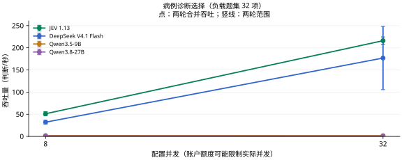

# 病例诊断选择：模拟病例子集

[返回首页](../../README.md) · [主评测任务](README.md) · [辅助与暂停任务](AUXILIARY.md) · [数据集目录](../datasets/README.md)

**当前用途：临床主评测。** 方向适合，但与临床病例候选诊断同属诊断选择；建议合并为任务下的数据来源分层，保留模拟性质。

本页为来源子集，统一并入 [病例诊断选择](diagnosis.md) 计分，不另增加任务权重。

## 任务是什么

给定 DDXPlus 观察到的症状与背景，从完整病种表选择模拟主诊断。

| 项目 | 说明 |
| --- | --- |
| 任务 ID | `synthetic_diagnosis` |
| 医疗场景 | 诊断与鉴别 |
| 能力维度 | 临床候选方案 |
| 评测类别 | 临床判断与行动 |
| 当前题数 / 目标题数 | 100 / 100 |
| 来源组数 | 100 |
| 语种 | 英语 100 题 |
| 数据范围 | 开放许可部分 100 题 |

## 数据集来源

| 数据集说明 | 收录题数 | 上游入口 |
| --- | --- | --- |
| [DDXPlus](../datasets/ddxplus.md) | 100 | [原始来源](https://doi.org/10.6084/m9.figshare.20043374) |

## 如何作答与评分

根据材料从 `request.questions.decision.criteria` 选择一个选项键。`gold` 不向模型发送。缺失或无效回答按错计。本轮指标见下方任务表；固定临床类别与题内位置选项分开处理。

本轮按任务报告；少于 20 题作为探索性结果，不计入首页汇总图。

当前比较的材料、计分和额度条件见[医疗多问题评估方法](../MEDICAL_LOAD.md)。

## 多问题与并发性能

<a id="diagnosis"></a>

### 当前多题评测

**表 6｜病例诊断选择：200 项独立判断，200 个来源组；每请求最多 8 项。准确率测试配置 8 并发，负载测试配置 32 并发。**

| 模型 | 准确率 (%) ↑ | 吞吐量 (判断/秒) ↑ | 完整响应 P95 (秒) ↓ | 成本 (元/千项判断) ↓ |
| --- | ---: | ---: | ---: | ---: |
| JEV 1.13 | **78.50** | **216.00** | **1.961** | **0.258** |
| DeepSeek V4.1 Flash | 75.00 | 176.85 | 4.117 | 0.538–1.076 |
| Qwen3.5-9B | 58.00 | 1.65 | — | 0.300 |
| Qwen3.8-27B | 78.00 | 0.84 | — | 1.744 |

准确率和成本来自完整的 200 项固定题集；吞吐与 P95 来自其中预先选定的 32 项判断，持续循环施压两轮。重复调用不增加独立题量。P95 从实际发出计时，不含额度排队；不足 20 个响应时留空。



下载图表：[PNG](../../docs/assets/medical-load-jev-gateway-v1/diagnosis.png) · [SVG](../../docs/assets/medical-load-jev-gateway-v1/diagnosis.svg)

<details>
<summary>查看本任务的两个并发档</summary>

**表 6a｜病例诊断选择：每请求最多 8 项，负载题集 32 项，各档两轮。**

| 模型 | 配置并发 | 吞吐量 (判断/秒) ↑ | 完整响应 P95 (秒) ↓ | 实际平均同时请求数 |
| --- | ---: | ---: | ---: | ---: |
| JEV 1.13 | 8 | **51.20** | **2.002** | 7.99 |
| DeepSeek V4.1 Flash | 8 | 32.10 | 4.716 | 7.99 |
| Qwen3.5-9B | 8 | 1.90 | — | 0.64 |
| Qwen3.8-27B | 8 | 0.96 | — | 0.55 |
| JEV 1.13 | 32 | **216.00** | **1.961** | 31.97 |
| DeepSeek V4.1 Flash | 32 | 176.85 | 4.117 | 31.97 |
| Qwen3.5-9B | 32 | 1.65 | — | 0.67 |
| Qwen3.8-27B | 32 | 0.84 | — | 0.29 |

配置并发是工作器上限；实际在途请求可能因账户额度更少。P95 不含客户端额度等待；不足 20 个完整响应时不报告 P95。

</details>

[评估方法](../../docs/MEDICAL_LOAD.md) · [原始记录与计价依据](../../results/medical-load-jev-gateway-v1/README.md)

JEV 返回版本为 `jev-1.13.0`；成本按官方标价估算，非实际账单。渠道与测试日期差异见评估方法。

粗体表示同一任务、同一并发档内已测模型的最优观测值，并列最优均加粗；不表示统计显著性。成本区间重叠、无法确定最低者时不加粗。

[历史单题测试](../MODEL_RESULTS.md) · [历史有限批次测试](../TASK_PERFORMANCE.md)；与本轮分开归档。

## 收录样例

以下为当前评测集中实际收录的一题，展示适配后的请求格式。为便于阅读，选取较短记录；样例不代表全任务的难度或类别分布，材料与选项未截断或改写。

题目 ID：`synthetic_diagnosis:ddxplus:108735`；语种：英语；来源组：`ddxplus:108735`。

### 模型输入

只把以下 `request` 对象发送给模型。`state` 是输入材料，`questions.decision` 包含问题、选项和输出类型。

```json
{
  "questions": {
    "decision": {
      "criteria": {
        "d0": "Acute COPD exacerbation / infection",
        "d1": "Acute dystonic reactions",
        "d10": "Boerhaave",
        "d11": "Bronchiectasis",
        "d12": "Bronchiolitis",
        "d13": "Bronchitis",
        "d14": "Bronchospasm / acute asthma exacerbation",
        "d15": "Chagas",
        "d16": "Chronic rhinosinusitis",
        "d17": "Cluster headache",
        "d18": "Croup",
        "d19": "Ebola",
        "d2": "Acute laryngitis",
        "d20": "Epiglottitis",
        "d21": "GERD",
        "d22": "Guillain-Barré syndrome",
        "d23": "HIV (initial infection)",
        "d24": "Influenza",
        "d25": "Inguinal hernia",
        "d26": "Larygospasm",
        "d27": "Localized edema",
        "d28": "Myasthenia gravis",
        "d29": "Myocarditis",
        "d3": "Acute otitis media",
        "d30": "PSVT",
        "d31": "Pancreatic neoplasm",
        "d32": "Panic attack",
        "d33": "Pericarditis",
        "d34": "Pneumonia",
        "d35": "Possible NSTEMI / STEMI",
        "d36": "Pulmonary embolism",
        "d37": "Pulmonary neoplasm",
        "d38": "SLE",
        "d39": "Sarcoidosis",
        "d4": "Acute pulmonary edema",
        "d40": "Scombroid food poisoning",
        "d41": "Spontaneous pneumothorax",
        "d42": "Spontaneous rib fracture",
        "d43": "Stable angina",
        "d44": "Tuberculosis",
        "d45": "URTI",
        "d46": "Unstable angina",
        "d47": "Viral pharyngitis",
        "d48": "Whooping cough",
        "d5": "Acute rhinosinusitis",
        "d6": "Allergic sinusitis",
        "d7": "Anaphylaxis",
        "d8": "Anemia",
        "d9": "Atrial fibrillation"
      },
      "instructions": "给定 DDXPlus 观察到的症状与背景，从完整病种表选择模拟主诊断。",
      "type": "choice"
    }
  },
  "state": {
    "age": 4,
    "observed_evidence": [
      {
        "question": "Have you or any member of your family ever had croup?",
        "value": "present"
      },
      {
        "question": "Do you have nasal congestion or a clear runny nose?",
        "value": "present"
      },
      {
        "question": "Does the person have a whooping cough?",
        "value": "present"
      },
      {
        "question": "Have you traveled out of the country in the last 4 weeks?",
        "value": "N"
      },
      {
        "question": "Are your vaccinations up to date?",
        "value": "present"
      }
    ],
    "sex": "F"
  }
}
```

### 标准答案与预测格式

原始标注映射后的正确选项键为 `d18`，对应选项：

```json
"Croup"
```

评分用预测文件每行包含题目 ID 与模型选择的选项键。下面使用标准答案演示文件格式，不是模型运行结果：

```json
{"id": "synthetic_diagnosis:ddxplus:108735", "choice": "d18"}
```

### 样例溯源

[上游资源](https://ndownloader.figshare.com/files/40495565) · [数据集说明](../datasets/ddxplus.md)

以下信息用于追溯材料、划分和答案来源，不作为模型输入。`locator` 是原文件中的定位信息：

```json
{
  "data_license": "CC-BY-4.0",
  "distribution": "open",
  "gold_origin": "upstream_annotation",
  "independent_clinical_review": false,
  "locator": {
    "csv_row": 108736,
    "zip_member": "release_test_patients"
  },
  "material_kind": "simulated_patients",
  "resource": "ddxplus__release_test_patients.zip",
  "resource_sha256": "ad3bb981f3453fd7abffb35cc595a1c02197e409c581bff97c1265c33eb00d23",
  "resource_url": "https://ndownloader.figshare.com/files/40495565",
  "source_id": "ddxplus",
  "source_url": "https://doi.org/10.6084/m9.figshare.20043374",
  "split": "official_test",
  "upstream_group": "108735",
  "upstream_id": "108735",
  "version": "figshare:20043374.v15"
}
```

## 覆盖与使用边界

题数是决策问题数，来源组可能是病例、文档、句子或指南条目，不应一律视为独立患者。答案沿用上游标注或机械映射，尚未经过本项目独立医生逐题审核。

当前标准标签分布：d0 2 题、d1 2 题、d10 2 题、d11 2 题、d13 3 题、d14 2 题、d15 2 题、d16 3 题、d17 2 题、d18 2 题、d2 2 题、d20 2 题、d21 2 题、d22 2 题、d23 2 题、d24 2 题、d25 2 题、d26 2 题、d27 2 题、d28 2 题、d29 2 题、d3 3 题、d30 2 题、d31 2 题、d32 2 题、d33 3 题、d34 2 题、d35 2 题、d36 2 题、d37 2 题、d38 2 题、d39 2 题、d4 2 题、d40 2 题、d41 2 题、d42 2 题、d43 2 题、d44 2 题、d45 2 题、d46 3 题、d47 3 题、d48 2 题、d5 2 题、d6 2 题、d7 2 题、d8 2 题、d9 2 题。

**[DDXPlus](../datasets/ddxplus.md)**：模拟器生成症状与诊断，不是实际病历。 答案依据：PATHOLOGY 为模拟主诊断；不把 differential distribution 当患者结局。

其中 100 题材料或片段命中过往评测指纹；训练效果对比应核查材料暴露，并对各模型冻结相同子集。

## 数据文件

[本任务全部记录](../../benchmarks/medical_decision_v1/tasks/synthetic_diagnosis/samples.jsonl) · [任务定义与统计](../../benchmarks/medical_decision_v1/tasks/synthetic_diagnosis/task.json) · [格式与使用方法](../REPRODUCING.md)

[返回首页](../../README.md)
