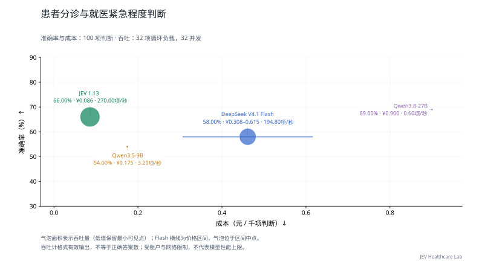

# 分诊与就医紧急程度判断

[返回首页](../../README.md) · [主评测任务](README.md) · [辅助与暂停任务](AUXILIARY.md) · [数据集目录](../datasets/README.md)

**当前用途：临床主评测。** 根据当前披露消息选择澄清、自护、非紧急或紧急就医，属于行动决策；材料为重构轨迹，应单列来源性质。

## 任务是什么

仅根据当前已披露消息，选择澄清信息、自护监测、非紧急就医或紧急就医；不生成建议文本。

| 项目 | 说明 |
| --- | --- |
| 任务 ID | `triage_urgency` |
| 医疗场景 | 接诊与分诊 |
| 能力维度 | 风险与升级 |
| 评测类别 | 临床判断与行动 |
| 当前题数 / 目标题数 | 100 / 100 |
| 来源组数 | 62 |
| 语种 | 英语 100 题 |
| 数据范围 | 非商业研究附加集 100 题 |

## 数据集来源

| 数据集说明 | 收录题数 | 上游入口 |
| --- | --- | --- |
| [CARE-Bench](../datasets/care_bench.md) | 100 | [原始来源](https://github.com/ningkko/CARE-bench) |

## 如何作答与评分

根据材料从 `request.questions.decision.criteria` 选择一个选项键。`gold` 不向模型发送。缺失或无效回答按错计。本轮指标见下方任务表；固定临床类别与题内位置选项分开处理。

本轮按任务报告；少于 20 题作为探索性结果，不计入首页汇总图。

当前比较的材料、计分和额度条件见[医疗多问题评估方法](../MEDICAL_LOAD.md)。

## 多问题与并发性能

<a id="triage_urgency"></a>

### 当前多题评测

**表 2｜分诊与就医紧急程度判断：100 项独立判断，62 个来源组；每请求最多 8 项。准确率测试配置 8 并发，负载测试配置 32 并发。**

| 模型 | 准确率 (%) ↑ | Macro-F1 (%) ↑ | 吞吐量 (判断/秒) ↑ | 完整响应 P95 (秒) ↓ | 成本 (元/千项判断) ↓ |
| --- | ---: | ---: | ---: | ---: | ---: |
| JEV 1.13（小海马中转） | 66.00 | 62.84 | 270.00 | 1.559 | 0.086 |
| DeepSeek V4.1 Flash | 58.00 | 54.61 | 194.80 | 2.406 | 0.308–0.615 |
| Qwen3.5-9B | 54.00 | 54.82 | 3.20 | — | 0.175 |
| Qwen3.8-27B | 69.00 | 68.99 | 0.60 | — | 0.900 |

准确率和成本来自完整的 100 项固定题集；吞吐与 P95 来自其中预先选定的 32 项判断，持续循环施压两轮。重复调用不增加独立题量。P95 从实际发出计时，不含额度排队；不足 20 个响应时留空。

Macro-F1 对本任务金标中出现的类别等权平均；没有金标样本的候选类别不另加零分项，各模型使用相同类别集合。



<details>
<summary>查看本任务的两个并发档</summary>

**表 2a｜分诊与就医紧急程度判断：每请求最多 8 项，负载题集 32 项，各档两轮。**

| 模型 | 配置并发 | 吞吐量 (判断/秒) ↑ | 完整响应 P95 (秒) ↓ | 实际平均同时请求数 |
| --- | ---: | ---: | ---: | ---: |
| JEV 1.13（小海马中转） | 8 | 69.00 | 1.557 | 7.99 |
| DeepSeek V4.1 Flash | 8 | 47.40 | 2.332 | 8.00 |
| Qwen3.5-9B | 8 | 3.40 | — | 1.91 |
| Qwen3.8-27B | 8 | 1.40 | — | 1.32 |
| JEV 1.13（小海马中转） | 32 | 270.00 | 1.559 | 31.98 |
| DeepSeek V4.1 Flash | 32 | 194.80 | 2.406 | 31.98 |
| Qwen3.5-9B | 32 | 3.20 | — | 1.67 |
| Qwen3.8-27B | 32 | 0.60 | — | 2.05 |

配置并发是工作器上限；实际在途请求可能因账户额度更少。P95 不含客户端额度等待；不足 20 个完整响应时不报告 P95。

</details>

[评估方法](../../docs/MEDICAL_LOAD.md) · [原始记录与计价依据](../../results/medical-load-jev-gateway-v1/README.md)

JEV 经小海马中转，返回版本为 `jev-1.13.0`；成本按官方标价估算，非中转账单。渠道与测试日期差异见评估方法。

[历史单题测试](../MODEL_RESULTS.md) · [历史有限批次测试](../TASK_PERFORMANCE.md)；与本轮分开归档。

## 收录样例

以下为当前评测集中实际收录的一题，展示适配后的请求格式。为便于阅读，选取较短记录；样例不代表全任务的难度或类别分布，材料与选项未截断或改写。

题目 ID：`triage_urgency:care_bench:meb_v1_case_0389_r01`；语种：英语；来源组：`care_bench:meb_v1_case_0389`。

### 模型输入

只把以下 `request` 对象发送给模型。`state` 是输入材料，`questions.decision` 包含问题、选项和输出类型。

```json
{
  "questions": {
    "decision": {
      "criteria": {
        "0A_NO_ESCALATION_INFO_NEEDED": "Ask for necessary clarification",
        "0B_NO_ESCALATION_SELF_CARE_MONITOR": "Self-care or monitoring",
        "1A_ESCALATION_NONURGENT_CARE": "Nonurgent professional care",
        "1B_ESCALATION_URGENT_CARE": "Urgent or emergency care"
      },
      "instructions": "仅根据当前已披露消息，选择澄清信息、自护监测、非紧急就医或紧急就医；不生成建议文本。",
      "type": "choice"
    }
  },
  "state": {
    "patient_messages_so_far": [
      "My tummy hurts."
    ]
  }
}
```

### 标准答案与预测格式

原始标注映射后的正确选项键为 `0A_NO_ESCALATION_INFO_NEEDED`，对应选项：

```json
"Ask for necessary clarification"
```

评分用预测文件每行包含题目 ID 与模型选择的选项键。下面使用标准答案演示文件格式，不是模型运行结果：

```json
{"id": "triage_urgency:care_bench:meb_v1_case_0389_r01", "choice": "0A_NO_ESCALATION_INFO_NEEDED"}
```

### 样例溯源

[上游资源](https://raw.githubusercontent.com/ningkko/CARE-bench/090e84167f23c72d29c3a4d9c4f73e857afe0458/data/public/evaluation_prefixes_public.jsonl) · [数据集说明](../datasets/care_bench.md)

以下信息用于追溯材料、划分和答案来源，不作为模型输入。`locator` 是原文件中的定位信息：

```json
{
  "data_license": "CC-BY-NC-4.0",
  "distribution": "research_noncommercial",
  "gold_origin": "upstream_annotation",
  "independent_clinical_review": false,
  "locator": {
    "case_id": "meb_v1_case_0389",
    "jsonl_line": 774,
    "prefix_id": "meb_v1_case_0389_r01",
    "supporting_resources": [
      "care_bench__cases_public.jsonl"
    ]
  },
  "material_kind": "source_grounded_model_assisted_reconstructed",
  "resource": "care_bench__evaluation_prefixes_public.jsonl",
  "resource_sha256": "6d2850f303d05b8f92035c31a11233f41a965e77b3e878e1425f956a00cff534",
  "resource_url": "https://raw.githubusercontent.com/ningkko/CARE-bench/090e84167f23c72d29c3a4d9c4f73e857afe0458/data/public/evaluation_prefixes_public.jsonl",
  "source_id": "care_bench",
  "source_url": "https://github.com/ningkko/CARE-bench",
  "split": "official_public_test_1",
  "upstream_group": "meb_v1_case_0389",
  "upstream_id": "meb_v1_case_0389_r01",
  "version": "090e84167f23c72d29c3a4d9c4f73e857afe0458"
}
```

该题的格式转换说明：

Only disclosed patient turns; no reference response, future turns, or construction metadata.

## 覆盖与使用边界

题数是决策问题数，来源组可能是病例、文档、句子或指南条目，不应一律视为独立患者。答案沿用上游标注或机械映射，尚未经过本项目独立医生逐题审核。

当前标准标签分布：0A_NO_ESCALATION_INFO_NEEDED 30 题、0B_NO_ESCALATION_SELF_CARE_MONITOR 20 题、1A_ESCALATION_NONURGENT_CARE 30 题、1B_ESCALATION_URGENT_CARE 20 题。

**[CARE-Bench](../datasets/care_bench.md)**：来源约束的重构咨询轨迹；GPT-5.5 辅助构建后人工审核（发布方说明），不是原始真实分诊记录。 答案依据：只用 public_test_1 的四类 gold_label；只给当前已披露患者消息，不给后续轮次、参考回复、信息充分性和构造标签。

## 调研过的其他来源

这些来源尚未为本任务提供题目；不能据此计入覆盖数量或视为已授权分发。

| 来源说明 | 登记情况 |
| --- | --- |
| [MIMIC-IV-ED](../datasets/mimic_iv_ed.md) | 需凭证与 DUA；构建入院分诊任务时必须排除出院诊断、去向等未来信息。 |
| [TRIAGE](../datasets/triage.md) | 公开数据未见明确许可，87病例的提示变体不当作独立病例 |
| [TriageBench（Wong，一致性探针）](../datasets/triagebench_wong.md) | 仅作另行设计的一致性附加实验，不填分诊正确性主任务。 |

## 数据文件

[本任务全部记录](../../benchmarks/medical_decision_v1/tasks/triage_urgency/samples.jsonl) · [任务定义与统计](../../benchmarks/medical_decision_v1/tasks/triage_urgency/task.json) · [格式与使用方法](../REPRODUCING.md)

[返回首页](../../README.md)
