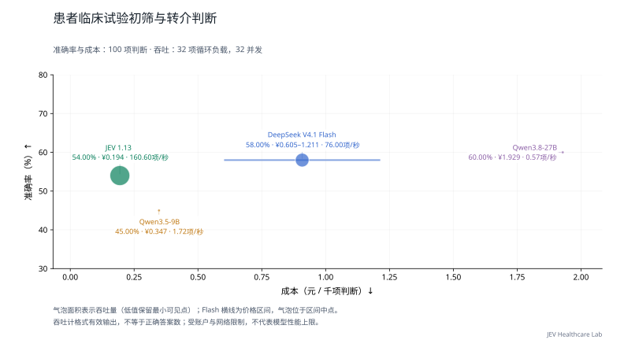

# 患者临床试验初筛与转介判断

[返回首页](../../README.md) · [主评测任务](README.md) · [辅助与暂停任务](AUXILIARY.md) · [数据集目录](../datasets/README.md)

**当前用途：临床主评测。** 输入含患者与试验条件并输出转介相关等级，适合主评测；不是最终入组资格，原 material_judgment 标签应调整。

## 任务是什么

根据患者和试验材料，判断不相关、可能适合或很可能适合转介。

| 项目 | 说明 |
| --- | --- |
| 任务 ID | `trial_referral` |
| 医疗场景 | 临床试验筛选 |
| 能力维度 | 资格与适宜性、证据与一致性 |
| 评测类别 | 临床判断与行动 |
| 当前题数 / 目标题数 | 100 / 100 |
| 来源组数 | 58 |
| 语种 | 英语 100 题 |
| 数据范围 | 开放许可部分 100 题 |

## 数据集来源

| 数据集说明 | 收录题数 | 上游入口 |
| --- | --- | --- |
| [TrialGPT SIGIR](../datasets/trialgpt.md) | 100 | [原始来源](https://github.com/ncbi-nlp/TrialGPT) |

## 如何作答与评分

根据材料从 `request.questions.decision.criteria` 选择一个选项键。`gold` 不向模型发送。缺失或无效回答按错计。本轮指标见下方任务表；固定临床类别与题内位置选项分开处理。

本轮按任务报告；少于 20 题作为探索性结果，不计入首页汇总图。

当前比较的材料、计分和额度条件见[医疗多问题评估方法](../MEDICAL_LOAD.md)。

## 多问题与并发性能

<a id="trial_referral"></a>

### 当前多题评测

**表 26｜患者临床试验初筛与转介判断：100 项独立判断，58 个来源组；每请求最多 8 项。准确率测试配置 8 并发，负载测试配置 32 并发。**

| 模型 | 准确率 (%) ↑ | Macro-F1 (%) ↑ | 吞吐量 (判断/秒) ↑ | 完整响应 P95 (秒) ↓ | 成本 (元/千项判断) ↓ |
| --- | ---: | ---: | ---: | ---: | ---: |
| JEV 1.13 | 54.00 | 49.64 | **160.60** | **2.439** | **0.194** |
| DeepSeek V4.1 Flash | 58.00 | 55.23 | 76.00 | 7.781 | 0.605–1.211 |
| Qwen3.5-9B | 45.00 | 37.67 | 1.72 | — | 0.347 |
| Qwen3.8-27B | **60.00** | **57.91** | 0.57 | — | 1.929 |

准确率和成本来自完整的 100 项固定题集；吞吐与 P95 来自其中预先选定的 32 项判断，持续循环施压两轮。重复调用不增加独立题量。P95 从实际发出计时，不含额度排队；不足 20 个响应时留空。

Macro-F1 对本任务金标中出现的类别等权平均；没有金标样本的候选类别不另加零分项，各模型使用相同类别集合。



下载图表：[PNG](../../docs/assets/medical-load-jev-gateway-v1/trial_referral.png) · [SVG](../../docs/assets/medical-load-jev-gateway-v1/trial_referral.svg)

<details>
<summary>查看本任务的两个并发档</summary>

**表 26a｜患者临床试验初筛与转介判断：每请求最多 8 项，负载题集 32 项，各档两轮。**

| 模型 | 配置并发 | 吞吐量 (判断/秒) ↑ | 完整响应 P95 (秒) ↓ | 实际平均同时请求数 |
| --- | ---: | ---: | ---: | ---: |
| JEV 1.13 | 8 | **46.40** | **2.164** | 7.99 |
| DeepSeek V4.1 Flash | 8 | 39.20 | 3.585 | 8.00 |
| Qwen3.5-9B | 8 | 1.53 | — | 0.80 |
| Qwen3.8-27B | 8 | 0.86 | — | 0.70 |
| JEV 1.13 | 32 | **160.60** | **2.439** | 31.98 |
| DeepSeek V4.1 Flash | 32 | 76.00 | 7.781 | 31.99 |
| Qwen3.5-9B | 32 | 1.72 | — | 0.54 |
| Qwen3.8-27B | 32 | 0.57 | — | 0.90 |

配置并发是工作器上限；实际在途请求可能因账户额度更少。P95 不含客户端额度等待；不足 20 个完整响应时不报告 P95。

</details>

[评估方法](../../docs/MEDICAL_LOAD.md) · [原始记录与计价依据](../../results/medical-load-jev-gateway-v1/README.md)

JEV 返回版本为 `jev-1.13.0`；成本按官方标价估算，非实际账单。渠道与测试日期差异见评估方法。

粗体表示同一任务、同一并发档内已测模型的最优观测值，并列最优均加粗；不表示统计显著性。成本区间重叠、无法确定最低者时不加粗。

[历史单题测试](../MODEL_RESULTS.md) · [历史有限批次测试](../TASK_PERFORMANCE.md)；与本轮分开归档。

## 收录样例

以下为当前评测集中实际收录的一题，展示适配后的请求格式。为便于阅读，选取较短记录；样例不代表全任务的难度或类别分布，材料与选项未截断或改写。

题目 ID：`trial_referral:trialgpt:sigir-201512:NCT02418169`；语种：英语；来源组：`trialgpt:sigir-201512`。

### 模型输入

只把以下 `request` 对象发送给模型。`state` 是输入材料，`questions.decision` 包含问题、选项和输出类型。

```json
{
  "questions": {
    "decision": {
      "criteria": {
        "0": "Irrelevant: would not refer",
        "1": "Potential: consider referral after further investigation",
        "2": "Eligible: highly likely to refer"
      },
      "instructions": "根据患者和试验材料，判断不相关、可能适合或很可能适合转介。",
      "type": "choice"
    }
  },
  "state": {
    "patient": "A 44-year-old man was recently in an automobile accident where he sustained a skull fracture. In the emergency room, he noted clear fluid dripping from his nose. The following day he started complaining of severe headache and fever. Nuchal rigidity was found on physical examination.",
    "trial": {
      "brief_summary": "This study evaluates the association between traumatic brain injuries and craniofacial or/and skull fractures. Purpose is to find out the amount of missed diagnoses and improve primary diagnostics of trauma patients.",
      "brief_title": "Association Between Craniofacial Fractures and Brain Injuries: Diagnostic and Therapeutic Considerations",
      "exclusion_criteria": ": \n\n Died before admitted to hospital",
      "inclusion_criteria": "inclusion criteria: \n\n Severe traumatic brain injury, GCS 8 or less and/or Craniofacial fracture \n\n "
    }
  }
}
```

### 标准答案与预测格式

原始标注映射后的正确选项键为 `1`，对应选项：

```json
"Potential: consider referral after further investigation"
```

评分用预测文件每行包含题目 ID 与模型选择的选项键。下面使用标准答案演示文件格式，不是模型运行结果：

```json
{"id": "trial_referral:trialgpt:sigir-201512:NCT02418169", "choice": "1"}
```

### 样例溯源

[上游资源](https://raw.githubusercontent.com/ncbi-nlp/TrialGPT/1b3242cd50c153a9c324661d4a0bd94fc68a4226/dataset/sigir/retrieved_trials.json) · [数据集说明](../datasets/trialgpt.md)

以下信息用于追溯材料、划分和答案来源，不作为模型输入。`locator` 是原文件中的定位信息：

```json
{
  "data_license": "LicenseRef-NCBI-Public-Domain",
  "distribution": "open",
  "gold_origin": "upstream_annotation",
  "independent_clinical_review": false,
  "locator": {
    "nct_id": "NCT02418169",
    "patient_id": "sigir-201512",
    "relevance": "1"
  },
  "material_kind": "synthetic_patient_real_trial",
  "resource": "trialgpt__dataset_sigir_retrieved_trials.json",
  "resource_sha256": "8516049da9f4663b1288086532cc885da232532bd2e081a2b70f54fb035ddb81",
  "resource_url": "https://raw.githubusercontent.com/ncbi-nlp/TrialGPT/1b3242cd50c153a9c324661d4a0bd94fc68a4226/dataset/sigir/retrieved_trials.json",
  "source_id": "trialgpt",
  "source_url": "https://github.com/ncbi-nlp/TrialGPT",
  "split": "sigir_judged_pool",
  "upstream_group": "sigir-201512",
  "upstream_id": "sigir-201512:NCT02418169",
  "version": "1b3242cd50c153a9c324661d4a0bd94fc68a4226"
}
```

## 覆盖与使用边界

题数是决策问题数，来源组可能是病例、文档、句子或指南条目，不应一律视为独立患者。答案沿用上游标注或机械映射，尚未经过本项目独立医生逐题审核。

当前标准标签分布：0 34 题、1 33 题、2 33 题。

**[TrialGPT SIGIR](../datasets/trialgpt.md)**：患者题设配真实试验文件；不是实际入组结局。 答案依据：SIGIR 公开 relevance 0/1/2；0 不相关、1 可能转介、2 高度适合转介。

其中 82 题材料或片段命中过往评测指纹；训练效果对比应核查材料暴露，并对各模型冻结相同子集。

## 数据文件

[本任务全部记录](../../benchmarks/medical_decision_v1/tasks/trial_referral/samples.jsonl) · [任务定义与统计](../../benchmarks/medical_decision_v1/tasks/trial_referral/task.json) · [格式与使用方法](../REPRODUCING.md)

[返回首页](../../README.md)
